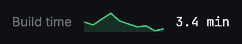
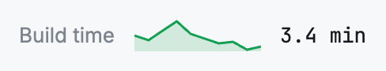
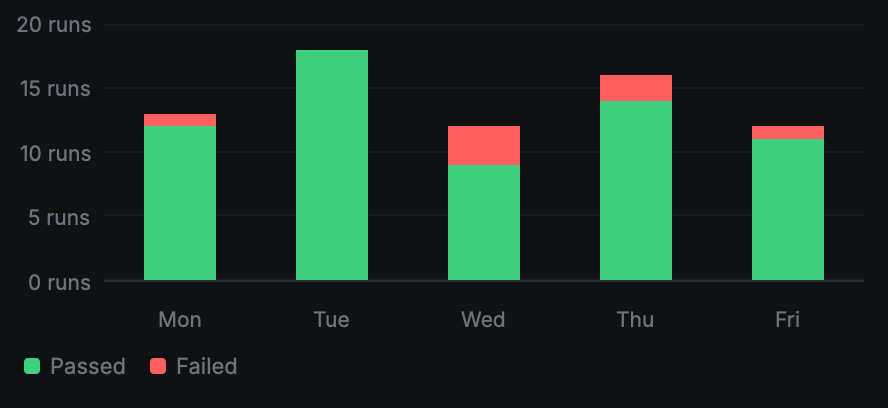
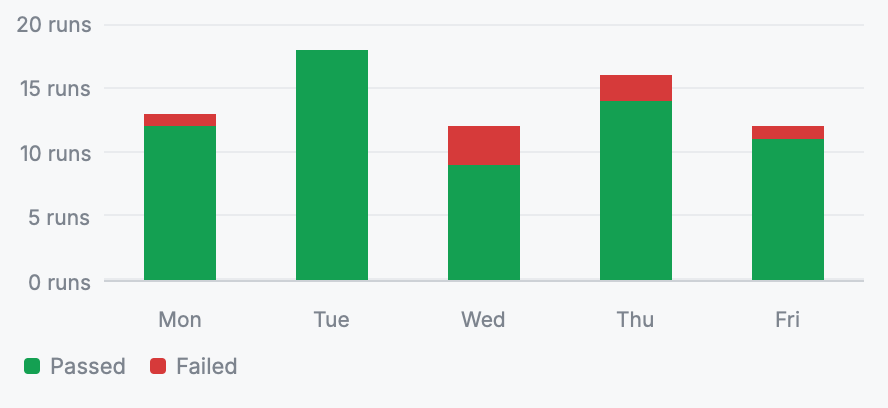
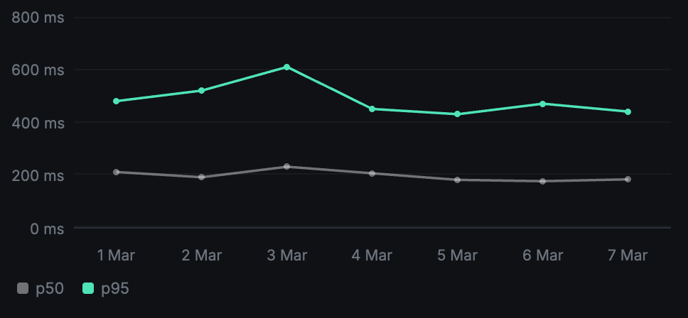
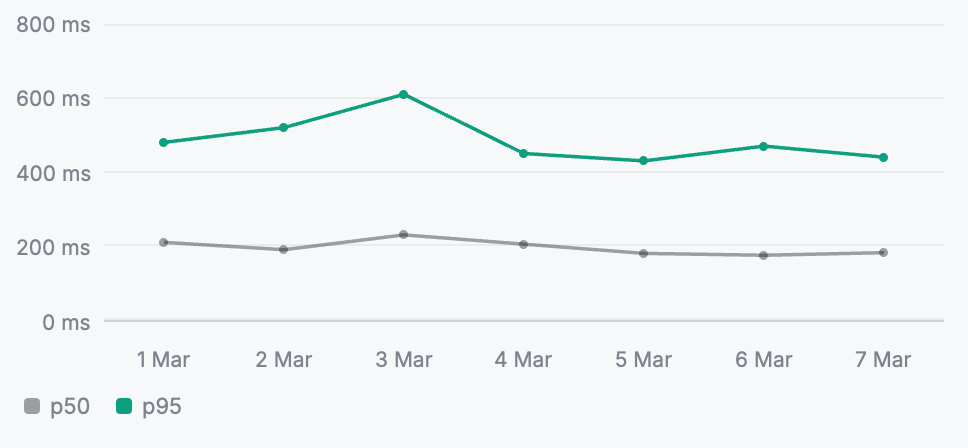
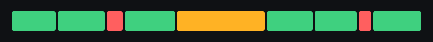
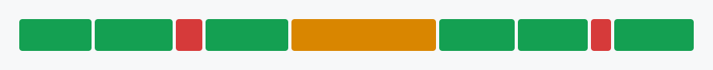

# Charts

Sparklines, bar charts, line charts and status timelines, drawn by Pitwall in the theme's colours with axes, legends and tooltips. A tile sends the data (series and a few options), never drawing instructions, so charts look the same in every tile, follow dark and light, and are drawn without a round trip while the user hovers. For a drawing of your own, use the [canvas](canvas.md).

The examples come from the Charts page of the gallery tile (`crates/pitwall-tile-host/tests/fixtures/hello-tile/src/widgets.rs`), the screenshots from that tile drawn headless. See also [Form controls](components-forms.md), [Feedback](components-feedback.md), [Layout](components-layout.md) and [Data display](components-data.md).

What every chart shares:

- **Colours.** A series without a colour of its own takes the next of the theme's series colours (`Focus`, `Done`, `Good`, `Warn`, `Bad`, `Text3`, in order). Give one by meaning with a `Token` (`series_colored(…, Token::Bad)` for failures).
- **Size.** Give a chart a height (`.h(px(180.))`); it fills its width.
- **Accessibility.** `.label("…")` names it ("Runs this week"). Pitwall also reads a summary made from the data: the kind, the series and their latest or largest values ("Bar chart of 5 labels: Passed up to 18 runs; Failed up to 3 runs"). Each bar, point and segment has a tooltip with its values, so nothing is shown by colour alone.
- **Values.** A NaN or infinite value is a gap.
- **Tests.** The snapshot shows each chart with its summary.

## Sparkline

 

A small line without axes, inline with text: a trend at a glance (build times, a queue's length). For values the user reads off, use a [line chart](#line-chart).

```rust
{{#include crates/pitwall-tile-host/tests/fixtures/hello-tile/src/widgets.rs#gallery-sparkline}}
```

| Option | What it does |
|---|---|
| `sparkline(values)` | A line through `values`, oldest first |
| `.color(Token)` | Its colour (default: the text colour) |
| `.filled()` | The area under the line filled, faintly |

- **Limits.** 1 000 values.

## Bar chart

 

Amounts by category: runs per day, failures per suite. One group of bars per label, one bar per series, or one stacked bar per label; a value axis, a legend for more than one series, and a tooltip per bar.

```rust
{{#include crates/pitwall-tile-host/tests/fixtures/hello-tile/src/widgets.rs#gallery-bar-chart}}
```

| Option | What it does |
|---|---|
| `bar_chart(labels)` | A chart over `labels` |
| `.series(name, values)` | A series: one value per label |
| `.series_colored(name, values, Token)` | A series in a colour of its own |
| `.stacked()` | The series stacked in one bar per label |
| `.unit(text)` | The values' unit, in the axis and tooltips (`"runs"`, `"ms"`) |

- **Limits.** 200 labels; 8 series, each up to 200 values.

## Line chart

 

Values over time or another order: response times, coverage. Axes with round steps, a legend for more than one series, and a tooltip under the pointer listing each series' value at that label.

```rust
{{#include crates/pitwall-tile-host/tests/fixtures/hello-tile/src/widgets.rs#gallery-line-chart}}
```

| Option | What it does |
|---|---|
| `line_chart(labels)` | A chart over `labels` |
| `.series(name, values)`, `.series_colored(name, values, Token)` | As in a [bar chart](#bar-chart) |
| `.unit(text)` | The values' unit |
| `.min(v)`, `.max(v)` | The axis's ends (default: from the data, with 0 included, rounded out to round steps) |

- **Limits.** 1 000 labels; 8 series, each up to 1 000 values.

## Status timeline

 

A row of coloured segments, oldest first: a CI pipeline's last runs, a service's uptime, deploys. Each segment has a tooltip and can be clicked.

```rust
{{#include crates/pitwall-tile-host/tests/fixtures/hello-tile/src/widgets.rs#gallery-status-timeline}}
```

| Option | What it does |
|---|---|
| `status_timeline()` | An empty timeline |
| `.segment(key, label, Option<Tone>)` | A segment: `key` (sent when clicked), its tooltip and accessible name, its colour by meaning (`None`: neutral, a run not started) |
| `.segment_weighted(key, label, tone, weight)` | A segment `weight` times as wide as one of 1 (a run's duration) |
| `.on_pick(listener)` | Hears the key (`&str`) of the segment clicked |

- **Events.** `value-changed` with `choice(key)`.
- **Keyboard.** With `on_pick`, a Tab stop.
- **Accessibility.** Its summary counts the runs and the failed ones and reads the latest segment's label.
- **Limits.** 500 segments; keys unique.
- **Test.** `t.choose("key", "segment")`.
