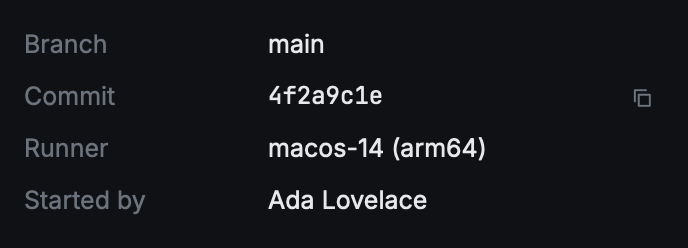
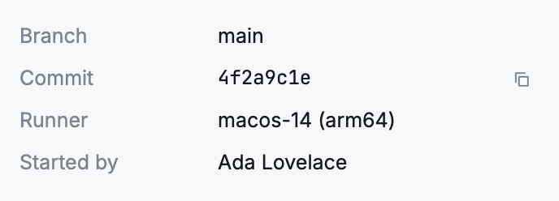
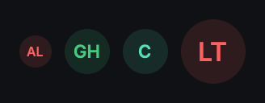
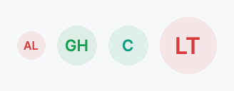
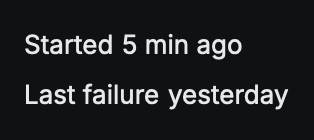
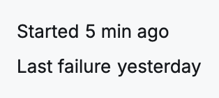
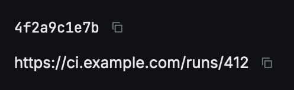
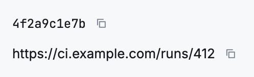
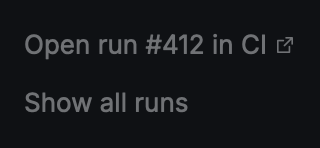
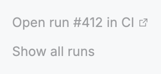

# Data display

Key-value lists, avatars, relative times, copyable text and links: showing facts the way Pitwall shows its own. The examples come from the Data display page of the gallery tile (`crates/pitwall-tile-host/tests/fixtures/hello-tile/src/widgets.rs`), the screenshots from that tile drawn headless. See also [Form controls](components-forms.md), [Feedback](components-feedback.md), [Layout](components-layout.md) and [Charts](components-charts.md); for long lists and tables, [Components](ui.md#components).

## Key-value list

 

Facts about one thing, labels and values aligned in two columns: a run's branch, commit and runner.

```rust
{{#include crates/pitwall-tile-host/tests/fixtures/hello-tile/src/widgets.rs#gallery-key-values}}
```

| Option | What it does |
|---|---|
| `key_values()` | An empty list |
| `.entry(label, value)` | A line |
| `.mono()` | The last line's value in the monospace font (ids, hashes, paths) |
| `.copyable()` | The last line's value gets a copy button (see [Copyable text](#copyable-text)) |

- **Accessibility.** Each line is read as its label and value.
- **Limits.** 500 lines.
- **Test.** The snapshot shows `key-values Branch="main" Commit="…"`.

## Avatar

 

A person or a bot, as their initials in a circle. The colour comes from the theme's set, chosen by the name: the same name gets the same colour everywhere, in dark and light.

```rust
{{#include crates/pitwall-tile-host/tests/fixtures/hello-tile/src/widgets.rs#gallery-avatar}}
```

| Option | What it does |
|---|---|
| `avatar(name)` | Up to two initials of `name` ("Ada Lovelace": AL; "ci-bot": C) |
| `.small()` | 20 px (default 28) |
| `.large()` | 40 px |

- **Accessibility.** The name is its accessible name and its tooltip.
- **Network.** No pictures are fetched: tiles have no network for images ([Images](ui.md#images)).

## Relative time

 

When something happened, as "just now", "5 min ago", "yesterday" or a date. Pitwall keeps it up to date as time passes: the tile sends the time once and needs no timer. Its tooltip is the full date and time.

```rust
{{#include crates/pitwall-tile-host/tests/fixtures/hello-tile/src/widgets.rs#gallery-relative-time}}
```

| Option | What it does |
|---|---|
| `relative_time(SystemTime)` | A time |
| `relative_time_ms(ms)` | A time in milliseconds since 1970-01-01 UTC |

- **Wording.** Under 45 seconds "just now"; then seconds, minutes and hours ("3 h ago"), "yesterday", days up to a week, then the date ("31 Jan 2026"). A time ahead reads "in 5 min".
- **Test.** The harness draws it with its virtual clock, so `t.advance(…)` moves it: the snapshot shows `relative-time "5 min ago"`.

## Copyable text

 

A value the user will paste elsewhere (a commit, an id, an address), with a copy button. Pitwall writes the clipboard itself, and only when the user clicks: a tile can't write the clipboard on its own.

```rust
{{#include crates/pitwall-tile-host/tests/fixtures/hello-tile/src/widgets.rs#gallery-copyable}}
```

| Option | What it does |
|---|---|
| `copyable(text)` | The text and its copy button |
| `.mono()` | In the monospace font |
| `.on_click(listener)` | Also hears the copy (`Click`), to say so |

- **Events.** `click`, when it has a listener. The button shows a check for a moment after copying.
- **Keyboard.** A Tab stop; Enter or Space copies.
- **Limits.** 64 KiB of text.
- **Test.** `t.copy("key")`, then `t.clipboard()`.

## Link

 

Text the user clicks to go somewhere: a web page, or another place in the tile.

```rust
{{#include crates/pitwall-tile-host/tests/fixtures/hello-tile/src/widgets.rs#gallery-link}}
```

| Option | What it does |
|---|---|
| `link(label)` | A link |
| `.url(address)` | A web page to open |
| `.on_click(listener)` | Hears `Click` |

- **Opening pages.** With an `http` or `https` address and the extension's `show` permission ([Permissions](permissions.md)), Pitwall opens the page in a web tile, as an agent's `show_web` does. Without the permission, or without an address, the click goes to the tile's listener instead, so it can show something itself.
- **Keyboard.** A Tab stop; Enter or Space follows it.
- **Accessibility.** The label is its name: make it say where it goes ("Open run #412 in CI", not "here").
- **Limits.** An address up to 2 048 bytes.
- **Test.** `t.open_link("key")`, then `t.opened_pages()` (with `Harness::grant("show")`), or the listener heard it.
