# Feedback

Progress bars, spinners, skeletons, empty states, banners, badges, chips, key hints and tooltips: how a tile says what is going on, drawn as Pitwall's own screens say it. The examples come from the Feedback page of the gallery tile (`crates/pitwall-tile-host/tests/fixtures/hello-tile/src/widgets.rs`), the screenshots from that tile drawn headless. See also [Form controls](components-forms.md), [Layout](components-layout.md), [Data display](components-data.md) and [Charts](components-charts.md).

Colours by meaning come from `Tone`: `Info`, `Good`, `Warn`, `Bad`, drawn with the theme's own colours for them, in dark and light.

## Progress bar

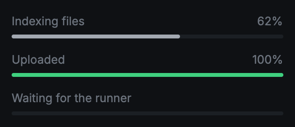 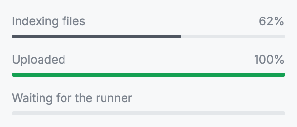

Work with a known end (indexing, an upload), or still going with none known. For a short wait in place, use a [spinner](#spinner).

```rust
{{#include crates/pitwall-tile-host/tests/fixtures/hello-tile/src/widgets.rs#gallery-progress}}
```

| Option | What it does |
|---|---|
| `progress(Some(share))` | A bar `share` done, 0.0–1.0 (kept in it) |
| `progress(None)` | Indeterminate: a moving band (still with Reduce motion on) |
| `.tone(Tone)` | Its colour by meaning (default: the text colour) |
| `.label(text)` | What it measures; drawn by screen readers, not on screen |

- **Events.** None.
- **Accessibility.** Name it with `.label("…")`; its value is read as a percentage.
- **Test.** The snapshot shows `progress 62%` or `progress indeterminate`.

## Spinner

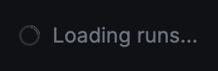 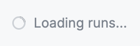

Something is loading and will be here soon: Pitwall's own spinning ring. Pair it with a line saying what.

```rust
{{#include crates/pitwall-tile-host/tests/fixtures/hello-tile/src/widgets.rs#gallery-spinner}}
```

| Option | What it does |
|---|---|
| `spinner()` | The ring, as tall as the text |
| `.label(text)` | Its accessible name ("Loading") |

- **Motion.** It turns without the tile doing anything; with Reduce motion it is still.

## Skeleton

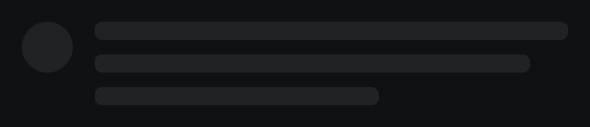 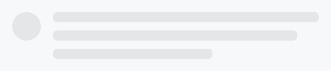

A grey placeholder in the shape of content that is loading, so the layout doesn't jump when it comes.

```rust
{{#include crates/pitwall-tile-host/tests/fixtures/hello-tile/src/widgets.rs#gallery-skeleton}}
```

| Option | What it does |
|---|---|
| `skeleton(SkeletonShape::Lines(n))` | `n` lines of text (1–20), the last shorter |
| `skeleton(SkeletonShape::Block)` | A box; give it a size |
| `skeleton(SkeletonShape::Circle)` | A circle as tall as its width (an avatar's place) |

- **Motion.** It shimmers, unless Reduce motion is on.
- **Limits.** 20 lines.

## Empty state

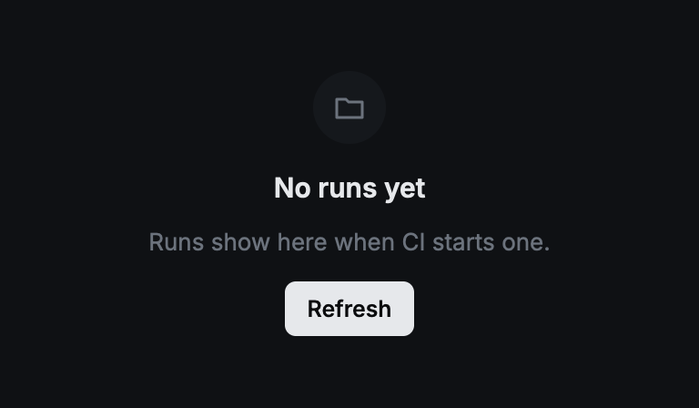 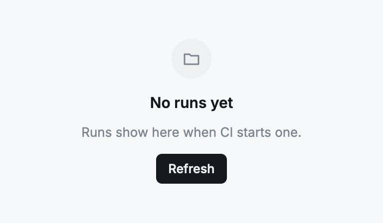

Nothing to show yet, and what to do about it: as Pitwall's own lists say they are empty. Centred in its box.

```rust
{{#include crates/pitwall-tile-host/tests/fixtures/hello-tile/src/widgets.rs#gallery-empty-state}}
```

| Option | What it does |
|---|---|
| `empty_state(title)` | The title |
| `.icon(Icon)` | An icon over it |
| `.text(text)` | A line under it: why, or what to do |
| `.action(label, listener)` | A button; its listener hears `Click` |

- **Events.** `click` from the action.
- **Keyboard.** The action is a Tab stop.

## Banner

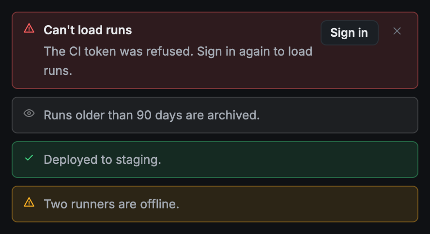 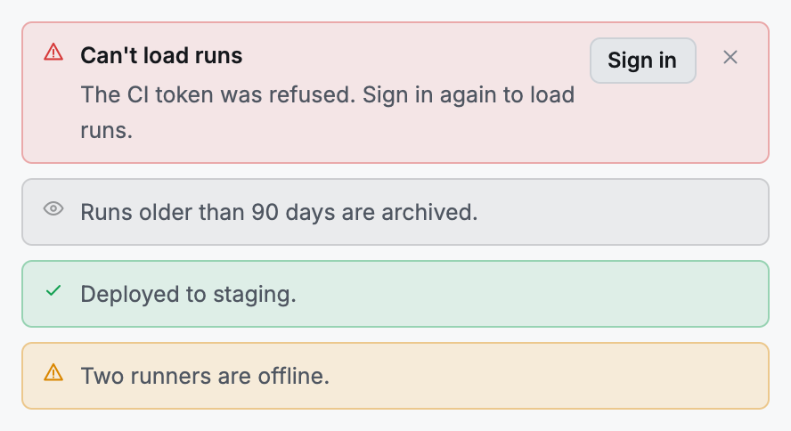

A message in the tile's flow: information, success, a warning or an error, with an action and a close button. Use it for something that stays true until fixed (a refused token); for "Saved", a toast (`ui::toast`) is enough.

```rust
{{#include crates/pitwall-tile-host/tests/fixtures/hello-tile/src/widgets.rs#gallery-banner}}
```

| Option | What it does |
|---|---|
| `banner(Tone, text)` | A banner of that tone |
| `.title(text)` | A bold first line |
| `.action(label, listener)` | A button; its listener hears `Click` |
| `.on_dismiss(listener)` | A close button; its listener hears `Dismissed`. Leave the banner out of the next render |

- **Events.** `click` from the action; `dismissed` from the close button.
- **Keyboard.** The action and the close button are Tab stops.
- **Accessibility.** Don't rely on the colour alone: say what happened in the text or the title.
- **Test.** `t.dismiss("key")`; the snapshot shows `banner bad "…" title=… action=… dismissible`.

## Badge

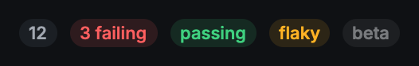 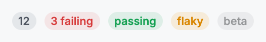

A small count or status beside something: "3 failing", "beta". Not clickable; for a tag the user picks or removes, use a [chip](#chip).

```rust
{{#include crates/pitwall-tile-host/tests/fixtures/hello-tile/src/widgets.rs#gallery-badge}}
```

| Option | What it does |
|---|---|
| `badge(text)` | A badge |
| `.tone(Tone)` | Its colour by meaning (default: neutral) |

- **Limits.** 32 bytes of text.

## Chip

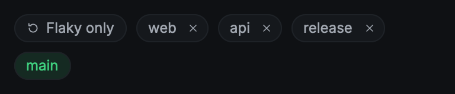 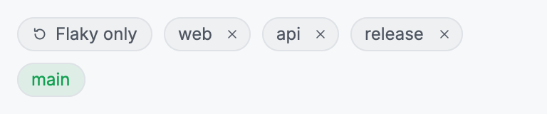

A tag or a filter: picked on and off with a click, or removed with its ×.

```rust
{{#include crates/pitwall-tile-host/tests/fixtures/hello-tile/src/widgets.rs#gallery-chip}}
```

| Option | What it does |
|---|---|
| `chip(label)` | A chip |
| `.icon(Icon)` | An icon before the label |
| `.tone(Tone)` | Its colour by meaning |
| `.selected(bool)` | Drawn picked (a filter that is on) |
| `.disabled(bool)` | Dimmed; no clicks |
| `.on_click(listener)` | Clickable: hears `Click` |
| `.on_remove(listener)` | A × that sends `Dismissed` |

- **Events.** `click`; `dismissed` from the × (or the keys below).
- **Keyboard.** A chip that can be clicked or removed is a Tab stop. Enter or Space clicks it; Backspace or Delete removes it.
- **Test.** `t.click_key("key")`; `t.dismiss("key")`; `t.key_on("key", "backspace")`.

## Key hint

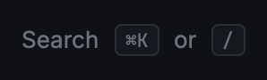 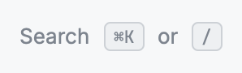

A key or shortcut, drawn as Pitwall draws its own: `"cmd-k"` is ⌘K on macOS and Ctrl+K elsewhere. Use the names the keymap uses ([Keys](ui.md#keys)).

```rust
{{#include crates/pitwall-tile-host/tests/fixtures/hello-tile/src/widgets.rs#gallery-kbd}}
```

| Option | What it does |
|---|---|
| `kbd(keys)` | The key, as `bind_key` names it (`"cmd-k"`, `"shift-enter"`, `"/"`) |

## Tooltip

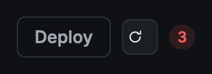 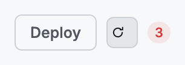

`.tooltip("…")` works on any element, components included: Pitwall's own tooltip after the usual hover delay. An icon button gets its label as its tooltip (`icon_button(icon, label)`). Keep it to a few words that add something; don't hide what the user needs to act on.

```rust
{{#include crates/pitwall-tile-host/tests/fixtures/hello-tile/src/widgets.rs#gallery-tooltip}}
```

- **Accessibility.** An element with no text needs `.label("…")` as well; a tooltip isn't its name.
- **Test.** The node's `tooltip` field holds it (`t.find_key("key").unwrap().node.tooltip`).
