# Form controls

Checkboxes, switches, radio groups, segmented controls, sliders, number fields, search fields and form rows, drawn by Pitwall with the controls of its own Settings and dialogs, in the user's theme. Anything Pitwall's own screens draw, a tile draws the same way ("kit parity", [ui.md §3.10](../../spec/tile-sdk/ui.md)).

The examples come from the gallery tile Pitwall's tests run (the Form controls page of `crates/pitwall-tile-host/tests/fixtures/hello-tile/src/widgets.rs`); the screenshots are that tile drawn headless, dark and light. Other component groups: [Feedback](components-feedback.md), [Layout](components-layout.md), [Data display](components-data.md), [Charts](components-charts.md), and the lists, tables and menus in [Tiles and UI components](ui.md#components).

What every control shares:

- **Controlled.** A control shows the value the tile gives it. The user's change comes to its `on_change` listener as `value-changed`; set your state, call `cx.notify()`, and the next frame shows it. A control without a listener can't be changed. Text fields are the exception: Pitwall owns what is typed ([Text fields](ui.md#text-fields)).
- **Keyboard and focus.** Each enabled control is a Tab stop with Pitwall's focus ring. A disabled one is skipped and can't be changed by click or key.
- **Accessibility.** The label is the accessible name; `.label("…")` names a control that has none (a radio group, a slider). `.tooltip("…")` works on all of them.
- **Limits.** Over a limit, the tile stops with the reason, as for any frame ([Limits](ui.md#limits)).
- **Tests.** `pitwall-extension-test` drives each control as the user would, with the host's own rules for clicks and keys, so the harness and Pitwall agree.

## Checkbox

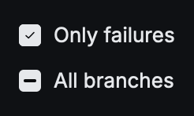 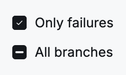

An option the user turns on or off, usually among others in a form or a filter. Use a [switch](#switch) instead for a setting that takes effect at once.

```rust
{{#include crates/pitwall-tile-host/tests/fixtures/hello-tile/src/widgets.rs#gallery-checkbox}}
```

| Option | What it does |
|---|---|
| `checkbox(label)` | A checkbox with its label; the label is clickable too |
| `.checked(bool)` | On |
| `.mixed(bool)` | Some of a group on: drawn with a dash. A click turns it on |
| `.disabled(bool)` | Drawn dimmed; no clicks, no Tab stop |
| `.on_change(listener)` | Hears the new state (`&bool`) |

- **Events.** `value-changed` with `on(bool)`: the other state, or `on(true)` from mixed.
- **Keyboard.** Space toggles it.
- **Accessibility.** Its label is its name.
- **Test.** `t.toggle("key")`; `t.key_on("key", "space")`.

## Switch

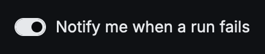 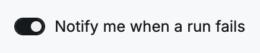

An on/off setting that applies right away, as Pitwall's Settings use them. The same options and events as a [checkbox](#checkbox), without `mixed`.

```rust
{{#include crates/pitwall-tile-host/tests/fixtures/hello-tile/src/widgets.rs#gallery-switch}}
```

| Option | What it does |
|---|---|
| `switch(label)` | A switch with its label |
| `.checked(bool)`, `.disabled(bool)`, `.on_change(listener)` | As for a checkbox |

- **Events.** `value-changed` with `on(bool)`.
- **Keyboard.** Space toggles it.
- **Test.** `t.toggle("key")`.

## Radio group

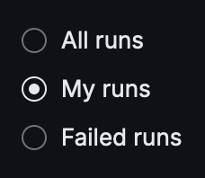 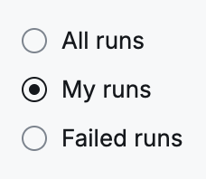

One of a few choices, all in sight, stacked: up to about six, when each needs words. For more, or less room, use a [select](ui.md#select); for two to four short ones side by side, a [segmented control](#segmented-control).

```rust
{{#include crates/pitwall-tile-host/tests/fixtures/hello-tile/src/widgets.rs#gallery-radio-group}}
```

| Option | What it does |
|---|---|
| `radio_group()` | An empty group |
| `.option(key, label)` | A choice; `key` is what the tile hears |
| `.option_disabled()` | The last option added can't be chosen |
| `.selected(key)` | The chosen option |
| `.horizontal()` | Side by side instead of stacked |
| `.disabled(bool)` | The whole group |
| `.on_change(listener)` | Hears the chosen key (`&str`) |

- **Events.** `value-changed` with `choice(key)`.
- **Keyboard.** One Tab stop for the group. The arrow keys move the choice (skipping disabled options, wrapping), Home and End go to the first and last, Space chooses the first when none is.
- **Accessibility.** Name the group with `.label("…")`; each option's label is its name.
- **Limits.** 64 options; keys unique.
- **Test.** `t.choose("key", "option")`; `t.key_on("key", "down")`.

## Segmented control

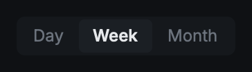 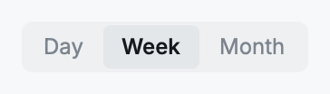

Two to five short choices side by side: a range (Day, Week, Month), a view mode. It is drawn with the same segmented control as [tabs](ui.md#tabs), Pitwall's own. Tabs switch what the tile shows and send `select`; a segmented control is a form value: it sends `value-changed`, and options and the whole control can be disabled.

```rust
{{#include crates/pitwall-tile-host/tests/fixtures/hello-tile/src/widgets.rs#gallery-segmented}}
```

| Option | What it does |
|---|---|
| `segmented()` | An empty control |
| `.option(key, label)`, `.option_disabled()`, `.selected(key)`, `.disabled(bool)`, `.on_change(listener)` | As for a [radio group](#radio-group) |

- **Events.** `value-changed` with `choice(key)`.
- **Keyboard.** As a radio group: Left and Right move the choice, wrapping.
- **Accessibility.** Name it with `.label("…")`.
- **Limits.** 64 options; keys unique.
- **Test.** `t.choose("key", "option")`; `t.key_on("key", "right")`.

## Slider

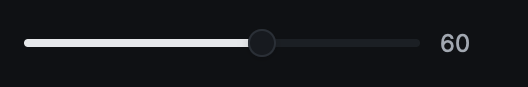 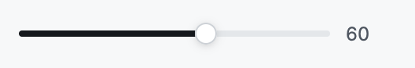

A number in a range where the exact value matters less than where it sits: a volume, an opacity, a threshold. For an exact number, use a [number field](#number-field).

```rust
{{#include crates/pitwall-tile-host/tests/fixtures/hello-tile/src/widgets.rs#gallery-slider}}
```

| Option | What it does |
|---|---|
| `slider(value, min..=max)` | A slider at `value` |
| `.step(n)` | Values snap to `min + k·n`; 0 (the default) is any value |
| `.show_value()` | The value drawn beside it |
| `.disabled(bool)` | No dragging, no Tab stop |
| `.on_change(listener)` | Hears the value (`&f64`) |

- **Events.** `value-changed` with `number(f64)`, kept in the range and snapped to the step. While the user drags, Pitwall draws the thumb itself and sends at most one value every 50 ms, and always the last one when they let go.
- **Keyboard.** Left and Down step down, Right and Up step up (a step, or a hundredth of the range), Page Up and Page Down by a tenth of the range, Home and End to the ends.
- **Accessibility.** Name it with `.label("…")`.
- **Limits.** `min` below `max`, both finite; the step 0 or more.
- **Test.** `t.set_slider("key", 73.0)` (snapped as Pitwall snaps); `t.key_on("key", "end")`.

## Number field

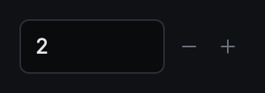 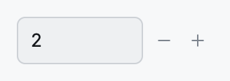

An exact number: retries, a port, a timeout. A text field with − and + steps; Pitwall checks what is typed and keeps it within the bounds.

```rust
{{#include crates/pitwall-tile-host/tests/fixtures/hello-tile/src/widgets.rs#gallery-number-field}}
```

| Option | What it does |
|---|---|
| `number_field(Option<f64>)` | A field holding the number, or empty |
| `.min(v)`, `.max(v)` | The bounds; a number typed past one is kept at it |
| `.step(n)` | What − and + add (default 1) |
| `.decimals(n)` | Decimal places shown and kept (0–6, default 0) |
| `.placeholder(text)` | Shown while empty |
| `.readonly(bool)` | Shown, selectable, not changed |
| `.disabled(bool)` | Dimmed, no Tab stop |
| `.on_change(listener)` | Hears `&Option<f64>`: the number, or `None` when emptied |

- **Events.** `value-changed` with `number(f64)`, or `empty` when the user clears it. A typed number is sent on Enter or when the field loses focus; text that isn't a number puts the old value back and sends nothing. A comma works as the decimal point.
- **Keyboard.** Up and Down step; an empty field steps to its min (or 0). Typing as in any text field.
- **Accessibility.** Name it with `.label("…")` or a [form row](#form-row).
- **Limits.** The step above 0; `min` at most `max`; all finite.
- **Test.** `t.type_number("key", "12")` (returns whether it sent anything); `t.step_number("key", true)`; `t.key_on("key", "up")`.

## Search field

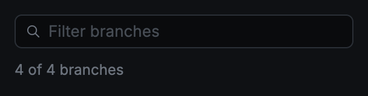 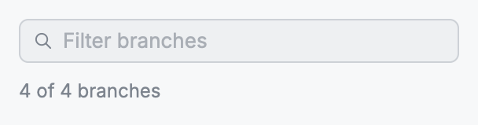

Filter text above a list or a table: a text field with a magnifier and a clear button, as Pitwall's own lists have.

```rust
{{#include crates/pitwall-tile-host/tests/fixtures/hello-tile/src/widgets.rs#gallery-search-field}}
```

| Option | What it does |
|---|---|
| `search_field(key)` | A search field; it takes the same options as `input(key)`: `.placeholder`, `.value`, `.disabled`, `.on_change`, `.on_submit` |

- **Events.** As a text field's: `input-changed` while the user types (at most one every 50 ms), `submit` on Enter. The clear button empties it and sends `input-changed` with `""`.
- **Keyboard.** As a text field. The clear button is shown only while it has text.
- **Limits.** As a text field: 1 MiB of text.
- **Test.** `t.type_into("key", "fix")`; `t.clear_search("key")`; `t.field_text("key")`.

## Form row

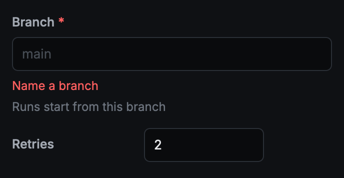 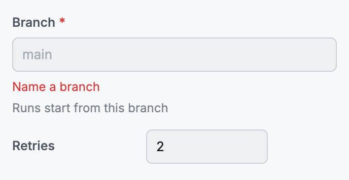

A control with its label, help text, validation message and required mark, laid out as Pitwall's Settings and dialogs lay theirs out. Use one for every field of a form, so forms in tiles read like Pitwall's.

```rust
{{#include crates/pitwall-tile-host/tests/fixtures/hello-tile/src/widgets.rs#gallery-form-row}}
```

| Option | What it does |
|---|---|
| `form_row(label)` | A row; its children are the control |
| `.help(text)` | A line under the control |
| `.error(Option<text>)` | The validation message, in red; `None` hides it |
| `.required()` | A required mark after the label |
| `.inline()` | The label beside the control instead of above |

- **Events.** None of its own; the control's.
- **Accessibility.** The label names the control under it; the error is read with it.
- **Test.** The snapshot shows `form-row "Branch" required help=… error=…`.

## Disabled and read-only

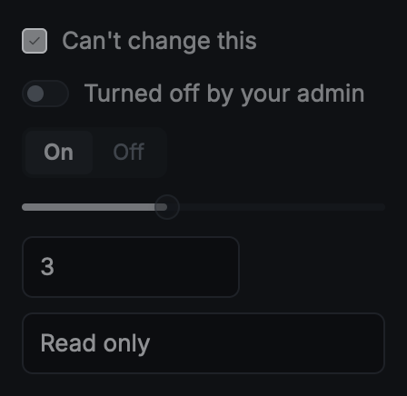 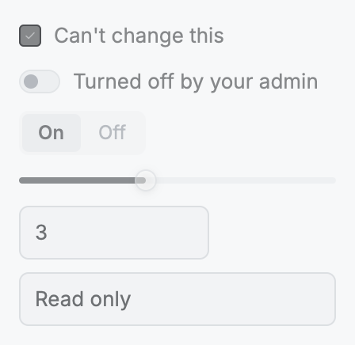

Every control has `.disabled(true)`: drawn dimmed, no clicks, no keys, no Tab stop. A number field and a text field also have read-only (`.readonly(true)` on a number field): the value is shown and can be selected and copied, but not changed. Say why something is disabled near it (a [form row](#form-row)'s help, a tooltip) when it isn't plain.

```rust
{{#include crates/pitwall-tile-host/tests/fixtures/hello-tile/src/widgets.rs#gallery-disabled}}
```

- **Test.** The snapshot shows `disabled` and `readonly`; the harness panics when a test changes a disabled control, as the user can't.
