# Layout

Split panes, disclosures, cards, dividers, breadcrumbs, toolbars, popovers and confirm sheets: the structure Pitwall's own screens are built from, for tiles. The examples come from the Layout page of the gallery tile (`crates/pitwall-tile-host/tests/fixtures/hello-tile/src/widgets.rs`), the screenshots from that tile drawn headless. See also [Form controls](components-forms.md), [Feedback](components-feedback.md), [Data display](components-data.md) and [Charts](components-charts.md); for rows and columns of boxes, [Elements](ui.md#elements) and [Styles](ui.md#styles).

## Split pane

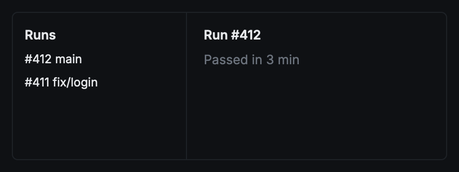 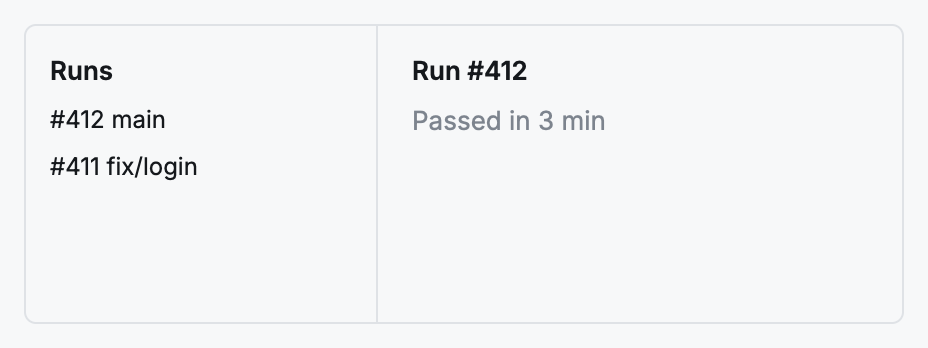

Two panes with a bar between them the user drags: a list beside its detail, an editor over its output. `h_split()` puts them side by side, `v_split()` one above the other.

```rust
{{#include crates/pitwall-tile-host/tests/fixtures/hello-tile/src/widgets.rs#gallery-split}}
```

| Option | What it does |
|---|---|
| `h_split()`, `v_split()` | A split, side by side or stacked |
| `.first(element)`, `.second(element)` | The two panes (both are needed) |
| `.initial(share)` | The first pane's share at first, 0.05–0.95 (default 0.5) |
| `.min_sizes(first, second)` | The panes' smallest sizes in logical pixels (default 80 each) |
| `.on_resize(listener)` | Hears the first pane's share (`&f64`) when a drag ends |

- **The user's size.** Pitwall keeps the size the user dragged to for the view, by the split's key path, across restarts; the tile doesn't need to store it. `on_resize` is for a tile that wants to know.
- **Events.** `value-changed` with `number(share)`, once at the end of a drag.
- **Size.** Give it a size, or let it grow (`.flex_1()`).
- **Limits.** Exactly two children.
- **Test.** `t.resize_split("key", 0.7)` (kept within the minimum sizes, as Pitwall does).

## Disclosure

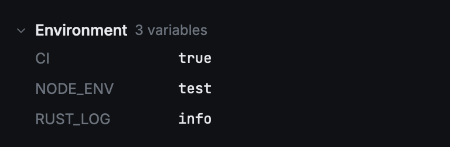 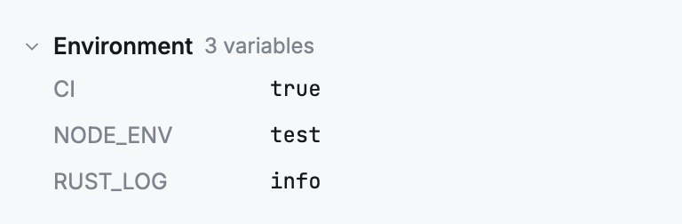

A section the user opens and closes, for detail most people don't need every time: an environment, advanced options.

```rust
{{#include crates/pitwall-tile-host/tests/fixtures/hello-tile/src/widgets.rs#gallery-disclosure}}
```

| Option | What it does |
|---|---|
| `disclosure(title, open)` | A section; its children are drawn under the header while `open` |
| `.detail(text)` | Muted text at the header's right (a count, a summary) |
| `.on_toggle(listener)` | Hears the new state (`&bool`: open) |

- **Events.** `value-changed` with `on(open)`.
- **Keyboard.** The header is a Tab stop; Enter or Space opens and closes it.
- **Accessibility.** The title is its name; open or closed is read with it.
- **Test.** `t.toggle("key")`; `t.key_on("key", "enter")`.

## Card

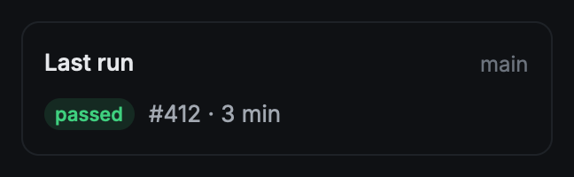 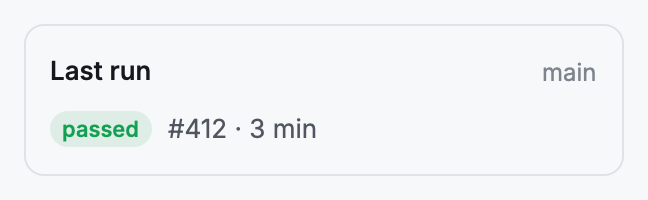

A bordered box on the raised surface, for one item among others: a run, a deploy, a service. With `on_click` the whole card is clickable.

```rust
{{#include crates/pitwall-tile-host/tests/fixtures/hello-tile/src/widgets.rs#gallery-card}}
```

| Option | What it does |
|---|---|
| `card()` | A card; its children are its body |
| `.title(text)` | A title at its top |
| `.detail(text)` | Muted text at the title's right |
| `.on_click(listener)` | The card is clickable: hears `Click` |

- **Keyboard.** A clickable card is a Tab stop; Enter or Space clicks it.
- **Accessibility.** The title is its name.
- **Test.** `t.click_key("key")`; `t.key_on("key", "enter")`.

## Divider

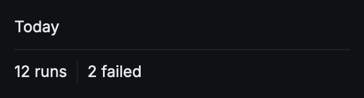 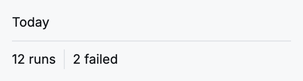

A hairline in the theme's line colour: `divider()` across stacked things, `vertical_divider()` between things in a row (give the row a height).

```rust
{{#include crates/pitwall-tile-host/tests/fixtures/hello-tile/src/widgets.rs#gallery-divider}}
```

## Breadcrumbs

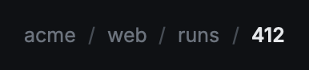 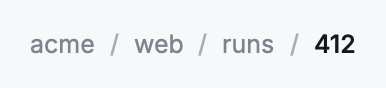

Where the user is in something nested (an org, a repository, a run), each level but the last clickable to go back up.

```rust
{{#include crates/pitwall-tile-host/tests/fixtures/hello-tile/src/widgets.rs#gallery-breadcrumbs}}
```

| Option | What it does |
|---|---|
| `breadcrumbs()` | An empty trail |
| `.crumb(key, label)` | A level; the last is where the user is |
| `.on_pick(listener)` | Hears the key (`&str`) of the level clicked |

- **Events.** `value-changed` with `choice(key)`.
- **Keyboard.** With `on_pick`, a Tab stop; the levels are buttons.
- **Limits.** 32 levels; keys unique.
- **Test.** `t.choose("key", "level")` (the last level can't be picked).

## Toolbar row

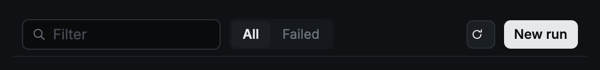 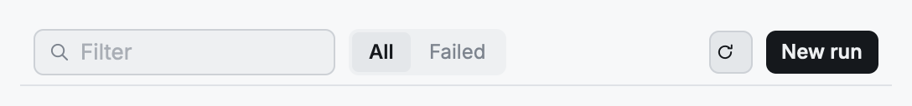

A row of buttons and fields at the top of a tile, with Pitwall's bar look: its height, spacing and the hairline under it. Put a `div().flex_1()` in it to push what follows to the right.

```rust
{{#include crates/pitwall-tile-host/tests/fixtures/hello-tile/src/widgets.rs#gallery-toolbar-row}}
```

| Option | What it does |
|---|---|
| `toolbar()` | A toolbar; its children are laid out in a row |

## Popover

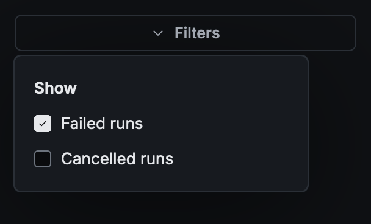 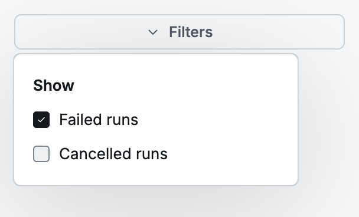

A floating panel anchored to an element: filters, a small form, details on demand. Pitwall draws it inside the tile, above everything else, and keeps it in sight.

```rust
{{#include crates/pitwall-tile-host/tests/fixtures/hello-tile/src/widgets.rs#gallery-popover}}
```

| Option | What it does |
|---|---|
| `popover()` | A popover; its children are its content |
| `.placement(Placement)` | `Below` (default), `Above`, `Start` or `End` of its anchor |
| `.width(px)` | Its width (default: its content's, 160–480) |
| `.on_dismiss(listener)` | Hears `Dismissed`: Esc, or a click outside it. Leave it out of the next render |

- **Anchor.** It is open while it is in the frame, anchored to its parent: put it in a box with the button that opens it, as the example does.
- **Events.** `dismissed` on Esc or a click outside.
- **Keyboard.** Esc closes it; Tab moves among its controls.
- **Limits.** One popover a frame; it can't be the root.
- **Test.** `t.key_on("key", "escape")`; `t.dismiss("key")`.

## Confirm sheet

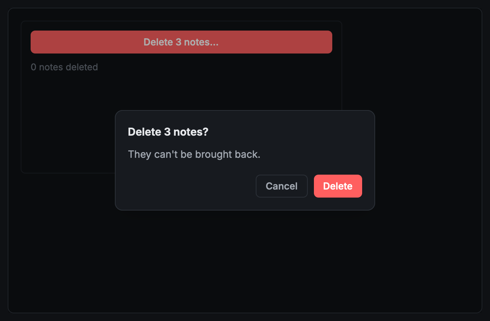 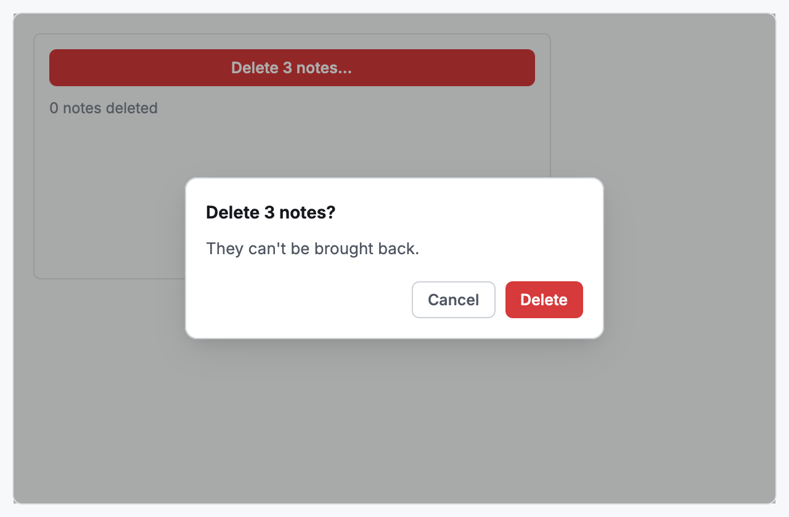

Asking the user to confirm before something that can't be undone. Tiles can't open the system's dialogs, so this is how a tile asks: a sheet over the tile, the rest of it dimmed and taking no input, in Pitwall's dialog look.

```rust
{{#include crates/pitwall-tile-host/tests/fixtures/hello-tile/src/widgets.rs#gallery-confirm-sheet}}
```

| Option | What it does |
|---|---|
| `confirm_sheet(title, confirm)` | A sheet asking `title`, with a button labelled `confirm` |
| `.text(text)` | More about it |
| `.cancel_label(text)` | The cancel button's label (default "Cancel") |
| `.danger()` | The confirm button is red |
| `.on_confirm(listener)` | Hears `Click` when the user confirms |
| `.on_cancel(listener)` | Hears `Dismissed` on Cancel, Esc or a click on the dimmed tile |

- **Placement.** Shown while it is in the frame, wherever it is in the tree.
- **Events.** `click` to confirm; `dismissed` to cancel. Leave it out of the next render either way.
- **Keyboard.** While it is open, Enter confirms and Esc cancels wherever focus is in the tile.
- **Wording.** Say the action in the title and on the button ("Delete 3 notes?", "Delete"), not "Are you sure?" and "OK".
- **Limits.** One confirm sheet a frame.
- **Test.** `t.key_on("key", "enter")`; `t.key_on("key", "escape")`; `t.dismiss("key")`.
