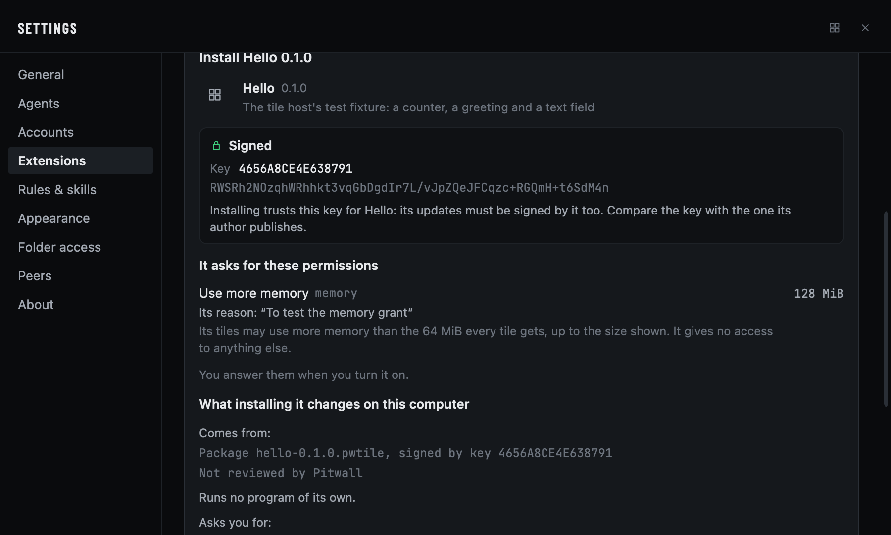
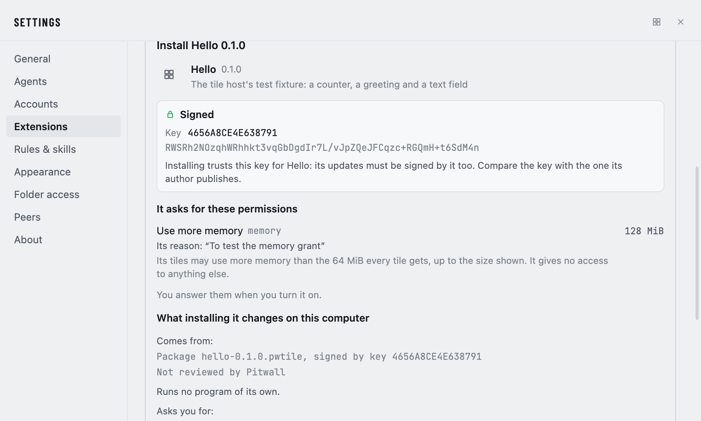
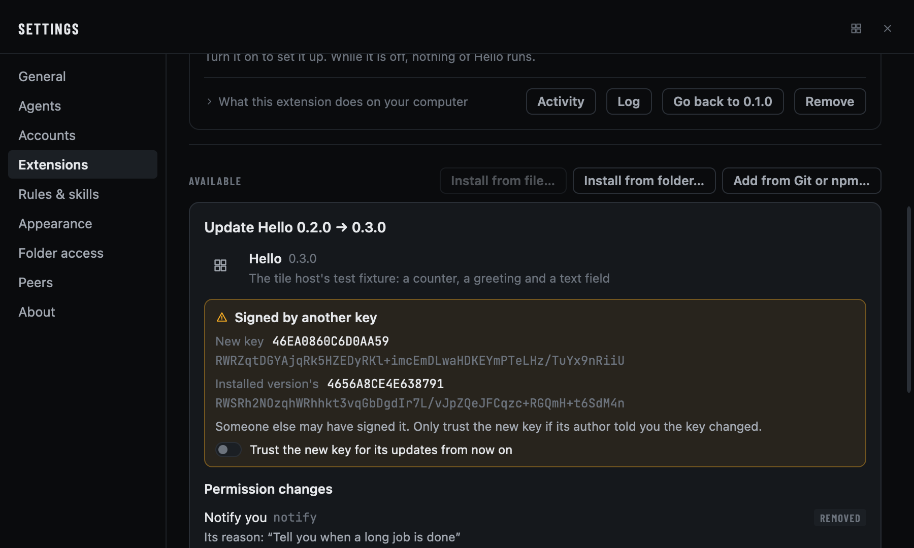
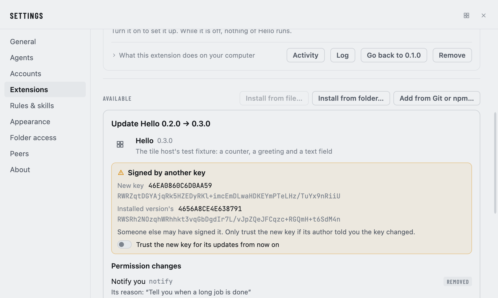
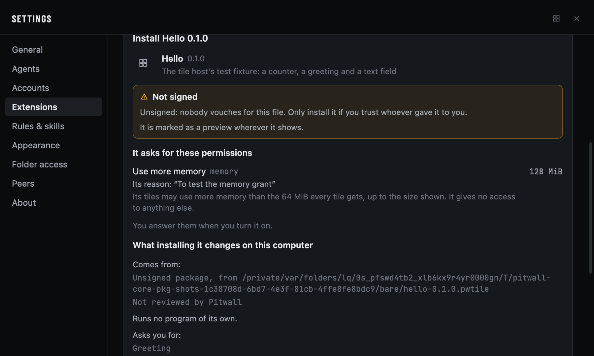
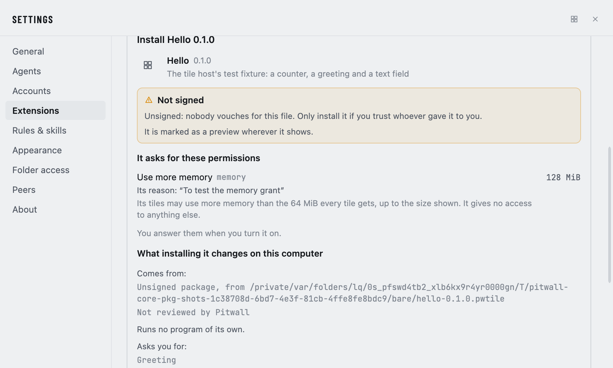
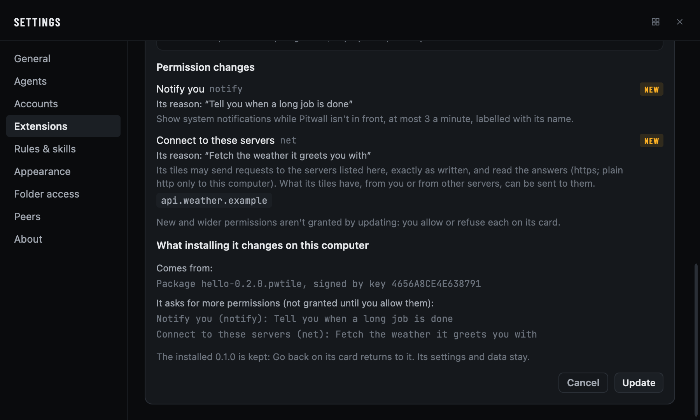
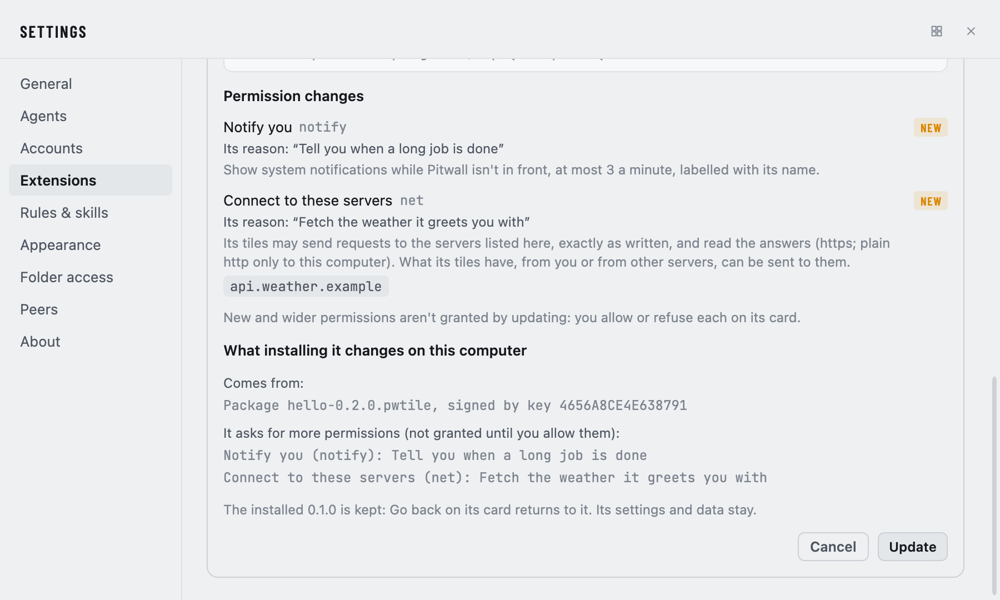

# Install, update and remove

**Preview.** How to install a tile extension from a `.pwtile` file, keep it up to date, go back to the version you had, and remove it. [Packaging](packaging.md) is the author's side.

## Install from a file

You need the package, `<id>-<version>.pwtile`, and normally its signature, `<id>-<version>.pwtile.minisig`, in the same folder.

- **In Pitwall:** Settings → Extensions → Install from file…, then pick the `.pwtile`.
- **From a terminal:** `pitwall extension install ./my-tile-0.1.0.pwtile`. It prints who signed it and what it asks for, then you approve it in Pitwall.

Pitwall checks the signature before it unpacks anything. A package that was changed after it was signed is refused, and Pitwall says why.

Installing turns nothing on. Turn the extension on in Settings → Extensions, or with `pitwall extension on <id>`, and answer its permission screen ([Permissions](permissions.md)).

 

## Who signed it

The install screen shows one of these:

- **Signed.** Pitwall shows the key id (16 characters) and the full public key. Compare it with the key the author publishes, for example in their README. Installing trusts this key for this extension: every later version must be signed by it.
- **Signed by the same key as the installed version.** This is an update from the same author.
- **Signed by another key.** Someone else may have signed it. Install it only if the author told you that their key changed. To go ahead, turn on "Trust the new key for its updates from now on". From a terminal, add `--new-key`.
- **Not signed.** Nobody vouches for the file. Install it only if you trust whoever gave it to you. The button reads "Install unsigned". From a terminal, add `--unsigned`. It is marked as a preview wherever it shows, as a folder install is.

 

 

## Updates

To update, install the newer file the same way. The screen reads "Update Hello 0.1.0 → 0.2.0" and lists what changes:

- **New** permissions, and **More**: new servers for `net`, more memory or a larger database. None of these is granted by updating. Each waits on the extension's card until you allow or refuse it, and new servers mean you are asked about `net` again.
- Permissions it **no longer** asks for.
- What installing changes on this computer.

 

Pitwall refuses an older version (use Go back instead), and refuses the version already installed. A folder can't replace a signed package.

An extension installed from a file has no automatic update check yet. Its card says to update it with Install from file… and a newer package.

## Go back

The version before the last update is kept. Go back to `<version>` on the extension's card puts it back, together with the key it was signed with. Your settings and the extension's data stay as they are.

## Remove

Remove on the extension's card asks first. If the extension stored anything, the confirmation also offers "Also delete its data (size)". That is off by default, so its data stays for a later install. Removing deletes the installed files and the kept previous version, and forgets its settings, secrets and permission answers.

`pitwall extension remove <id>` removes it the same way, after you approve it in Pitwall, and keeps the data.

## From a folder

An author can also share a tile as a folder: Settings → Extensions → Install from folder…, or `pitwall extension install ./folder`. A folder is never signed and always marked as a preview ([Quick start](quick-start.md#share-a-preview-tile)).
