# C4 diagrams and Notes

**Preview.** Two tiles built on the public Tile SDK alone, as any author would build them: their source is in the repository ([`tiles/c4`](../../../tiles/c4/README.md), [`tiles/notes`](../../../tiles/notes/README.md)). Install either from its folder with Settings → Extensions → Install from folder… or `pitwall extension install tiles/c4`.

## C4 diagrams: ask an agent to draw it

Ask an agent Pitwall started to draw something: "draw the containers of this repo as a C4 diagram and show it on the right". It writes the diagram in Mermaid and calls `c4__show`; the diagram opens right of its terminal, with no setup. Ask for a change ("add a cache") and the same diagram updates in place, wherever you moved the tile.

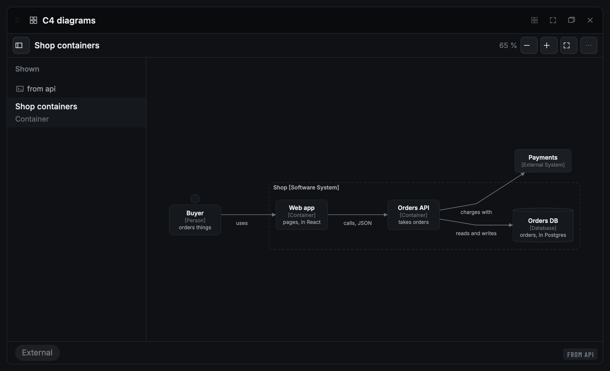 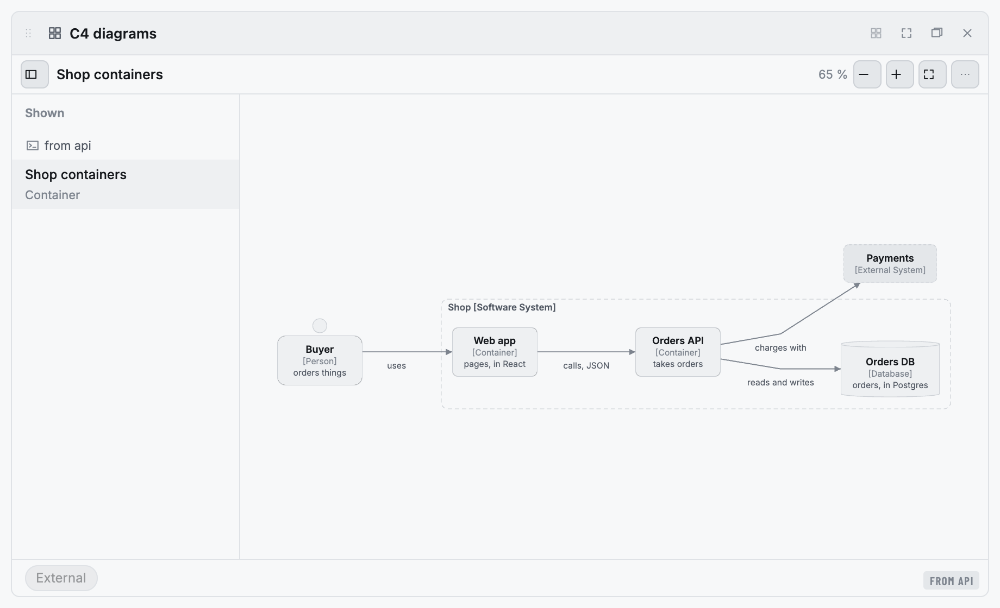

- **What it draws.** Mermaid `flowchart` (or `graph`) and `sequenceDiagram`. In a flowchart, a box's label is read as C4: `Name [Kind] what it does` (`Orders API [Container]`), a `subgraph` is a boundary, `class x external` (or `new`, `changed`) colours it. Parts it doesn't draw (styles, links, icons) are skipped and listed under "Not shown" in the footer.
- **Zoom.** The wheel or a pinch zooms, dragging pans; `+`, `-`, `F` (fit) and `0` do the same from the keyboard, the arrows move the selection, Enter opens it and `B` switches Now and Changes.
- **Click to zoom in.** A box another shown diagram details (a "Shop [Software System]" box, and a diagram of Shop's containers) has a magnifier; clicking it opens that diagram, and the path back is in the bar. When several diagrams detail it, a menu under the box asks which.
- **Changes since the last show.** When an agent updates a diagram, Now / Changes in the bar shows what it added (green), changed (amber) and removed (grey, dashed).

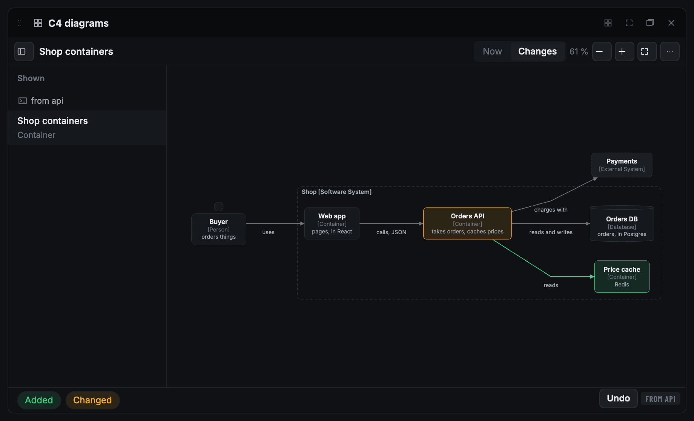 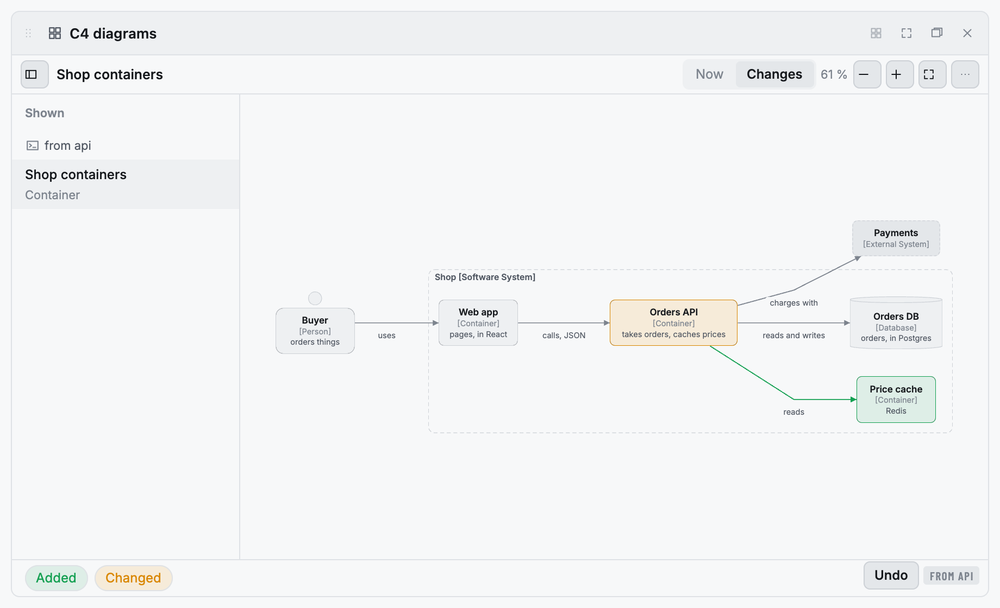

- **The list.** In a wide tile, the diagrams shown so far, by agent. Close one with its ×. They are kept across restarts, at most 50 a project; the oldest you haven't opened for a while makes room.

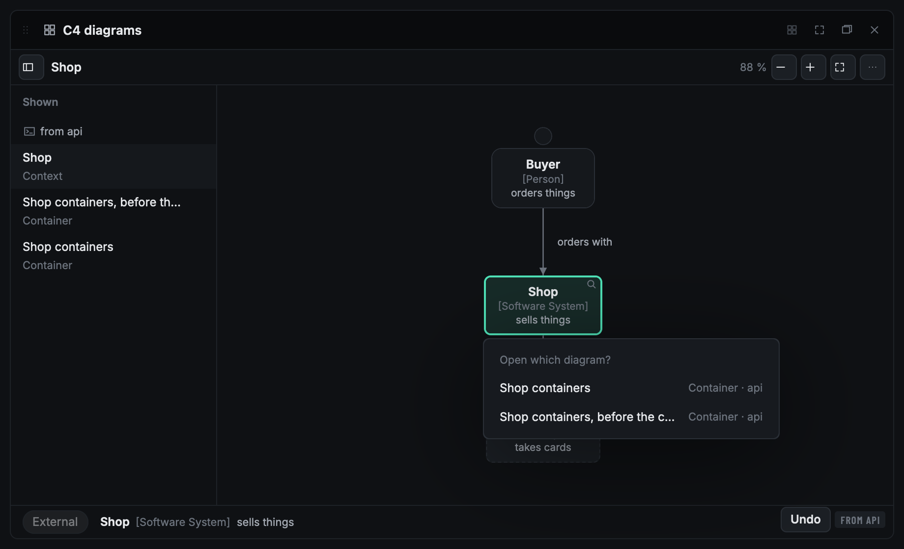 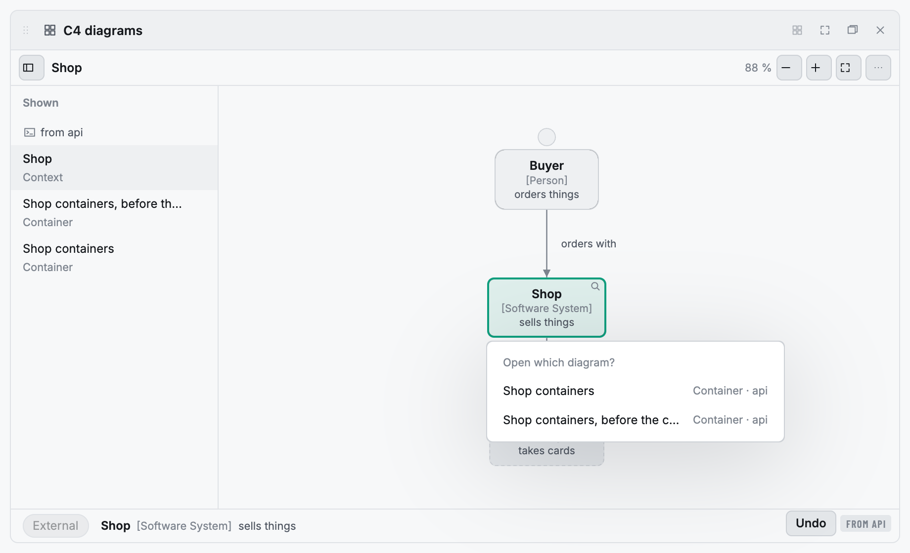

**Bad Mermaid changes nothing.** The agent is told each problem with its line and column, and fixes its call. You see a notice; Show the source shows the agent's text with each bad line marked as an error and what is wrong beside it.

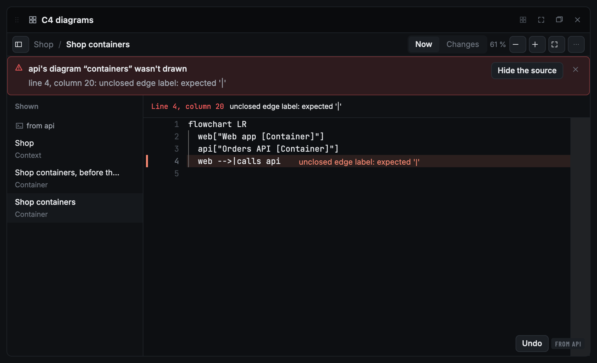 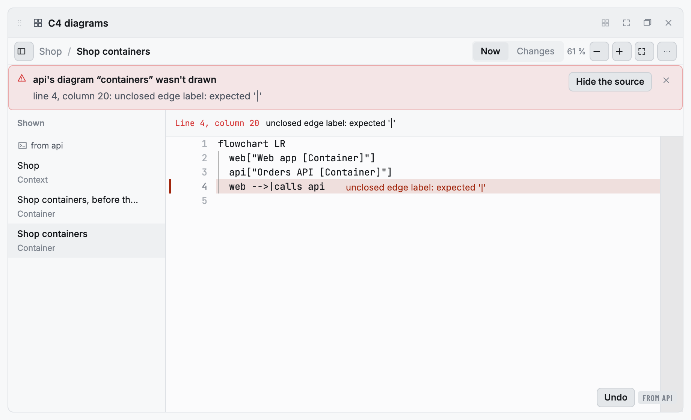

Diagrams in your project's Markdown files come later, once tiles can read files.

## Notes: send a note to an agent

Notes keeps private plain-text notes beside your agents. **Send to an agent** (the arrow in a note's bar) lists your agents and puts the text you selected in the note, the note, or one section of it under a heading, in that agent's Next up, waiting for your Send. Notes asks for "See your agents" and "Put text in an agent's Next up" for this; without them, the rest of Notes works.

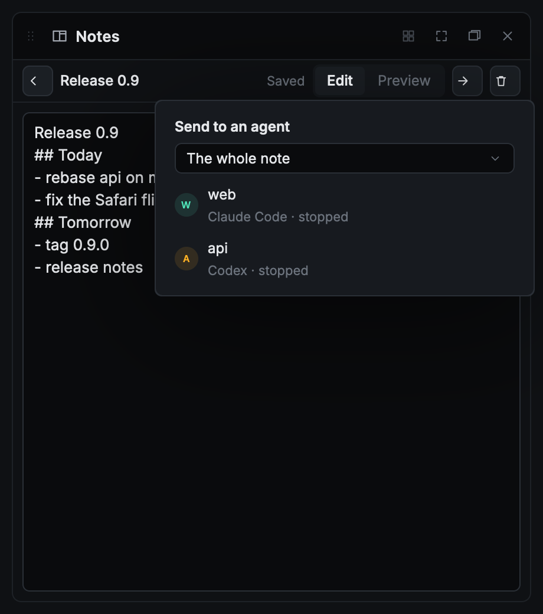 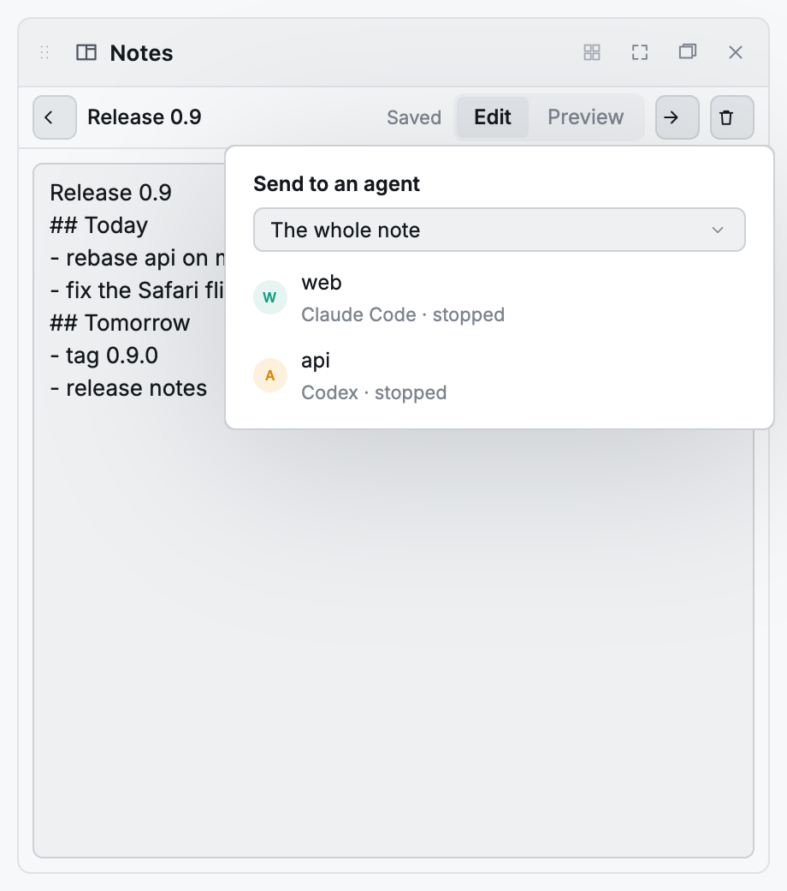

With text selected, Send offers the selection first.

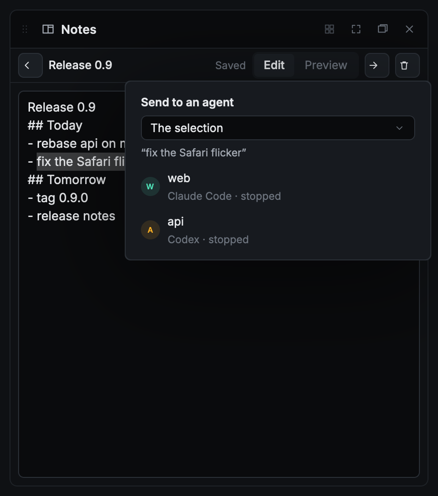 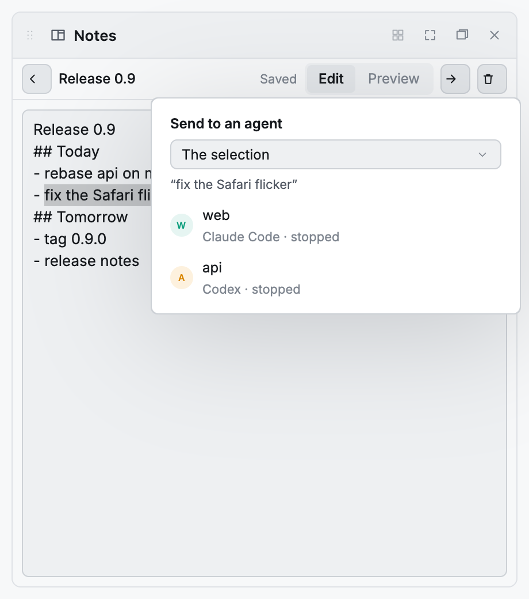

A note longer than 4 000 characters is too long to send whole: select a part or pick a section. ⌘/ switches a note between Edit and Preview.
