# Extensions in Settings

> Tile SDK preview. Browse opens to everyone after the outside security review; until then it reads an index only when one is set up (below).

Everything about your extensions is in one place: the **Extensions tile**. Open it with **Extensions** in the command palette (⌘K), the last entry of a project's Tiles menu in the sidebar, or **Open Extensions** on Settings → Extensions. It is a tile like the others: move it, maximise it (⌘⏎), or give it a window of its own, and it is back where you left it after a restart.

When the tile is wide, the list is on the left and the page you pick is on the right. When it is narrow, you get one column: the list, and a page in its place with a way back.

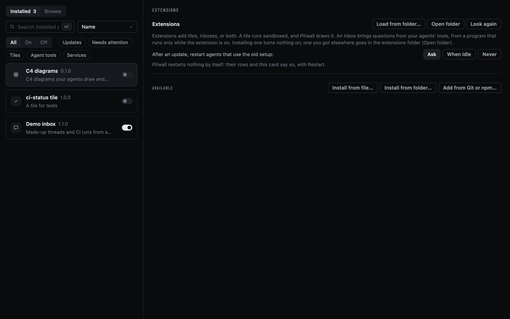 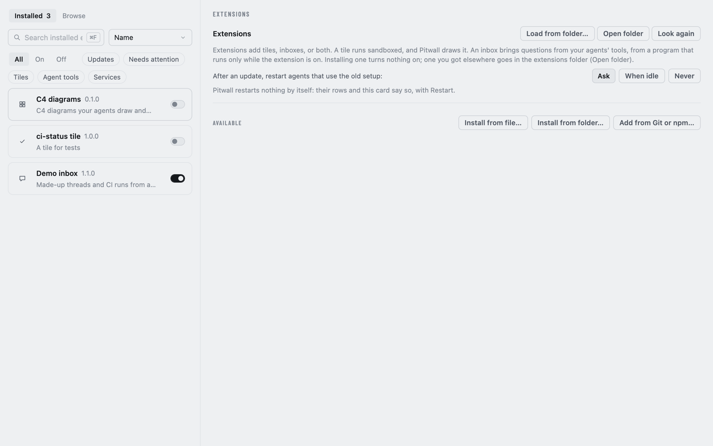

Settings → Extensions in the Settings dialog shows only the short list: each installed extension with its switch, a search, and Open Extensions. Picking one opens its page in the Extensions tile. The Settings dialog fits itself to your window, and you can drag its bottom-right corner to resize it. Pitwall remembers the size.

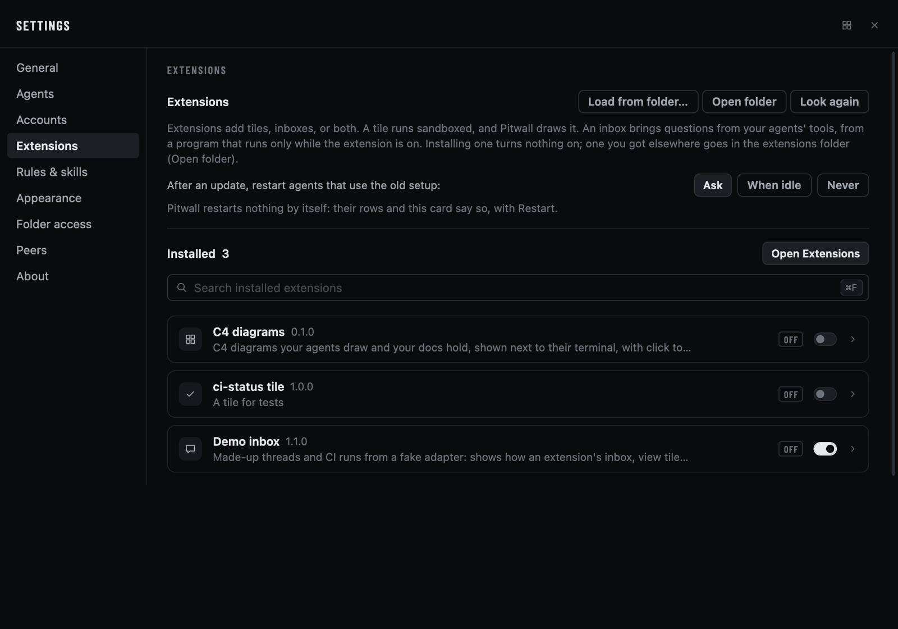 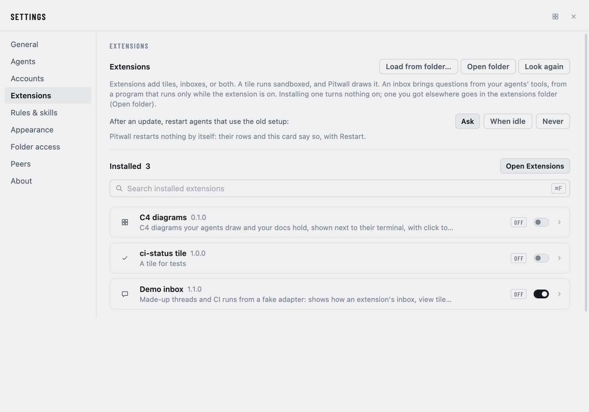

## Installed

- **Search.** Type words in any order: they match the name, the line under it, the author and the names of its tiles, as the palette matches. ⌘F (Ctrl+F) puts the cursor in the search.
- **Filters.** All, On or Off; then Updates, Needs attention (a setup to finish, a new permission to answer, agents on its previous setup, something failed), Tiles, Agent tools and Services.
- **Order.** By name, or most recently updated first.
- **Cards or rows.** Cards have each extension's setup in place. Rows are compact. The wide tile always shows rows.
- **Keys.** ↑ and ↓ move the selection, and Enter opens its page.

When nothing is installed, or nothing matches, the list says so and offers to clear the search and filters.

## An extension's page

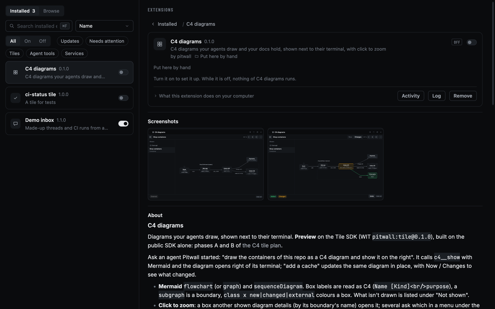 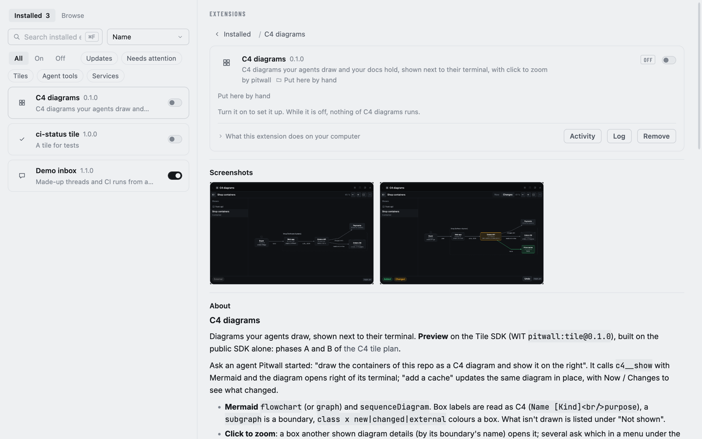

- **Head.** Its icon, name, author, version, who signed it (and Verified, when the index says so of that very file), and its switch.
- **Its line and categories**, then its **screenshots** (your theme's, with their captions; click one to see it larger, with ← and →), then its **README** from its own folder. The README is drawn inert: no HTML runs. Its images from its own folder are shown; one from the network is a link instead, never fetched, and one outside its folder isn't shown. See [Adding images](packaging.md#adding-images).
- **Permissions**, each with the reason the extension gives and, for those that act on your agents or files, what can go wrong. When it is on, each permission has its switch.
- **What it adds**: its tiles, inbox, services and agent tools (with their switches), and the projects its skills are installed in.
- **Versions and changelog**: the one installed, the one Go back returns to, the versions the index lists with how each stands, and its CHANGELOG.md.
- **Licence, homepage and source**, and **Update**, **Go back**, **Remove** and its activity.

A copy installed from the index says so. If the index later blocks that version, Pitwall turns it off and its card gives the reason. A version withdrawn by its author, or an extension no longer listed, says so too. It keeps working, but gets no more updates from the index.

## Browse

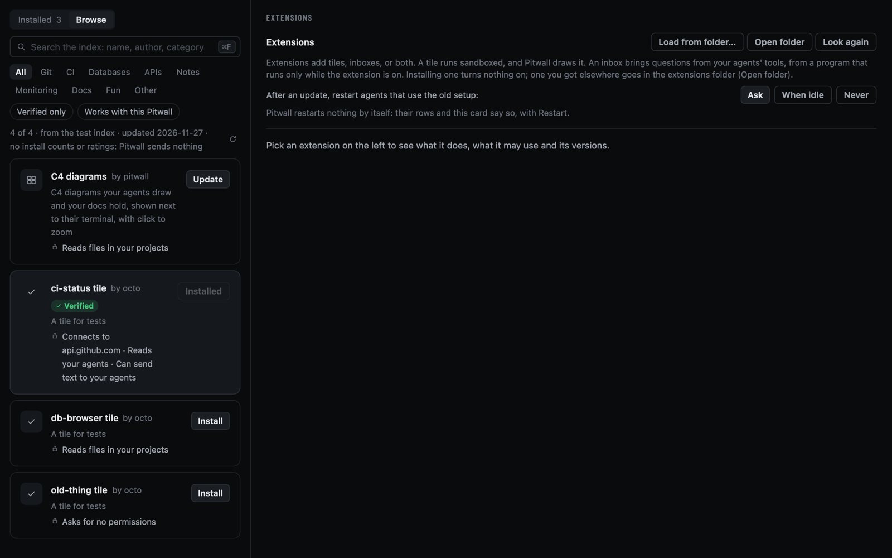 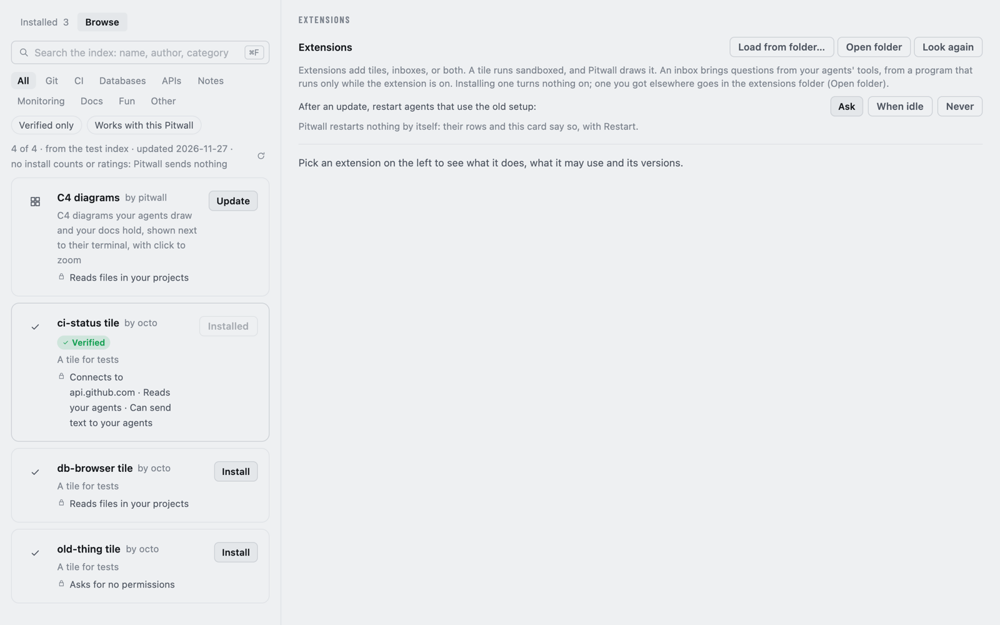

Browse reads the [extensions index](marketplace.md). Pitwall checks its signature against the keys built into Pitwall and searches it on your computer. It sends nothing: there are no install counts or ratings.

- **Search** by name, line, author and category, a **category** (Git, CI, Databases, APIs, Notes, Monitoring, Docs, Fun, Other), **Verified only** (on at first) and **Works with this Pitwall**.
- **Cards** have the extension's own icon, name, author, Verified, its tagline (or line), its first screenshot, what it may do in words ("Connects to api.github.com · Reads your agents"), and **Install**, **Installed** or **Update**.
- **States.** Browse says when it is loading or offline, when the index couldn't be read or checked, when it shows the copy Pitwall kept from before, and when the index is more than 14 days old and may be out of date.

### A listing's page and Install

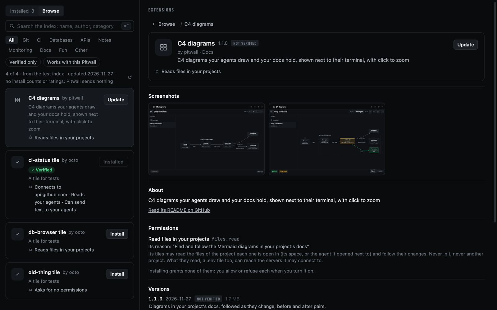 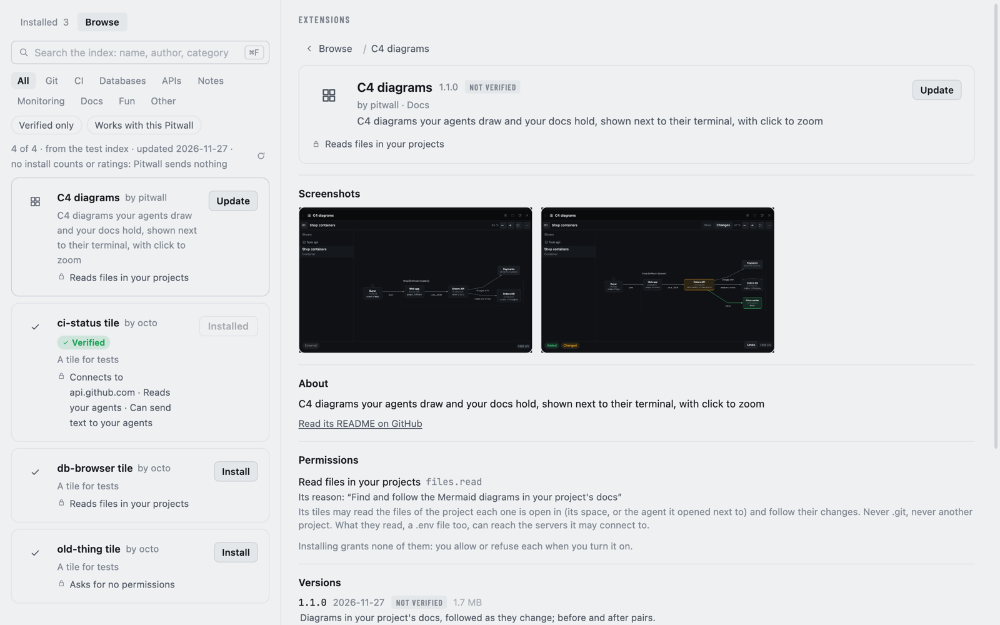

A listing's page has its screenshots, its README with its images (copied into the index, so nothing comes from anywhere else; a listing without one links to its README on GitHub), its permissions with their reasons and risk notes, its versions (Verified, not yet reviewed, withdrawn or blocked), its licence and repository, and **Report a problem**.

**Install** downloads the version the index offers: the newest Verified one, or the newest when none is Verified. Pitwall refuses a blocked or withdrawn version. It checks that the file is the one listed (its SHA-256) and that it is signed by one of its author's keys in the index. Then you get the same trust screen as [Install from a file](install.md), and nothing is installed until you press Install there. Pitwall records that the copy came from the index, so its updates come from there too.

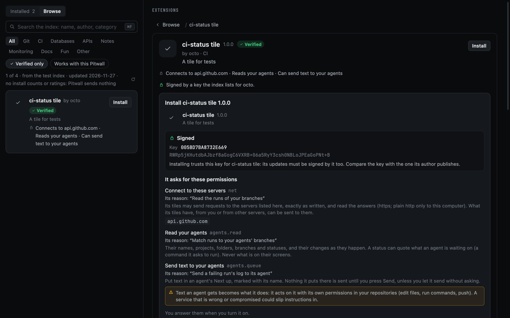 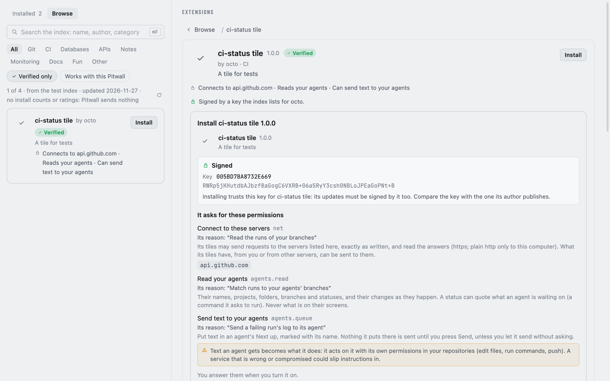

**Report a problem** lets you pick what is wrong (malware, misleading, broken, other). It then opens a new issue on the index's GitHub repository in your browser, filled in with the extension's id, version and file SHA-256. Pitwall itself sends nothing. For security problems, the index's SECURITY.md gives a private address.

### Trying an index (authors)

Until Browse opens to everyone, set `PITWALL_EXTENSION_INDEX` to an index's https base (the folder that holds `index.json`) or to a built `dist/v1/` folder. Set `PITWALL_EXTENSION_INDEX_KEY` to the public key it is signed with. Without both, Browse says it isn't open yet and fetches nothing.

## Narrow

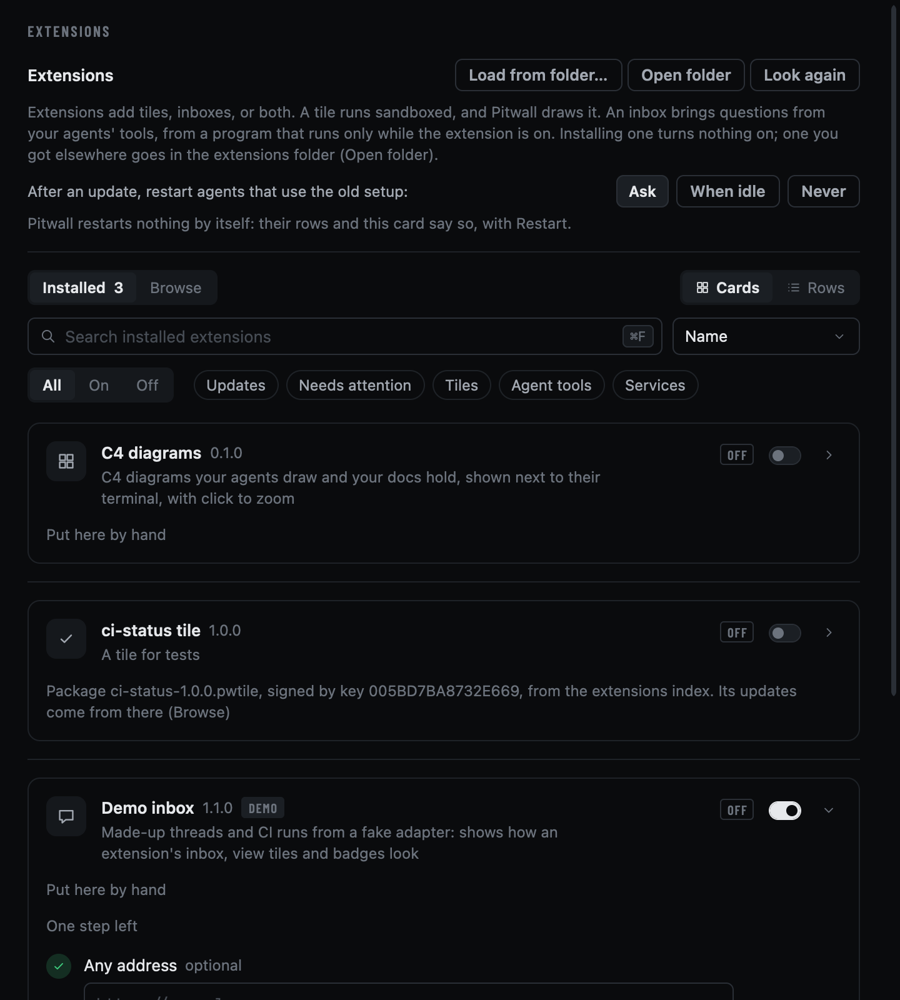 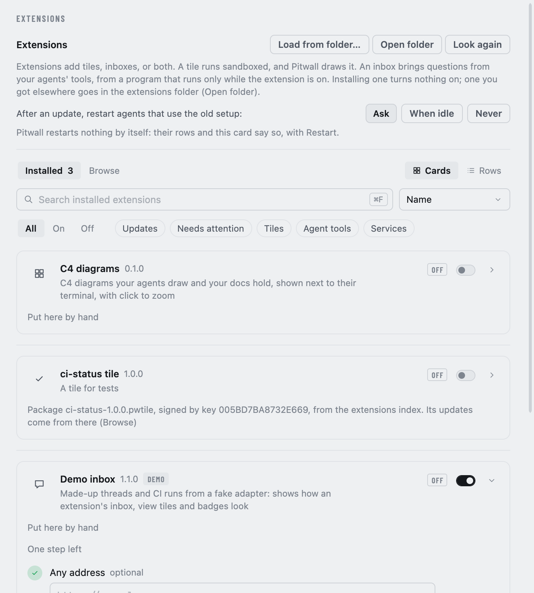
