# Tiles and UI components

**Preview.** A tile describes what to show as a tree of elements, and Pitwall lays it out and draws it in its own theme. This page covers the elements and components of WIT 0.1 (long lists, tables, trees, tabs, selects, menus, Markdown and images, all drawn by Pitwall), styles and theme colours, events and keys, the `Tile` trait, and opening a tile with content. A canvas with drag and drop is on [Canvas and drag](canvas.md), and Pitwall's code and diff views on [Native building blocks](blocks.md).

The names follow GPUI, the UI framework Pitwall is built with, so `div().flex().gap_2().child(…)` reads as it does there. Everything below comes from `use pitwall_extension::prelude::*;`.

## A tile in Pitwall

Each tile an extension that is on contributes is in the command palette as "Open <tile title> (<extension name>)". It opens as a tile in the layout, beside your terminals, files and web pages. The extension's component starts when one of its tiles is shown, and stops when its last tile closes or the extension is turned off. While none of its tiles is shown (another space, another tile maximised over it), it is suspended: no renders, no timers.

While it starts, the tile says so (the first time, Pitwall prepares each version for this computer, which takes a moment). When it stops, over a deadline, after a crash, or with a frame over the limits, it says why in its place, with Restart.

## The `Tile` trait

A tile is a type that implements `Tile`. One value of it runs per extension; each place in the layout that shows one of the extension's tiles is a view of it, rendered with its own id.

| Method | Called | Default |
|---|---|---|
| `new(cx)` | Once, before any view opens. Make the state, read `storage`, start timers. Deadline 2 s | Required |
| `render(view, cx)` | After a view opens, after a listener or timer calls `cx.notify()`, and when the tile is shown again. Returns the view's whole tree | Required |
| `on_view_opened(view, cx)` | A view opened; its first render follows | Nothing |
| `on_content(view, cx)` | A view was given content, when it opened or later ([below](#opening-a-tile-with-content)) | Nothing |
| `on_view_closed(view, cx)` | A view closed | Nothing |
| `on_event(event, cx)` | Shown or hidden, focus, a view's size, the theme, settings or grants changed | Renders again on theme, settings and grants changes |
| `save_state()` | Before the tile is reloaded or dropped to save memory. At most 1 MiB, 50 ms | Nothing kept |

End the crate with `pitwall_extension::export!(MyTile);`. The [quick start](quick-start.md#the-tile) shows a whole tile.

**Keep `render` quick.** Aim for under 8 ms; past 250 ms the tile is stopped and the user sees why. Compute in listeners and timers, and only read state in `render`. A listener or event has 1 s.

`cx` (the context, `Cx`) is passed to every call. Besides `listener`, `notify` and the timers ([Platform services](platform-services.md#tasks-timers)), it tells the tile about its views (`cx.views()`, `cx.view(id)`, `cx.content(id)`), the theme (`cx.theme()`), its grants (`cx.is_granted("memory")`), whether it is shown (`cx.is_visible()`), and its own id and version.

## Elements

| Element | Made with | What it is |
|---|---|---|
| Box | `div()`, `v_flex()`, `h_flex()` | A flex container. `div()` and `v_flex()` are columns; `h_flex()` is a row with its children centred across it. The usual root |
| Text | `text("…")` | A paragraph. Its children are inline runs, each with its own style: `text("Built in ").child(text("3 s").font_bold())`. Plain `&str` and `String` children become text |
| Button | `button("Save")`, `icon_button(Icon::X, "Remove")` | Pitwall's own buttons. Looks: `.primary()` (one main action per area), the default hairline, `.danger()`, `.link()`. Size: regular, or `.small()`, with any look (`.small().danger()`). `.icon(Icon::Plus)` puts an icon before the label; `.disabled(true)` dims it and drops clicks. An icon button is square; its label is its accessible name and tooltip |
| Icon | `icon(Icon::Check)` | One of Pitwall's icons ([the list](#icons)), in the text colour and size |
| Text field | `input("key")` | A one-line or multi-line field ([below](#text-fields)). Its key is required |
| Scroll | `.overflow_y_scroll()`, `.overflow_x_scroll()`, `.overflow_scroll()` on a box | Its children scroll inside it. Pitwall draws the scrollbar and keeps the position |
| Components | `virtual_list`, `table`, `tree`, `tabs`, `select`, `menu_button`, `.context_menu(…)`, `markdown`, `image_asset`, `image_data` | Pitwall's own lists, menus, Markdown and images ([below](#components)) |

Every element can have:

- `.id("key")`: its key among its siblings ([below](#keys)).
- `.tooltip("…")`: text shown when the pointer rests on it.
- `.label("…")`: its accessible name, read by screen readers.
- `.focusable()`: it can take keyboard focus. Buttons and fields always can.
- `.when(condition, |el| …)` and `.when_some(option, |el, value| …)`: apply styles or children only sometimes.

`Div` (what `div()`, `v_flex()` and `h_flex()` return), `Button`, `Input`, `Text` and `IconElement` are in the prelude, for helpers that build part of a tree.

Children are added with `.child(…)` and `.children(iter)`. `.into_any()` turns any element into an `AnyElement`, so different builders fit one type (for a helper function, or the arms of a `match`).

A row of the `list` template: a button that toggles the item, its text, and a button to remove it.

```rust
{{#include crates/pitwall-cli/templates/tile/list/lib.rs.tmpl#list-row}}
```

### Icons

`Icon` has one variant per icon Pitwall draws, and `Icon::from_name` and `.name()` go between them and their names, which are also what `extension.json` names an icon by. An unknown `Icon::Named("…")` draws a dot (`pitwall-extension-test` warns of it), and `pitwall extension check` warns of an unknown icon in the manifest. The names:

`sidebar`, `search`, `gear`, `plus`, `x`, `send`, `stop`, `restart`, `refresh`, `trash`, `branch`, `folder`, `chevron`, `grid`, `wall`, `maximize`, `restore`, `window`, `more`, `review`, `terminal`, `file`, `expand`, `copy`, `chevron-down`, `check`, `headset`, `user`, `laptop`, `server`, `eye`, `external`, `image`, `browser`, `back`, `phone`, `inspect`, `page-right`, `page-left`, `page-below`, `pin`, `grip`, `minus`, `chevron-up`, `lock`, `alert`, `extension`, `inbox`, `bell`, `chat`, `list`.

## Components

Components are drawn by Pitwall as its own lists, menus and Preview are, so they look and behave like the rest of the app (theme, hover, keyboard, scrollbars), and work without a round trip to the tile while the user scrolls or hovers. Prefer them to lists, tabs or menus built from boxes. This page has the lists, tables, trees, tabs, selects, menus, Markdown and images; the other components have a page per group: [Form controls](components-forms.md) (checkboxes, switches, radio groups, segmented controls, sliders, number and search fields, form rows), [Feedback](components-feedback.md) (progress, spinners, skeletons, empty states, banners, badges, chips, key hints, tooltips), [Layout](components-layout.md) (split panes, disclosures, cards, dividers, breadcrumbs, toolbars, popovers, confirm sheets), [Data display](components-data.md) (key-value lists, avatars, relative times, copyable text, links) and [Charts](components-charts.md) (sparklines, bar and line charts, status timelines). The examples below come from the gallery tile Pitwall's tests run (`crates/pitwall-tile-host/tests/fixtures/hello-tile/src/gallery.rs`), and the screenshots are that tile drawn headless, dark and light (`gallery_shots` in `crates/pitwall-app/src/tiles/gallery_tests.rs`); `pitwall-extension-test` drives each one ([quick start](quick-start.md#test-it)).

What every component shares:

- **Key.** Each takes a key first (menus excepted: their button's label is it). Events and the test harness name it by its key path, like any element's.
- **Accessibility.** A component's text (row text, column titles, tab, option and item labels) is its accessible name; `.label("…")` names one that has no text, such as an icon-only menu button or an image. `.tooltip("…")` works on all of them.
- **Limits.** Over a limit, the tile stops with the reason, as for any frame ([Limits](#limits)).

### Virtual list

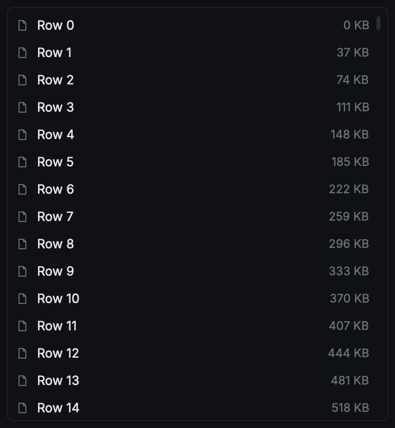 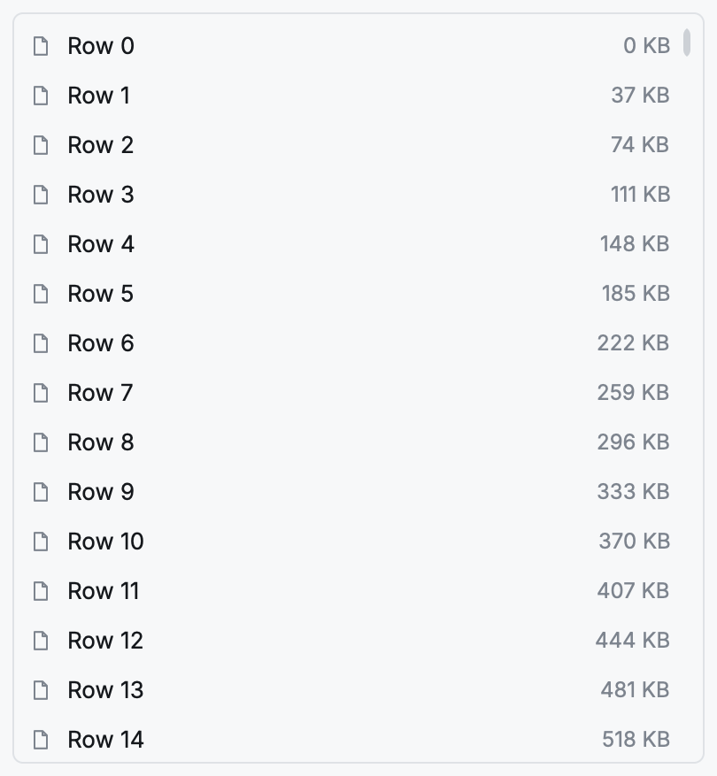

A long list: search results, log lines, a file's history, anything that may run past a few hundred rows. `virtual_list(key, count, rows)` is a list of `count` rows that scrolls smoothly at 100 000 rows. The frame holds only the count; `rows`, made with `cx.rows(|tile, i, cx| …)`, renders row `i` when it comes into sight. Pitwall asks for rows a page (64) at a time and keeps what it has drawn until the list's data changes. For a dozen rows that never grow, a column of boxes is simpler.

```rust
{{#include crates/pitwall-tile-host/tests/fixtures/hello-tile/src/gallery.rs#gallery-virtual-list}}
```

| Option | What it does |
|---|---|
| `.row_height(px)` | Every row's height: 12 to 200, default 28 (Pitwall's own rows') |
| `.selected(keys)` | The selected rows' keys, drawn selected; the tile keeps the selection |
| `.revision(n)` | A number that changes only when the rows do. Without it every render counts as new data and Pitwall asks for the rows in sight again |
| `.on_select(listener)` | Hears a row chosen |

- **Rows.** A row is a small tree (at most 64 nodes) of boxes, text, icons, buttons, images, a context menu, [badges](components-feedback.md), [avatars and relative times](components-data.md); no text fields or nested lists. Give each row its item's id with `.id(…)`, so the selection follows the item; a key has no `/`. Listeners in a row (a button's `on_click`, a [context menu](#menus)) work like any other.
- **Events.** `on_select` gets the row's key (`&str`), or the whole `Picked`: `key`, `index`, `modifiers` (⌘ or Shift for adding to a selection), and `activate`, true for a double click or Enter.
- **Keyboard.** With the list focused (a click on it), Up and Down move the selection, Home and End go to the ends, Page Up and Page Down by a screen, and Enter activates; each sends `select`. A row that isn't loaded yet is selected when it arrives.
- **Size.** It fills its parent: give the parent a height, or let it grow (`flex_1` in a column that has one).
- **Speed.** Keep the row callback quick: a page of 64 rows in a few milliseconds. In Pitwall's measurement a page of 64 gallery rows took about 0.5 ms, and a jump to row 50 000 was drawn in about 20 ms ([runtime.md §2.7](../../spec/tile-sdk/runtime.md)).
- **Limits.** 1 000 000 rows; a row 64 nodes; a `rows` call 256 rows and 250 ms.

### Table

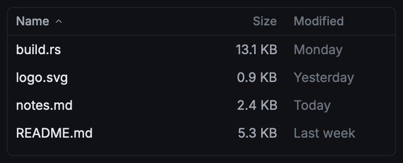 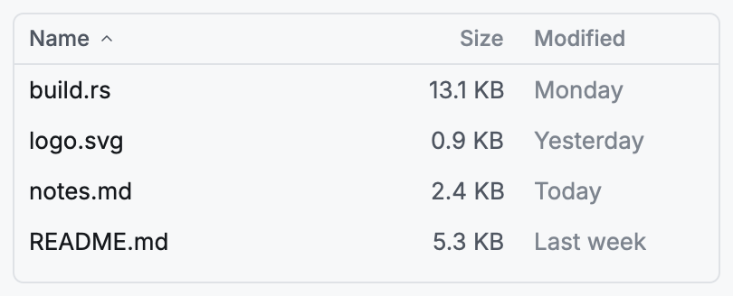

Rows with the same fields side by side: files with their size and date, test results, issues. `table(key, columns, count, rows)` is a virtual list with a header. Each row's root holds its cells, one child per column in order.

```rust
{{#include crates/pitwall-tile-host/tests/fixtures/hello-tile/src/gallery.rs#gallery-table}}
```

| Option | What it does |
|---|---|
| `column(key, title)` | A column. `.width(px)` fixes its width (else it shares the room left); `.align_end()` (numbers) or `.align_center()`; `.sortable()` makes its title clickable |
| `.sort(column, direction)` | Which column the rows are sorted by, drawn as an arrow in its title |
| `.on_sort(listener)` | Hears a sortable title clicked: `SortChange` with the `column` and the next `direction` (ascending first). Sort the rows, pass `.sort(…)` |
| `.on_column_resize(listener)` | Hears a column resized: `ColumnWidth` with the `column` and its `width`, once at the end of the drag, to keep it |
| `.row_height`, `.selected`, `.revision`, `.on_select` | As in a [virtual list](#virtual-list) |

- **Resizing.** The user drags the right edge of a title; Pitwall keeps that width until the column's own `.width` changes.
- **Keyboard.** As in a virtual list.
- **Limits.** 64 columns; rows as in a virtual list.

### Tree

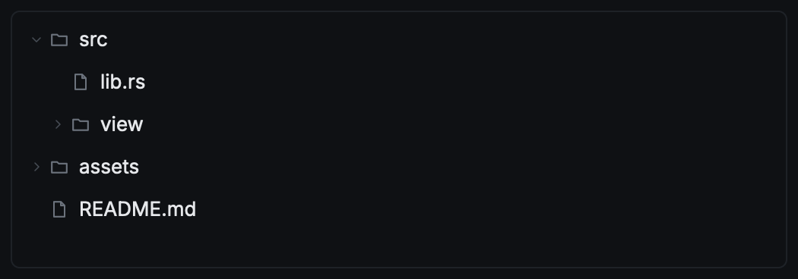 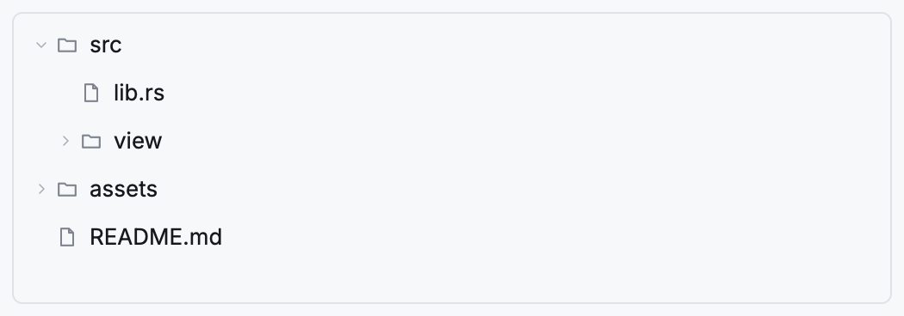

Nested items: folders and files, symbols, an outline. `tree(key, count, rows)` is a virtual list of the tree's visible rows, in order: the tile flattens its open branches and keeps which are open. A row is a `tree_row(element)`.

```rust
{{#include crates/pitwall-tile-host/tests/fixtures/hello-tile/src/gallery.rs#gallery-tree}}
```

| Option | What it does |
|---|---|
| `tree_row(el).depth(n)` | The row's level, 0 at the top; Pitwall indents it |
| `tree_row(el).branch(open)` | A branch, open or closed, drawn with a chevron. Leave it out for a leaf |
| `.on_toggle(listener)` | Hears a branch opened or closed: `Toggled` with the row's `key`, its `index` and `on` (true: open it). Change your open set and render again |
| `.row_height`, `.selected`, `.revision`, `.on_select` | As in a [virtual list](#virtual-list) |

- **Opening.** A click on the chevron, or a double click on a branch, sends `toggle`.
- **Keyboard.** As in a virtual list, and → opens the selected branch, ← closes it; ← on a leaf or a closed branch moves to its parent.
- **Limits.** As in a virtual list (counting only the visible rows).

### Tabs

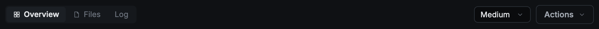 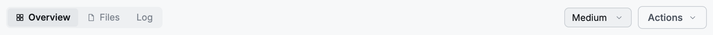

A few views of the same thing, one at a time: Overview, Files, Log. `tabs(key, [tab(key, label), …])` is Pitwall's segmented control. It only marks the choice: draw the tab's content yourself, by the key you keep. For more than about five choices, or ones that aren't views, use a [select](#select).

```rust
{{#include crates/pitwall-tile-host/tests/fixtures/hello-tile/src/gallery.rs#gallery-tabs}}
```

| Option | What it does |
|---|---|
| `tab(key, label).icon(icon)` | An icon before the tab's label |
| `.selected(key)` | The current tab |
| `.on_select(listener)` | Hears a tab clicked, with its key (`&str`) or `Picked` |

- **Keyboard.** Tabs are chosen with the pointer for now; bind keys with `cx.bind_key` to switch them ([Keyboard and focus](#keyboard-and-focus)).
- **Limits.** 1 000 tabs.

### Select

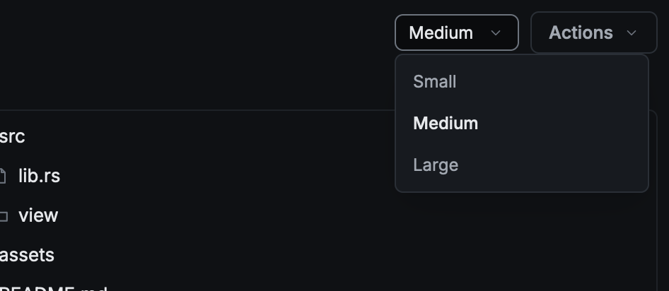 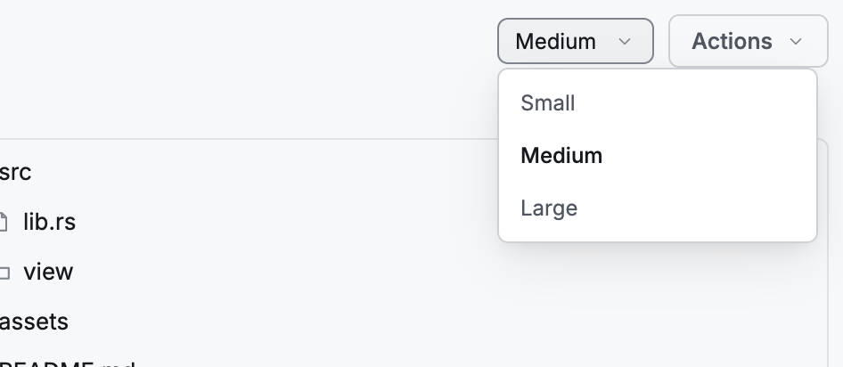

One value out of a list: a size, a sort order, a branch. `select(key, [choice(key, label), …])` is a dropdown: a button with the chosen label that opens Pitwall's menu of the options, the chosen one ticked.

```rust
{{#include crates/pitwall-tile-host/tests/fixtures/hello-tile/src/gallery.rs#gallery-select}}
```

| Option | What it does |
|---|---|
| `.selected(key)` | The chosen option |
| `.placeholder("…")` | Shown while no option is chosen |
| `.disabled(true)` | Dimmed; it doesn't open |
| `.on_select(listener)` | Hears an option chosen, with its key (`&str`) or `Picked` |

- **Keyboard.** Esc closes the open list; options are chosen with the pointer for now.
- **Limits.** 1 000 options.

### Menus

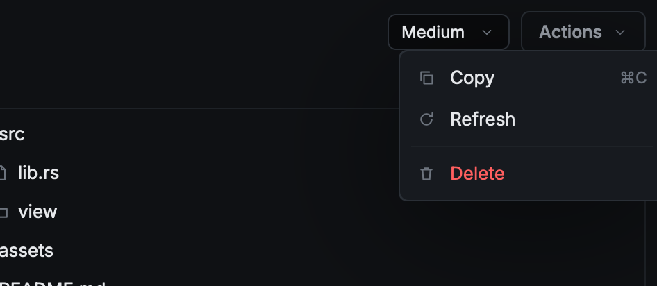 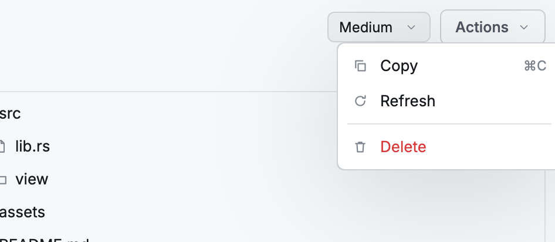

Actions on a thing that don't need a button each: Copy, Rename, Delete. A menu is a list of `menu_item(key, label)` and `separator()`. Pitwall draws it as its own menus, above the tile (a glass pop-up under Liquid Glass), closes it on a click outside or Esc, and calls the listener with the chosen item's key.

- `menu_button(label, entries)` is a button that opens it; `menu_icon_button(icon, label, entries)` an icon-only one, `label` being its accessible name.
- `.context_menu(entries, listener)` on any element opens it on a right-click there, rows of lists, tables and trees included (a right-click selects the row first). An element has at most one.

```rust
{{#include crates/pitwall-tile-host/tests/fixtures/hello-tile/src/gallery.rs#gallery-menu-button}}
```

| Option | What it does |
|---|---|
| `menu_item(…).icon(icon)` | An icon before the label |
| `menu_item(…).hint("⌘C")` | A shortcut shown on the right (bind it yourself with `cx.bind_key`) |
| `menu_item(…).disabled(true)` | Dimmed; it can't be chosen |
| `menu_item(…).danger()` | Drawn in the danger colour, for destructive actions |
| `menu_button(…).icon(icon)`, `.disabled(true)` | The button's icon; a disabled button doesn't open |
| `.on_select(listener)` | Hears an item chosen, with its key (`&str`) or `Picked` |

- **Keyboard.** Esc closes an open menu; items are chosen with the pointer for now.
- **Limits.** 1 000 items in a menu.

### Markdown

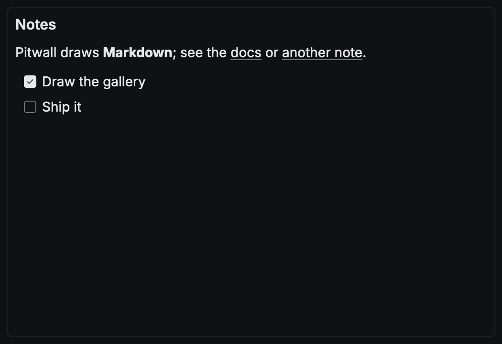 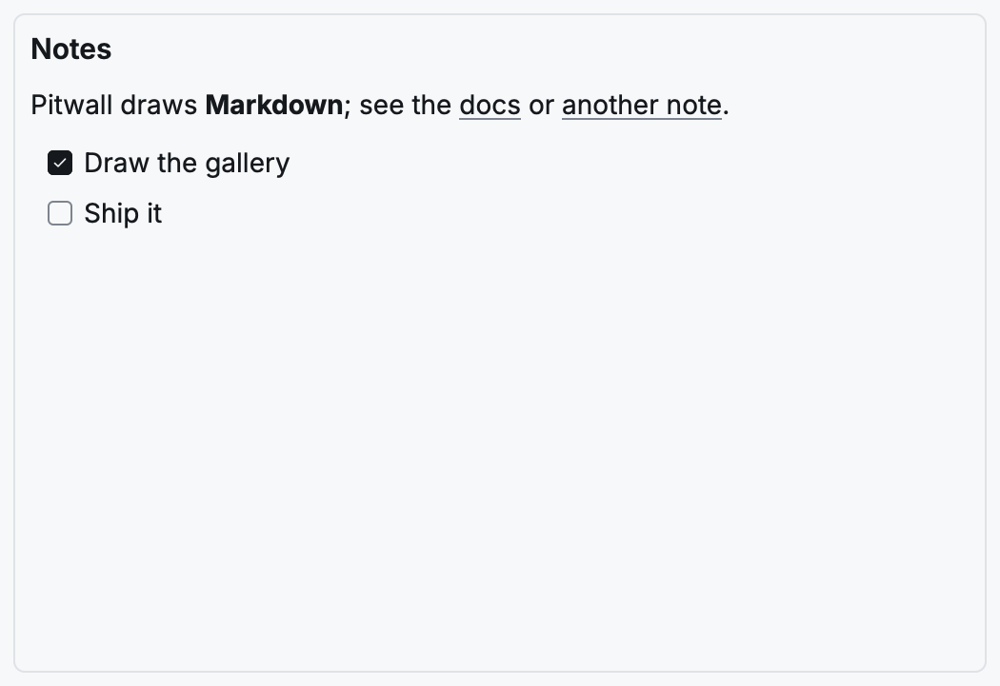

Text the user or an agent wrote: notes, a README, a description. `markdown(text)` draws it with Pitwall's Preview: headings, lists, tasks, code, tables, quotes. It is inert: no HTML, no remote images, nothing runs.

```rust
{{#include crates/pitwall-tile-host/tests/fixtures/hello-tile/src/gallery.rs#gallery-markdown}}
```

| Option | What it does |
|---|---|
| `.on_link(listener)` | Gets every link click instead of Pitwall opening it: `LinkClick` with the `url` as written (a relative link can open another of the tile's items) and the `modifiers` |
| `.on_toggle(listener)` | Makes task boxes clickable: `Toggled` with the task's line in `index` (0-based) and `on`, whether it is ticked now. Change the text and render again |

- **Links.** Without `on_link`, `http`, `https` and `mailto` links open in the browser and other links do nothing; without `on_toggle`, task boxes can't be clicked.
- **Size.** Given a height (or room to grow), it fills it and scrolls; otherwise it is as tall as its text.
- **Keyboard.** Text can be selected and copied as in Preview.
- **Limits.** 1 MiB of text.

### Images

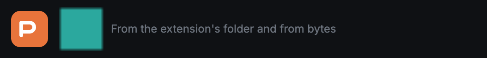 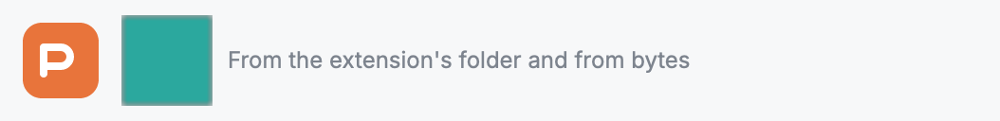

A logo, an avatar, a thumbnail or a picture the tile made. `image_asset("assets/logo.svg")` shows a file of the extension's folder (a path inside it, no `..`); `image_data(name)` shows bytes the tile handed over with `ui::put_image(name, &bytes)` ([Platform services](platform-services.md#ui)) and can drop with `ui::drop_image(name)`. PNG, JPEG, GIF, WebP and SVG; never fetched from the network.

```rust
{{#include crates/pitwall-tile-host/tests/fixtures/hello-tile/src/gallery.rs#gallery-image}}
```

| Option | What it does |
|---|---|
| `.contain()` | Fits inside its box, whole (the default) |
| `.cover()` | Fills its box, cropped |
| `.fill()` | Stretched to its box |
| `.w(…)`, `.h(…)` | Its size: give it one |
| `.label("…")` | What it shows, for screen readers |

- **Missing.** A missing or unreadable image draws an image icon in its place.
- **Limits.** An asset at most 16 MiB; a put image at most 8 MiB, and 64 MiB for all of a tile's.

## Styles

Styles use GPUI's names:

| Kind | Methods |
|---|---|
| Flex | `flex`, `flex_row`, `flex_col`, `flex_wrap`, `flex_1`, `flex_grow`, `flex_shrink_0`, `flex_none`, `gap_0` … `gap_8`, `gap(length)` |
| Alignment | `items_start`, `items_center`, `items_end`, `items_baseline`, `justify_start`, `justify_center`, `justify_end`, `justify_between`, `justify_around`, `self_align` |
| Size | `w`, `h`, `size`, `w_full`, `h_full`, `size_full`, `min_w`, `max_w`, `min_h`, `max_h` |
| Spacing | `p_0` … `p_6`, `px_1` … `px_4`, `py_1` … `py_3`, `pt_*`, `pb_*`, `pl_2`, `pl_3`, `pr_1`, `pr_2`, `m_1`, `m_2`, `mx_2`, `my_2`, `mt_2`, `mb_2`, `p(length)`, `m(length)` |
| Borders and corners | `border_1`, `border_t_1`, `border_b_1`, `border_l_1`, `border_r_1`, `border_color`, `rounded_none`, `rounded_sm`, `rounded_md`, `rounded_lg`, `rounded_full` |
| Colour | `text_color`, `bg`, `hover_bg`, `opacity` |
| Text | `text_xs`, `text_sm`, `text_base`, `text_lg`, `text_xl`, `font_mono`, `font_ui`, `font_normal`, `font_medium`, `font_semibold`, `font_bold`, `italic`, `underline`, `truncate`, `line_clamp(n)`, `selectable` |
| Hover groups | `group("row")` names a hover group; `visible_on_group_hover("row")` on an element inside it keeps the element hidden (its space kept) until the pointer is over the group, drawn by Pitwall without a round trip: a row's Delete |
| Other | `overflow_hidden`, `cursor_pointer`, `cursor_text` |

Lengths are `px(n)` (logical pixels), `rems(n)` (multiples of Pitwall's text size, so they follow the user's font size), `relative(f)` (a fraction of the parent) or a bare number (pixels). The spacing scale (`gap_2`, `p_3`) is in rems.

### Theme colours

A tile has no raw colours. `text_color`, `bg`, `hover_bg` and `border_color` take a theme token, named by meaning. Each has a light and a dark value, and the user's theme picks one, so a tile follows Pitwall's appearance by itself.

| Token | For |
|---|---|
| `Bg` | The window's background, behind tiles |
| `Surface`, `Surface2`, `Surface3` | A tile's background, then raised areas inside it (a header, a selected row, a field) |
| `Raised` | Floating surfaces |
| `Line`, `LineStrong` | Hairlines and borders; stronger ones that must be seen |
| `Text`, `Text2`, `Text3`, `Text4` | Main text, secondary, muted, faint |
| `Focus` | The focus ring |
| `Good`, `Warn`, `Bad`, `Done` | Success, needs attention, failure, finished |
| `GoodSoft`, `WarnSoft`, `BadSoft`, `DoneSoft` | Soft backgrounds for the same |
| `DiffAddBg`, `DiffDelBg` | Added and removed lines in a diff |

`cx.theme()` gives the rest of the user's appearance: light or dark, density (comfortable, compact, dense) and whether they asked for less motion. When it changes, the tile hears `Event::Theme` and renders again.

## Events

A listener is made with `cx.listener` while rendering and handed to the element at once. Its closure gets the tile, the event and the context; it calls `cx.notify()` when what the tile shows changed.

| Method | On | The closure gets |
|---|---|---|
| `on_click` | Any element; also Space or Enter while it has focus | `Click`: button, modifier keys, click count, position |
| `on_hover` | Any element | `Hover`: entered or left, position |
| `on_pointer` | Any element | `Pointer`: press, release or move, with position and modifiers. After a press, moves and the release go to the same node |
| `on_change` | Text field | The new text (`&str`) or the whole `InputChange` with the selection |
| `on_submit` | Text field | `Submit`: Enter (⌘Enter, Ctrl+Enter off macOS, in a multi-line field) |
| `on_select` | Text field | `Selection`: the cursor or selection moved |
| `on_wheel` | Any element | `Pointer` with `PointerKind::Wheel` or `PointerKind::Pinch`: for zooming and panning a [canvas](canvas.md#zoom-and-pan) |
| `on_drop` | Any element | `Dropped`: something dragged with `.draggable` was dropped on it ([Drag and drop](canvas.md#drag-and-drop)) |
| `on_scroll` | Scroll container | `ScrollPosition`: offset and content size, for loading more at the end |
| `on_focus`, `on_blur` | Text field or focusable element | `Focused` / `Blur`: it took the keyboard, or lost it (to another element, or out of the tile). A field's blur is the moment to save it |
| `on_select` | List, table, tree, tabs, select, menu button, `context_menu` | The chosen row's, tab's, option's or item's key (`&str`), or the whole `Picked` (key, index, modifiers, `activate`) |
| `on_toggle` | Tree, Markdown | `Toggled`: a branch opened or closed, or a task's box clicked (its line) |
| `on_link` | Markdown | `LinkClick`: a link's target |
| `on_sort`, `on_column_resize` | Table | `SortChange` (column, direction), `ColumnWidth` (column, width) |

Events that aren't for one element (shown or hidden, focus, a view's size, the theme, settings, grants) go to `Tile::on_event`.

## Keys

Give each element that can move a key with `.id("key")`: list rows take their item's id. Pitwall keeps scroll positions, focus and typed text by key path (the keys from the root down, joined by `/`), so they survive when the list around them changes. Children without a key get their position as their key. Keys are unique among siblings (a duplicate gets a suffix and a Log line) and at most 128 bytes.

The `list` template's scrolling list, keyed by `items`, with one keyed row per item:

```rust
{{#include crates/pitwall-cli/templates/tile/list/lib.rs.tmpl#list-scroll}}
```

## Text fields

Pitwall owns what the user types: typing, selection, undo and input methods never wait for the tile. The tile hears each change with `on_change`, keeps its own copy, and passes that copy back with `.value(…)`. The SDK sends the value only when it differs from what the field holds, so this never undoes what the user typed meanwhile, and setting your copy to `""` clears the field.

```rust
{{#include crates/pitwall-cli/templates/tile/list/lib.rs.tmpl#list-submit}}
```

**The selection.** `on_change` with the whole `InputChange` has the cursor or selection after each edit, and `.on_select(listener)` hears it move without an edit (`Selection`, a range of UTF-8 byte offsets in the text); keep the latest with your copy of the text, and the selected text is that range of it. Notes sends the selection to an agent this way. In tests, `t.select_text(key, range)` or `t.select_in(key, "words")` selects as the user would.

`.placeholder(…)` shows faint text while it is empty. `.multiline()` makes it several lines (Enter adds a line, ⌘Enter submits) and `.rows(n)` its height, or, given a height or room to grow (`.size_full()`, `.flex_1()`), it fills that, at least its rows; `.select(range)` places the cursor when `.value` changes the text; `.disabled(true)` makes it read-only. The `form` template's fields:

```rust
{{#include crates/pitwall-cli/templates/tile/form/lib.rs.tmpl#form-inputs}}
```

## Keyboard and focus

- A tile gets keys only while it has focus. Pitwall's own shortcuts always win.
- Tab and Shift-Tab move focus among focusable elements in tree order, with Pitwall's focus ring.
- While rendering, `cx.bind_key("j", handler)` makes a key call a listener (`Handler<KeyPress>`) while the view has focus. Keys are written like `j`, `enter`, `/`, `shift-tab` or `cmd-s`; `cmd` is ⌘ on macOS and Ctrl elsewhere.
- A binding without ⌘, Ctrl or Alt (`j`, `/`, `shift-n`) doesn't fire while a text field has focus: the key types into the field.
- Number keys answer a question as Pitwall's inbox does: bind `1` to `9` while the question is open, each picking its suggestion. They type into a reply field that has focus, and pick when it doesn't.
- Pitwall's own keys are never a tile's: a binding of one is dropped, with a line in the tile's Log. They are Esc, Tab, Shift-Tab, Ctrl-Enter (and Ctrl-Shift-Enter), `cmd-` and `cmd-shift-` with any of `enter`, `0`–`9`, `=`, `+`, `-`, `,`, `a`, `b`, `c`, `e`, `h`, `i`, `j`, `k`, `l`, `m`, `n`, `p`, `q`, `r`, `t`, `v`, `w`, `x`, `z`, and `cmd-shift-f`, `cmd-alt-h`, `cmd-ctrl-f`, `cmd-shift-alt-e`, `-n`, `-r` and `-t`. (Off macOS Pitwall's keys are Ctrl+Shift ones; the list is the same everywhere, so a tile's keys work the same on every system.)
- While rendering, `cx.focus("list/row-3")` asks for focus on the element at that key path: the keys from the root down, joined by `/`, without the root's (the same path `ui::scroll_to` takes). Pitwall honours it only while the tile already has focus, so a tile can't take the keyboard from an agent's terminal. `cx.focused(view)` is the element that has it.

## Opening a tile with content

A tile can be opened with content: a JSON value that matches a schema the tile names in its manifest entry (`"input": "input.schema.json"`). Pitwall checks the content against the schema before the tile sees it. A later call with the same content id goes to the same view and updates it in place.

The tile hears `on_view_opened` and then `on_content`, or only `on_content` when an open view gets new content. `Content::parse` reads the JSON into the tile's own `serde` type. The `list` template's input type and handler:

```rust
{{#include crates/pitwall-cli/templates/tile/list/lib.rs.tmpl#list-content-type}}
```

```rust
{{#include crates/pitwall-cli/templates/tile/list/lib.rs.tmpl#list-on-content}}
```

`Content` also has `id()` (the caller's id for it), `json_text()` and `bytes()` (a binary payload, at most 8 MiB).

Keep the schema small and describe each field: agents read it. In this preview, opening a tile from the palette gives it no content, so content reaches a tile in tests (`open_with`, `set_content`, see the [quick start](quick-start.md#test-it)). Agents opening a tile with content come in phase 2 ([Agent tools](agent-tools.md)).

`ui::open_view("main")` opens one of the extension's own tiles, or focuses it when it is open ([Platform services](platform-services.md#ui)).

## A shortcut to open a tile

A tile may suggest keys that open it from anywhere in Pitwall, as ⌘I opens the inbox: `"shortcut": "cmd-shift-u"` in its manifest entry, with the `shortcut` permission and your reason.

```json
"permissions": { "shortcut": "To open the desk from anywhere" },
"contributes": { "tiles": [{ "id": "main", "title": "Desk", "wasm": "tile.wasm", "shortcut": "cmd-shift-u" }] }
```

- The keys are `cmd-<key>` or `cmd-shift-<key>`, the key a letter, a digit or F1 to F12. As for Pitwall's own shortcuts, `cmd` is ⌘ on macOS and Ctrl+Shift elsewhere (`cmd-shift` is Ctrl+Shift+Alt there), so plain Ctrl stays the terminals'.
- Pitwall's own keys are refused ([Keyboard and focus](#keyboard-and-focus)): `pitwall extension check` says so. Two tiles of one extension can't share keys.
- The shortcut is off until the user grants it: the permission screen offers "Use a keyboard shortcut" switched off, with the keys it suggests. Granted, the palette shows the keys beside "Open <tile>".
- The user can change the keys under the permission, in the extension's card, or leave the field empty for the ones the tile suggests. Pitwall's own keys are refused there too, and keys another extension has: of two extensions that want the same keys, the first by name gets them.

## Toolbar button

An extension may add one button to Pitwall's top bar. Its buttons sit in a group of their own after the agent counts, behind a hairline, in the order of the extensions. Ask only when the button is worth a place there: a count that needs attention, or a quick look.

```json
"contributes": {
  "toolbar": {
    "icon": "server",
    "tooltip": "Builds",
    "badge": true,
    "visibleByDefault": true,
    "action": { "kind": "popover", "tile": "main", "size": { "w": 320, "h": 400 } }
  }
}
```

| Field | |
|---|---|
| `icon` | One of Pitwall's icon names ([Icons](#icons)) |
| `tooltip` | What it does, in a few words, at most 80 characters (needed); the tile can change it |
| `badge` | `true`: the tile sets a badge, and Pitwall keeps the tile running for it |
| `scope` | `window` (the default), or `project`: the badge of the project the window shows |
| `visibleByDefault` | Shown when the extension is turned on (the default); `false`: the user turns it on from the card |
| `action` | What a press does: `{ "kind": "tile", "tile": "main" }` opens the tile; `popover` opens the tile's popover, `size` from 200×100 to 420×560 (320×400 when not given); `{ "kind": "command", "command": "sync" }` runs a command; `{ "kind": "menu", "commands": […] }` shows a menu of up to 10 commands |

The user hides the button with Hide from toolbar (its right-click menu), or with Show in toolbar on the extension's card. What they choose is kept: an update never shows a hidden button again.

The popover is a view of the tile with the id `toolbar::POPOVER_VIEW`: draw it in `render` when `view` is that id. Esc, a press outside it, a press on the button or `toolbar::close_popover()` closes it. The badge shows only while the tile runs ([Platform services](platform-services.md#toolbar-button)).

## Limits

| | Limit |
|---|---|
| Nodes in a view | 20 000 |
| A frame | About 2 MiB |
| A key | 128 bytes |
| A text field's text | 1 MiB |
| A list's, table's or tree's rows | 1 000 000; a row 64 nodes, 12–200 px tall |
| A table's columns; tabs, options or menu items | 64; 1 000 |
| Markdown | 1 MiB |
| An image | 16 MiB from the folder, 8 MiB put (64 MiB for all) |
| `render` | 250 ms (aim for under 8 ms) |
| A listener or event | 1 s |
| `new` | 2 s |

A tile over a frame limit or a deadline is stopped, and the user sees the reason.
