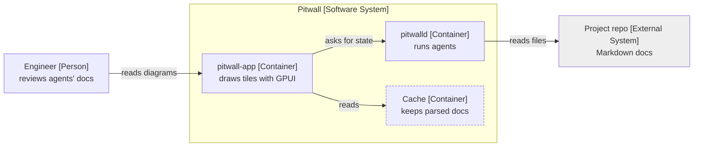

Status: phase A (the core, plain Rust) built in `tiles/c4/`; the tile
itself waits for the Tile SDK. Started 2026-11-27.

# C4 diagram tile: functional requirements

The C4 diagram tile is Pitwall's flagship seed tile
([Tile SDK §10.1](../tile-sdk/README.md#101-seed-tiles-first-party-public-sdk-only)).
Its headline use: the user asks a coding agent "draw me this diagram
and show it on the right"; the agent writes Mermaid and calls the tile's
show tool, `c4__show`; the diagram opens in a C4 tile next to that
agent's terminal, drawn natively. A later call with the same diagram id
updates the tile in place. Placement works like Pitwall's own
`show_files` and `show_web`. Second, the tile shows the C4 diagrams that
agents write into a project's Markdown docs. Later, agents use its tools
to read and change those docs' diagrams, with the user's approval.

The C4 tile is the first user of an SDK-wide principle: extensions
provide their own agent tools, Pitwall registers them with every agent
it starts, and every tile can be opened by an agent
([agent-tools §11.1](../tile-sdk/agent-tools.md#111-why-and-what)).

It is a third-party tile in every sense but its author. It is built only
on the public Tile SDK, so every gap it hits is a gap in the SDK.

Related documents:
- [hla.md](hla.md): the architecture, with its own C4 diagrams.
- [plan.md](plan.md): phases, checkboxes and definitions of done.
- [Tile SDK design](../tile-sdk/README.md): the platform it is built on.

Marks used here: **[SDK]** is a fact from the Tile SDK design (not
built yet either). *Guess* marks something this spec assumes and has not
checked. *Proposal* marks a choice this spec makes that the owner may
change.

## 1. Why

Pitwall users run coding agents that write spec-driven development
(SDD) docs: `frd.md`, `hla.md`, `*-lld.md` and `plan.md` in a feature
folder (`.claude/skills/sdd/SKILL.md`). In the owner's variant of that
skill, the architecture is drawn as C4 diagrams in Mermaid. Today the
user reads them as source text in an editor, or opens a browser preview
that sits apart from the agents. Neither shows how the levels connect,
or what an agent's change adds.

Agents also draw diagrams on request, in chat: "how does auth flow
through these services?" The answer comes back as Mermaid source in the
terminal, which the user can't read as a picture. The agent has no way
to put a picture in front of the user beside its own terminal.

The tile answers five questions at a glance, inside Pitwall:
0. What did the agent just draw for me? (Show it, next to the agent.)
1. What does the system look like? (Draw the diagram.)
2. What is inside this box? (Click it to go one level down.)
3. What does this change add or alter? (New and changed parts stand out;
   before and after side by side when the doc has both.)
4. Did the agent just change it? (The tile follows the files.)

## 2. Personas

| Persona | Who | What they want from the tile |
|---|---|---|
| The engineer | A Pitwall user who runs several agents on a project and reviews their design docs | Read the architecture fast, see what a proposed change touches, jump to the source line |
| The agent | A coding agent Pitwall started (Claude Code, Codex, …) | v1: show a diagram it wrote to the user, next to its terminal, and update it; v2: list and read the project's diagrams; propose a change to a doc's diagram; write it into the doc after approval; export SVG |
| The tile author | Pitwall's own team, writing the tile on the public SDK | Prove that canvas, files and agent tools are enough for a real tile; find the gaps before WIT 1.0 |

## 3. The input format

The tile reads the C4 convention of the owner's SDD skill variant. This
section describes that convention as the tile's input. The convention
itself is not in this repository, so its details here come from the
owner's description (2026-11-27). Points marked *guess* need the owner
to confirm.

### 3.1 Where diagrams live

- Fenced code blocks with the info string `mermaid` in Markdown files.
- Default places to look, relative to the project root:
  `docs/**/*.md`, `**/hla.md`, `**/*-lld.md`. The user can change the
  list in the tile's settings.
- Several diagrams per file are normal. The heading above a block names
  it.
- A shown diagram (§5.1) is not in a file: its Mermaid source comes in
  the agent's `c4__show` call, in the same convention.

### 3.2 C4 structure diagrams (context, container, component)

- A Mermaid `flowchart` (or `graph`).
- **One `subgraph` per boundary.** The subgraph's title names the
  system or container that the boxes inside belong to.
- **Boxes are labelled `Name [Kind]` plus a one-line purpose.** For
  example `Scanner [Component]` and "finds Mermaid blocks in Markdown".
  The purpose sits on a second line of the label. The tile accepts
  ` `, ` ` and a line break inside a quoted label as the
  separator; ` ` is the canonical form (decided, [§9](#9-open-questions-for-the-owner)).
- **Arrows are labelled** with what flows or what is called:
  `A -->|reads files| B` or `A -- reads files --> B`.
- **`classDef new`, `classDef changed`, `classDef external`** mark boxes
  that a change adds, alters, or that sit outside the system. Classes
  are applied with `class a,b new` or `a:::new`.
- The level (context, container, component) is not written in the
  diagram. The tile infers it ([§5.5](#55-levels-and-zoom-v1)).

A container diagram in this convention looks like this:

### 3.3 Sequence diagrams

- A Mermaid `sequenceDiagram`, used for order-critical flows.
- Participants are usually the same names as boxes in the structure
  diagrams (*guess*: the skill asks for this, but agents may drift).

### 3.4 Before and after

A change may show the system before and after it. The tile pairs two
diagrams as before and after when they sit under sibling headings whose
words say so: "Before" / "After", "Current" / "Proposed", "As is" /
"To be", "Today" / "Target", without case (decided,
[§9](#9-open-questions-for-the-owner)). Without a pair, the `new` and
`changed` classes alone show the change.

## 4. User stories

v1, first part (shown diagrams; no file access), and v1.1:

- **S1. Show me.** In Claude Code I type "draw me the containers of this
   service as a C4 diagram and show it on the right". The agent writes
   Mermaid in the convention (§3) and calls `c4__show` with
   `item: "containers"`. A C4 tile opens right of that agent's terminal
   with the drawing, marked "from <agent>". I say "add the cache"; the
   agent calls `c4__show` again with the same item, and the same tile
   redraws in place, with Cache highlighted as new ("Changes since last
   show"). If its Mermaid has an error, nothing changes in the tile and
   the agent gets "line 4, column 9: …" and fixes it.
- **S2. Placement.** "Show it below the api agent's terminal": the agent
   passes `where: "below"`, `of: "api"`. "In its own window":
   `where: "window"`. I drag the tile elsewhere; the agent's next call
   goes to it there.
- **S3. Zoom across shown diagrams.** The agent shows a context diagram
   and a container diagram as two items. Clicking the system box in the
   first zooms into the second (§5.5).
- **S4. Save to file** (v1.1). I press "Save to file" on a shown diagram.
   The tile asks which Markdown file in the agent's project and under
   which heading (default: a new `docs/diagrams.md`), and writes the
   Mermaid block there, after Pitwall's `files.write` grant (§5.2).

v1, second part (diagrams in the docs), and v2:

1. **Open.** I open "C4 diagrams" from the palette. The tile asks which
   project it may read. I pick `my-app`. It lists the diagrams it found,
   grouped by file, and draws the first context diagram.
2. **Zoom in.** I click the box "Pitwall [Software System]". The tile
   draws the container diagram whose boundary is "Pitwall". The
   breadcrumb reads "Context › Pitwall". I click "pitwall-app" and get
   its component diagram. Backspace (or the breadcrumb) goes back up.
3. **See the change.** An agent wrote a new LLD with a container diagram
   where "Cache" is `new` and "pitwalld" is `changed`. The tile draws
   Cache in the "new" colour and pitwalld in the "changed" colour, with
   a legend.
4. **Before and after.** The LLD has "Before" and "After" sections, each
   with a diagram. The tile shows a Before | After | Changes switch.
   "Changes" draws the after diagram with removed boxes as faint dashed
   ghosts and added ones highlighted.
5. **Follow the agent.** The agent edits `hla.md` while I watch. Within
   a second of the save, the tile redraws. If the new text doesn't parse,
   the tile keeps the last good drawing, marks it "out of date", and
   shows the error line.
6. **Jump to source.** I click "Open source" on a diagram. Pitwall's
   editor opens the Markdown file at the block's first line.
7. **Unsupported diagram.** A doc has a `classDiagram`. The tile lists
   it, and when selected, shows "Class diagrams aren't drawn here" with
   the source in a read-only code view and "Open source".
8. **(v2) Ask an agent to change the docs.** I tell my agent "add the cache container". It
   reads the container diagram through the tile, sends a proposal, and
   the tile shows it over the current diagram with "from api" and Undo.
   I press Apply, or the agent asks to write it; Pitwall asks me first,
   showing the exact change to the file.
9. **(v2) Export.** I ask for an SVG of the context diagram in
   `docs/img/`. Pitwall asks me first; the file appears.

## 5. Functional requirements

FR numbers are stable ids: requirements added later get the next free
number, wherever they sit. v1 ships in two parts: **shown diagrams**
(§5.1) first, which need no file access, and **diagrams in the docs**
(§5.3) second. Save to file (§5.2) is v1.1. Drawing, zoom, change views
and fallbacks (§5.4 to §5.8) apply to shown diagrams and docs diagrams
alike.

### 5.1 Shown diagrams (v1, first)

- **FR-34.** The tile declares one show tool, `show` (kind `present`,
  [agent-tools §11.2](../tile-sdk/agent-tools.md#112-four-kinds)),
  which agents see as `c4__show`. Input: `mermaid` (the source, required,
  ≤ 200 000 characters), `title` (optional; else the frontmatter title,
  else the first box's Name), `item` (the diagram id chosen by the
  agent, optional; the tile makes one when absent and returns it).
  Pitwall adds `where` and `of` to the schema and handles them
  [SDK, [agent-tools §11.8](../tile-sdk/agent-tools.md#118-where-the-tile-opens)].
- **FR-35.** A call opens the C4 tile next to the calling agent's
  terminal (right by default; `where`: `right`, `left`, `above`,
  `below`, `replace`, `window`; `of`: another agent in the space), or
  goes to the C4 tile that agent opened before, wherever the user moved
  it [SDK]. The tile draws the diagram and selects it.
- **FR-36.** The same `item` from the same agent replaces that diagram
  in place, keeping zoom and pan when the boxes still fit; a new `item`
  adds a diagram to the outline's "Shown" group, under the agent's name.
- **FR-37.** All or nothing: Mermaid that doesn't parse, an unsupported
  type, or a diagram over the size limit (FR-21) changes nothing in the
  tile, and the agent gets the problems as "line L, column C: message",
  lines counted in its `mermaid` text. A diagram that parses with
  skipped parts (FR-20) is shown, and the reply lists what was skipped.
- **FR-38.** The reply is short text: what was shown, the item id, the
  number of boxes, and what was skipped. It never returns other
  diagrams, the user's state or file contents (show-only rule [SDK]).
- **FR-39.** Each shown diagram carries the host's mark "from <agent>"
  [SDK]; clicking it focuses that agent's terminal. The user can close
  a shown diagram. If the user has edited it (in v1 nothing in the tile
  edits a diagram, so this applies only from v2) a later call with the
  same item is refused [SDK, phase 2 rule].
- **FR-40.** "Changes since last show": after an update in place, the
  tile offers the Changes view (FR-17) between the previous and the new
  version, as for a before/after pair, until the next update.
- **FR-41.** Shown diagrams are kept in the tile's storage per project
  of the calling agent (the agent's project folder, or "no project")
  and come back after a restart (FR-25). At most 50 per project
  (*proposal*); past that the oldest the user hasn't opened for a week
  goes first.
- **FR-42.** Opening the tile with the host-provided `c4__open` [SDK]
  shows it as it was. The tile's declared `"input"` (v1, second part) takes a
  `diagram`: the id of a diagram in the docs (§3.1), to open at it.
- **FR-43.** Shown diagrams need no permission: no `files.*`, no `net`.
  The agent's access follows the SDK's agent-access switches [SDK].

### 5.2 Save to file (v1.1)

- **FR-44.** "Save to file" on a shown diagram writes it as a fenced
  `mermaid` block into a Markdown file of the calling agent's project:
  an existing file under a heading the user picks, or a new file
  (default `docs/diagrams.md`, heading from the title). After saving,
  the diagram is also a docs diagram (§5.3) and the tile links the two.
- **FR-45.** It needs `files.write` on that project, which starts off
  [SDK]; the first Save asks for it.

**Why v1.1, not v1.** Writing needs `files.write`, an on-demand service
that isn't built yet and starts off by default; v1's first part needs
no file access at all, so it can ship as soon as SDK phase 2 does.
Meanwhile the agent that drew the diagram can already write it into
the docs with its own file tools when the user asks ("put that in
hla.md"), so v1 loses little. Save to file comes with, or right after,
the `files.read` that the docs part brings.

### 5.3 Finding diagrams in the docs (v1, second)

- **FR-1.** The tile reads only projects the user granted it under
  `files.read` [SDK]. It never asks for more.
- **FR-2.** It finds Markdown files matching the path list (§3.1),
  skipping `.git/`, `node_modules/`, `target/` and hidden folders. Limits
  (*proposal*): 2 000 Markdown files and 1 MiB per file; past a limit it
  says so and shows what it has.
- **FR-3.** In each file it finds fenced `mermaid` blocks with their line
  numbers and the heading path above them.
- **FR-4.** It follows changes: a created, changed, renamed or deleted
  file updates the list and the drawing within 1 s of the change while
  the tile is shown (*proposal*). While hidden, the tile is suspended
  [SDK]; it checks for changes when shown again.

### 5.4 Drawing (v1)

- **FR-5.** It draws supported diagrams (§6) on the SDK canvas [SDK],
  laid out automatically. Boxes show Name, Kind and purpose. Shapes
  follow the Kind: Person as a person, Database or Store as a cylinder,
  Queue as a pipe, the rest as rounded boxes (*proposal*).
- **FR-6.** Boundaries are drawn as titled dashed frames around their
  boxes, nested as the subgraphs are.
- **FR-7.** Arrows are drawn with their labels, in the direction the
  diagram sets (`TB`, `TD`, `BT`, `LR`, `RL`).
- **FR-8.** Colours come from Pitwall's theme tokens, so the drawing
  follows Dark, Light, Flat and Glass [SDK]. `new` uses the "good" tones,
  `changed` the "warn" tones, `external` the muted ones. Colours written
  in `classDef` are ignored on purpose, so every diagram reads the same
  way (*proposal*).
- **FR-9.** Pan by dragging. Zoom with ⌘+ / ⌘− and fit with ⌘0 (and the
  pointer wheel or a pinch once the SDK delivers them,
  [hla §7](hla.md#7-sdk-gaps)). A new diagram
  opens fitted to the tile.
- **FR-10.** A legend shows the classes the diagram uses.

### 5.5 Levels and zoom (v1)

- **FR-11.** The tile infers each structure diagram's level: a heading or
  title that says "context", "container" or "component" wins; otherwise
  the Kinds decide (any `[Component]` → component; any `[Container]` →
  container; else context) (*proposal*).
- **FR-12.** A box is "detailed" by another diagram (a shown one of
  the same agent and project, or one in the docs) when that diagram
  has a boundary (subgraph) whose title is the box's Name (compared
  without the `[Kind]` part, case and extra spaces). Detailed boxes show
  a small zoom mark.
- **FR-13.** Clicking a detailed box opens the diagram that details it.
  When several diagrams detail it, the tile prefers one in the same file
  (for a shown diagram: shown by the same agent), then the same folder;
  if still more than one, it shows a menu.
- **FR-14.** A breadcrumb shows the path from the top. Each crumb goes
  back to its level. Backspace goes up one level.
- **FR-15.** Clicking a box that is not detailed selects it. The footer
  shows its Name, Kind, purpose, its class, and the sequence diagrams in
  which a participant has the same Name. Clicking one opens it.

### 5.6 Change views (v1)

- **FR-16.** Boxes and arrows with `new` or `changed` are highlighted
  (FR-8).
- **FR-17.** For a before/after pair (§3.4), a switch offers Before,
  After and Changes. Changes draws the after diagram, plus boxes only in
  before as dashed ghosts, and highlights boxes only in after even
  without a class. Boxes match by Name; arrows by both ends' Names and
  the label.

### 5.7 Problems and fallbacks (v1)

- **FR-18.** A block of an unsupported diagram type is listed, with its
  type, and shows the fallback: a short note, the source in a read-only
  code view [SDK], and "Open source".
- **FR-19.** A supported block that fails to parse shows the same
  fallback with each problem as "line L, column C: message", the line
  counted in the Markdown file.
- **FR-20.** Parts of a supported diagram that the tile doesn't
  understand (a `click` line, `linkStyle`, an unknown shape) are skipped
  or drawn as plain boxes, and listed under "Not shown" in the footer.
  The rest still draws.
- **FR-21.** A diagram over the size limit (*proposal*: 300 boxes or
  600 arrows) shows the fallback with "too large to draw here".
- **FR-22.** After a file change that breaks a diagram already drawn,
  the tile keeps the last good drawing, marked "out of date", with the
  problems listed.

### 5.8 Navigation and state (v1)

- **FR-23.** An outline lists files, and the diagrams in each, with
  their level or type. It is keyboard friendly: ↑ ↓ move, Enter opens.
- **FR-24.** "Open source" opens the file at the block's line in
  Pitwall's editor (`viewer.open`, `show` permission [SDK]). A shown
  diagram that isn't saved has no file; it offers its source in a
  read-only code view instead.
- **FR-25.** The tile remembers the project, the open diagram, the zoom
  path and pan per diagram, and the shown diagrams (FR-41), across
  restarts (own storage [SDK]).
- **FR-26.** Keyboard on the canvas: arrows move the selection between
  boxes, Enter zooms into a detailed box, Backspace goes up, `f` fits,
  `b` cycles Before / After / Changes. No key that Pitwall reserves
  [SDK].

### 5.9 Agent tools for the docs (v2)

Kinds are the SDK's four ([agent-tools §11.2](../tile-sdk/agent-tools.md#112-four-kinds)).
The show-only tools moved to v1 (§5.1); these return data or change
files, so they wait for SDK phase 3.

- **FR-27.** Opening the tile at a docs diagram is the host-provided
  `c4__open` with a `diagram` input (FR-42), in v1.
- **FR-28.** `read`: list the project's diagrams (file, line, title,
  level or type, boundaries, which box each details, problems).
- **FR-29.** `read`: get one diagram: its Mermaid text, the boxes (Name,
  Kind, purpose, class, boundary), the arrows and the problems.
- **FR-30.** `present`: propose a new or changed diagram for a block in a
  file, or a new block under a heading. The tile shows it over the
  current one as a change view, marked with the agent and with Undo
  [SDK]. Nothing is written. Input with errors changes nothing and
  returns the problems.
- **FR-31.** `act`: apply a proposal to the Markdown file. The approval
  dialog shows the file and the exact text change [SDK]. If the file
  changed since the proposal, it refuses and says so. The user can also
  press Apply on a proposal in the tile, which writes with the tile's own
  `files.write` grant.
- **FR-32.** `act`: export a diagram as an SVG file into the project.
  The SVG uses fixed colours from the current theme (*proposal*), since a
  file can't follow Pitwall's theme.
- **FR-33.** A skill (`agents/SKILL.md`) tells agents the convention
  (§3) and when to use each tool [SDK]. Export is also a palette
  command and a CLI command.

## 6. Mermaid support

### 6.1 Supported in v1

| Area | Supported |
|---|---|
| Diagram types | `flowchart` and `graph`; `sequenceDiagram` |
| Flowchart direction | `TB`, `TD`, `BT`, `LR`, `RL`; `direction` inside a subgraph is read but the whole diagram uses one direction (*proposal*: dagre lays out one direction) |
| Nodes | ids; labels in `[...]`, `(...)`, `([...])`, `[(...)]`, `((...))`, `{...}`, `{{...}}`, `[/.../]`, `[\...\]`, `>...]`; quoted labels; ` ` and line breaks; the shape is a hint, the Kind decides (FR-5) |
| Edges | `-->`, `---`, `-.->`, `-.-`, `==>`, `===`, `--x`, `--o`, `<-->`; labels as `-->|text|` and `-- text -->`; chains `a --> b --> c`; `a & b --> c` |
| Subgraphs | `subgraph id [title]`, `subgraph id["title"]`, `subgraph title`; nesting; edges to a subgraph id |
| Classes | `classDef`, `class a,b name`, `a:::name`; `new`, `changed`, `external` have meaning, others are kept as names |
| Ignored, listed under "Not shown" | `style`, `linkStyle`, `click`, `%%{init}%%`, icons and images in labels, Markdown strings in labels (drawn as plain text) |
| Comments | `%%` lines |
| Frontmatter | `---\ntitle: …\n---` gives the title |
| Sequence | `participant` and `actor`, with `as` aliases; messages `->`, `-->`, `->>`, `-->>`, `-x`, `--x`, `-)`, `--)`; `+` / `-` and `activate` / `deactivate`; `Note left of / right of / over`; `loop`, `alt` / `else`, `opt`, `par` / `and`, `critical` / `option`, `break` frames; `autonumber`; `box` groups as frames |

### 6.2 Not supported in v1

- Every other diagram type (class, state, entity relationship, Gantt,
  pie, mindmap, timeline, …) gets the fallback (FR-18).
- Mermaid's own C4 syntax (`C4Context`, `C4Container`, …) gets the
  fallback too, with a note (decided, §9). The owner's convention uses
  flowcharts, and Mermaid calls that syntax experimental. Supporting it
  later means mapping its elements onto the same model.
- Hand placement of boxes. The layout is always automatic.

## 7. Non-functional requirements

- **NFR-1. Native look.** Fonts, colours and focus come from Pitwall
  [SDK]; nothing looks like a web page.
- **NFR-2. Speed** (*proposal*, to measure in the plan): a 50-box diagram
  is parsed, laid out and drawn within 100 ms of opening it; a redraw
  after pan or zoom fits in the SDK's 8 ms budget for `draw`
  ([runtime §2.5](../tile-sdk/runtime.md#25-sandbox-and-limits-summary-details-in-5)).
- **NFR-3. Least privilege.** Shown diagrams ask for nothing. The docs
  part asks for `files.read` on chosen projects and `show`. Save to file
  (v1.1) and v2 add `files.write`, which starts off [SDK].
- **NFR-4. No network.** The tile never asks for `net`.
- **NFR-5. Never writes in v1.** v1 changes no file in the project;
  the first write is Save to file in v1.1, by the user's press.
- **NFR-6. Accessible outline.** Everything the canvas shows can also be
  reached from the outline and the footer by keyboard, since a canvas has
  no accessible structure of its own.
- **NFR-7. Platforms.** macOS, Linux and Windows, one `tile.wasm` [SDK].

## 8. Out of scope

- Editing diagrams by hand in the tile (drag boxes, rename). Later, if
  users ask. The source stays the Markdown file.
- Diagram types other than those in §6.1.
- Git history views (the diagram as of a commit). They would need
  `git.read` [SDK, on demand].
- Following the project of the active space or focused agent. That needs
  `projects.read` or the focused-agent read [SDK, on demand]. v1 shows
  the project the user picked, with a switcher among granted projects.
- PNG export.

## 9. Open questions for the owner

The first four were decided by the owner on 2026-11-27. Each lives in
one place in the code, so a change of mind is a small change. The fifth
is still open.

1. The exact label form for the purpose line (§3.2). **Decided (owner,
   2026-11-27):** the tile accepts every form §3.2 lists (` `,
   ` `, ` `, a line break inside a quoted label); docs show the
   first, ` `, as the canonical one
   ([mermaid-lld §5](mermaid-lld.md#5-c4-reading)).
2. The heading words that mark before and after (§3.4). **Decided
   (owner, 2026-11-27):** the words §3.4 proposes, without case
   (`BEFORE_AFTER` in `tiles/c4/src/index.rs`).
3. Whether the tile should also draw Mermaid's own `C4Context` syntax
   (§6.2). **Decided (owner, 2026-11-27):** not in v1. Those blocks get
   the fallback (source view) with a note saying to write C4 diagrams as
   flowcharts.
4. The extension id. This spec uses `c4`, so agents see tools such as
   `c4__show` and `c4__get_diagram` ([agent-tools §11.4](../tile-sdk/agent-tools.md#114-how-agents-reach-them)).
   **Decided (owner, 2026-11-27):** `c4`.
5. Whether a shown diagram should also go into the docs without a press
   (an agent option `save_to`), once `files.write` exists. This spec
   says no: the agent can write files itself, and a show tool stays
   show-only.
