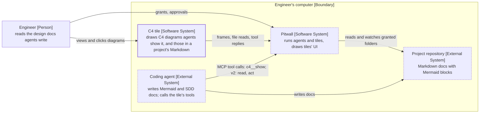
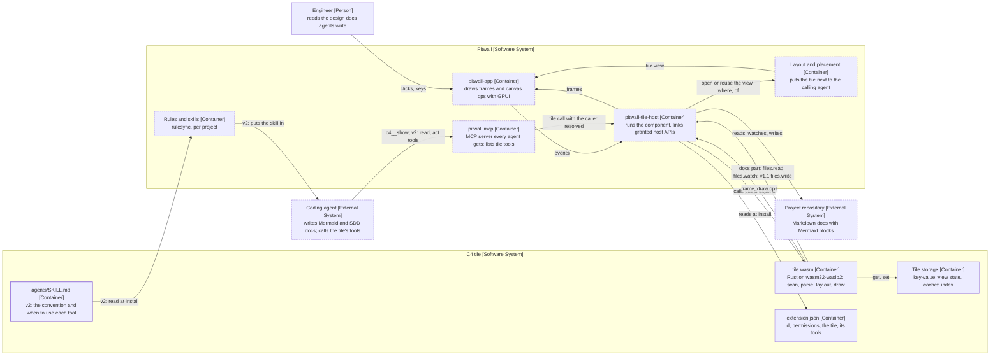
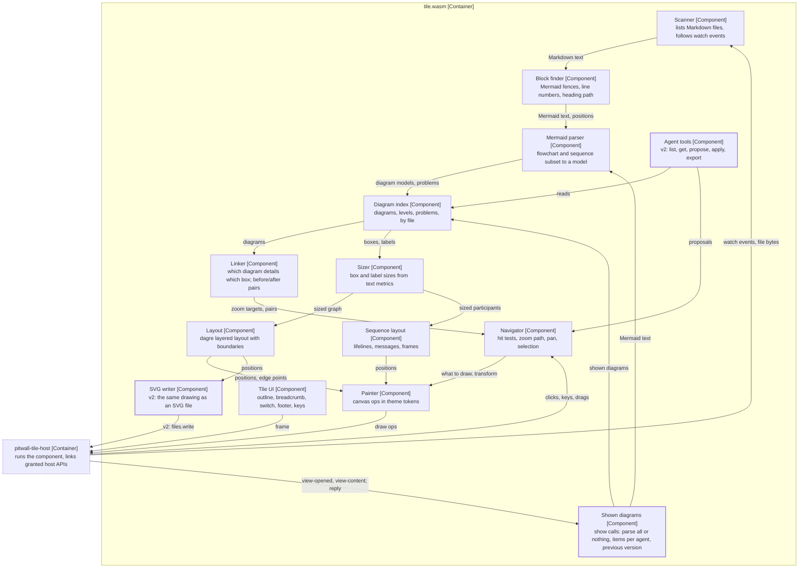
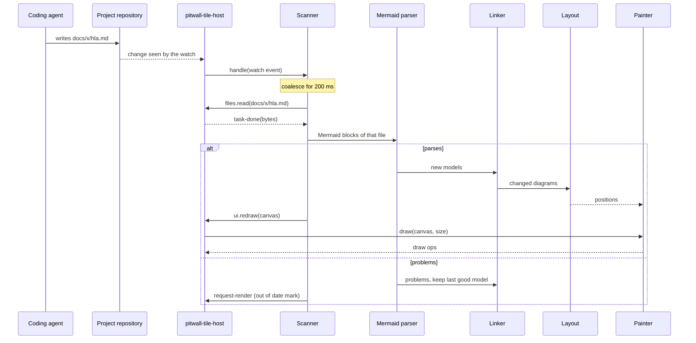
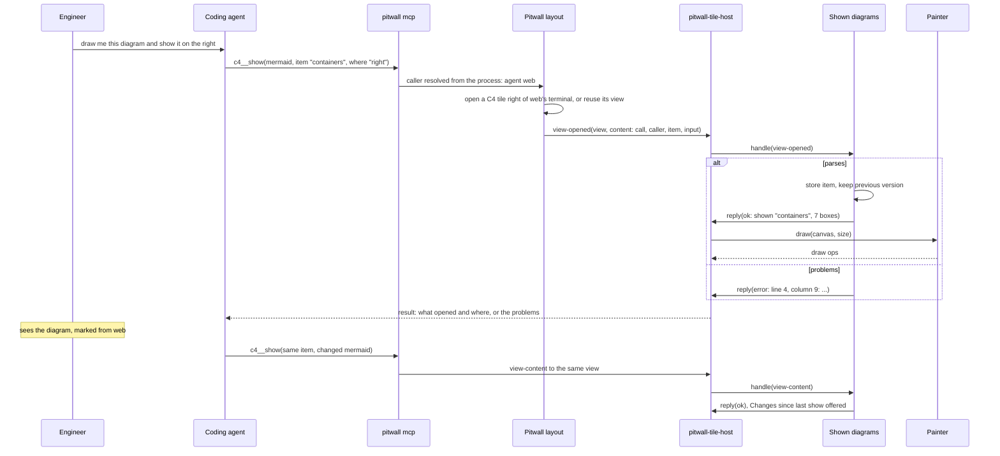
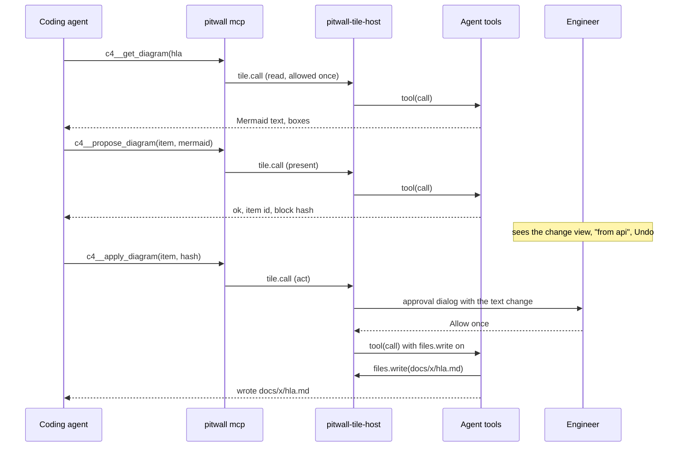

Status: phase A (the core, plain Rust) built in `tiles/c4/`; the tile
itself waits for the Tile SDK. Started 2026-11-27.

# C4 diagram tile: high-level architecture

How the C4 diagram tile ([frd.md](frd.md)) is built on the public Tile
SDK ([Tile SDK design](../tile-sdk/README.md)), where its code lives,
which SDK pieces it needs and when, and what the SDK design doesn't
cover yet. Progress is tracked in [plan.md](plan.md).

Marks: **[SDK]** is a fact from the Tile SDK design (designed, not built).
**[checked]** is something this spec verified on 2026-11-27. *Guess*
and *proposal* are as in [frd.md](frd.md).

The diagrams below follow the convention the tile reads
([frd.md §3](frd.md#3-the-input-format)), so this file is also one of
the tile's test inputs: the context diagram's "C4 tile" box is detailed
by the container diagram, and its "tile.wasm" box by the component
diagram.

## 1. Context



The tile reaches nothing directly. Every file read, every drawing and
every agent call goes through Pitwall, which checks the tile's grants
[SDK, [permissions §5.2](../tile-sdk/permissions.md#52-enforcement)].
The agent reaches the tile only through Pitwall's MCP server, which
Pitwall gives every agent it starts; the tile's tools are registered
there with no setup by the user
[SDK, [agent-tools §11.4](../tile-sdk/agent-tools.md#114-how-agents-reach-them)].

## 2. Containers



| Container | What it is |
|---|---|
| `tile.wasm` | The whole tile: one WebAssembly component built from the crate in `tiles/c4/` ([§6](#6-where-it-lives)). No server, no service [SDK, [services §13](../tile-sdk/services.md#13-tile-apps-with-a-server)]: everything it does fits a tile |
| `extension.json` | The manifest. v1, first part: one tile, its `"input"` (what `c4__open` takes) and one show tool, `show` (kind `present`), in the `tools` block written by `pitwall extension pack` from the code [SDK, [authoring §4.1](../tile-sdk/authoring.md#41-shape)]; no permissions. Docs part: `files.read` and `show` with reasons, settings (path list), and `diagram` in the open input. v1.1 adds `files.write`; v2 adds the `read` and `act` tools |
| `agents/SKILL.md` | v2 only. The convention of [frd.md §3](frd.md#3-the-input-format) and when to call each tool [SDK, [agent-tools §11.11](../tile-sdk/agent-tools.md#1111-a-skill-for-agents)] |
| Tile storage | The tile's own key-value store, 10 MiB [SDK, [platform services §14.2](../tile-sdk/platform-services.md#142-the-v0x-minimum-built-in-phases-12)]. Holds the view state and a cache of the parsed index ([§3.6](#36-state-and-the-index-cache)) |

## 3. Components of tile.wasm



### 3.1 Scanning and following files

- On start, and when the user picks a project, the Scanner lists the
  granted project's files under the path list (FR-2) through the SDK's
  `files` interface (`list`, `stat`, `read`) [SDK,
  [runtime §3.8](../tile-sdk/runtime.md#38-host-apis)].
- It then calls `files.watch` on the project and reacts to change
  events: re-read the changed file, re-run the Block finder and the
  parser for that file only, re-link, redraw. Events are coalesced over
  200 ms (*proposal*), since agents often write a file several times in a
  row.
- While the tile is suspended it gets no events [SDK,
  [runtime §2.3](../tile-sdk/runtime.md#23-lifecycle)]. On
  `visibility(true)` it compares `stat` times with its index and re-reads
  what changed.

### 3.2 Finding blocks

`pulldown-cmark`, a pure-Rust CommonMark parser, finds fenced code
blocks with the `mermaid` info string and the headings above them. It
compiles for `wasm32-wasip2` with default features off [checked: Rust
1.98.1, the repository's toolchain]. Byte offsets are turned into line
numbers so problems point at the Markdown file's lines.

A diagram's id is `<path>#<heading slug>` with `-2`, `-3` for repeats
under one heading. The id survives edits elsewhere in the file.

### 3.3 Parsing

A hand-written lexer and recursive-descent parser for the subset in
[frd.md §6.1](frd.md#61-supported-in-v1). Hand-written, because the
errors must carry line and column and say what was expected, the way
the SDK's diagram example does
([authoring §4.2](../tile-sdk/authoring.md#42-a-diagram-tile-as-an-author-writes-it)).
The grammar is written down in `mermaid-lld.md` (a plan item).

The model, in short:
- **Structure diagram:** direction; boundaries (id, title, Name, Kind,
  parent); boxes (id, Name, Kind, purpose, shape hint, classes,
  boundary); arrows (from, to, label, line style, heads); class names;
  skipped parts with their lines.
- **Sequence diagram:** participants (id, alias, actor or not, box
  group); an ordered list of steps (message, note, activation, frame
  start, frame branch, frame end).
- **Unsupported:** the type word and the text.

The tile never writes Mermaid back from its model. In v2 the agent sends
whole Mermaid text, and the tile swaps a block's text in the file
([§5](#5-v2-agent-tools-for-the-docs)). A shown diagram keeps the
agent's text as sent, and Save to file writes that text. So the model
can drop details freely.

`mermaid-rs-renderer`, a pure-Rust Mermaid renderer, also compiles for
`wasm32-wasip2` [checked]. It was not chosen: it renders to SVG with its
own fonts, while the tile needs a model with C4 meaning (Kinds, classes,
boundaries) for zoom, change views and hit tests.

### 3.4 Levels, zoom links and before/after pairs

Levels follow FR-11. Zoom links and pairs are rebuilt after every parse,
in the Linker. Pseudocode:

```text
name(s)  = lowercase(trim(collapse_spaces(strip_kind(s))))
details  = map Name -> list of (diagram, boundary)
for each structure diagram D, for each boundary B in D:
    details[name(B.title)].push(D)

zoom_target(box X in diagram D):
    candidates = details[name(X.name)] minus D minus D's ancestors on the zoom path
    prefer same file as D, then same folder, then all
    one left  -> that diagram
    several   -> a menu (FR-13)
    none      -> not detailed

pairs: for each heading H with two child sections whose titles match a
before/after word pair (frd.md §3.4), and one structure diagram in each:
    pair(before, after)
```

The Changes view (FR-17) matches boxes by `name(Name)` and arrows by
`(name(from), name(to), label)`.

### 3.5 Layout

**Approach: the `dagre` crate**, a Rust port of dagre.js (Apache-2.0).
Its README says it is a complete port of dagre.js's layered (Sugiyama)
layout, cross-validated against dagre.js, with compound graphs: nodes
inside parent nodes with subgraph boundaries. That is what C4 boundaries
need. Its README also says dagre.js is what Mermaid's flowcharts are laid
out with, so drawings will look familiar.

What was checked on 2026-11-27:
- It compiles for `wasm32-wasip2` with Rust 1.98.1 [checked].
- A compound graph (a boundary with three boxes, a person and an
  external system, labelled edges, `LR`) lays out natively and returns
  positions and the boundary's size [checked].
- Its only runtime dependency is `log`, plus optional `serde`. With the
  default `json` feature off, version 0.1.2 fails to compile, so the tile
  keeps the default features [checked].
- It has not been run under Wasmtime yet: there is no Pitwall tile host
  to run it in. Plan item.
- Phase A compared it with `rust-sugiyama` on the fixtures and chose it
  for v1 ([layout-lld §7](layout-lld.md#7-dagre-against-rust-sugiyama)):
  no arrows through boxes or labels on boxes, at about 15 ms for 50 boxes
  and 170 ms for 300, natively.

Risk: the crate is young (version 0.1.2, about 11 000 downloads on
crates.io on 2026-11-27). The tile wraps it behind a small `Layout`
trait. **Fallback:** `rust-sugiyama` (MIT, petgraph-based, about 81 000
downloads), which also compiles for `wasm32-wasip2` [checked] but has
no compound graphs. With it, the tile would lay out each boundary's
inside first and then lay out boundaries as single big nodes. Both were
compared on the fixtures in phase A
([layout-lld §7](layout-lld.md#7-dagre-against-rust-sugiyama)).

Steps for a structure diagram:
1. **Size** each box from its three lines (Name, Kind, purpose) and each
   arrow label from its text ([§3.7](#37-text-sizes)). Cap a box at
   240 px wide (*proposal*) and wrap the purpose to at most two lines.
2. **Build** a compound graph: a node per box, a parent node per
   boundary (nested), an edge per arrow with a label size. An arrow to a
   boundary goes to a hidden anchor node inside it.
3. **Lay out** with the diagram's direction. Spacing comes from
   Pitwall's spacing scale (*proposal*).
4. **Route** edges along dagre's points, drawn as smooth curves.
5. **Cache** the result per diagram and per text-metrics version.
   Layout runs only after a parse or a metrics change, never on pan or
   zoom.

Sequence diagrams need no graph layout: participants in order of first
appearance, one row per step, frames as nested rectangles. That is the
Sequence layout component.

Layout runs inside the guest's `handle` call that follows the file
event. That call has a 1 s hard limit and a warning past 50 ms [SDK,
[runtime §2.5](../tile-sdk/runtime.md#25-sandbox-and-limits-summary-details-in-5)].
How long dagre takes for 300 boxes in Wasmtime is *unverified*; the
plan measures it, and the size limit (FR-21) moves to match.

### 3.6 State and the index cache

- **Saved state** (`save-state`, ≤ 1 MiB [SDK]): the project, the open
  diagram, the zoom path, pan and zoom per diagram.
- **Index cache** in tile storage: per file, its `stat` time and size
  and the parsed models. Two reasons. Opening is quick on a large
  project. And in v2 a `read` tool call may wake a tile that was dropped,
  while `files.*` is switched off for the length of that call [SDK,
  [agent-tools §11.2](../tile-sdk/agent-tools.md#112-four-kinds)]; the
  cache lets it answer anyway, saying how old the answer is.

### 3.7 Text sizes

Layout needs each label's size before anything is drawn. The canvas
draws text shaped by the host [SDK,
[ui §3.7](../tile-sdk/ui.md#37-canvas)], but the SDK design has no way
for the guest to measure text ([§7](#7-sdk-gaps), gap G2).

**v1 approach, until the SDK can measure:** a table of advance widths and
kerning pairs for Inter, the UI font Pitwall ships
(`crates/pitwall-app/assets/fonts/`, OFL-1.1; the tile keeps its own copy
in `tiles/c4/assets/fonts/` so it builds outside this repository),
generated into the crate at build time in font units, so it serves every
size ([layout-lld §1](layout-lld.md#1-text-widths)). The guest sums
advances and kerning and adds 8 % slack (*proposal*).
Wrong widths only make a box a little too wide, or a label truncated by
the host. When the SDK gains a measuring call, the Sizer switches to it
and the table goes.

### 3.8 Drawing and input

- **Painter.** Turns positions into canvas ops: `rect` for boxes and
  boundaries, `path` for person shapes, cylinders, pipes, curves and
  arrowheads, `text` for labels [SDK, [ui §3.7](../tile-sdk/ui.md#37-canvas)].
  Colours are theme tokens (FR-8). Pan and zoom are a transform the
  Painter applies to coordinates. Only what is inside the tile's
  rectangle is emitted. A 100-box diagram is about 1 500 ops, far under
  the 20 000 limit [SDK] (*estimate*).
- **Navigator.** Keeps the zoom path, pan, zoom and selection; does hit
  tests on canvas clicks; turns keys into moves (FR-26). Clicks on the
  canvas need a position, which the SDK design doesn't deliver yet (gap
  G1).
- **Tile UI.** Ordinary SDK elements around the canvas: a `tree` for the
  outline, a `segmented` control for Before / After / Changes, `chip`s
  for the legend, a `menu` for "detailed in several places", a `code`
  view for fallbacks, `split` between outline and canvas [SDK,
  [ui §3.3](../tile-sdk/ui.md#33-the-ui-description)].

### 3.9 File change to redraw



### 3.10 Shown diagrams

The headline flow (FR-34 to FR-43 in [frd.md §5.1](frd.md#51-shown-diagrams-v1-first)).
It uses the SDK's show-only tools, in SDK phase 2
([agent-tools §11.2](../tile-sdk/agent-tools.md#112-four-kinds)):
- **Declared, not configured.** The tile declares `show` (kind
  `present`) with `#[tools]`; Pitwall lists it as `c4__show` in its MCP
  server for every agent it starts, and adds `where` and `of`. Opening
  without content is the host-provided `c4__open` [SDK].
- **The host places it.** The daemon resolves the calling agent from
  the connecting process, and Pitwall opens the C4 tile next to that
  agent's terminal, or reuses the view that agent opened before, before
  the call reaches the tile [SDK, [§11.8](../tile-sdk/agent-tools.md#118-where-the-tile-opens)].
  The tile never sees `where` or `of`.
- **All or nothing.** The Shown diagrams component parses the Mermaid
  with the same parser as docs diagrams. On problems it replies with
  them and changes nothing. On success it stores the item under
  (project, agent, item id), keeps the previous version for "Changes
  since last show" (FR-40), and asks the Linker to re-link, so zoom
  works across shown diagrams and, once the docs part exists, docs
  diagrams of the same project.
- **No files.** The source is in the call; nothing is read or written.
  So this flow ships before the files service.
- **Storage.** Items go to tile storage (10 MiB [SDK]) per project,
  ≤ 200 000 characters of source each and ≤ 50 per project (FR-41).



## 4. v1: what it needs from the SDK, and when

The tile asks for nothing beyond the SDK's design. It needs these
pieces, in this order. Phase numbers are the SDK's
([README §10.2](../tile-sdk/README.md#102-order-of-work)).

| Need | SDK piece | SDK phase |
|---|---|---|
| Build, run, reload while writing | WIT 0.1, `pitwall extension new/dev/check`, the test harness, install from a folder (preview) | 1 |
| Shown diagrams: `c4__show`, `c4__open`, placement next to the calling agent | show-only agent tools: `present` declared with `#[tools]`, delivered as view content, `reply`, registration in Pitwall's MCP server ([agent-tools §11.2](../tile-sdk/agent-tools.md#112-four-kinds)) | 2 |
| View state | `storage`, `save-state` | 1 |
| Path list setting | `settings` | 1 |
| Coalescing timer | `tasks` | 1 |
| The drawing | `canvas` with `rect`, `path`, `text`, clip | 2 |
| Outline, switch, legend, menus, fallback source | `tree`, `segmented`, `chip`, `menu`, `code`, `split`, drag inside a tile (pan) | 2 |
| Open source at a line | `viewer.open` through `pitwall`, with the `show` permission | 2 (the minimum, [§14.2](../tile-sdk/platform-services.md#142-the-v0x-minimum-built-in-phases-12)) |
| Docs part: read docs | `files.read`: `pick-project`, `list`, `stat`, `read` | on demand ([§14.3](../tile-sdk/platform-services.md#143-later-on-demand)) |
| Docs part: follow changes | `files.watch` | on demand; today planned with the files tree port ([native blocks §16.3](../tile-sdk/native-blocks.md#163-which-built-in-tiles-move-to-the-sdk)) |
| The gaps in [§7](#7-sdk-gaps) marked v1 | new | phase 2, or with `files` |
| Save to file (v1.1) | `files.write` | on demand |

So **v1's first part, shown diagrams, can ship as soon as SDK phase 2
is done**: the source comes in the agent's call, so it needs no file
access at all and no service beyond the minimum. The docs part follows
when `files.read` with `watch` exists, and Save to file (v1.1) with
`files.write`. The parser, Linker, Layout and Painter are plain Rust and
can be written and tested natively before then (plan phase A).

**This tile is a trigger for `files.read`** (for its docs part). Platform services
[§14.3](../tile-sdk/platform-services.md#143-later-on-demand) adds a
service when a seed tile can't do without it. The C4 tile can't: reading
the project's Markdown is its whole job. It also needs `files.watch`
earlier than the files tree port that §16.3 ties watching to. (Updating
§14.3's trigger text is left to the SDK's plan; see [plan.md](plan.md).)

## 5. v2: agent tools for the docs

Built when SDK phase 3 lands (`read` and `act` tools, approvals, Undo,
skill, commands). The show-only tool moved to v1 ([§3.10](#310-shown-diagrams)),
and the host-provided `c4__open` replaces the `c4__open` this table
used to list. Tool kinds
and their rules are the SDK's
([agent-tools §11.2](../tile-sdk/agent-tools.md#112-four-kinds),
[§11.5](../tile-sdk/agent-tools.md#115-permissions)).

| Tool (MCP name) | Kind | Does |
|---|---|---|
| `c4__list_diagrams` | `read` | Diagrams of the caller's project from the index: id, file, line, title, level or type, boundaries, zoom links, problems. Takes a path filter and a cursor |
| `c4__get_diagram` | `read` | One diagram: Mermaid text, boxes, arrows, problems |
| `c4__propose_diagram` | `present` | Mermaid text for an existing diagram id, or for a new block (file and heading). Parsed all or nothing; on success the tile shows it as a change view over the current one, marked and undoable [SDK, [§11.6](../tile-sdk/agent-tools.md#116-presented-content-ids-marks-undo)]. Returns the item id and the block's hash |
| `c4__apply_diagram` | `act` | Writes a proposal into its Markdown file. Refused if the block's hash no longer matches. The approval dialog shows the file and the text change [SDK] |
| `c4__export_svg` | `act` | Writes a diagram as SVG into the caller's project; also a palette and CLI command [SDK, [§11.12](../tile-sdk/agent-tools.md#1112-commands-for-the-shell-and-the-palette)] |

Rules that shape the design:
- `read` and `present` calls run with `files.*` off [SDK]. So they
  answer from the index (and its cache, [§3.6](#36-state-and-the-index-cache)),
  and `propose_diagram` diffs against the block text the index already
  holds.
- Agents can already edit the Markdown themselves. The tools add a
  checked, reviewed path (parse errors before anything is written, a
  change view, an approval with the exact text), not a new capability.
  The tile follows the file either way.
- The Apply button in the tile writes with the tile's own
  `files.write` grant, as a user action; no approval dialog.



**SVG export.** The SVG writer walks the same laid-out drawing the
Painter draws. Colours are the current theme's values, written as fixed
colours. Fonts are named (Inter, then a generic sans-serif) and not
embedded (*proposal*). Text widths come from the same Sizer, so the file
matches the tile.

## 6. Where it lives

- **`tiles/c4/` in the Pitwall repository, outside `crates/`.** The SDK
  design already allows "`tiles/` in this repo, outside the crates"
  for seed tiles
  ([README §10.1](../tile-sdk/README.md#101-seed-tiles-first-party-public-sdk-only)).
- **Its own Cargo workspace**, not a member of the root workspace. The
  root `Cargo.toml` lists its members one by one under `crates/`, so the
  tile stays out of the app's build, and the app's `cargo test
  --workspace` doesn't build wasm.
- **One Pitwall dependency: `pitwall-extension`**, the public guest crate
  [SDK, [runtime §2.2](../tile-sdk/runtime.md#22-crates-new)]. While both
  live in this repository it is a path dependency on
  `sdk/pitwall-extension`; once that crate is published, a version from
  crates.io. Tests may also use the published harness,
  `pitwall-extension-test`, as a dev-dependency only, since it never
  ships in `tile.wasm`. **Approved by the owner on 2026-11-27** as the
  one exception to "only `pitwall-extension`".
- **CI enforces it.** The `tile-c4` job in `.github/workflows/ci.yml`
  runs the tile's tests and clippy, builds it for `wasm32-wasip2`, and
  runs `tiles/c4/scripts/check-deps.sh`: `cargo metadata` on
  `tiles/c4/Cargo.toml` fails the job if any package whose name starts
  with `pitwall` is in the resolved graph other than `pitwall-extension`
  (and `pitwall-extension-test` as a dev-dependency only), or if any path
  dependency points outside `tiles/c4/` and `sdk/`. So the tile's own
  crate is named `c4-tile`, not `pitwall-…`. `pitwall extension check`
  joins the job once that command exists (SDK phase 1). The repository's
  `rust-toolchain.toml` doesn't list `wasm32-wasip2` among its targets,
  so the job adds it.
- **Why so strict.** The point of a seed tile is that it uses nothing an
  outside author can't. A shortcut into `pitwall-core` would hide a gap
  in the SDK instead of finding it.
- **It moves to its own repository when the marketplace opens** (SDK
  phase 5, [marketplace §7](../tile-sdk/marketplace.md#7-marketplace)).
  Then it is released and listed like anyone's tile: its history is
  split out of this repository, the path dependency becomes a crates.io
  version, its releases carry the `.pwtile`, and `pitwall extension
  publish` lists it. Until then it travels as a preview folder (SDK
  phase 1, [packaging §6.3](../tile-sdk/packaging.md#63-install)) and as
  a `.pwtile` from SDK phase 4.

How it fits Pitwall's architecture
([architecture.md](../architecture.md)): it adds no crate, no provider
and no daemon method. It is an extension that contributes one tile, and
its tools (a show tool in v1, more in v2) and, in v2, a skill. The repository rule "no extension names in
crates" [SDK, [runtime §2.2](../tile-sdk/runtime.md#22-crates-new)]
holds: nothing in `crates/` knows the tile exists.

## 7. SDK gaps

Requirements the C4 tile has that the Tile SDK design doesn't cover
yet. Each goes to the SDK's design as the platform rule asks: a seed
tile that can't ship is the signal
([platform services §14.1](../tile-sdk/platform-services.md#141-the-rule-the-minimum-then-on-demand)).

| # | Gap | Needed for | Without it | Suggested fix |
|---|---|---|---|---|
| G1 | **Canvas pointer position.** The `click` event carries handler, button, modifiers and count, no position ([ui §3.4](../tile-sdk/ui.md#34-events)). Elements have no absolute position style, so the tile can't lay clickable boxes over the canvas either | v1: click to zoom, select | No zoom by click; outline and keys only | Canvas events with canvas-local coordinates: click, double-click, hover (coalesced), and a context menu with a position |
| G2 | **Text measurement.** Canvas `text` is shaped by the host, but the guest can't ask how wide a string is ([ui §3.7](../tile-sdk/ui.md#37-canvas)) | v1: box sizes before layout; v2: SVG | The Inter width table of [§3.7](#37-text-sizes), which drifts if Pitwall's fonts or scale change | `ui.measure-text(list of (text, size, weight, font)) -> list of sizes`, answered on the worker. Whether GPUI's text system can measure off the main thread is *unverified* |
| G3 | **Text size in a canvas is a token** (`xs`…`xl`), so text can't shrink or grow with zoom | v1: zoom | Zoomed-out text stays at `xs` and overflows its box; the Painter hides labels below a zoom level | A `px` size for canvas text, or a scale transform op |
| G4 | **Stroke width and dashes.** `path` has fill or stroke, nothing about width or dash pattern | v1: dashed boundaries, external boxes, dotted `-.->` arrows | The Painter cuts dashes into many short paths; more ops, still under the limit | `stroke(width, dash list)` on `path` and `rect` |
| G5 | **Wheel and pinch on a canvas.** Not in the event list | v1: zoom with the pointer | Keys (⌘+ / ⌘− / ⌘0) and buttons | Wheel and pinch events with position, coalesced like scroll |
| G6 | **Listing a tree of files.** `files.list` is named, but not whether it recurses, filters by glob or stops at a limit | v1: find `docs/**/*.md` | The guest walks folders one `list` at a time; slow on large repositories (*unverified*) | Recursive `list` with globs, excludes and an entry limit, or `files.search` as planned for the files tree port ([native blocks §16.3](../tile-sdk/native-blocks.md#163-which-built-in-tiles-move-to-the-sdk)) |
| G7 | **`files.watch` details.** Named in [runtime §3.8](../tile-sdk/runtime.md#38-host-apis) and tied to the files tree port; its events, coalescing, renames and behaviour while suspended are not designed | v1: follow changes | Poll `stat` on a timer while shown (2 s, *proposal*) | Design `watch` when `files.read` is built, with the C4 tile as its first user |
| G8 | **Canvas accessibility.** A canvas node has one `label`; its contents have no accessible structure | v1: screen readers | Outline and footer carry everything (NFR-6) | Later: accessible regions inside a canvas |
| G9 | **A woken tile's own file reads.** A `read` tool call can instantiate a dropped tile, with `files.*` off during the call. Whether the tile may then read files on its own after replying, while not shown, is not said | v2 | Answer from the cached index with its age | Say so in [agent-tools §11.2](../tile-sdk/agent-tools.md#112-four-kinds) |

G1, G2 (or its workaround), G3 and G6 (or its workaround) decide whether
v1 is usable. G1 has no workaround that keeps click to zoom.

**Answered in Tile SDK phase 2 (canvas):** G1 (hit regions with click
and hover handlers over the drawing, and pointer events with canvas
positions), G3 (text sizes in pixels), G4 (stroke width and dash lists
on rects and paths), G5 (wheel and pinch as pointer kinds), G8 in part
(each region has a label, its accessible name). G2 keeps the Inter
width table of [§3.7](#37-text-sizes): no measuring call, because canvas
text is drawn only in Inter and JetBrains Mono at any pixel size, and
GPUI's text system isn't reachable from the tile's worker; labels take a
`max-width` so a short measure cuts with an ellipsis instead of
overflowing.

## 8. Security and limits

- **Input is untrusted.** Markdown in a repository may come from
  anyone, and a shown diagram's source comes from an agent that may have
  read anything.
  The parser has limits: 1 MiB per file, 300 boxes and 600 arrows per
  diagram, nesting depth 16 (*proposal*). Past them the diagram gets the
  fallback, never a long stall. The SDK's own limits apply on top: time
  per call, memory, ops per draw [SDK].
- **Labels are text.** No HTML, links, images or scripts from labels are
  rendered; the canvas can only draw text [SDK].
- **Grants.** Shown diagrams: none. Docs part: `files.read` on
  projects the user picks, and `show`. v1.1 and v2: `files.write` on
  those projects, off until the user turns it on
  [SDK, [permissions §5.1](../tile-sdk/permissions.md#51-new-permissions-new)];
  agents' writes and exports ask every time.
- **Skill text** (v2) only describes this tile's tools and the
  convention, as Verified review requires [SDK, agent-tools §11.11].
