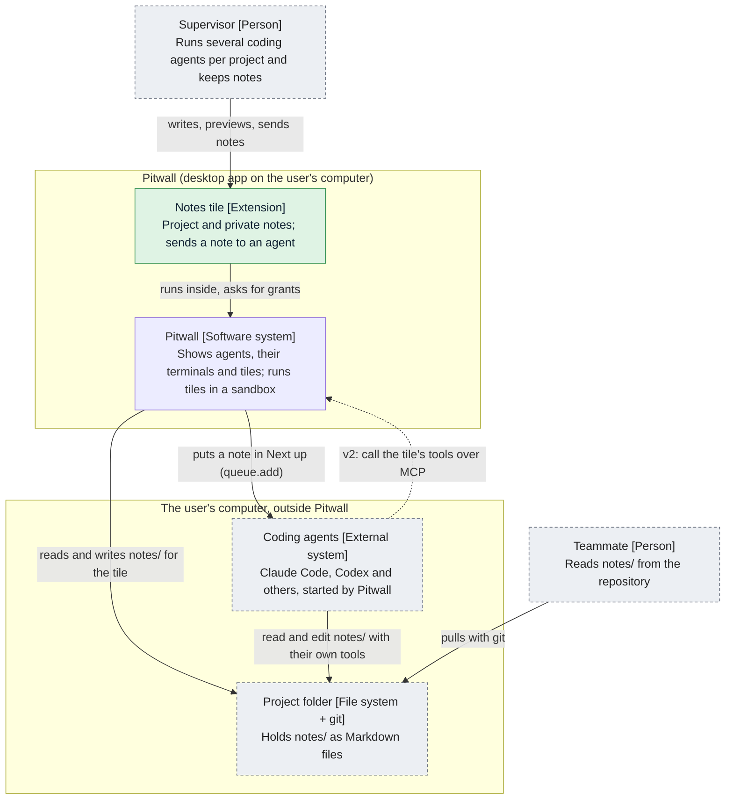
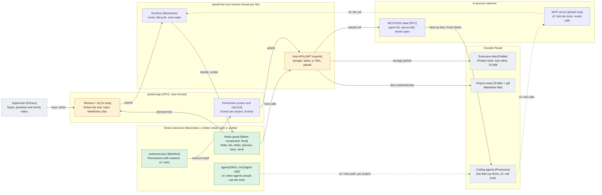

Status: design, not built. Requirements in [frd.md](frd.md), progress in
[plan.md](plan.md).

# Notes tile: high-level architecture

The Notes tile is an extension with one tile, written in Rust against the
public SDK crate `pitwall-extension`, compiled to one `tile.wasm`
(`wasm32-wasip2`) and run by Pitwall like anyone's tile
([runtime.md](../tile-sdk/runtime.md)). It adds nothing to Pitwall's own
crates. Where it needs something the SDK doesn't give, that is an SDK
change ([frd.md §7](frd.md#7-sdk-gaps)), not a private hook.

Marks: **[SDK]** is designed in `docs/spec/tile-sdk/`; **[today]** is
built; *guess* is not checked.

## 1. Where it lives

- **Source:** `tiles/notes/` in the Pitwall repository, outside
  `crates/`. It is its own Cargo project, not a member of the app's
  workspace (the root `Cargo.toml` lists only `crates/*` [today]), and it
  builds for `wasm32-wasip2` only.
- **Dependencies:** `pitwall-extension` is the only Pitwall crate it uses.
  `pitwall-extension-test`, also published, is its one dev-dependency
  from Pitwall, for the headless tests ([9.3](../tile-sdk/authoring.md#93-test-harness)).
  Ordinary crates from crates.io are fine, as for any author.
- **Enforced by CI:** a check fails the build if `tiles/notes/Cargo.toml`
  (or its lock file) names any other `pitwall-*` crate or a path into
  `crates/` [new: CI has no such check today]. Until `pitwall-extension`
  is on crates.io, it is a path dependency on `sdk/pitwall-extension`,
  which is the published crate's source [SDK, [2.2](../tile-sdk/runtime.md#22-crates-new)].
- **Why in this repository first:** the SDK changes in 0.x, with breaking
  changes allowed ([14.1](../tile-sdk/platform-services.md#141-the-rule-the-minimum-then-on-demand)).
  Keeping the tile next to the SDK lets one pull request change the WIT,
  the SDK and the tile together, and lets the docs build pull examples
  from its source ([9.6](../tile-sdk/authoring.md#96-website-docs)).
- **Why only the public crate:** the seed tiles exist to prove the SDK is
  enough. A tile that reached into `pitwall-core` would hide exactly the
  gaps it is meant to find ([10.1](../tile-sdk/README.md#101-seed-tiles-first-party-public-sdk-only)).
- **Moving out:** when the marketplace opens (phase 5), the tile moves to
  its own repository, with its history, and is released, signed and listed
  in the index like any author's ([7](../tile-sdk/marketplace.md#7-marketplace)).
  From then on it pins a published `pitwall-extension` version. The docs
  build then pulls its examples from a pinned tag of that repository
  (*guess*: the include step of [9.6](../tile-sdk/authoring.md#96-website-docs) would need to fetch it).

## 2. C4: system context

Legend for both diagrams: **new** is built by this spec; **changed** is a
part of Pitwall or the SDK that this spec asks to change
([frd.md §7](frd.md#7-sdk-gaps)); **external** is outside Pitwall. Boxes
without a class are Pitwall as the SDK designs it, unchanged here.



The tile never talks to agents or files directly. Every effect goes
through Pitwall, which checks the grant, logs it in the extension's
Activity, and keeps the tile's text in the agent's Next up until the user
presses Send [today's `agents.queue` rules].

## 3. C4: containers



`TileView + kit` is marked changed for the `input` element (G1, G1b,
G2) and the Markdown event (G6, not v1). `Host APIs` is marked changed for
`files` (G3, G4, G4b, G7) and the view's project (G5, G5b). Nothing else
in Pitwall changes for this tile.

## 4. Inside the guest

One instance serves every Notes tile the user opens ([2.3](../tile-sdk/runtime.md#23-lifecycle)):
each view renders on its own (`render(view-id)`), and all share the
state below.

| Part | Holds or does |
|---|---|
| `Library` | The notes known for each project: id, title, where (project file or private key), the version last read (size and modified time from `stat`, or a counter for private notes) |
| `Editor` | The open note per view: text, unsaved flag, mode (edit or preview), the selection when G2 exists |
| `Saver` | Debounced save (a `tasks` timer, about 1 s), save on blur and on `visibility(false)`, the conflict check before each write |
| `Sender` | Agent picker from `agent.list`, the 4 000-character check, `queue.add`, the outcome as a toast |
| `Store` | Private notes in `storage` under `p/<project-key>/<note-id>` (`p/_/…` until G5); an index entry per project |
| `Tools` (v2) | The `#[tools]` impl and `Presented<Draft>` for agents' drafts ([11.6](../tile-sdk/agent-tools.md#116-presented-content-ids-marks-undo)) |

### 4.1 Saving a project note (pseudocode)

```text
on save(note):
  if note.where is private:
      storage.set(key(note), note.text); note.version += 1; return
  disk = files.stat(project, path(note))
  if disk is missing and note was read before:   # deleted outside
      ask "Deleted on disk": Save again | Discard
  elif disk.version != note.read_version:         # changed outside
      if not note.unsaved: reload(note)
      else: ask "Changed on disk": Reload | Keep mine | Save as a copy
  else:
      files.write(project, path(note), note.text)
      note.read_version = files.stat(project, path(note)).version
```

The check and the write are two calls, so a change in between is lost to
the write (*guess*: rare, since agents write whole files in a moment).
A `files.write` that takes the expected version and refuses on a
mismatch would close it; it is a smaller ask than watching (G3).

### 4.2 Sending to an agent

1. The user presses Send to agent (or a section's Send in Preview).
2. `Sender` calls `agent.list` through `pitwall` (`agents.read`) and
   shows the agents of the note's project first (G5b).
3. Over 4 000 characters, the tile says so and doesn't call.
4. `queue.add(agentId, text)`; the task's outcome comes back as
   `task-done` and is shown as a toast ("Queued for api", or Pitwall's
   refusal in its words).

No new host code: `queue.add` and `agent.list` are today's methods,
reached through the `pitwall` interface ([3.8](../tile-sdk/runtime.md#38-host-apis)).

## 5. SDK pieces each step needs

| Step | Phase it waits for | SDK pieces used |
|---|---|---|
| Step 0: preview, private plain-text notes | 1 | `box`, `text`, `button`, `icon`, `scroll`, `input` (multi-line, G1, G1b), events, `ui` (render, toast), `log`, `storage`, `tasks`, `save-state`; folder install ([6.3](../tile-sdk/packaging.md#63-install)) |
| v1: project notes, preview, send | 2 and the on-demand `files` service | step 0, plus `markdown`, `segmented`, `menu` or `select` (agent picker), `virtual-list` (long lists), `status`; `files.read/write` with `pick-project`, `list`, `stat`, `read`, `write` (and G4b); `pitwall` with `agents.read` (`agent.list`) and `agents.queue` (`queue.add`); `show` (`viewer.open`); toasts |
| v2: agent tools | 3 | `agent-tools` WIT, `#[tools]`, `Presented<T>`, `undo-present`, the agent skill, commands and palette entries ([11](../tile-sdk/agent-tools.md#11-tools-for-agents)) |
| Own repository, Browse | 4 and 5 | `.pwtile`, signing, the index ([6](../tile-sdk/packaging.md), [7](../tile-sdk/marketplace.md#7-marketplace)) |

## 6. v2: tools for agents

Fewer tools than one might expect, because project notes are plain files
agents already edit:

| Tool | Kind | Does |
|---|---|---|
| `open` | `show` | Opens the tile beside the agent, optionally at a note |
| `draft_note` | `present` | Puts a draft note in the tile, marked "from <agent>", with Undo; `mode: append` adds to the agent's own draft. The user keeps it as a project or a private note, or drops it |
| `read_note` | `read` | Returns a note as it is now, with unsaved edits, private notes included; allowed once per tile |
| `list_notes` | `read` | Titles and places of the project's notes, project and private |

- **No `act` tool.** Writing project notes is a file effect, and agents
  already write files in their project. A tile tool for it would ask the
  user every time and add nothing ([11.2](../tile-sdk/agent-tools.md#112-four-kinds)).
- **Agents can't change the user's notes through the tile.** `present`
  only touches the agent's own draft items ([11.6](../tile-sdk/agent-tools.md#116-presented-content-ids-marks-undo)).
- **The skill** says when to use `draft_note` (the user asks for a note)
  and that project notes are files in `notes/`. It names only Notes'
  own tools ([11.13](../tile-sdk/agent-tools.md#1113-decisions), item 7).
- **Commands:** `new_note` exposed to the palette ("Notes: New note")
  and the CLI ([11.12](../tile-sdk/agent-tools.md#1112-commands-for-the-shell-and-the-palette)).

## 7. Security

- Private notes stay in the extension's data folder; no other extension
  can read them ([14.2](../tile-sdk/platform-services.md#142-the-v0x-minimum-built-in-phases-12)).
- The tile asks for no `net`: notes never leave the computer through it.
- `files.write` is the sharp edge: today it covers the whole project.
  The tile writes only under the notes folder and refuses paths with
  `..` or a separator in a file name, but only G4 makes the host enforce
  that.
- Text queued to agents is marked and waits for Send by default, so a
  bad note can't run an agent by itself [today].
- v2: `draft_note` content is marked and undoable; `read_note` is off
  until the user allows it.
