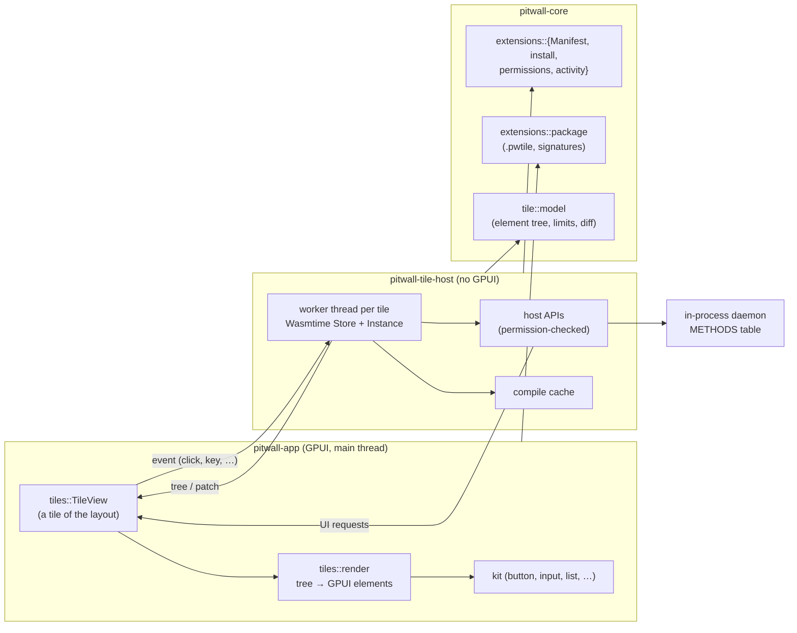
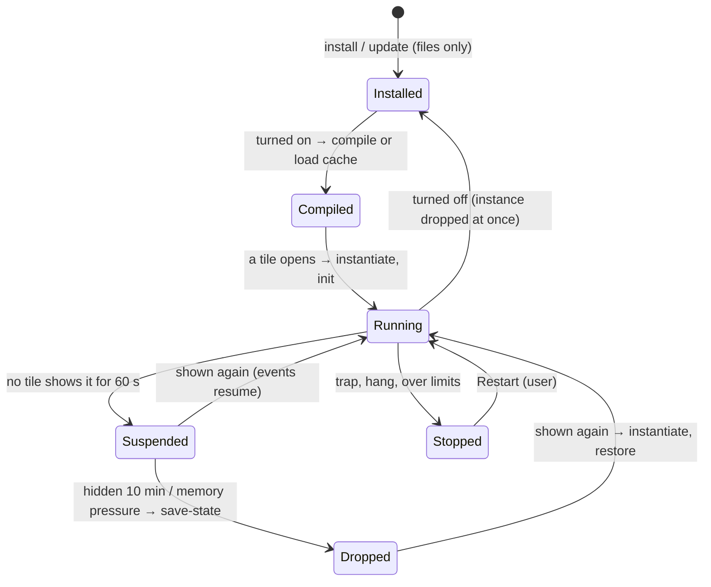
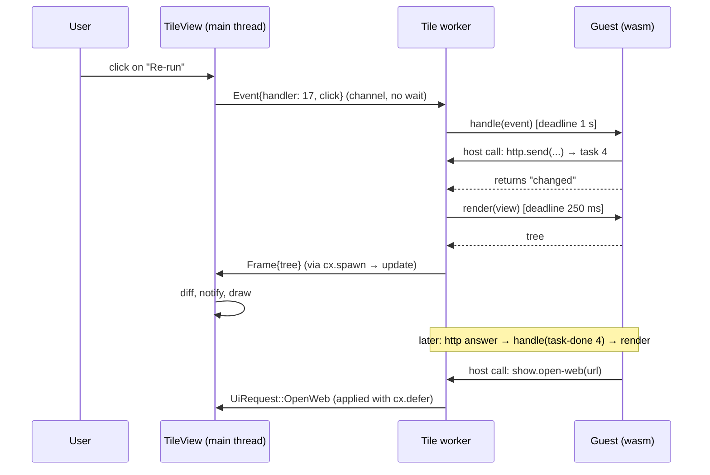
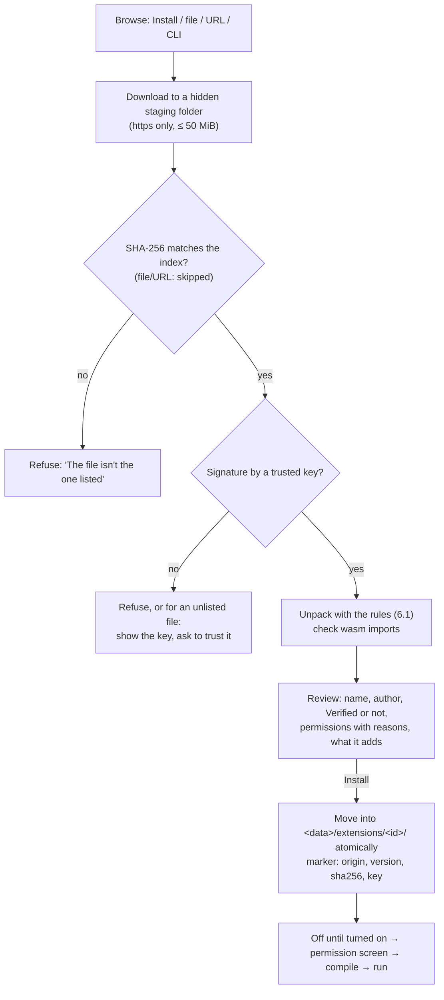

Status: design, not built. Supersedes the "proposed" parts of
[extension-api.md](extension-api.md) on signed packages, a curated list
and dev reload (see "What this replaces" at the end).

# Tile SDK and marketplace

Third-party tiles for Pitwall, written in Rust, compiled to a
WebAssembly component, run in a sandbox inside Pitwall, and drawn by
Pitwall's own GPUI code. Plus a way to find and install them: one
package file, a signed index on GitHub, and a Browse page in Settings.

This document builds on the extension system that exists today
([extensions.md](extensions.md), [extension-api.md](extension-api.md),
[docs/extensions/](../extensions/README.md)). A tile is one more thing
an extension can contribute. It reuses the manifest, the permission
screen, grants, the activity log, sources, install, Go back and the
one-step update.

Marks: **[today]** is built; **[new]** is proposed here.
Claims about third-party software carry a source number (S1…, listed
in "Sources" at the end) or the word *unverified*.

## Summary (one page)

**What.** An author writes a tile in Rust against a crate,
`pitwall-tile`, whose UI code reads like GPUI
(`div().flex().gap_2().child(…)`). It compiles to one `tile.wasm`
(target `wasm32-wasip2`, a WebAssembly component). Pitwall runs it with
Wasmtime, with no ambient authority: no files, no network, no
programs, nothing but what the user granted. The tile returns a
description of its UI (an element tree of boxes, text and Pitwall's own
components). Pitwall draws that tree with GPUI, so the tile has
Pitwall's fonts, theme, Flat and Glass looks, focus ring, keyboard
model and IME. The tile's code never touches a window.

**Key decisions.**
1. **WebAssembly component, in process, one worker thread per tile.**
   Not a native library (crashes and full rights), not a separate
   window (can't look native), not a scripting language. The host crate
   is shaped so the runtime can move into a helper process later
   without changing the WIT.
2. **The guest describes, the host draws.** A retained element tree
   with stable keys, sent whole after each state change; the host
   diffs it against the last one to keep GPUI state (scroll, focus,
   caret, hover). Patches from the guest come later only if
   measurements ask for them.
3. **Colours and type come from Pitwall.** Styles name theme tokens
   (`text-2`, `surface`, `bad`), not colours, except inside a canvas.
   A tile follows Dark, Light, Flat, Glass and Reduce motion by itself.
4. **Rich components are Pitwall's.** Text input (with IME), lists,
   virtual lists, tables, trees, tabs, a read-only code view,
   Markdown, menus, tooltips, splits: drawn by the host's kit, driven
   by the tile. A canvas covers charts and custom drawing.
5. **No re-entrancy.** GPUI handlers never call the guest. They post an
   event to the tile's worker; the worker calls the guest and posts the
   new tree back; the app applies it on the main thread. Anything the
   guest asks of the UI (open a web tile, focus an agent) is applied
   with `cx.defer`.
6. **Host APIs start at a minimum** (section 14): key-value storage,
   SQLite run by Pitwall, HTTPS to granted hosts, settings and secrets,
   notifications, opening a file, the editor or a web tile, timers. The
   rest (files, git, agents' status, Next up, clipboard, …) is designed
   here but built only when a seed tile needs it. Each is a named
   permission with the author's reason; Pitwall data comes through the
   existing method table.
7. **One file to install.** A `.pwtile` (zip): `extension.json`,
   `tile.wasm`, `assets/`, `README.md`, `screenshots/`, `LICENSE`. The
   index names its URL (usually a GitHub release asset), its SHA-256
   and the author's Ed25519 key; Pitwall checks both, shows the
   permission screen, unpacks into `<data>/extensions/<id>/`, compiles
   the wasm to native code once and caches it.
8. **Marketplace v1 is a GitHub repository.** A pull request lists a
   tile. CI checks the package. A maintainer's review earns
   "Verified". Pitwall reads a signed `index.json` from it; no server
   of ours. Takedown is a signed block list Pitwall checks daily.
9. **Updates show what changes** (new permissions first) and keep the
   previous version for Go back, through today's `safe_update`.
10. **Seed tiles on the public SDK only**: git client, database
    browser, API client, CI and pull requests, notes, diagrams.
11. **Tiles offer tools to agents** (section 11), through Pitwall's
    existing MCP server and CLI. Four kinds: `show` (open it),
    `present` (put content in it: a diagram, a table, a draft),
    `read` (get back what it shows, with the user's edits), `act`
    (effects outside the tile). `show` and `present` are allowed by
    default, `read` once per tile, `act` asks every time in the approval
    dialog. Built-in tiles follow the same model; the web tile stays
    show-only on purpose. A package may also bring an agent skill (a
    Markdown file, through the existing rules path, per project) and
    expose tools as commands (`pitwall tile run`, the palette); never
    native scripts.
12. **A tile app can have a server** (section 13). First, a tile plus
    the managed `service` that exists today (any language, runs as the
    user, disclosed as "runs a program on your computer"), with a
    loopback grant to it generated for the tile. Later, once tiles are
    stable, a headless `service.wasm` written with the same SDK: Pitwall
    runs an HTTP server and calls the component per request
    (`wasi:http/incoming-handler`), in a small host process of its own
    that keeps running when the window closes.
13. **Platform services: the minimum, then on demand** (section 14).
    A service is added only when a first-party seed tile, built solely
    on the public SDK, can't reasonably do without it. The WIT stays 0.x
    (breaking changes with notice) until the seed tiles ship, and 1.0
    freezes only then. Never terminal contents, credentials or other
    tiles' data; no hosted database, sync or accounts. The minimum
    includes what today's extensions already have for agents' questions
    (badges and row notes, questions in the floating control, Next up),
    so inbox-style tiles are a v0.x target.

**Phases** (rough size for one engineer): 0 spike (2 wk) → 1 runtime,
WIT 0.1, core elements, dev mode (5 wk) → 2 components and the
minimum platform services, with badges, floating-control questions and
Next up (6.5 wk) → 3 agent tools, skill and commands (4 wk) → 4
package, signing, install, update (3 wk) → 5 index and Browse (4 wk) →
6 seed tiles (in parallel from phase 2), with on-demand services as
they trigger them → 7 WIT 1.0 once the seed tiles ship. Tile plus
managed service: documented and wired during phase 2 (1 wk). Headless wasm services: after phase 7 (≈ 6 wk).

**Owner decisions needed** are in 10.3, 11.13 and 13.6, each with a
recommendation.

---

## 1. Goals, non-goals, user stories

### Goals
- A tile by someone else looks and behaves like Pitwall's own: same
  fonts, colours, density, glass, focus ring, keys (⌘⏎ maximise, Esc,
  ↑↓), same tile chrome (move, window of its own, close, restore).
- A crash, a hang or a hostile tile can't take Pitwall down, read what
  it wasn't given, or keep running after the user stops it.
- Installing is one click from Browse, one file, or one command, and
  never runs code before the user turns it on.
- Updates come from the author without a Pitwall release, and always
  show what they change. Go back is one click.
- Authors write ordinary Rust with a small, typed API, see changes on
  save, and test tiles headless in CI.
- Old tiles keep working across Pitwall releases for a stated time.

### Non-goals
- Native dynamic libraries loaded into Pitwall.
- Compatibility with VS Code extensions, or running their JavaScript.
- Arbitrary HTML or a script bridge (the web tile [today] stays the
  escape hatch, with no bridge).
- Changing how agents behave: no rules, skills, system prompts, hooks
  or modes from tiles ([extension-api.md](extension-api.md), "Fixed
  constraints" [today]).
- Default keybindings outside the tile, status items in the chrome,
  reading terminal output or screens.
- A hosted store, payments, ratings or install counts (later, out of
  scope).
- A tile that is itself a server. A tile's package can bring one
  instead: a managed `service` [today] or, later, a headless wasm
  service (section 13).

### User stories
**User installs.**
1. In Settings → Extensions → Browse I type "postgres", see "Database
   browser" with a Verified badge, its screenshots, "Reads and writes
   files in projects you choose; connects to hosts you add", and
   Install. The permission screen lists each permission with the
   author's reason. I press Turn on, then "Open Database browser" in
   the palette, and a tile appears beside my agents.
2. A colleague sends me `ci-status-1.2.0.pwtile`. I drop it on
   Settings → Extensions (or run `pitwall extension install
   ci-status-1.2.0.pwtile`). It says "Not listed: signed by key
   `RWQ…k3`, which you haven't seen before" and the same permission
   screen.
3. An update adds `agents.queue`. The card says "Update to 1.3.0 —
   asks for a new permission: Send text to agents". I update; the new
   permission stays off until I press Allow. The tile misbehaves, so I
   press Go back to 1.2.0.
4. A tile hangs. Its tile says "CI status stopped: it didn't answer for
   1 s" with Restart and Turn off. The rest of Pitwall never paused.
5. I ask my agent "draw the request flow of the auth service". A
   Diagrams tile opens right of its terminal with a flowchart marked
   "from api". I drag two boxes and rename one. I say "add the cache
   between them"; the agent reads my edited diagram, sends an update to
   the same diagram, and I can Undo its change. When it asks to export
   the diagram as SVG into the repository, Pitwall asks me first.

**Author builds.**
6. `pitwall tile new ci-status` writes a Cargo project. `pitwall tile
   dev` builds it on every save and reloads it in my running Pitwall,
   keeping its state. `cargo test` runs it headless against a fake
   Pitwall. `pitwall tile pack` makes the `.pwtile`, `pitwall tile
   sign` signs it, I attach both to a GitHub release, and `pitwall tile
   publish` opens a pull request on the index.

**Maintainer reviews.**
7. The index's CI downloads the package, checks hash, signature,
   manifest, imports and size, rebuilds the wasm from the tagged source
   and compares hashes. For Verified, a maintainer reads the source at
   that commit, checks each permission's reason, merges, and the
   signed index is regenerated. A malware report leads to a block
   entry; within a day every Pitwall turns that tile off and says why.

---

## 2. Architecture

### 2.1 Where it fits



### 2.2 Crates [new]

The repo's rules hold: OS-specific code only in `platform/` folders,
no `cfg(target_os)` in `pitwall-core` outside `src/platform/`, no
extension names in crates.

| Crate | Owns | Depends on |
|---|---|---|
| `pitwall-core` (`extensions::package`, `tile::model`) | The `.pwtile` reader (zip, limits, no symlinks), signature and hash checks, the index schema, the element-tree model (types, limits, cleaning, keyed diff). Pure, testable, no Wasmtime. | `zip` (reading only), `ed25519-dalek`, `sha2` (exact crates *to decide in phase 0*) |
| `pitwall-tile-host` (new) | Wasmtime engine, `bindgen!` of the WIT, one `Store` per tile on its own thread, limits, epoch ticker, compile cache, host-API implementations behind a `TileHost` trait (the app supplies the parts that need the UI or the daemon). No GPUI. | `wasmtime`, `wasmtime-wasi`, `pitwall-core` |
| `pitwall-app` (`tiles/`) | `TileView` (a `Content::Tile` in the layout tree), rendering the model with the kit, event routing, focus, IME, the permission screen and Browse UI, the `TileHost` implementation. | `pitwall-tile-host`, GPUI |
| `pitwall-tile-test` (new, published) | The headless harness: loads a built `tile.wasm` in `pitwall-tile-host` with a fake host, sends events, queries the tree. | `pitwall-tile-host` |
| `sdk/pitwall-tile` (new, published, not in the app's build) | The guest crate: element builders, components, `Tile` trait, async helpers over host APIs, `export!`. | `wit-bindgen` |
| `sdk/wit/` | The WIT package `pitwall:tile`, one folder per published version. | — |
| `pitwall-cli` | `pitwall tile new|dev|check|test|pack|sign|publish`, `pitwall extension install <url|file>`. | `pitwall-core`, `pitwall-tile-host` (for `check`) |

Wasmtime is Apache-2.0 with the LLVM exception (S2), compatible with
Pitwall's Apache-2.0 licence; it is credited in NOTICE like the
vendored GPUI [today].

Why a separate host crate: Wasmtime is a large dependency with its own
compile time; keeping it out of `pitwall-core` keeps the core fast to
build and test, and keeps the "no Wasmtime in core" line easy to check.
Why the model in core: the same element tree can later be what an
adapter sends (protocol 3), so adapters and wasm tiles draw from one
model instead of two.

OS code: Wasmtime handles its own per-OS memory mapping and trap
handling (*unverified in detail*; its `signals-based-traps` feature,
S17, suggests so). Pitwall expects to add none. If phase 0 finds something
OS-specific (for example a guard-page setting), it goes in
`pitwall-tile-host/src/platform/`.

### 2.3 Lifecycle



- **Load.** Turning the extension on reads `tile.wasm`, checks its
  hash against the install marker, and loads the compiled form from
  the cache or compiles it (on the worker, never the main thread). The
  tile shows "Preparing…" while it compiles.
- **Instantiate.** When a tile first shows it, or an agent calls one
  of its tools (section 11): a new `Store` with the
  limits, the linker with only the interfaces the tile may use (others
  are linked to stubs that return `denied`, so a tile built for more
  permissions still loads; see 5.2), then `init(context)`: theme,
  size, granted permissions, settings, the state saved last time.
- **Visible.** Events and timers flow. Rendering happens after each
  handled event that says state changed.
- **Suspended when hidden.** No tile shows it (closed, another space,
  window minimised, occluded per `platform::visible` [today]): the
  guest gets `visibility(false)`, timers stop, network answers queue
  (≤ 64, then dropped with an error), no renders. Memory stays.
- **Dropped.** After 10 minutes suspended, or when Pitwall's tile
  memory total passes its cap, the host calls `save-state` (≤ 1 MiB,
  ≤ 50 ms) and drops the instance. Showing it again instantiates and
  passes the bytes to `init`. Background work (polling CI) is
  therefore only while shown or within 10 minutes; a tile that needs
  more is an adapter's or a service's job.
- **Killed on a hang.** Every call into the guest has a deadline
  (epoch interruption, 2.5). Past it the call traps, the instance is
  dropped, the tile shows "stopped" with the reason, and the activity
  log keeps it. Three stops within 10 minutes: no automatic restart,
  only Restart by hand.
- **Turned off.** The instance is dropped at once, everything it drew
  goes away, its timers and requests are cancelled, its queued Next up
  items are removed [today's rule for adapters].

Several tiles of the same extension (two views, or the same view in
two spaces) share one instance; each view is a root the guest renders
separately (`render(view-id)`).

### 2.4 Threading with GPUI

GPUI views must never be called back synchronously from their own
handlers [today's rule: outcomes go through `cx.defer`]. Wasm calls can
also take milliseconds. So the guest never runs on the main thread.



- One OS thread per running tile, named `tile:<id>`. Its loop takes
  one message at a time: an event, a timer, a task result, a
  `rows`/`draw` request, `save-state`. Events for the same handler
  that pile up are coalesced (scroll, pointer move, resize: keep the
  newest).
- The main thread only sends and receives messages. A frame from the
  worker is applied in the view's update, then `cx.notify()`.
- Host calls that need the UI or the daemon don't block the guest on
  the main thread. Reads the host can answer from a snapshot (theme,
  agents' status, settings) are answered on the worker from a snapshot
  the app pushes when it changes. Actions (open a web tile, focus an
  agent, queue to Next up, notify) are queued as `UiRequest`s and
  applied by the app with `cx.defer`; the guest gets a task id and a
  `task-done` event with the outcome.
- The guest can't be re-entered: while it is inside a call the host
  never calls it again, because all calls come from the one worker
  loop. (Whether Wasmtime itself refuses to re-enter a component
  instance is *unverified*; the design doesn't rely on it.)
- Text input stays on the main thread: the kit's `TextInput` [today]
  edits locally with no round trip, so typing never waits on the
  guest. The guest gets `input-changed` after the fact (2 per frame at
  most, coalesced) and may set a new value with a revision number; a
  value older than the user's latest edit is ignored.

### 2.5 Sandbox and limits (summary; details in 5)

| Limit | Default | How |
|---|---|---|
| Linear memory | 64 MiB, manifest may ask up to 512 MiB (shown on the permission screen) | `StoreLimitsBuilder::memory_size` (S3; unlimited unless set). With `trap_on_grow_failure(true)` a grow past the limit traps instead of returning -1 (S3), so a runaway allocation ends the tile clearly |
| Instances, tables | a handful of instances, 10 000 table elements | `StoreLimitsBuilder` (defaults are 10 000 instances/tables/memories, S3) |
| Time per `handle` | 1 s hard; > 50 ms warned in the Log | epoch interruption (S4): a ticker thread increments the engine epoch every 10 ms; each call sets its deadline with `Store::set_epoch_deadline` and traps past it (`epoch_deadline_trap`) |
| Time per `render` / `rows` / `draw` | 250 ms hard; budget 8 ms (2.7) | same |
| `init` | 2 s; `save-state` 50 ms | same |
| Background CPU while hidden | none (suspended) | lifecycle |
| Tree size | 20 000 nodes, 2 MiB encoded per frame | checked in `tile::model` |
| Host calls | 200 a second; 32 tasks in flight | host counters, `busy` |
| Storage | 10 MiB key-value + 100 MiB data folder | host |

Epoch interruption is chosen over fuel: Wasmtime's docs call fuel
"somewhat expensive" and measure epochs as up to 2–3× faster, and
recommend fuel when deterministic yielding is needed (S4). Pitwall
wants wall-clock deadlines, not determinism. Epochs need 64-bit atomics
(S4), which every platform Pitwall ships on has.

### 2.6 Compile and cache

- Wasmtime compiles a component to native code once (Cranelift), and
  can serialize the result (`Component::serialize`) and load it later
  (`Component::deserialize_file`, which memory-maps the file). Loading
  is `unsafe`: the bytes are "only lightly validated", so a tampered
  file could run arbitrary code; bytes from another Wasmtime version
  give an error, safely (S5). The mapped file must not change while
  loaded (S5). Wasmtime's own on-disk cache (`Config::cache`) exists
  but is off by default (S5); Pitwall manages its own files so it
  controls where they live and when they go.
- Pitwall writes compiled files only itself, in
  `<data>/cache/tiles/<id>/<wasm-sha256>.cwasm`, mode 600 in a 700
  folder, never in the extension folder (so the install digest
  [today] is unaffected and Go back keeps its own cache entry). The
  file name ties it to the exact wasm; Wasmtime's own header check
  ties it to the engine version and settings (S5). A file that fails
  to load is deleted and the wasm compiled again.
- Compiled files are tied to the exact Wasmtime version, patch
  included (S1), so any Pitwall update that moves Wasmtime recompiles
  each tile once, on first use, off the main thread. Compile times for
  typical tiles aren't published (*unverified*); phase 0 measures them.
- Compile happens at "turn on" (and after an update), not at install,
  so nothing derived from the package runs, even the compiler, before
  the user agrees. Cranelift is not the guest's code; compiling at
  install would be safe, but the rule "install writes files only"
  [today] is simpler to keep whole.

### 2.7 Performance budget

Pitwall draws at the display's rate; a tile must not be why a frame is
late.

| Step | Where | Budget |
|---|---|---|
| Event delivery | main → worker | < 0.1 ms (channel) |
| `handle` + `render` | worker | 8 ms typical; warned over 16 ms; hard stop 1 s / 250 ms |
| Decode + diff + apply | main | ≤ 2 ms for 2 000 nodes (to measure in phase 0) |
| Draw | main | as any tile: only visible nodes; virtual lists lay out visible rows only |

- Renders are coalesced to one per display frame: a burst of events
  makes one tree.
- Full tree per change is the v1 protocol. A tile of 2 000 nodes
  encodes to roughly 100–200 KiB (*estimate*); canonical ABI lifting
  of that size is expected to be well under a millisecond
  (*unverified; phase 0 measures it*). If it isn't, WIT 0.2 adds
  guest-side patches (8.4), not a different model. Prior art for both
  halves: Raycast's first extension runtime serialised a React tree to
  JSON after each render, diffed it with JSON Patch and sent it over
  stdio to be built into native views (S13); Dioxus's diff produces a
  short list of "mutations" (create, set attribute, insert, replace,
  listeners) as its only link to the real tree (S19).
- Large collections never go in the tree: a `virtual-list` or `table`
  names a row count and a row height, and the host asks the guest for
  rows in pages (`rows(list, start, count)`) as they scroll into view,
  cached until the guest invalidates them.

---

## 3. The WIT interface

WIT package `pitwall:tile`, version 0.1.0 at first (stable 1.0 in
phase 7). Below is the shape, abbreviated; the real files live in
`sdk/wit/0.1.0/`, one frozen folder per published version, as Zed keeps
`since_v0.x.y` folders for its extension API (S18). WIT has no
recursive types as far as Pitwall's authors know (*unverified against
the current WIT spec*), and a flat list is cheaper to lift anyway, so a
tree is a list of nodes with parent indices.

### 3.1 The world

```wit
package pitwall:tile@0.1.0;

world tile {
  // What the tile gets (each behind a permission, section 5).
  import ui;          // request a render, focus, scroll-to, toasts
  import storage;     // own key-value store
  import tasks;       // timers
  import settings;    // own settings and secrets
  import net;         // HTTPS to named hosts
  import files;       // chosen project folders
  import git;         // git through Pitwall
  import pitwall;     // the daemon's method table, filtered by grants
  import clipboard;
  import log;
  import agent-tools; // answer tools agents call (section 11)
  // WASI 0.2: clocks, random, stdout/stderr to the Log, and a
  // filesystem with only the tile's own data folder preopened.
  include wasi:cli/imports@0.2.0;

  export guest;
}
```

`include wasi:cli/imports` lets ordinary Rust (`std::time`,
`std::fs` in the data folder, `println!` to the Log, `rand`) work
unchanged. The host builds the WASI context from
`WasiCtxBuilder::new()`, whose defaults are: stdin closed, stdout and
stderr discarded, no environment, no arguments, no preopens, name
lookup denied, and TCP/UDP addresses all denied (S7). Pitwall adds only
what is granted: stdout/stderr to the Log, one preopen (`/data`), plus
`/projects/<n>` for each project folder the user granted under
`files.*`. It also installs a `socket_addr_check` that refuses every
address, because the docs are not consistent about whether TCP is off
by default (S7), and Pitwall's own tests assert it.

**WASI 0.2 or 0.3.** WASI 0.3 (native async in the Component Model)
was declared stable in June 2026 and Wasmtime 46+ ships it (S15);
Rust's `wasm32-wasip3` target is tier 2 from Rust 1.100 (S16; whether
that release is out yet is *unverified*), while `wasm32-wasip2` has
been tier 2 since Rust 1.82 (S16). WIT 0.1 targets WASI 0.2 so authors
can use a stable toolchain today; a later world moves to 0.3's
`async func`, replacing task ids (8.4).

### 3.2 The guest's exports

```wit
interface guest {
  use types.{init-context, event, frame, row-range, rows, draw-op, size, view-id};
  use agent-tools.{tool-call, tool-output};

  init: func(cx: init-context) -> result<_, string>;
  /// Build the view's tree. Called after a handled event that changed state,
  /// on resize, theme change, and when shown.
  render: func(view: view-id) -> frame;
  /// Handle one event. Returns true when state changed (a render follows).
  handle: func(event: event) -> bool;
  /// Rows of a virtual list or table, as small trees.
  rows: func(view: view-id, list: string, range: row-range) -> rows;
  /// Draw a canvas at its laid-out size.
  draw: func(view: view-id, canvas: string, at: size) -> list<draw-op>;
  /// State to keep across a drop or a dev reload (≤ 1 MiB).
  save-state: func() -> list<u8>;
  /// A tool an agent called (section 11). `none`: the tile answers later
  /// with agent-tools.reply.
  tool: func(call: tool-call) -> option<tool-output>;
}
```

### 3.3 The UI description

```wit
interface types {
  type view-id = string;
  type handler = u32;          // a guest closure, by number

  enum token {                 // Pitwall's theme (theme.rs), by meaning
    bg, surface, surface-2, surface-3, raised, line, line-strong,
    text, text-2, text-3, text-4, focus,
    good, good-soft, warn, warn-soft, bad, bad-soft, done, done-soft,
    diff-add-bg, diff-del-bg,
  }
  variant color { token(token), rgba(u32) }   // rgba: canvas only
  variant length { px(f32), rem(f32), fraction(f32), auto }
  enum text-size { xs, sm, md, lg, xl }       // Pitwall's scale
  enum font { ui, mono }

  variant style {               // a list of these per node
    flex-row, flex-col, wrap, grow(f32), shrink(f32),
    gap(length), padding(edges), margin(edges),
    width(length), height(length), min-width(length), max-width(length),
    min-height(length), max-height(length),
    align-items(align), justify(justify), self-align(align),
    overflow-x(overflow), overflow-y(overflow),
    border(edges), border-color(token), radius(radius),
    background(token), color(token), opacity(f32),
    text-size(text-size), font(font), weight(weight),
    italic, underline, truncate, line-clamp(u8), selectable,
    hover-background(token), cursor(cursor),
  }

  variant element {
    box,                                  // a div
    text(string),                         // inline runs: children of kind text
    icon(icon),                           // Pitwall's icon set or a tile asset (svg, tinted)
    image(image),                         // a tile asset or bytes from a task
    button(button), icon-button(icon-button),
    input(input), checkbox(checked), toggle(checked), radio(checked),
    select(select), segmented(segmented), tabs(tabs),
    chip(chip), status(status), spinner, divider, split(split),
    virtual-list(virtual-list), table(table), tree(tree),
    code(code), markdown(string), canvas(canvas),
    scroll(scroll),
  }

  record node {
    parent: option<u32>,        // index into frame.nodes; none = root
    key: string,                // stable among siblings (diffing, focus, scroll)
    element: element,
    style: list<style>,
    on: list<listener>,         // events this node wants, with their handler
    focusable: bool,
    tooltip: option<string>,
    label: option<string>,      // accessible name; required for icon-only buttons
    drag: option<drag-source>,
    drop: option<drop-target>,
    origin: option<u64>,        // the tool call that put this content here;
                                // the host draws "from <agent>" and Undo (11.6)
  }

  record frame {
    nodes: list<node>,
    focus: option<string>,      // key path the tile wants focused, honoured only
                                // after a user action in the tile (3.5)
    keymap: list<binding>,      // keys the tile handles while focused (3.5)
  }
}
```

How this maps onto GPUI (vendored at the commit named in
`third_party/zed/README.md`):

| Tile element | Host draws with |
|---|---|
| `box` + styles | `div()` with the matching `Styled` calls (Taffy flex layout) |
| `text` | GPUI text (`StyledText` with runs for inline children), Pitwall's fonts from `kit::fonts` |
| `scroll` | `div().overflow_y_scroll()` with a `ScrollHandle` kept by key; `kit::scrollbar` |
| `virtual-list` | `uniform_list` (fixed row height) or `list` (variable, measured) |
| `table` | a header row + `uniform_list` rows; column widths resizable with `kit::divider` |
| `tree` | `uniform_list` over the flattened open nodes |
| `input` | `kit::input::TextInput` (IME through `EntityInputHandler`) |
| `button`, `checkbox`, `toggle`, `select`, `segmented`, `chip`, `status`, `spinner`, `tabs` | `kit::button`, `kit::controls`, `kit::chip`, `kit::status` |
| `code` | the read-only code view (`code_view`) with Pitwall's highlighting by language name |
| `markdown` | `markdown_view` (inert: no HTML, no remote images) [today] |
| `canvas` | GPUI `canvas()`; draw ops → `paint_quad`, `paint_path`, `paint_svg`, `paint_image`, shaped text |
| `image` | `img()` with an `ImageSource` from decoded bytes |
| tooltips, menus | `kit::tooltip`, `kit::menu` |
| `split` | `kit::divider` |
| glass | none: a tile's body is content, so it stays solid ([layout.md](layout.md), "Only chrome is glass") |

Prior art: Zed's extension API has no UI at all (S18); Zellij's wasm
plugins draw by printing text for their pane (S20); Figma runs plugin
logic in a minimal sandbox and its UI in a separate iframe, joined only
by messages (S20); Raycast built native views from a serialised React
tree (S13). Pitwall's design is closest to Raycast's, with wasm in
place of Node and Pitwall's kit in place of AppKit.

What the tile can't do: set fonts other than Pitwall's UI and mono
faces, set colours outside a canvas, draw outside its bounds, open
overlays outside its tile (menus, tooltips and popovers are anchored
inside it by the host), or animate the layout. Hover, press, focus and
open/close motion are the host's (and follow Reduce motion).

### 3.4 Events

```wit
variant event {
  click(click),                 // handler, button, modifiers, count
  input-changed(input-change),  // handler, value, revision
  submit(handler),              // Enter / ⌘⏎ in an input
  key(key-event),               // a binding from the keymap fired
  select(selection),            // list/table/tree/tabs/select: key or index
  toggle-row(tree-toggle),
  scroll(scroll-pos),           // only where the node asked (infinite load)
  hover(hover),                 // only where asked; coalesced
  drop(dropped),                // text, a project file path (files.read), an agent id (agents.read)
  context-menu(menu-pick),
  resize(size), visibility(bool), focus(bool),
  theme(theme-info),            // mode, look, density, reduce-motion
  timer(u32), task-done(task-result),
  settings-changed, grants-changed(list<string>),
  agents-changed,               // with agents.read; the snapshot is read via `pitwall`
  undo-present(u64),            // the user pressed Undo on an agent's change (11.6)
  tool-cancelled(u64),          // the call timed out or the agent went away
}
```

Handlers are numbers. The SDK keeps the closures guest-side in a table
rebuilt on each render and sends only the numbers. A handler from an
older frame that no longer exists is dropped by the SDK.

### 3.5 Keyboard and focus

- A tile gets keys only while it has focus, as every tile [today].
  Pitwall's own bindings always win: the palette, ⌘⏎, ⌘W, space
  switching, ⌘1–9, Esc to leave a maximised tile. The reserved set is
  listed in the SDK docs and checked by `pitwall tile check`.
- A tile declares its keys in `keymap` (for example `j`, `k`, `enter`,
  `cmd-r`, `/`). The host turns them into a GPUI key context named
  `tile:<id>` with those bindings; a fired binding becomes a `key`
  event. No global or default bindings outside the tile (decision 8 in
  extension-api.md [today]).
- Focus moves with Tab / Shift-Tab among `focusable` nodes in tree
  order, drawn with Pitwall's focus ring. A tile can ask for focus by
  key in its frame; the host honours it only while the tile already
  has focus (so a tile can't steal the keyboard from an agent's
  terminal).

### 3.6 Drag and drop

Inside a tile: a node with `drag` can be dropped on a node with `drop`
in the same tile; the host draws the drag preview. Between tiles:
Pitwall's own drags [today: files, agents] can be dropped on a tile
that accepts them, giving it a project path (needs `files.read` on
that project) or an agent id (needs `agents.read`). A tile can drag
out only text. Dragging a tile itself is the host's (`TileDrag`
[today]).

### 3.7 Canvas

`draw` returns a list of ops in the canvas's own coordinates: `rect`
(fill, border, radius), `path` (move/line/quad/cubic, fill or stroke),
`text` (string, size token, colour, alignment; shaped by the host),
`icon`, `image` (asset or task bytes), `clip-push`/`clip-pop`. At most
20 000 ops a draw. Colours may be `rgba` here, or tokens (recommended,
so a chart follows the theme). A canvas is redrawn on resize, theme
change, or when the guest asks with `ui.redraw(canvas)`, at most once
per frame. A tile that wants motion (a live graph) calls
`ui.redraw` each frame; that counts against the frame budget and stops
while hidden or with Reduce motion on, where it gets one draw per
second.

### 3.8 Host APIs

Each interface is linked to a stub returning `denied` unless its
permission is granted. Long operations return a task id and finish
with `task-done`, so the guest never blocks its worker on the network.
The SDK wraps them as `async` functions on a small single-threaded
executor driven by `task-done` events (no Tokio in the guest).

| Interface | Functions | Permission |
|---|---|---|
| `ui` | `request-render(view)`, `redraw(canvas)`, `scroll-to(key)`, `toast(text, tone)`, `open-view(view)` | none |
| `log` | `debug/info/warn/error` to the tile's Log | none |
| `tasks` | `timer(ms, repeat) -> u32`, `cancel(u32)`; ≥ 100 ms, paused while hidden | none |
| `storage` | `get/set/delete/list(prefix)`; 10 MiB; plus `/data` through WASI | none (own data only) |
| `settings` | `get(key)`, `secret(key)` (own only, from the system's secure store [today]), `open()` (shows its card) | none (own only) |
| `net` | `fetch(request) -> task` (method, URL, headers, body ≤ 8 MiB, answer ≤ 32 MiB); `https://` only, `http://` only to loopback | `net` with hosts (5.1) |
| `files` | `pick-project() -> task`, `read`, `write`, `list`, `stat`, `watch` in granted project folders; also via WASI under `/projects/<n>` | `files.read`, `files.write` |
| `git` | `status`, `diff`, `log`, `show`, `branches`, `blame`; `stage`, `unstage`, `commit`, `checkout`, `fetch`, `pull`, `push` — fixed operations, argv built by Pitwall over `Exec` [today's git code], never free arguments | `git.read`, `git.write`, `git.remote` |
| `pitwall` | `call(method, params-json) -> task` into the daemon's `METHODS` table [today], filtered exactly as for adapters; `subscribe(topics)` → `agents-changed` | the existing ones: `agents.read`, `projects.read`, `worktrees.read`, `profiles.read`, `show`, `agents.focus`, `agents.queue`, `agents.start`, `notify` |
| `clipboard` | `write(text)` (only within 1 s of a user click or key in the tile), `read() -> task` | `clipboard.read` for reading |

Reusing the method table means a tile reaches agents' status, Next up
(`queue.add`), opening a file or a web tile (`viewer.open`,
`web.open`), focusing an agent, and notifications exactly as adapters
do, with the same limits, approvals and activity log ([permissions.md]
(../extensions/permissions.md) [today]). One API, two transports.

Not offered: running programs, raw sockets (TCP to databases is an
open question, 10.3), other extensions' data, the agents' terminals or
screens, Pitwall's own settings.

Not all of this is built at once: section 14 says which services make
the v0.x minimum and which wait until a seed tile needs them.

---

## 4. The SDK crate (`pitwall-tile`)

### 4.1 Shape
- `Tile` trait: `fn new(cx: &mut Cx<Self>) -> Self`,
  `fn render(&mut self, view: &str, cx: &mut Cx<Self>) -> impl IntoElement`,
  optional `save`/`restore` (serde), `on_theme`, `on_visible`.
- Builders that read like GPUI: `div()`, `h_flex()`, `v_flex()`,
  `.flex()`, `.gap_2()`, `.p_3()`, `.size_full()`, `.child()`,
  `.children()`, `.text_color(Token::Text2)`, `.bg(Token::Surface)`,
  `.when(cond, |d| …)`, `.id("key")`. Same spacing scale names as GPUI
  (`gap_1`…`gap_8`) so GPUI code ports by search and replace.
- Components as functions returning builders: `button("Re-run")
  .primary()`, `icon_button(Icon::Refresh, "Refresh")`, `input("q")
  .placeholder("Filter")`, `toggle(..)`, `select(..)`, `tabs(..)`,
  `virtual_list("runs", count, row_h, |i, cx| …)`, `table(..)`,
  `tree(..)`, `code(text, "rust")`, `markdown(text)`, `canvas(..)`,
  `status(..)`, `chip(..)`, `split(..)`.
- Listeners like GPUI's: `.on_click(cx.listener(|this, ev, cx| …))`.
- Async: `cx.spawn(async move |this, cx| { let r = net::get(url).await?; this.update(cx, |t, cx| …) })`.
  `net`, `files`, `git`, `pitwall` are async modules.
- `pitwall_tile::export!(MyTile);` generates the WIT glue
  (`wit-bindgen`).
- Typed helpers for the method table (`pitwall::agents()`,
  `pitwall::queue(agent, text)`), generated from `METHODS` like
  `methods.md` [today].
- Agent tools (section 11): `#[pitwall_tile::tools] impl MyTile { … }`
  with one `#[tool(kind = …)]` method per tool. Input and output types
  derive `serde` and `schemars::JsonSchema`; doc comments become the
  descriptions agents read. The macro writes the tool list (names,
  kinds, descriptions, schemas) into a custom section of the wasm, and
  `pitwall tile pack` copies it into `extension.json`, so the Rust
  code is the one source and `pitwall tile check` refuses a manifest
  that disagrees with it. `Presented<T>` keeps what each agent put in
  the tile by item id, with the value before, for Undo.

### 4.2 A diagram tile, as an author writes it

The main worked example, because it shows the main reason agents call
tiles: putting content in front of the user and continuing from what
the user did with it.

`extension.json` (the `tools` block is written by `pitwall tile pack`
from the code below; shown here for reading):
```json
{
  "v": 2,
  "id": "diagrams",
  "name": "Diagrams",
  "version": "0.1.0",
  "pitwall": ">=0.14.0",
  "icon": "shapes",
  "description": "Flowcharts you and your agents draw together",
  "license": "Apache-2.0",
  "categories": ["docs"],
  "permissions": {
    "files.write": "To export a diagram as SVG into a project, when you or an agent asks"
  },
  "contributes": {
    "tiles": [{
      "id": "board", "title": "Diagrams", "icon": "shapes", "wasm": "tile.wasm",
      "world": "pitwall:tile@0.1.0",
      "tools": [
        { "name": "open", "kind": "show",
          "description": "Open the Diagrams tile next to your terminal.",
          "input": { "type": "object", "properties": {} } },
        { "name": "show_diagram", "kind": "present",
          "description": "Show a flowchart to the user, written in Mermaid flowchart syntax. Pass the same item to change a diagram you showed before instead of adding a new one. Errors say which line is wrong.",
          "input": { "type": "object", "required": ["mermaid"], "properties": {
            "item": { "type": "string", "description": "Your id for this diagram, e.g. \"auth-flow\"" },
            "title": { "type": "string" },
            "mermaid": { "type": "string", "maxLength": 200000 } } } },
        { "name": "current_diagram", "kind": "read",
          "description": "Get a diagram as it is now, including the user's edits, as Mermaid.",
          "input": { "type": "object", "properties": { "item": { "type": "string" } } } },
        { "name": "export_svg", "kind": "act",
          "description": "Write a diagram as an SVG file into your project.",
          "input": { "type": "object", "required": ["item", "path"], "properties": {
            "item": { "type": "string" },
            "path": { "type": "string", "description": "Relative to your project, e.g. docs/auth.svg" } } } }
      ]
    }]
  }
}
```

`src/lib.rs` (the diagram model, parser and layout are the author's own
modules, left out):
```rust
use pitwall_tile::prelude::*;
use pitwall_tile::tools::{Call, Reply, ToolError, Problem};
use schemars::JsonSchema;
use serde::{Deserialize, Serialize};

mod flow; // Mermaid flowchart subset: parse, layout, draw, to_mermaid, to_svg

#[derive(Default)]
struct Diagrams {
    items: Presented<flow::Diagram>,   // by item id, with origin and the value before
    shown: Option<String>,
    drag: Option<flow::Drag>,
}

impl Tile for Diagrams {
    fn new(cx: &mut Cx<Self>) -> Self {
        cx.restore().unwrap_or_default()
    }

    fn render(&mut self, _view: &str, cx: &mut Cx<Self>) -> impl IntoElement {
        let Some(id) = self.shown.clone() else {
            return status::empty("No diagram yet", "Ask an agent to draw one, or press New.")
                .action("New", cx.listener(|t, _, cx| t.new_blank(cx)))
                .into_any();
        };
        let d = self.items.get(&id).unwrap();
        v_flex().size_full()
            .child(tabs("diagrams", self.items.ids().map(|i| (i.clone(), self.items.get(i).unwrap().title())))
                .selected(&id)
                .on_select(cx.listener(|t, key: &str, _| t.shown = Some(key.into()))))
            .child(canvas(format!("d:{id}"))
                .size_full()
                .origin(self.items.origin(&id))          // host draws "from <agent>" + Undo
                .on_draw({ let d = d.clone(); move |at, ops| d.draw(at, ops) })
                .on_drag(cx.listener(|t, ev: &CanvasDrag, cx| t.move_node(ev, cx))))
            .into_any()
    }
}

/// Input of show_diagram.
#[derive(Deserialize, JsonSchema)]
struct ShowDiagram {
    /// Your id for this diagram; the same id changes the same diagram.
    item: Option<String>,
    title: Option<String>,
    /// Mermaid flowchart text (`flowchart LR`, nodes, `-->` edges).
    mermaid: String,
}

#[derive(Deserialize, JsonSchema)]
struct Which { item: Option<String> }

#[derive(Serialize, JsonSchema)]
struct Current { item: String, mermaid: String, edited_by_user: bool }

#[derive(Deserialize, JsonSchema)]
struct Export { item: String, path: String }

#[pitwall_tile::tools]
impl Diagrams {
    /// Open the Diagrams tile next to your terminal.
    #[tool(kind = "show")]
    fn open(&mut self, _call: Call<()>, _cx: &mut Cx<Self>) -> Result<Reply, ToolError> {
        Ok(Reply::text("Diagrams is open."))
    }

    /// Show a flowchart to the user, written in Mermaid flowchart syntax.
    #[tool(kind = "present")]
    fn show_diagram(&mut self, call: Call<ShowDiagram>, _cx: &mut Cx<Self>) -> Result<Reply, ToolError> {
        let input = call.input();
        // All or nothing: a diagram with errors changes nothing.
        let diagram = flow::parse(&input.mermaid).map_err(|errs| {
            ToolError::problems("The diagram has errors; nothing was changed.",
                errs.into_iter().map(|e| Problem::at(e.line, e.column, e.message)))
        })?;
        let item = input.item.clone().unwrap_or_else(|| self.items.new_id("diagram"));
        self.items.put(&item, diagram.titled(input.title.as_deref()), call.origin());
        self.shown = Some(item.clone());
        Ok(Reply::text(format!("Showing “{item}” ({} boxes).", self.items.get(&item).unwrap().len()))
            .item(item))
    }

    /// Get a diagram as it is now, including the user's edits, as Mermaid.
    #[tool(kind = "read")]
    fn current_diagram(&mut self, call: Call<Which>, _cx: &mut Cx<Self>) -> Result<Reply, ToolError> {
        let item = call.input().item.clone().or(self.shown.clone())
            .ok_or_else(|| ToolError::plain("There is no diagram yet."))?;
        let d = self.items.get(&item).ok_or_else(|| ToolError::plain(format!("No diagram “{item}”.")))?;
        Reply::json(&Current { item: item.clone(), mermaid: d.to_mermaid(), edited_by_user: self.items.user_edited(&item) })
    }

    /// Write a diagram as an SVG file into your project.
    #[tool(kind = "act")]
    async fn export_svg(&mut self, call: Call<Export>, cx: &mut Cx<Self>) -> Result<Reply, ToolError> {
        let Export { item, path } = call.input().clone();
        let svg = self.items.get(&item).ok_or_else(|| ToolError::plain(format!("No diagram “{item}”.")))?.to_svg();
        // The caller's own project, resolved and checked by Pitwall; needs files.write on it.
        files::write(call.caller().project()?, &path, svg.as_bytes()).await?;
        Ok(Reply::text(format!("Wrote {path}.")))
    }
}

impl Diagrams {
    fn move_node(&mut self, ev: &CanvasDrag, cx: &mut Cx<Self>) {
        if let Some(id) = &self.shown {
            self.items.edit_by_user(id, |d| d.move_node(ev.start, ev.delta));
            cx.notify();
        }
    }
    fn new_blank(&mut self, cx: &mut Cx<Self>) {
        let id = self.items.new_id("diagram");
        self.items.put(&id, flow::Diagram::default(), None);
        self.shown = Some(id);
        cx.notify();
    }
}

pitwall_tile::export!(Diagrams);
```

What an agent sees when the call goes wrong (an MCP result with
`isError: true`):
```
Diagrams: the diagram has errors; nothing was changed.
- line 4, column 9: expected "-->" or "---" after "Auth"
- line 7: the node "Cache" is used but never closed with "]"
```

### 4.3 A CI status tile

`extension.json`:
```json
{
  "v": 2,
  "id": "ci-status",
  "name": "CI status",
  "version": "1.0.0",
  "pitwall": ">=0.14.0",
  "icon": "check",
  "description": "GitHub Actions runs for your agents' branches",
  "license": "MIT",
  "categories": ["ci"],
  "settings": [
    { "key": "repo", "type": "text", "label": "Repository", "placeholder": "owner/name", "required": true },
    { "key": "token", "type": "secret", "label": "GitHub token", "required": true }
  ],
  "permissions": {
    "net": { "hosts": ["api.github.com"], "reason": "To read your workflow runs" },
    "agents.read": "To show which agent pushed each branch",
    "agents.queue": "To offer “Send the failure to the agent”"
  },
  "contributes": {
    "tiles": [{ "id": "runs", "title": "CI runs", "icon": "check", "wasm": "tile.wasm" }]
  }
}
```

`src/lib.rs`:
```rust
use pitwall_tile::prelude::*;
use serde::Deserialize;

#[derive(Deserialize, Clone)]
struct Run { id: u64, name: String, head_branch: String, conclusion: Option<String>, html_url: String }

#[derive(Default)]
struct Ci { runs: Load<Vec<Run>>, selected: Option<u64>, filter: String }

impl Tile for Ci {
    fn new(cx: &mut Cx<Self>) -> Self {
        cx.every(Duration::from_secs(60), |this, cx| this.refresh(cx));
        let mut ci = Ci::default();
        ci.refresh(cx);
        ci
    }

    fn render(&mut self, _view: &str, cx: &mut Cx<Self>) -> impl IntoElement {
        v_flex()
            .size_full()
            .child(
                h_flex().gap_2().p_2().border_b_1().border_color(Token::Line)
                    .child(input("filter").placeholder("Filter by branch")
                        .value(&self.filter)
                        .on_change(cx.listener(|this, v: &str, _| this.filter = v.into())))
                    .child(icon_button(Icon::Refresh, "Refresh")
                        .on_click(cx.listener(|this, _, cx| this.refresh(cx)))),
            )
            .child(match &self.runs {
                Load::Pending => status::loading("Loading runs").into_any(),
                Load::Failed(e) => status::error("Couldn't load runs", e)
                    .action("Try again", cx.listener(|this, _, cx| this.refresh(cx)))
                    .into_any(),
                Load::Ready(runs) => {
                    let shown: Vec<Run> = runs.iter()
                        .filter(|r| r.head_branch.contains(&self.filter)).cloned().collect();
                    virtual_list("runs", shown.len(), RowHeight::Standard, move |i, cx| {
                        let r = &shown[i];
                        list_row(r.id.to_string())
                            .tone(match r.conclusion.as_deref() {
                                Some("success") => Tone::Good,
                                Some("failure") => Tone::Bad,
                                None => Tone::Busy,
                                _ => Tone::None,
                            })
                            .title(&r.name)
                            .subtitle(&r.head_branch)
                            .action(button("Open").on_click(open_url(&r.html_url)))
                    })
                    .on_select(cx.listener(|this, key: &str, _| this.selected = key.parse().ok()))
                    .into_any()
                }
            })
    }
}

impl Ci {
    fn refresh(&mut self, cx: &mut Cx<Self>) {
        let repo = settings::get("repo").unwrap_or_default();
        cx.spawn(async move |this, cx| {
            let token = settings::secret("token").await?;
            let res = net::get(format!("https://api.github.com/repos/{repo}/actions/runs?per_page=50"))
                .bearer(&token)
                .header("Accept", "application/vnd.github+json")
                .send().await;
            #[derive(Deserialize)] struct Page { workflow_runs: Vec<Run> }
            this.update(cx, |t, _| t.runs = match res.and_then(|r| r.json::<Page>()) {
                Ok(p) => Load::Ready(p.workflow_runs),
                Err(e) => Load::Failed(e.to_string()),
            });
            Ok(())
        });
    }
}

pitwall_tile::export!(Ci);
```

Its tools: the agent that pushed a branch can see the run, read it and
re-run it.
```rust
#[derive(Deserialize, JsonSchema)] struct Branch { branch: String }
#[derive(Deserialize, JsonSchema)] struct RunId { run: u64 }

#[pitwall_tile::tools]
impl Ci {
    /// Open the CI runs tile next to your terminal, filtered to a branch.
    #[tool(kind = "show")]
    fn show_runs(&mut self, call: Call<Branch>, _cx: &mut Cx<Self>) -> Result<Reply, ToolError> {
        self.filter = call.input().branch.clone();
        Ok(Reply::text(format!("Showing runs of {}.", self.filter)))
    }

    /// The latest runs of a branch: name, conclusion, URL.
    #[tool(kind = "read")]
    fn latest_runs(&mut self, call: Call<Branch>, _cx: &mut Cx<Self>) -> Result<Reply, ToolError> {
        let Load::Ready(runs) = &self.runs else { return Err(ToolError::plain("Runs are still loading; try again in a moment.")) };
        let mine: Vec<_> = runs.iter().filter(|r| r.head_branch == call.input().branch).take(10).collect();
        Reply::json(&mine)
    }

    /// Re-run the failed jobs of a run on GitHub.
    #[tool(kind = "act")]
    async fn rerun_failed(&mut self, call: Call<RunId>, _cx: &mut Cx<Self>) -> Result<Reply, ToolError> {
        let repo = settings::get("repo").unwrap_or_default();
        let token = settings::secret("token").await?;
        net::post(format!("https://api.github.com/repos/{repo}/actions/runs/{}/rerun-failed-jobs", call.input().run))
            .bearer(&token).send().await?.ok()?;
        Ok(Reply::text("Re-running the failed jobs."))
    }
}
```

`tests/runs.rs`, run by `cargo test` on the author's machine (native,
loads the built `tile.wasm`):
```rust
use pitwall_tile_test::{Harness, Fake};

#[test]
fn shows_a_failed_run() {
    let mut h = Harness::load("ci-status")             // builds and loads tile.wasm
        .setting("repo", "octo/app").secret("token", "t")
        .grant("net")
        .fake_http("https://api.github.com/repos/octo/app/actions/runs?per_page=50",
                   Fake::json(include_str!("runs.json")))
        .open("runs");
    h.settle();                                        // timers and tasks run
    let row = h.find_text("api: tests").row();
    assert_eq!(row.tone(), "bad");
    h.type_into("filter", "nope").settle();
    assert!(h.find_text("api: tests").is_none());
    insta::assert_snapshot!(h.text_snapshot());        // an outline of the tree
    let out = h.call_tool("latest_runs", json!({"branch": "agent/fix-auth"}))
        .as_agent("api", "~/code/my-app").settle();
    assert_eq!(out.json()[0]["conclusion"], "failure");
}
```

---

## 5. Permissions and security model

The existing model [today] stays: named permissions with the author's
reason, granted per extension on the permission screen, kept in
`ui.json` with dates, revocable at any time, applied to the next call,
recorded in the activity log. Tiles add enforcement: unlike an
adapter, a tile's code *can't* do more than it is given.

### 5.1 New permissions [new]

| Permission | Gives | Starts | Risk |
|---|---|---|---|
| `net` (`hosts` list) | HTTPS to exactly those hosts (exact name or `*.example.com`; no IP literals unless loopback); `http://` only to `localhost`, `127.0.0.1`, `[::1]` | on | Medium: data the tile has can leave to those hosts. The list is shown as written. |
| `net.ask` | HTTPS to hosts the user approves at run time, one at a time ("API client wants to connect to api.example.com — Allow once / Always / Deny") | on (each host asks) | Medium; for tools whose hosts are the user's choice (an API client) |
| `files.read` | Read files in projects the user picks for this tile (not all projects) | on (asks which projects) | Medium: source, `.env` files |
| `files.write` | Write in those projects | off | High: can change code agents and the user run |
| `git.read` | Status, diffs, history of granted projects | on | Medium |
| `git.write` | Stage, commit, checkout | off | High |
| `git.remote` | Fetch, pull, push with the user's git credentials | off, asks each push | High: publishes work |
| `clipboard.read` | Read the clipboard | off | Medium |
| `memory` (a number, MiB) | Linear memory above the 64 MiB default | shown, not a switch | Low |

The existing ones (`agents.read`, `projects.read`, `worktrees.read`,
`profiles.read`, `show`, `agents.focus`, `agents.queue`,
`agents.start`, `notify`) keep their meaning, defaults, risk notes and
limits [today].

What agents may do with a tile's tools is a separate grant, shown in
its own part of the permission screen (11.5). A tile's tools can never
do more than the tile's own grants allow.

Manifest form: a permission's value is the reason string, as today, or
an object with the reason and parameters (`net`'s `hosts`, `memory`'s
size). A manifest with an object value needs a Pitwall that knows
tiles, which the `tiles` contribution already guarantees (an older
Pitwall refuses unknown `contributes` keys [today]).

### 5.2 Enforcement
- **No ambient authority.** The component can only call what is in the
  linker. WASI is built from an empty context (S7). Imports a tile
  declares but isn't granted are linked to stubs that return
  `denied`, so it loads and degrades instead of failing.
- **Checks at the boundary.** URLs are parsed by the host, the host
  name compared after IDNA normalisation and before DNS; redirects are
  followed by the host only within the allowed hosts; the TLS stack is
  Pitwall's (rustls [today, via ureq]). Project paths are resolved
  against the granted roots with symlinks followed and refused if they
  leave the root.
- **What it gets is filtered** exactly as adapters' calls [today].
- **Its UI is labelled.** The tile's header shows the extension's icon
  and name, always drawn by the host, so a tile can't pass as
  Pitwall's own settings or an approval. Tiles can't draw over other
  tiles or the chrome, and can't open dialogs; the few host dialogs a
  tile triggers (pick a project, allow a host) name it.

### 5.3 What a hostile tile can still do
Honestly:
- Use what it was granted, for anything: send project files it may read
  to a host it may reach; queue misleading text to agents if
  `agents.queue` is on (still lands in Next up, marked, waiting for
  Send by default [today]).
- Show misleading content inside its own tile (a fake "sign in" form
  asking for a password). Mitigations: the host-drawn header, secrets
  entered only in Settings [today], and Verified review.
- Burn CPU up to its deadlines while shown, and memory up to its limit
  (one tile's worker is one core at most).
- Exploit a bug in Wasmtime or in Pitwall's host code to escape the
  sandbox. This is not theoretical: on 19 November 2026 Wasmtime
  shipped patch releases across its supported lines for a WASI
  filesystem sandbox escape on Windows (S1). Wasmtime backports
  security fixes to every supported release (S1), and Pitwall must ship
  those promptly (10.3, item 5).
  Running tiles in a helper process later reduces the blast radius.
- Fingerprint: theme, window size, timing.
- Through its tools (section 11): answer an agent's `read` with
  misleading text, which the agent may act on. Tool results reach the
  agent as tool output, as any MCP server's do; the agent and its own
  permissions decide what it does with them. Pitwall labels every tool
  with the tile's name, and `act` calls are approved by the user.
- The other way round, an agent (possibly carrying injected
  instructions from a web page or a file) can send a tile hostile
  input. The tile's sandbox and grants bound the damage; `act` still
  asks the user.

What it can't: read files or reach hosts it wasn't given, start
programs, read other extensions' data or secrets, read agents'
terminals, keep running after it is turned off, steal focus from a
terminal, or crash Pitwall short of a Wasmtime bug (a trap ends only
the tile).

### 5.4 Kill switches and revocation
- **Per tile:** Stop in the tile's menu and on the card; turning the
  extension off.
- **All third-party tiles:** "Run tiles from others" switch in Settings
  → Extensions (on by default once installed; off stops them all and
  shows them as paused).
- **Remote:** the index's signed `blocked.json` (7.6), checked at start
  and daily. A blocked id/version/hash is turned off with the reason
  shown; the user can't turn it back on without removing and
  reinstalling a non-blocked version. Fetch failures change nothing.
- **Grants:** each permission on the card with Granted/Refused, date
  and a switch [today]; a revoke reaches the tile as
  `grants-changed` and its next call is denied; `files.*` and
  `net.ask` grants list each project or host with Remove.
- **Activity:** every call that acted, every denial, every stop with
  its reason, kept 30 days [today].

---

## 6. Packaging, signing, install, update

### 6.1 The `.pwtile` file

A zip (stored or deflate only):
```
extension.json        required; format 2 with contributes.tiles
tile.wasm             required; a component (not a core module)
README.md             required; shown on the detail page
LICENSE               required for the index
CHANGELOG.md          optional; "What's new" on update
agents/SKILL.md       optional; an agent skill, text only, ≤ 16 KiB (11.11)
assets/               optional; svg, png, webp, fonts are refused
screenshots/          optional; png/webp, ≤ 6, ≤ 2 MiB each
```
Rules, checked before anything is written: ≤ 50 MiB packed and
unpacked, ≤ 5 000 files [today's limits], `tile.wasm` ≤ 20 MiB, no
absolute paths, no `..`, no symlinks or special files, names NFC and
unique case-insensitively, the manifest's `id` and `version` match the
index entry. `tile.wasm` must be a component whose imports are all in
the `pitwall:tile` world of a version this Pitwall serves (checked by
loading its type, not by running it).

A `.pwtile` can hold an adapter or service too (a folder of files as
today); then it is an ordinary extension with a tile, and the
disclosure ("What this extension does on your computer") lists the
programs as today.

### 6.2 Signing

- **Author key: Ed25519, minisign format.** The author signs the
  package bytes; the signature ships as `<file>.minisig` beside it.
  Minisign is a small, documented format over Ed25519 with a key id
  and a trusted comment (S9); authors can use `minisign` or `rsign2`,
  or `pitwall tile sign` which writes the same format.
- **Where keys are trusted.** In the index, each author has a
  `keys` list; an entry's versions must be signed by one of them. Out
  of the index (a file or a URL), the key is shown and trusted on first
  install for that id; a later version signed by another key is
  refused unless the old key signed a rotation statement (`key
  rotate`, the plan of extension-api.md phase 6 [proposed there]).
- **The index is signed too.** `index.json` and `blocked.json` carry a
  minisign signature by the index key, whose public half ships in
  Pitwall. Two keys ship (current and next) so the index key can
  rotate without stranding old Pitwalls.
- **Why not Sigstore now.** Keyless signing ties a signature to an
  OIDC identity (a GitHub workflow) and a transparency log (S10). It is
  attractive for "built by this repo's CI", but verifying needs the
  trust root and log inclusion proofs, more code in Pitwall and more
  moving parts offline. Revisit for Verified builds (10.6).

### 6.3 Install



- Reuses `install::install` [today] (staging, atomic rename, marker).
  `Origin` gains `Package { url, sha256, key, index: Option<String> }`;
  `Source` gains `Index { index, id }` (updates from the index) and
  `Release { github: "owner/repo", asset: "{id}-{version}.pwtile" }`
  (updates from GitHub releases for unlisted tiles).
- **Offline install:** a `.pwtile` and its `.minisig` from disk work
  with no network. A file without a signature can be installed only
  with "Install unsigned" behind a warning, and is marked Development
  trust ([extension-api.md](extension-api.md), "Trust levels"
  [today]).
- **CLI:** `pitwall extension install <url|file|index-id>` prints the
  same review and asks on the terminal (`--yes` refuses to grant
  permissions: it installs off, the user turns it on in Settings).

### 6.4 Updates and Go back
- Checks: with the index, one fetch of `index.json` (conditional GET,
  ETag) at start and daily covers every listed tile; unlisted
  `Release` sources use the GitHub releases API, at most daily.
- The review lists what changes, in this order: new permissions (and
  new `net` hosts, larger `memory`), removed permissions, new
  contributions, the signing key if it changed (rotation), then the
  author's CHANGELOG section. A new permission is not granted until
  Allow [today].
- Applying goes through `safe_update` [today]: a tile-only extension
  has no service or setup steps, so its steps are Install and "Start
  and check", where check means the new tile instantiates and `init`
  returns ok within 2 s on a hidden instance. A failure puts the
  previous files back by itself. The tile's `/data` and key-value store
  are kept outside the installed folder (`<data>/extension-data/<id>/`)
  and survive updates and Go back; a tile that changes its data format
  must read the old one (documented).
- Go back: the previous folder is kept as `.<id>.previous` [today]; its
  compiled cache entry is kept too, so going back is instant.
- Auto-install (opt-in per extension [today]) applies only when the
  permission list, hosts, memory and key are unchanged.

### 6.5 Uninstall
Remove [today]: off, settings and secrets forgotten, folder and
`.previous` deleted, plus the compile cache. Its data folder asks:
"Also delete its data (3.2 MiB)?", default keep, as services' data
[today].

---

## 7. Marketplace

### 7.1 The index repository

A public GitHub repository, `pitwall-extensions` (name to decide),
owned by the Pitwall project. The shape follows Zed's extensions
repository (an index file changed by pull request, CI that checks and
packages, human review; S8) and Obsidian's (a list Pitwall reads plus a
list of removed entries; S11), with one difference: the package is the
author's release asset, pinned by hash and signature, not rebuilt and
re-hosted by us, since we run no storage. Layout:

```
extensions/
  ci-status.toml          one file per extension id
  db-browser.toml
authors/
  octo.toml               handle, GitHub login, public keys, contact
categories.toml           the fixed list of categories
blocked.toml              takedowns (7.6)
dist/                     generated by CI on main, never edited by hand
  v1/index.json
  v1/index.json.minisig
  v1/blocked.json
  v1/blocked.json.minisig
  v1/screens/<id>/<sha256>.webp   copies of screenshots, resized
.github/workflows/check.yml       runs on pull requests
.github/workflows/publish.yml     builds and signs dist/ on main
```

`extensions/ci-status.toml`:
```toml
id = "ci-status"
author = "octo"
repository = "https://github.com/octo/pitwall-ci-status"
categories = ["ci"]
verified = false            # set only by maintainers

[[versions]]
version = "1.0.0"
url = "https://github.com/octo/pitwall-ci-status/releases/download/v1.0.0/ci-status-1.0.0.pwtile"
sha256 = "9b1e…"
commit = "4f1c…"            # the source the wasm was built from
pitwall = ">=0.14.0"
world = "pitwall:tile@0.1.0"
```

`dist/v1/index.json` (what Pitwall reads; one file, small enough
to fetch whole for a long time, as Obsidian's
`community-plugins.json` is, S11):
```json
{"format":1,"generated":"2026-11-26T10:00:00Z",
 "extensions":[{"id":"ci-status","name":"CI status","author":"octo","verified":false,
   "description":"GitHub Actions runs for your agents' branches","icon":"check",
   "categories":["ci"],"license":"MIT","repository":"https://github.com/octo/pitwall-ci-status",
   "permissions":{"net":["api.github.com"],"agents.read":true,"agents.queue":true},
   "screens":["screens/ci-status/1c…e2.webp"],"keys":["RWQ…k3"],
   "versions":[{"version":"1.0.0","url":"…","sha256":"9b1e…","pitwall":">=0.14.0",
                "world":"pitwall:tile@0.1.0","size":812345,"date":"2026-11-20"}]}]}
```
When it outgrows one file (thousands of entries), split it the way
the crates.io sparse index does, one file per id (S12), with a small
summary file for search.

### 7.2 Submitting

1. The author publishes a GitHub release with the `.pwtile` and its
   `.minisig`.
2. `pitwall tile publish` (or by hand) opens a pull request adding or
   changing `extensions/<id>.toml` (and `authors/<handle>.toml` the
   first time).
3. `check.yml` (read-only token, no secrets, runs the package in the
   same harness Pitwall uses, never runs it as a program):
   - id free or owned by the same author; version new; the manifest
     matches;
   - download, size, SHA-256, minisign signature by one of the
     author's keys;
   - unpack rules, `pitwall tile check` (manifest, imports only from a
     served world, permissions known, reasons present, reserved keys
     not bound);
   - rebuild from `repository` at `commit` in a pinned toolchain image
     and compare the wasm's hash: **reproducible** or not (shown on
     the page; required for Verified);
   - load it headless, run `init` and one `render` with no grants under
     the limits: it must not trap;
   - screenshots resized and hashed.
4. A maintainer merges after a light check (name not misleading, not
   impersonating, licence present). Listing is not endorsement.
5. Updates: a pull request adding a `[[versions]]` entry. An author's
   GitHub login matching `authors/<handle>.toml` can be auto-merged by
   a bot when every check passes and no permission, host or key changed
   (the same "nothing sensitive changed" rule as auto-install).

### 7.3 Verified
A badge meaning "a Pitwall maintainer read this version's source and
it does what it says". Per version, not per author:
- reproducible build (same wasm from the tagged source);
- source read for the permissions it uses: hosts contacted, files
  touched, text queued to agents;
- each reason accurate; no obfuscated code or bundled binaries;
- an update that changes no permission, host or key keeps the badge
  after an automated check plus a diff glance; one that does goes back
  to review. Until reviewed, the new version is listed as "not yet
  reviewed" and Browse offers the last Verified one by default.
This is the Raycast model (every change reviewed by the store team;
S13) applied only to Verified, so listing stays cheap.

### 7.4 Browse in Settings → Extensions [new tab]
- **Search** over name, description, author, categories, locally on
  `index.json` (fuzzy, as the palette [today]).
- **Categories**: a fixed list (Git, CI, Databases, APIs, Notes,
  Monitoring, Docs, Fun, Other); filters "Verified only" (on by
  default) and "Works with this Pitwall".
- **Cards**: icon, name, author, one line, Verified badge, the
  permission summary in words ("Connects to api.github.com · Reads your
  agents · Can queue text to agents"), Install / Installed / Update.
- **Detail page**: screenshots (from `dist/screens/`, hashed), README
  through the inert Markdown renderer [today], permissions with
  reasons and risk notes, versions with dates and changelog, licence,
  repository, "Report a problem", Install.
- No install counts, ratings or comments in v1 (no server).

### 7.5 Abuse reporting
"Report a problem" opens a prefilled GitHub issue form on the index
repository (extension id, version, hash, a category: malware, misleading,
broken, other) in the browser; nothing is sent from Pitwall. A private
address for security reports is in the index's `SECURITY.md`.

### 7.6 Takedown and yanking
- **Yank** (author or maintainer): a version marked `yanked = true`
  isn't offered for new installs or updates; installed copies keep
  working and the card says "1.0.0 was withdrawn by its author" (the
  crates.io model, S12).
- **Block** (maintainers, for malware or abuse): `blocked.toml` names
  id, versions or hashes, and a reason. Pitwall turns blocked copies
  off at its next daily check, says why, and offers Remove. VS Code
  does the same with a list of malicious extensions it uninstalls
  (S14).
- **Delisting** (unmaintained, licence problems): removed from Browse;
  installed copies keep working with "no longer listed".

### 7.7 Later, out of scope
A hosted server (search, install counts, ratings, faster review
queues), paid tiles and licences, organisation-private indexes (a
second index URL in Settings is easy and could come earlier), mirrors.

---

## 8. Versioning and compatibility

### 8.1 Three versions
- **Manifest `v`** [today]: tiles use format 2 with a new `contributes`
  key; older Pitwalls refuse it with "needs a newer Pitwall" [today].
- **`pitwall`** [today]: the lowest Pitwall, checked first.
- **The WIT world**: `pitwall:tile@X.Y.Z`, recorded in the manifest's
  tile entry (`"world"`) and in the component's own imports.

### 8.2 How old tiles keep working
- Pitwall links several world versions at once. Each supported version
  has its own `bindgen!` module in `pitwall-tile-host` (`v0_1`, `v1`, …)
  and a thin adapter from it onto one internal model, so the renderer
  and host APIs exist once. Choosing the module is by the versions the
  component imports.
- Within a major version, interfaces only grow: new functions, new
  enum cases at the end, new `style` and `element` variants, marked
  `@since(version = 1.2.0)` (S6). A tile built for 1.2 that imports a
  1.2-only function can't load in a 1.1 Pitwall; its manifest's
  `pitwall` says so in words before that.
- New element variants are a compatibility hazard for old hosts, not
  old tiles: an old tile never sends them. A new tile on an old host is
  prevented by `pitwall`.
- Pre-1.0 (0.x): each 0.minor may break; Pitwall keeps the last two 0.x
  worlds. WIT 1.0 is declared after the seed tiles have shipped on it
  for one release cycle.

### 8.3 Deprecation policy
- A world major version stays supported for at least 12 months and
  four Pitwall minor releases after its successor ships, whichever is
  longer.
- Settings marks a tile on a deprecated world ("built for an older
  Pitwall API; it will stop working in Pitwall 0.20"), and Browse
  shows the same to its author's page.
- Removing support is announced in the changelog two releases ahead.
- The compiled cache is keyed by wasm and engine, so Wasmtime upgrades
  never need anything from authors.

### 8.4 Planned evolutions (each as a new minor or major world)
- Guest-side patches instead of whole trees, if phase 0–2 measurements
  show decode/diff above budget.
- WASI 0.3 native async (`future`, `stream`) replacing task ids, once
  Wasmtime ships it as stable (status: S15).
- More components (charts as a host component, a diff view).

---

## 9. Author experience

### 9.1 Commands (`pitwall tile …`)
| Command | Does |
|---|---|
| `new <id> [--template list|ci|canvas|form|blank]` | A Cargo project: `Cargo.toml` (`crate-type = ["cdylib"]`, `pitwall-tile`), `extension.json`, `src/lib.rs`, `tests/`, `README.md`, `.github/workflows/release.yml` (build, test, pack, sign with a repository secret, attach to the release) |
| `dev [folder]` | Builds with `cargo build --release --target wasm32-wasip2` on every save, loads the folder into the running Pitwall as a Development extension (`devPath` [today]), reloads the tile after each build keeping its state (`save-state` → new instance → `init`), and streams its Log to the terminal |
| `check [folder|file]` | Manifest, limits, imports, world, reserved keys, permissions and reasons, package rules; offline |
| `test [folder]` | `cargo test` with the harness, plus a smoke run (init, render, no traps) |
| `pack [folder]` | A deterministic `.pwtile` (sorted entries, fixed times) and its SHA-256 |
| `sign <file>` | A `.minisig` with the author's key (`pitwall tile key new` makes one; or use `minisign`) |
| `publish` | Prints the index entry and opens the pull request (via `gh` when installed, else a link) |

The Rust target `wasm32-wasip2` is a tier 2 target in the Rust
toolchain (S16), so authors need `rustup target add wasm32-wasip2`
and nothing else; no `cargo-component` is required (S16).

### 9.2 Dev reload
- `pitwall tile dev` talks to the running app over the daemon socket
  (a new method `tile.reload`, allowed only to the user's own CLI).
- Reload keeps the tile open and its state (through `save-state`); a
  state that fails to deserialize starts fresh with a note in the Log.
- A build error shows in the tile itself ("Build failed — see the
  terminal") instead of the old version, so it's never unclear which
  version runs.
- Development tiles are marked on every surface [today's trust level 3]
  and never updated.

### 9.3 Test harness
- `pitwall-tile-test` loads the built component in the same host
  runtime Pitwall uses, with a fake host: fake settings and secrets,
  scripted `net` answers (unmatched requests fail the test), a fake
  agents list and method table, a temp folder as a project, a virtual
  clock for timers.
- Queries on the semantic tree: by text, key, role; `click`,
  `type_into`, `press`, `scroll_to`, `drop`; `settle()` runs tasks and
  timers until idle.
- Snapshots: `text_snapshot()` (an indented outline with roles, text
  and tones), stable across Pitwall versions within a world.
- Pixel snapshots are Pitwall's job, not authors': Pitwall's own tests
  render the seed tiles headless with GPUI's test platform to catch
  renderer regressions.

### 9.4 Docs
A new section in `docs/extensions/` and a "Build a tile" page on the
website: quick start (new, dev, see it), the element and component
reference with screenshots in both themes and looks, host APIs and
permissions, keyboard rules, testing, packaging and signing, publishing
and Verified, compatibility. API docs on docs.rs for `pitwall-tile`.

---

## 10. Plan, risks and open questions

### 10.1 Seed tiles (first party, public SDK only)
Built in their own repositories (or `tiles/` in this repo, outside the
crates), released and listed like anyone's, so every gap they hit is a
gap in the SDK.

| Tile | Exercises | Needs |
|---|---|---|
| Notes | input, Markdown, storage, files | `files.read/write` (a `notes/` folder) |
| CI and pull requests | net, secrets, virtual list, agents, Next up, notifications | `net`, `agents.read`, `agents.queue`, `notify` |
| API client | inputs, tabs, code view, `net.ask`, storage | `net.ask` |
| Git client | tree, table, diff in code view, keyboard, drag | `git.read/write/remote`, `files.read` |
| Database browser | table with 100k rows (virtual), code view for SQL, canvas for a schema | `files.read` (SQLite in the guest); Postgres needs 10.3, item 3 |
| Diagrams | canvas, drag, agent tools of all four kinds (4.2) | `files.write` for export only |

### 10.2 Order of work
| Phase | Content | Size |
|---|---|---|
| 0. Spike | Wasmtime in `pitwall-tile-host`, measure release-binary growth per platform and cold/warm compile times, a hello tile rendering a box tree, canonical-ABI cost of a 2 000-node frame, epoch kill, confirm the threading model | 2 wk |
| 1. Runtime | WIT 0.1 (box, text, button, icon, scroll, input, events, ui, log, and the first platform services: `tasks`, `storage`, `settings`), `TileView` in the layout, worker threads, limits, cache, Log, `tile new/dev/check`, the harness's core | 5 wk |
| 2. Components and minimum services | virtual list, table, tree, tabs, select, code, Markdown, canvas, images, menus, drag inside a tile; the rest of the minimum (14.2): `sql` with quotas and migrations, `net`, notifications and toasts, opening a file, the editor or a web tile; and the agents' questions group (14.2): `agents.read`, `badges`, `asks` into the floating control, `queue.add` with its origin mark (about 1.5 wk of the total, mostly wiring existing host code); permission screen changes | 6.5 wk |
| 3. Agent tools | `agent-tools` WIT, the `#[tools]` macro, tile tools in `mcp.tools`/`mcp.call` and `pitwall tile tools|call`, agent access on the permission screen, approvals for `act`, origin marks and Undo, built-in tiles described in the same kinds; the agent skill through rulesync (11.11); commands, `pitwall tile run|commands` and palette entries (11.12) | 4 wk |
| 4. Packages | `.pwtile`, minisign verification, install from file/URL/CLI, `Release` source updates, `safe_update` step for tiles, Go back, remove | 3 wk |
| 5. Marketplace | index repo and its CI, signed `index.json` and `blocked.json`, Browse tab, Verified, report flow, `tile pack/sign/publish` | 4 wk |
| 6. Seed tiles | Notes and CI from phase 2, Diagrams from phase 3; API client, git client, database browser after; each 1–3 wk | parallel |
| On demand | the services of 14.3, each when a seed tile triggers it (files for Notes, git for the git client, agents' status and Next up for CI, …); 0.5–2 wk each | with 6 |
| 7. Stabilise | WIT 1.0 once the seed tiles ship, docs site, deprecation policy in force | 2 wk |

### 10.3 Risks and open questions (each with a recommendation)

1. **In process or a helper process?** In process is simpler and
   faster; a Wasmtime escape or crash then hits the app.
   *Recommend in process for v1*, behind a message interface so moving
   the worker loop into a `pitwall-tiled` helper later changes no WIT
   and no SDK.
2. **This reverses "no third-party code in Pitwall's process"**
   (extension-api.md, Principles [today]). *Recommend* rewording it to
   "no third-party code with access to Pitwall's process": wasm code
   has none of the process's rights, unlike an adapter that has all of
   the user's. Needs the owner's yes.
3. **TCP for databases.** WASI sockets exist (S7) but raw TCP widens
   what a tile can reach. *Recommend*: not in v1; the database browser
   ships SQLite first; then `net.tcp` with `host:port` pairs the user
   enters, through the same allow-list code, if the owner agrees.
4. **Binary size.** Wasmtime's only published numbers are for its C
   library on Linux x86-64: 19 MB with default features, 2.1 MB with
   none, 1.2 MB with LTO and `panic=abort` (S17). Pitwall needs
   Cranelift, the component model and part of WASI, so the real cost
   is somewhere between, and no size work has been done on Cranelift
   yet (S17). *Recommend* measuring in phase 0 with default features
   off, and accepting up to ~10 MB per platform; Winch (still in
   development) or the Pulley interpreter (S17) are fallbacks, not a
   different runtime.
5. **Wasmtime releases.** A new major version ships every month; most
   are supported for 2 months, every 12th (36, 48, …) for 24 months,
   and security fixes are backported to all supported releases (S1).
   *Recommend* following the LTS line (48 now, 60 next), checking
   advisories in the release checklist, and shipping a Pitwall patch
   within a week of a sandbox-escape fix.
6. **Signatures: minisign now, Sigstore later?** *Recommend minisign*
   (small, offline, keys in the index); add Sigstore attestations as a
   second signal for reproducible Verified builds once the index is
   busy.
7. **Full tree vs. patches.** *Recommend full tree + host diff* in WIT
   0.1 and decide on patches from phase 0–2 measurements.
8. **Colours outside canvases.** Authors will ask for brand colours.
   *Recommend no* in 0.x (tokens keep tiles native in both themes);
   revisit with a small "accent" token per tile if real tiles need it.
9. **Background work while hidden.** *Recommend none* (suspend, drop
   after 10 min); a tile that needs to watch something all day pairs
   with an adapter or service, which already exist.
10. **Verified review load.** *Recommend* Verified only for tiles that
    ask for a High permission or for the first version of an author;
    automated checks for the rest; say so on the badge's tooltip.
11. **Index name and owner.** *Recommend* a separate public repo under
    the same owner as Pitwall. CI signs `index.json` with an index key
    kept as a repository secret; Pitwall ships that key and the next
    one (6.2), and the next key is held offline, so a leaked CI key is
    replaced by a Pitwall release that drops it. Minisign has no
    subkeys or certificate chains (S9), which is why two keys ship.
12. **Zed themes and grammars.** What is known: Zed's extensions are
    Rust built for `wasm32-wasip2` against versioned WIT folders, and
    can add languages (tree-sitter grammars and language servers),
    debug adapters, themes, icon themes, snippets and MCP servers, but
    no custom UI (S18). Zed themes are JSON files with a published
    schema (`https://zed.dev/schema/themes/v0.2.0.json`); grammars are
    compiled to wasm with wasi-sdk and loaded through the `tree-sitter`
    crate's `wasm` feature, which runs them on Wasmtime (S18). Zed's
    index requires each extension to carry a licence from a fixed list
    (MIT, Apache-2.0, BSD, GPLv3, LGPLv3, CC-BY-4.0, zlib, Unlicense)
    (S18). Pitwall's theme is a fixed token set and its editor links
    grammars natively (`tree-sitter` 0.25 [today]). *Recommend* not in
    this plan. Later, as separate designs: a "theme import" mapping a
    Zed theme's colours onto Pitwall's tokens (lossy: Zed has many more
    keys; whether the mapping looks right is *unverified*), and wasm
    grammars through tree-sitter's `wasm` feature, which would share the
    Wasmtime engine this plan adds. Each theme's or grammar's own
    licence must allow redistribution, and GPL-licensed ones need a
    licence review before Pitwall bundles any (installing them by the
    user's choice is simpler).
13. **Agent tools.** Their own questions are in 11.13.

### 10.4 What gets in the way in today's code
- `contributes` keys are checked against a fixed list; `tiles` must be
  added in `pitwall-core/src/extensions/mod.rs` with its limits.
- Contributions "each need an adapter" (views.md [today]); tiles
  don't, so the manifest check changes.
- `Content` and `Surface` (`main_screen/tree.rs`) get a `Tile` case
  beside `View`; layouts store `tile` keys (`<extension>/<tile>`) so
  older Pitwalls show an empty pane, as for views [today].
- `install::Origin` and `Source` gain package and index variants;
  `install::digest` must skip nothing new (the cache lives elsewhere).
- The permission screen and `permissions.rs` must accept object
  values (hosts, memory) and per-project grants.
- `pitwall_proto::mcp` builds a fixed tool list (`tools_for(files,
  web, settings, device)`); tile tools make it dynamic, merged by the
  daemon's `mcp.tools` with the tiles that are on. A new daemon method
  `tile.call` (Access: agents only, checked per kind) and the approval
  dialog's requester gain the tile and tool.
- `METHODS` calls from tiles need a caller kind `tile(<id>)` or reuse
  `extension(<id>)` (*recommend reuse*: one identity per extension).

---

## 11. Tools for agents

### 11.1 Why and what
A tile is most useful to an agent as a place to put things for the
user: a diagram, a table of results, a chart, a draft. The user looks,
edits, and the agent continues from what the user did. Agents already
call tools through MCP, and Pitwall already gives the agents it starts
an MCP server [today: `pitwall mcp`, with `show_files`, `show_folder`,
`show_web`, `show_settings`, `show_device`]. So a tile offers tools,
and Pitwall lists them in that server. No new agent capability, no
special message format, nothing the agent must be taught beyond a tool
list. This follows the extension rule that nothing invents a mode or
capability agents don't natively have ([extension-api.md](extension-api.md),
"Fixed constraints" [today]).

### 11.2 Four kinds
| Kind | What it does | Who decides | Example (Diagrams) |
|---|---|---|---|
| `show` | Opens or focuses the tile. Returns only what opened and where | Allowed by default | `open` |
| `present` | Puts content into the tile or changes content an agent put there: only what the tile shows changes | Allowed by default | `show_diagram` (Mermaid in, a diagram on screen) |
| `read` | Returns what the tile has now, including the user's edits | The user, once per tile | `current_diagram` |
| `act` | Has effects outside the tile: network, files, other services | The user, each call (approval dialog) | `export_svg` |

The kind is declared by the author and checked by Pitwall where it
can: a `show` or `present` call runs with the tile's `net`, `files.*`,
`git.*`, `clipboard` and `pitwall` acting calls switched off for its
duration (they return `denied`, and the Log says why), so a tool
declared `present` can't quietly act. A `read` call runs the same way.
Only `act` calls get the tile's full grants. The tile can still do
anything it may do on its own (timers, its own storage).

### 11.3 Declaring tools
In the manifest, under each tile, generated from the code by
`pitwall tile pack` (4.1):
```json
"tools": [{ "name": "show_diagram", "kind": "present",
            "description": "…", "input": { "type": "object", … }, "output": { … } }]
```
- `name`: `[a-z0-9_]`, ≤ 32 characters, unique in the extension.
- `description`: ≤ 1 000 characters, what an agent reads to choose it.
  Pitwall puts "<Extension name> (a Pitwall tile):" before it.
- `input` / `output`: JSON Schema (draft 2020-12 subset: object,
  array, string, number, integer, boolean, enum, required,
  maxLength, description), ≤ 16 KiB each. Pitwall validates the input
  before the tile sees it, and answers a bad one itself with the
  schema's words.
- ≤ 16 tools per extension.
- Static, so Pitwall can list them, show them on the permission screen
  and in Browse, and offer them while the tile isn't running (a call
  starts it).

WIT, added to the world in 3.1:
```wit
interface agent-tools {
  enum tool-kind { show, present, read, act }
  record caller {
    agent-id: string,
    agent-name: string,
    project: option<string>,   // the agent's project folder, when it has one
  }
  record tool-call {
    id: u64,                   // also the origin id for presented content
    tool: string,
    kind: tool-kind,
    caller: caller,
    input: string,             // JSON, already validated against the schema
    view: option<view-id>,
  }
  record problem { line: option<u32>, column: option<u32>, message: string }
  record tool-ok { text: string, json: option<string>, item: option<string> }
  record tool-error { message: string, problems: list<problem> }
  variant tool-output { ok(tool-ok), error(tool-error) }

  /// Answer a call the tile's `tool` export didn't answer at once.
  reply: func(call: u64, out: tool-output);
  /// Large input in pages (11.7).
  input-part: func(call: u64, offset: u64, len: u32) -> result<string, string>;
}
```
The guest's `tool` export (3.2) answers at once or returns `none` and
calls `reply` later (an `act` that waits on the network). Calls to the
same tile are delivered one at a time on its worker, in order, like
events.

### 11.4 How agents reach them
- **MCP.** `pitwall mcp` [today] is a proxy: it asks the running
  Pitwall for its tools (`mcp.tools`) and sends every call there
  (`mcp.call`), and tells the agent `notifications/tools/list_changed`
  when the list changes. Tile tools join that list. Turning a tile on
  or off, installing, updating or revoking agent access changes the
  list, and agents re-read it the way they already do after a Pitwall
  update.
- **Names.** The canonical name is `tile.<extension-id>.<tool>`. In
  MCP it is spelled `<extension-id>__<tool>` with `.` in the id turned
  into `-` (for example `diagrams__show_diagram`), ≤ 64 characters,
  because some agents accept only letters, digits, `_` and `-` in tool
  names (*unverified across all agents Pitwall starts; phase 3 checks
  each*). Pitwall's own tools keep their names (`show_web`, …).
- **CLI.** `pitwall tile tools [<id>]` lists them;
  `pitwall tile call <id> <tool> --json '{…}'` (or `--json -` from
  stdin) calls one, through the same daemon method (`tile.call`) as
  MCP. For agents that prefer shell commands.
- **Who may call.** The daemon identifies the caller from the
  connecting process: it takes the socket's peer pid and walks its
  parents to the terminal holder Pitwall runs for an agent [today:
  `pitwall-daemon/src/identity.rs`]; nothing the caller says about
  itself counts. Tile tools answer only callers that resolve to an
  agent Pitwall started on this computer. Anyone else (the user's own
  shell outside Pitwall, an adapter, a peer's agent) gets `show` only;
  `present`, `read` and `act` are refused with "only agents Pitwall
  started can use this tool". Commands run from a plain terminal
  Pitwall runs for the user are the one exception (11.12).
- **Instructions.** The server's instructions [today] gain one line per
  tile with tools ("Diagrams: show flowcharts to the user and read
  their edits"), within a fixed budget, so agents know what exists
  without a long prompt.

### 11.5 Permissions
Agent access is its own section of a tile's permission screen and card,
separate from the tile's own permissions:

> **What agents can do with Diagrams**
> - Open it · Put diagrams in it — *allowed*
> - Read the diagrams you see, with your edits — *ask once* [Allow]
> - Export a diagram as SVG into a project — *asks each time*
> - [switch] Agents can use Diagrams

- `show` and `present`: allowed by default. They only change what a
  sandboxed tile shows, and each change is marked and undoable (11.6).
- `read`: off until the user allows it once for this tile (on the
  screen above, or from the approval dialog the first time an agent
  asks, with "Allow agents to read Diagrams"). It may return the user's
  own edits and anything the tile holds.
- `act`: asks every time through the daemon's approval path [today:
  `Access::AskWhen`, the dialog that already names a requester], naming
  the agent, its project, the tile, the tool and the exact arguments
  (pretty-printed, long values folded). Options: Allow once, Always
  allow for this project (a dated grant record, revocable on the card),
  Deny. Never remembered across projects.
- Per tile: "Agents can use <name>" off removes its tools from every
  agent's list. Globally: Settings → Agents lists "Tile tools" beside
  "Show files", "Show web pages" [today: `agents.showFiles`,
  `agents.showWeb`, …], off by default for none.
- An update that adds a tool, or changes a tool's kind to a stronger
  one, says so in its review; a new `read` or `act` tool starts not
  allowed.

### 11.6 Presented content: ids, marks, Undo
- Every `present` call carries an optional `item` id chosen by the
  agent (or returned by the tile when absent). The same id changes the
  same diagram; a new id adds one. Ids are per tile and per agent, so
  two agents can't overwrite each other's items by guessing ids; an
  agent may change another's item only through `read` then `present`
  under its own id.
- The node that shows presented content carries `origin` (the call id,
  3.3). The host draws a small mark on it, "from api"; clicking it focuses that agent's terminal. The mark is the
  host's, so a tile can't forge it.
- **Undo** beside the mark sends `undo-present(call)` to the tile; the
  SDK's `Presented<T>` restores the value before that call (or removes
  the item if the call created it). The user's own edits are
  `edit_by_user` and carry no mark. A tile that doesn't use
  `Presented<T>` must handle `undo-present` itself; `pitwall tile check`
  warns when a `present` tool exists and the tile never handles it.
- The tile reports user edits to agents only through `read`.

### 11.7 Size, time, streaming, errors
| | Limit |
|---|---|
| Input, inline | 1 MiB of JSON |
| Input, large | A `present` input may name a file instead of inline text: `{"from_file": "docs/flow.mmd"}`, resolved inside the calling agent's project, ≤ 16 MiB. The tile reads it in pages with `input-part`. No `files.read` grant is needed: the agent chose the file in its own project |
| Incremental | `present` with `"mode": "append"` and the same `item` adds to it; the tile redraws at most 4 times a second per item while appends arrive |
| Output | 256 KiB of text or JSON; more is cut and the result says `truncated`; a `read` tool should take a range or cursor in its input |
| Time | `show` and `present` 10 s, `read` 10 s, `act` 120 s (after the user's approval). Past it the agent gets a plain error and the tile `tool-cancelled` |
| Rate | 10 calls in 10 s per agent per tile; more get "busy, try again in a few seconds" |

Errors are words the agent can act on. A tile's `tool-error` becomes an
MCP result with `isError: true`, its message first, then each problem
as "line L, column C: message" (4.2 shows one). `present` is all or
nothing: input with errors leaves the item as it was. Pitwall's own
refusals say why and what would change it ("Not allowed: reading
Diagrams is off. The user can allow it in Settings → Extensions →
Diagrams").

### 11.8 Where the tile opens
- Beside the calling agent's terminal, right of it by default, in the
  Pitwall window showing that agent, exactly as `show_web` places a web
  tile [today: `ViewerPlace`]. A `where` argument takes the same words
  (`right`, `left`, `above`, `below`, `replace`, `window`) and is added
  to every tile tool's schema by Pitwall.
- A later call goes to the same tile wherever the user moved it.
- `present` opens the tile when it isn't shown; `read` and `act` don't.
- Never takes the keyboard from a terminal and never brings Pitwall to
  the front [today's rule for show tools].

### 11.9 Built-in tiles, same model
Pitwall's own tiles describe themselves to agents in the same four
kinds, so built-in and third-party tiles look alike. Existing tool
names stay for compatibility.

| Tile | Tools |
|---|---|
| Files and editor | `show`: `show_files` (open a file at a line), `show_folder` [today] |
| Device | `show`: `show_device` [today] |
| Settings | `show`: `show_settings` [today] |
| Web | `show`: `show_web` [today], **and nothing else, on purpose** |
| Terminals | none |

The web tile stays show-only as a deliberate limit: agents never read
pages, click, type or run scripts in the user's web tiles, because
those carry the user's signed-in browser accounts. An agent that needs
the web uses its own tools. Terminals offer nothing either: agents'
screens carry secrets and prompts [today's rule]. A later `present`
for the editor (offer a draft as a diff the user accepts) fits the
model but is not in this plan.

### 11.10 Records
Each call is in the tile's Activity [today's log]: when, which agent and
project, tool, kind, a digest and the first 200 characters of the input
(full input for `act`), allowed or refused and why, ok or error,
duration. The agent's row offers "What it did in tiles" filtered from
the same records.

### 11.11 A skill for agents
Tools say *what* a tile can do; agents also do better when told *when*
to use them. So a package may bring one agent skill:
`agents/SKILL.md`, Markdown with the usual frontmatter (`name`,
`description`), for example:

```markdown
---
name: diagrams
description: Show flowcharts to the user in Pitwall's Diagrams tile and continue from their edits.
---
When the user asks for a diagram, a flow or an architecture sketch, call
`diagrams__show_diagram` with Mermaid flowchart text and an `item` id you
reuse for later changes. Before changing a diagram the user may have
edited, call `diagrams__current_diagram` and start from what it returns.
Only call `diagrams__export_svg` when the user asks for a file.
```

**How it reaches agents: the existing channel, not a new one.** Pitwall
already gives agents skills through rulesync ([rules.md](rules.md)
[today]): a library of skills, assigned at two scopes only, project
and agent, generated into the agent's working folder and kept out of
git (`.git/info/exclude`), taking effect from the next session, with
"Re-apply & restart" when they change. A tile's skill joins that
library as a read-only entry of a new source kind, `ext:<id>`
(`ext:diagrams:skills/diagrams`), and is applied like any skill:
- **Scope: projects the user picks.** On install (and on the card), the
  screen asks "Give agents Diagrams' skill in: ☑ my-app ☐ api", defaulting
  to the project the user is in. It is a project-scope assignment kept
  in Pitwall (like the project default set's fallback), never written
  into the repository's tracked files and never account-wide or global
  [rules.md: no account-wide rules]. It applies only while the extension
  is on and its tools are offered to agents (11.5); turning either off
  removes it at the next apply.
- **Removable per project**, from the card or from Settings → Rules &
  skills, where it shows as "from Diagrams (a tile)".
- **Updated with the tile.** An update that changes the skill lists it
  in the review, with the text's changes; the agents using it show the
  usual "rules changed" mark until restarted [today].
- **Agents without skills support** (rulesync has no skills target for
  Gemini CLI or Aider [today]) get the skill's one-line `description`
  only, through the MCP server instructions (11.4).

**Limits.** Text only: one `SKILL.md`, ≤ 16 KiB, no other files (no
scripts, no references), no per-tool sections that run anything
(`pitwall tile check` refuses them). Its `name` is forced to the
extension's id so it can't shadow another skill.

**Prompt injection, honestly.** A skill is instructions to the user's
agents, which act with their own permissions in the user's
repositories. What Pitwall does:
- shows the whole text before install and on every update that changes
  it, and on the card;
- marks it as the tile's: Pitwall adds a first line, "This skill comes
  from the Diagrams tile installed in Pitwall; it describes that tile's
  tools.";
- never lets it grant anything: a skill is text; the tools' kinds and
  approvals (11.5) apply whatever it says, and it can't name a tool of
  another extension in a way that changes that tool's grants;
- Verified review (7.3) reads it: it may only describe the tile's own
  tools and when to use them, not tell agents to run commands, skip
  confirmations or fetch other instructions.
What Pitwall can't do: stop an agent from following persuasive text in
a skill the user accepted, any more than in a README it reads.

### 11.12 Commands for the shell and the palette
"Scripts" in the sense of named things a user or an agent can run from
a shell: `pitwall tile run <tile> <command> [args]`. They are **calls
into the tile's wasm**, the same machinery as tools, not native
programs.

**A package can't ship native executables to run.** No shell scripts,
binaries or interpreters' files are ever executed from a `.pwtile`. The
only native-code route is the managed service (13.2), at its higher
trust level ("Runs a program on your computer").

**Declaring.** A tool becomes a command by saying where it is exposed:
```json
{ "name": "export_svg", "kind": "act", "expose": ["agents", "cli", "palette"],
  "title": "Export diagram as SVG", "input": { … } }
```
- `expose` defaults to `["agents", "cli"]`. `palette` needs a `title`
  and an input Pitwall can ask for in a small form (strings, numbers,
  booleans, enums; nothing nested). Palette entries read
  "Diagrams: Export diagram as SVG", with no keys [today's rule].
- Same kinds, schemas, limits and grants as tools (11.2–11.7): a
  command is a tool with another caller.

**Running.**
```
pitwall tile run diagrams export_svg --item auth-flow --path docs/auth.svg
pitwall tile run diagrams current_diagram --json '{"item":"auth-flow"}' > flow.json
echo '{"mermaid":"flowchart LR; A-->B"}' | pitwall tile run diagrams show_diagram --json -
pitwall tile commands [diagrams]        # what each tile offers, with their arguments
```
- Arguments: `--<property> <value>` for each top-level property of the
  input schema, or `--json <text|->` for the whole input.
- Output: the result's `json` on stdout with `--json`, otherwise its
  text; problems on stderr, one per line, as agents see them (11.7).
- Exit codes: 0 ok; 1 the tile answered with an error; 2 refused
  (permission, approval denied, agent access off); 3 not available
  (Pitwall not running, tile off or not installed); 4 timed out.
- Time limits as tools: 10 s for `show`, `present` and `read`, 120 s for
  `act` after approval; `--timeout` may only shorten them.

**Who the caller is.** The daemon identifies the process as for tools
(11.4):
- from an agent's terminal: that agent, with exactly the agent rules
  (11.5);
- from a plain terminal Pitwall runs for the user (not an agent): the
  user. `show`, `present` and `read` run; `act` still goes through the
  approval dialog, so a script can't act behind the user's back
  (whether plain terminals resolve apart from agents through their
  holders today is *to confirm*);
- from anywhere else (a shell outside Pitwall, cron): `show` only, as
  for tools.

**Minimum first.** Both the skill and commands are cheap: the skill is
a text file through the existing rules path, and commands reuse the
tool machinery and the CLI. They are part of v0.x, built with agent
tools in phase 3.

### 11.13 Open questions (each with a recommendation)
1. **Should `present` really be allowed by default?** It can fill a
   tile with misleading content. *Recommend yes*: it only changes a
   sandboxed tile, is marked with the agent and undoable, and asking
   each time would kill the main use.
2. **Agents of peers** (another computer's Pitwall). *Recommend no* in
   this plan, matching read-only peers.
3. **One tool per tile vs. many.** Long tool lists cost agents context.
   *Recommend* ≤ 16 per extension and listing only tools of tiles that
   are on; revisit with a "tools of tiles shown in this space" filter
   if lists grow.
4. **Should Pitwall's own MCP tools be renamed to `files__show` style?**
   *Recommend no*: existing agents and docs use the current names.
5. **Agents calling `act` without the user present.** *Recommend* no
   "always allow" across projects, and none for `act` tools whose
   tile holds `git.remote` or `agents.queue` grants (asks every time).
6. **Skill scope default.** *Recommend* offering it on install for the
   project the user is in, unticked for the others; never all projects
   silently.
7. **May a tile's skill mention other extensions' tools?** *Recommend
   no* (refused by `check`): cross-tile advice is how a hostile skill
   would steer agents to a more powerful tool.
8. **Commands from cron or other programs outside Pitwall** (`show`
   only today). *Recommend* keeping that until a seed tile needs
   unattended runs; then a per-command "may run from outside Pitwall"
   grant that still can't cover `act`.

| Alternative | For | Against | Verdict |
|---|---|---|---|
| **Native dynamic libraries** (Rust `cdylib` loaded with `libloading`) | Full GPUI, fastest | No stable Rust ABI across compiler versions, so every tile must be rebuilt per Pitwall release; a crash or a hang takes the app down; full access to memory, keychain and windows; per-OS binaries; code signing issues on macOS | Rejected (as extension-api.md [today]) |
| **A separate process drawing its own window**, embedded in the layout | Any toolkit, crash isolation | Can't look native (fonts, glass, focus ring differ); embedding foreign windows is OS-specific and fragile; no shared keyboard model | Rejected |
| **A separate process sending an element tree** (the adapter protocol, extended) | Any language, exists today | No sandbox (runs as the user); needs a runtime installed (Node); per-OS binaries for compiled languages; a pipe round trip per event | Not rejected outright: the element model lives in `pitwall-core` so adapters can send the same tree later (protocol 3). Wasm is the default for third-party tiles because it is enforced, portable and one file |
| **Web tiles only** | Exists today; any web stack | Doesn't look or feel native; no Pitwall keyboard model; no bridge by policy, so no access to agents or files | Stays the escape hatch [today] |
| **Lua or JavaScript scripting in process** | Easy for authors; hot reload | An engine to embed and secure (JS engines are large); no types; authors asked for Rust; sandboxing is per-engine and weaker than wasm's linear memory; slower for heavy work (parsing, diffing) | Rejected |
| **Wasm, but with a different runtime** (Wasmer, WAMR, wasmi) | Smaller (WAMR, wasmi) | Wasmtime is the Bytecode Alliance's reference for the Component Model and WASI 0.2/0.3 (S15; that others are less complete is *unverified*); Zed's extensions and its wasm grammars run on Wasmtime (S18), so GPUI-adjacent prior art exists | Wasmtime |
| **Expose GPUI itself to the guest** (proxy every GPUI call) | Authors use real GPUI | Thousands of calls per frame across the boundary; GPUI's API changes often and isn't versioned; the guest could then do anything GPUI can in the window | Rejected; the SDK mimics GPUI's builder style instead |

---

## 13. Tile apps with a server

### 13.1 Why, and which first
A tile is drawn, suspended when hidden and dropped after ten minutes
(2.3). That is right for a view, and wrong for a program that must keep
data, answer other programs, or work while nobody looks at it: a
team's shared board, a local API the user's agents call, a sync job.
So a tile can't itself be a server. Its package can bring one, in one
of two ways:

| | A. Tile + managed service | B. Headless wasm service |
|---|---|---|
| The server is | Any program, any language | A `service.wasm` component written with `pitwall-tile` |
| Runs | As the user, unsandboxed [today] | In Wasmtime, with only what is granted |
| Runs where | A process Pitwall starts, while the extension is on and Pitwall runs [today] | A small host process of Pitwall's, which keeps running when the window closes |
| Exists | Yes: `service` in format 2 manifests ([service.md](../extensions/service.md)) | No: new |
| Trust shown | "Runs a program on your computer" | Same as a tile: its grants |

**Recommendation: A first, B later.** A works with machinery that is
built and tested (install action, version check, ready check, data
folder, backup, one-step update and Go back). It only needs the tile
side wired up (13.2), so it can ship with tiles in phase 2. B is worth
building once tiles are stable (after phase 7), because it brings the
sandbox to servers and needs no runtime on the user's machine; it is
designed in 13.3 so A's manifest and the tile's view of it don't change
when an author moves from A to B.

### 13.2 A. A tile plus a managed service

**Manifest.** The existing `service` block, beside `contributes.tiles`:
```json
{
  "v": 2,
  "id": "team-board",
  "name": "Team board",
  "version": "1.0.0",
  "pitwall": ">=0.15.0",
  "settings": [
    { "key": "listen", "type": "text", "label": "Listens on", "default": "127.0.0.1:8790" }
  ],
  "actions": [
    { "id": "server", "label": "Install the board server",
      "steps": [{ "run": ["cargo", "install", "team-board-server", "--version", "1.0.0", "--locked"] }] }
  ],
  "service": {
    "label": "The board server",
    "run": ["team-board-server", "--data", "{data}", "--listen", "{setting:listen}"],
    "install": "server",
    "version": { "run": ["team-board-server", "--version"], "match": "(\\d+\\.\\d+\\.\\d+)", "requires": ">=1.0.0" },
    "ready": { "listen": "{setting:listen}" },
    "backup": { "run": ["team-board-server", "backup", "--data", "{data}", "--to", "{backup}/board.db"],
                "replaces": ["board.db"] }
  },
  "contributes": {
    "tiles": [{ "id": "board", "title": "Team board", "icon": "list", "wasm": "tile.wasm" }]
  }
}
```
Everything about the service is as [service.md](../extensions/service.md)
and [updates.md](../extensions/updates.md) say [today]: the program is
a name on the user's PATH, installed by one of the extension's actions;
its exact commands are confirmed once; `{data}` is private and outside
the installed folder; restarts at 1, 5 and 30 s; `ready.listen` must be
on this computer.

**What is new: the tile reaches its own service.**
- **An automatic loopback grant.** Pitwall gives the tile `net` access
  to exactly its service's `ready.listen` address (scheme `http`, that
  host and port, nothing else on loopback). It isn't a switch: the
  service is part of the same extension and was confirmed with it. The
  permission screen lists it as "Talks to its own server at
  127.0.0.1:8790". When the address comes from a setting, the grant
  follows the setting's current value.
- **A host interface, `service`**, in the tile's world (no permission;
  own service only):
  ```wit
  interface service {
    enum state { off, needs-install, starting, up, stopped, failed }
    record info { state: state, address: option<string>, version: option<string>, why: option<string> }
    info: func() -> info;
    restart: func() -> u32;        // a task; same as the card's Restart
    open-card: func();             // shows the card (install, first run)
  }
  ```
  plus an event `service-changed(info)`. The SDK wraps it as
  `service::info()` and `service::url("/api/items")`.
- **The tile and the service live apart.** Hiding or dropping the tile
  doesn't stop the service; turning the extension off stops both
  [today]. A tile shows `needs-install` or `stopped` with a button that
  opens the card, where the install action and first run already live.
- **Agents reach it** through the tile's tools (section 11): a `read`
  or `act` tool that calls the service. Agents run as the user and can
  also reach a loopback port themselves (`curl`); Pitwall can't stop
  that and doesn't pretend to. A service that wants a key from its
  clients declares it with `env` and a secret setting [today]; the tile
  reads that secret through `settings.secret` (its own extension's).
- **Updates** run today's ordered steps (back up, install, update the
  server's program, start and check, set up the agents), with the tile's
  "instantiates and `init` returns ok" check (6.4) added to step 4.

**Trust.** The package now runs a native program as the user, so:
- the install and permission screens say **"Runs a program on your
  computer"**, with the command lines (today's "What this extension does
  on your computer" disclosure), and the confirm card stays;
- Browse shows the same words as a mark on the card and lets "Verified
  only" users filter on it;
- Verified (7.3) covers the server too: its source at the version the
  install action pins, and the install action itself. A server installed
  from a binary nobody can read is never Verified.

What a hostile service can do is what an adapter can [today]
([extension-api.md](extension-api.md), "What a hostile extension can
still do"): everything the user can. The tile beside it stays sandboxed,
but that protects little when its server isn't.

### 13.3 B. A headless wasm service

**What it is.** A second component in the package, `service.wasm`,
built from the same crate (`pitwall-tile` with the `service` feature).
It has no UI. Pitwall runs it while the extension is on, whether or not
a tile shows it, and whether or not Pitwall's window is open.

```json
"service": {
  "label": "The board server",
  "wasm": "service.wasm",
  "world": "pitwall:tile/service@0.1.0",
  "listen": { "port": 8790 },
  "limits": { "memory": 256, "request": 30 }
}
```
A `service` with `wasm` has no `run`, `install` or `version`: the
program is in the package. Its address, its data folder and how it is
backed up and updated keep the meaning they have for a managed service,
so a tile written against 13.2 works unchanged.

**Where it runs.** Today Pitwall's daemon (the engine, the socket
server, approvals) runs inside the app's process: `pitwall-app` hosts
it (`crates/pitwall-app/src/host.rs`); a separate `pitwalld` is
designed in [architecture.md](architecture.md) but not built, and only
the terminal holders (`pitwall-hold`) outlive the app. So "keeps running
when the app closes" needs a process of its own. Proposed: a small
binary, `pitwall-svc`, one process per running wasm service, built like
the holders: started by Pitwall, its own process group, a socket at
`<data>/run/svc/<id>.sock` for status, logs and stop, found again when
Pitwall starts, and stopped when the extension is turned off. It links
`pitwall-tile-host` and nothing of GPUI. A crash or a Wasmtime bug then
takes down one service, not Pitwall. When a standalone daemon exists,
services could move into it; the socket protocol stays.

**How requests arrive: `wasi:http/incoming-handler`.** The host runs
the HTTP server; the component only answers requests. Wasmtime supports
this directly: an embedder adds the `wasi:http` interfaces to a linker,
pre-instantiates the component once (`ProxyPre`, which "makes
per-request instantiation much quicker"), and for each request creates
a fresh `Store`, turns the hyper request into a guest one and calls the
component's `handle`; Wasmtime's own example serves with hyper over
HTTP/1.1 only (S21). This is also what `wasmtime serve` does (S21).
Consequences:
- No socket code in the guest, no accept loop, no TLS, no port
  binding by the component: Pitwall binds the address it granted.
- A fresh instance per request: memory isn't shared between requests,
  so state lives in storage (below), not in globals. Concurrency comes
  from running requests in parallel instances (≤ 16 at a time by
  default), not from threads: `wasm32-wasip2` has no `std::thread`, and
  `wasm32-wasip3` doesn't support it yet either (S16).
- WASI 0.3 brings `wasi:http/handler@0.3` with native async; Wasmtime's
  p3 HTTP support is still called experimental (S15, S21). WIT
  `service@0.1` uses the 0.2 `incoming-handler`; a later world moves.
- The alternative, a long-lived instance that listens itself through
  `wasi:sockets` (TCP bind, listen, accept), is closer to an ordinary
  server and would allow in-memory state and other protocols. Wasmtime
  implements `wasi:sockets` with every address denied unless allowed
  (S7); whether its TCP `listen` path works for this is *unverified*,
  and the docs disagree about whether TCP is on by default (S7). Not in
  `service@0.1`; open question 13.6 (3).

**The service world.**
```wit
world service {
  include wasi:cli/imports@0.2.0;   // clocks, random, /data, logs
  import storage;                   // key-value, as tiles (3.8)
  import sql;                       // SQLite run by the host (below)
  import net;                       // outgoing HTTPS to named hosts, as tiles
  import tasks;                     // timers
  import settings;                  // own settings and secrets
  import pitwall;                   // the method table, by grants (3.8)
  import log;
  export wasi:http/incoming-handler@0.2.0;
  export lifecycle;                 // start, timer, migrate, stop
}

interface lifecycle {
  start: func() -> result<_, string>;          // once per process start, ≤ 10 s
  timer: func(id: u32);                        // background work, ≤ 60 s each
  migrate: func(from: string) -> result<_, string>;   // after an update, ≤ 5 min
  stop: func();                                // ≤ 5 s
}
```

**Data: SQLite run by the host.** SQLite compiled into the guest is
possible but not settled: rusqlite's own wasm support targets
`wasm32-unknown-unknown`, not WASI; third-party builds for
`wasm32-wasip2` exist, and one notes that Wasmtime lacks the `flock`
SQLite's locking uses (S22, *unverified in practice*). With parallel
instances writing one file, missing locks mean corruption. So the
service world has a `sql` interface: the host opens
`{data}/<name>.sqlite` with native SQLite (one connection pool per
service, WAL), and the guest sends statements and parameters and gets
rows back. Transactions are a resource the guest opens and commits.
Size ≤ the storage quota; the files are ordinary SQLite, so backups and
Go back treat them like any `replaces` file [today]. A guest that
brings its own SQLite on a single instance is allowed (`/data` is a
normal folder) but not recommended.

**Permissions** [new], on the same screen as the tile's:

| Permission | Gives | Starts | Risk |
|---|---|---|---|
| `net.listen` | Pitwall serves HTTP for the service on `127.0.0.1` (and `[::1]`) at its port | on | Low–medium: any program on this computer, and web pages through the user's browser, can send it requests (see below) |
| `net.listen` with `interfaces` | Also on another interface the user picks, such as the Tailscale address | off; the user picks the interface | High: other computers can reach it |
| `storage` | `{data}` (`/data` in WASI) and `sql`, up to 1 GiB by default, more if the manifest says so (shown) | on | Low |
| `background` | Runs while no tile shows it and while Pitwall's window is closed | on, shown | Low: CPU and battery; the card shows its use |

`net`, `settings`, `pitwall` and the rest keep their tile meanings. A
service never gets `files.*` or `git.*` in `service@0.1`: those are
the tile's, granted per project for a user looking at it.

**Requests from other programs are untrusted.** A loopback port is
reachable by every local process and, through DNS rebinding or a
cross-site form, by web pages in the user's browser. So Pitwall's HTTP
front:
- accepts only `Host` headers naming the granted address (`127.0.0.1:8790`,
  `localhost:8790`), which defeats DNS rebinding;
- adds a per-service key: the tile's requests carry it automatically,
  and other callers must send it (`Authorization: Bearer …`), unless the
  manifest marks a route `public` (shown on the permission screen);
- caps request bodies (8 MiB), headers and concurrent connections.
The key is a secret in the system's secure store, shown on the card for
the user to give to other programs, and rotated by Remove.

**Limits** (higher than a tile's, and a watchdog instead of a per-event
limit):
| | Default | Manifest may ask |
|---|---|---|
| Memory per instance | 128 MiB | 1 GiB |
| Instances at once | 16 | 64 |
| Time per request | 30 s | 5 min (long polls, streams) |
| `timer` | 60 s each, ≥ 1 s apart | — |
| `migrate` | 5 min | 30 min |
| CPU watchdog | over 80 % of one core for 10 minutes: Pitwall warns on the card; the user may stop it | — |
Deadlines use epoch interruption as tiles do (2.5); a trapped request
gets a 500 and an entry in the Log. Five traps in a minute restart the
service; three restarts in ten minutes stop it with why [today's
service rule].

**Lifecycle.**
- Turning the extension on starts `pitwall-svc` with the compiled
  component (cached as tiles are, 2.6), calls `start`, then binds the
  address; `ready` is when the bind succeeds and `start` returned ok.
- It keeps running when Pitwall's window closes and while no tile shows
  it. Quitting Pitwall asks once: "Keep Team board's server running?"
  (remembered per extension; default keep). It doesn't start at login
  on its own: Pitwall's "Start at login" [architecture decision 2]
  starts it with Pitwall.
- Start, Stop and Restart are on the card and in the tile's `service`
  interface (13.2), the same as for a managed service.
- **Logs**: `stdout`, `stderr` and `log` go to the card's Log [today's
  view], kept by `pitwall-svc` in a 500-line ring so they survive the
  window being closed; secrets taken out as today.

**Updates and data migrations.** Through `safe_update` [today], with
these steps:
1. stop accepting requests, let running ones finish (≤ 10 s), call
   `stop`;
2. back up: the `sql` files and `{data}`, through the host (a SQLite
   online backup for the databases, a copy for the rest, ≤ 2 GiB
   [today's cap]), into `extension-backups/<id>/<time>/`;
3. install the new files;
4. start the new component, call `migrate(from: "1.0.0")`, then
   `start`, then bind; the tile is checked as in 6.4;
5. any failure in 1–4 puts back the previous files and the backup,
   starts the previous version, and says what failed [today's rule].
`migrate` must be idempotent and must read the previous schema; the
SDK's `sql::migrations!` keeps numbered SQL files and a version table,
so most authors write SQL, not code. Go back offers to restore the data
taken at that update, default keep [today]. A downgrade can't migrate
backwards: Go back after a schema change needs the backup, and the
review says so.

**How the tile and agents reach it.** The tile, exactly as in 13.2:
the automatic grant, `service::url(…)`, the key added for it. Agents,
through the tile's tools (section 11), or a service may declare its own
tools of kinds `read` and `act` (no `show`/`present`: it has no UI),
answered by an `agent-tools` export in the service world with the same
grants and approvals. Agents and other local programs that hold the key
can call it directly; Pitwall shows who has called recently by process
name when the caller is local (*how much the OS tells about a loopback
peer per platform is unverified*).

**What a hostile wasm service can still do.**
- Everything its grants allow, all day: send what it stores to its
  `net` hosts; answer requests with misleading data; fill its quota.
- Use CPU and memory up to its limits while the user isn't looking
  (watchdog and card, not prevention).
- Serve something harmful to whoever calls it: its port is reachable by
  local programs, and by other computers if the user granted an
  interface.
- Exploit a Wasmtime or Pitwall host bug; the separate process limits
  that to the service's own process, which still runs as the user.
What it can't: read the user's files or repositories, run programs,
open other ports or interfaces, reach hosts outside `net`, read other
extensions' data, or keep running after the extension is turned off
(`pitwall-svc` is stopped with its process group).

### 13.4 Author experience
- `pitwall tile new <id> --service` (B) adds `src/service.rs` with an
  HTTP route, a migration and a test; `--service native` (A) adds a
  `service` block and an install action for the author to fill.
- `pitwall tile dev` builds both components and restarts the service on
  save (its `/data` kept); the Log streams both.
- `pitwall-tile-test` serves the service in-process and lets tests send
  requests (`h.service().get("/api/items")`) and run `migrate` from a
  fixture database.
- Packaging adds `service.wasm` to the `.pwtile` (6.1); the index
  records whether a package runs a program (A) or a wasm service (B),
  and Browse shows it.

### 13.5 Order of work
| Step | Content | Size |
|---|---|---|
| A, during phase 2 | the automatic loopback grant, the tile's `service` interface and event, the "Runs a program" wording in install, Browse and Verified, a starter, docs | 1 wk |
| B1, after phase 7 | `pitwall-svc` (process, socket, logs, rediscovery), the service world 0.1, incoming-handler over hyper, the HTTP front (Host check, key, caps), `net.listen` on loopback | 3 wk |
| B2 | backups and `migrate` in `safe_update` (the `sql` host code comes from tiles, 14.2), limits and watchdog, the quit question | 1 wk |
| B3 | `interfaces` (Tailscale), service tools for agents, `tile new --service`, test harness | 1–2 wk |

### 13.6 Open questions (each with a recommendation)
1. **May a package ship a native server binary** for A, instead of an
   install action with the author's package manager? It would make A
   one file, but means per-OS binaries in the package and Pitwall
   running a downloaded executable. *Recommend not in v1*: keep today's
   rule (a program on PATH, installed by a confirmed action); move
   authors who want one file to B.
2. **Run wasm services in `pitwall-svc` or in the app?** *Recommend
   `pitwall-svc`*: the owner asked for servers that keep running when
   the window is closed, the app's process can't give that, and the
   separate process isolates crashes.
3. **Raw `wasi:sockets` listening (non-HTTP protocols, in-memory
   state)?** *Recommend no* in `service@0.1`; revisit with WASI 0.3 if
   real services need it.
4. **Host-run SQLite vs. SQLite in the guest?** *Recommend host-run*
   (`sql`) for safety with parallel instances; allow the guest's own
   SQLite only as an author's choice.
5. **The per-service key by default?** *Recommend yes*, with
   per-route `public` for webhooks; a port open to every local program
   and every web page is the common mistake to avoid.
6. **Keep running after Pitwall quits?** *Recommend* ask once per
   extension, default keep, and always show running services in the
   tray/menu-bar menu so the user can stop them without opening the
   window.
7. **Other computers (`interfaces`).** *Recommend* allowed only on the
   Tailscale interface in the first version, named as such, never
   `0.0.0.0`.

## 14. Platform services: what Pitwall gives every tile

### 14.1 The rule: the minimum, then on demand
Every tile author would otherwise build the same few things: somewhere
to keep data, a way to call a service, a settings form. Pitwall gives
those, inside the sandbox it controls, and nothing more until a real
tile needs it.

- **A service is added only when a first-party seed tile (10.1), built
  solely on the public SDK, needs it and can't reasonably do without
  it.** "Would be nice" is not a reason; a seed tile that can't ship is.
- **The WIT stays 0.x until the seed tiles ship.** Breaking changes are
  allowed in 0.x, announced in the changelog one release ahead (8.2).
  **1.0 freezes only then**, with whatever the seed tiles proved they
  need (phase 7).
- Pitwall runs no servers of its own: it gives what runs on this
  computer and is the same for every tile.

### 14.2 The v0.x minimum (built in phases 1–2)
| Service | WIT interface | Permission | Default |
|---|---|---|---|
| Key-value store | `storage` (3.8) | none (own data only) | on; 10 MiB |
| SQLite database, run by Pitwall | `sql` (as designed for services, 13.3) | none (own data only) | on; 100 MiB |
| HTTP client to granted hosts | `net` (3.8, 5.1) | `net` with its hosts | as declared |
| Settings and secrets, form drawn by Pitwall | `settings` (3.8) | none (own only) | on [today's settings and secure store] |
| Notifications and toasts | `pitwall` (notify), `ui.toast` | `notify` for notifications | on when asked for, ≤ 3 a minute [today] |
| Open a file at a line, the editor, a web tile | `pitwall` (`viewer.open`, `web.open`) | `show` | off [today] |
| Timers | `tasks` (3.8) | none | on; paused while hidden |
| Agents and their status | `pitwall` (`agent.list`, `agent.status`, `events.subscribe`) | `agents.read` | on when asked for [today] |
| Badges and row notes on sidebar rows | `contrib.badges` [new for tiles] | none for rows named by `matchAgents`; `agents.read` for an agent by id, `projects.read` for a project [today's rules] | on when the manifest says `"badges": true` |
| Questions in the floating control | `asks` [new for tiles] | none (its own questions) | on when the manifest says `"asks": true` |
| An answer or instruction into an agent's Next up | `pitwall` (`queue.add`) | `agents.queue` | off; items marked "From <name>" and waiting for Send [today] |

**The agents' questions group: why it is in the minimum.** All four
exist for today's extensions; tiles get the same host code with the
same permission names, not new platform:
- `queue.add` and the agent reads are methods of the daemon's table
  ([methods.md](../extensions/methods.md) [today]), already reachable
  through the `pitwall` interface (3.8).
- Badges and row notes are the adapter's `badges` message
  ([views.md](../extensions/views.md#badges-and-notes) [today]); a tile
  sends the same set through `contrib.badges(list)`: the whole set each
  time, ≤ 500, a note ≤ 16 characters, at most four sets a second, gone
  when the extension is turned off.
- Questions are what the floating control already shows for
  extensions' inboxes ([extensions.md](extensions.md), "In the floating
  control" [today]): a card with who asks, the question, suggestions,
  a field, Send and Decline. Today they come from an adapter's inbox
  threads, not from the method table.
- `agents.read` comes along because Next up and badges by agent id need
  agent ids; it is the existing read permission, with its existing risk
  note. Projects, worktrees and the focused agent stay on demand.

With these, an inbox-style tile (questions from a service or from
agents, answered in the tile or the floating control, an answer sent to
an agent's Next up) is a v0.x target.

```wit
interface asks {
  record suggestion { label: string, description: option<string> }
  record ask {
    id: string,                 // the tile's own, stable while open
    from: option<string>,       // an agent by matchAgents name, or by id with agents.read
    title: string,              // ≤ 200
    question: string,           // ≤ 2 000, Markdown drawn inertly
    suggestions: list<suggestion>,   // ≤ 8
    multiple: bool,
    blocking: bool,             // holds an agent up: shown first, "Waiting on you"
  }
  /// The whole set of open questions, each time (≤ 50; the control shows
  /// the first 6, as it does for an inbox).
  set: func(open: list<ask>);
  /// After an `ask-answered` event: accepted, or refused with a note the card shows.
  result: func(id: string, refused: option<string>);
}
```
The tile gets `ask-answered(id, picks, text, declined)` as an event.
Pitwall keeps the last set while the tile is suspended or dropped (2.3),
so questions stay in the control; an answer to a dropped tile
instantiates it first. "Open in inbox" on the card becomes "Open
<tile>". The same answer path and "Sending…" state as inbox asks apply
[today], so the control doesn't learn a second model.

Plus what every tile has anyway: its Log (`log`), the theme and
appearance in `init` and the `theme` event (3.4), and its own `/data`
folder through WASI, counted in the same quota.

**Storage details.**
- **SQLite run by Pitwall**, not compiled into the tile: SQLite in a
  WASI guest is unproven and lacks file locking there (S22), and one
  host-run database can later be shared safely between a tile and its
  wasm service (13.3). The tile sends statements with parameters, gets
  rows, and opens transactions as resources.
  ```rust
  let db = sql::open()?;
  sql::migrations!(db, "migrations/")?;   // numbered .sql files, a version table
  let rows = db.query("SELECT id, title FROM notes WHERE done = ?", (false,))?;
  ```
- **One scope in 0.x: per extension**, in
  `<data>/extension-data/<id>/`, outside the installed folder, so
  updates and Go back keep it [today's rule for `{data}`]. A tile that
  needs data per project keys it by project itself. Per-project scopes
  are a "later" item (14.3).
- **Quotas** shown on the card with the current size and **Clear**;
  the manifest may ask for more (≤ 2 GiB, shown on the permission
  screen); over quota, writes fail with `quota`.
- **Migrations on update** run inside a transaction on first open;
  `safe_update` backs the databases up first (SQLite's online backup)
  so Go back can restore them, and the review says the update changes
  stored data.
- **Uninstall** asks "Also delete its data (12 MiB)?", default keep
  [today's rule for services' data].
- **No other tile's data**: no interface takes another extension's id
  or a path outside its folder.

*Not done: "included in Pitwall's backups".* Pitwall has no backup or
export of its own data today. Tile data sits in Pitwall's data folder,
so the user's own backups cover it, and the per-update backups exist
[today]. A Pitwall-wide backup is a separate feature.

### 14.3 Later, on demand
Each is designed enough to know it fits (the sections named), and is
built only when its trigger happens.

| Service | Where designed | Trigger that justifies it |
|---|---|---|
| Files in projects (`files.read`, `files.write`) | 3.8, 5.1 | Notes keeps notes as Markdown in a project, or Diagrams' `export_svg` writes into one |
| Git (`git.read/write/remote`) | 3.8, 5.1 | The git client seed tile |
| File and folder pickers (grant one item per pick) | — | A tile must open a file the user chooses without a project-wide `files` grant (database browser opening a SQLite file) |
| Reads of Pitwall data beyond agents: projects, worktrees, the focused agent | 3.8 (method table) | A seed tile must place data by project or follow the focused agent |
| Starting agents (`agents.start`) | 3.8 [today for adapters] | A seed tile's flow can't continue without a new agent |
| Tile-to-tile tool calls | — (would reuse 11's kinds and grants, with a caller of kind `tile`) | Two seed tiles must cooperate and the user can't reasonably copy between them |
| OAuth sign-in (system browser, loopback redirect with PKCE as RFC 8252 describes, S23; tokens in the secure store, added to requests by Pitwall) | — | A seed tile's service has no personal-token option the user can paste into a secret setting |
| Clipboard (write after a user action; read with `clipboard.read`) | 3.8 | The API client's "copy as curl" |
| Drag and drop between tiles | 3.6 | The files tile dropping a file on the database browser |
| Per-project storage scopes | 14.2 | Two seed tiles key data by project by hand |
| `net.ask` (hosts approved at run time) | 5.1 | The API client seed tile |

### 14.4 Not provided
- **A hosted database, sync between devices or users, accounts,
  payments or push.** These need a server, and Pitwall runs none. A
  tile that needs them talks to its own backend through `net`, or brings
  a service (13).
- **Terminal contents, at any grant.** Agents' screens and scrollback
  carry what passes through them: secrets printed by tools, prompts,
  approval text, other people's code. A tile that could read them would
  be a keylogger with a reason field. The same limit holds for adapters
  [today] and agents' tools (11.9).
- **Other tiles' or extensions' data, settings or secrets.**
- **Credentials**: account logins, tool logins, Pitwall's own settings.
- **Background work while hidden** for a tile (2.3): that is a
  service's job (13).

## What this replaces in extension-api.md

- "Distribution and updates" → phase 6 feed and `ed25519` signatures:
  replaced by 6.2–6.4 here (packages signed with minisign, keys in the
  index or trusted on first install).
- "A curated list, later" and decision 11 (registry): replaced by 7.
- Phase 6 "Feeds, signatures, sandbox, list": signatures and the list
  are here; the opt-in OS sandbox for adapters stays as written there.
- "Principles: A separate process, not code in the app": still true for
  adapters and services; tiles are the exception argued in 10.3 (2).
- Author experience "Dev mode": for tiles, reload on save (9.2);
  adapters' manual Reload is unchanged.
- "Later: agents as callers" (extension commands as MCP tools): for
  tiles, section 11 is that design. Adapters' commands could later be
  listed the same way, as `act` tools.

---

## Sources

Checked on 2026-11-26. Each was read on the page or in the project's
own repository unless marked.

- **S1** Wasmtime releases and release policy: v51.0.0 on 2026-11-20;
  patch releases 50.0.3, 49.0.7, 48.0.10, 36.0.23 on 2026-11-19 for a
  WASI filesystem sandbox escape on Windows; monthly majors, LTS every
  12th version for 24 months, others 2 months, security fixes
  backported; precompiled files tied to the exact version.
  https://github.com/bytecodealliance/wasmtime/releases,
  https://docs.wasmtime.dev/stability-release.html
- **S2** Wasmtime licence (Apache-2.0 WITH LLVM-exception).
  https://github.com/bytecodealliance/wasmtime/blob/main/LICENSE
- **S3** `StoreLimitsBuilder` (defaults, `trap_on_grow_failure`) and
  `Store::limiter`.
  https://docs.rs/wasmtime/latest/wasmtime/struct.StoreLimitsBuilder.html,
  https://docs.rs/wasmtime/latest/wasmtime/struct.Store.html
- **S4** Fuel and epoch interruption (`Config::consume_fuel`,
  `Config::epoch_interruption`, `Store::set_epoch_deadline`, the
  "2-3x" note, 64-bit atomics).
  https://docs.rs/wasmtime/latest/wasmtime/struct.Config.html,
  https://docs.rs/wasmtime/latest/wasmtime/struct.Store.html
- **S5** `Component::serialize` / `deserialize_file`, why `deserialize`
  is `unsafe`, `Engine::precompile_component` and
  `precompile_compatibility_hash`, `Config::cache` (off by default).
  https://docs.rs/wasmtime/latest/wasmtime/component/struct.Component.html,
  https://docs.rs/wasmtime/latest/wasmtime/struct.Module.html,
  https://docs.rs/wasmtime/latest/wasmtime/struct.Engine.html,
  https://docs.wasmtime.dev/cli-cache.html
- **S6** WIT: package versions, `@since`, `@unstable`, `@deprecated`;
  `bindgen!` matching semver-compatible imports.
  https://github.com/WebAssembly/component-model/blob/main/design/mvp/WIT.md,
  https://component-model.bytecodealliance.org/design/wit.html,
  https://docs.rs/wasmtime/latest/wasmtime/component/macro.bindgen.html
- **S7** `WasiCtxBuilder` defaults (no env, args or preopens; stdin
  closed, stdout/stderr discarded; name lookup denied; addresses denied,
  with an inconsistent note on `allow_tcp`), `socket_addr_check`;
  `WasiHttpHooks::send_request` for filtering outgoing HTTP.
  https://docs.rs/wasmtime-wasi/latest/wasmtime_wasi/struct.WasiCtxBuilder.html,
  https://docs.rs/wasmtime-wasi-http/latest/wasmtime_wasi_http/trait.WasiHttpHooks.html
- **S8** Zed's extension index: `extensions.toml` with git submodules,
  PR rules, CI packaging and upload, the removal workflow, review times.
  https://zed.dev/docs/extensions/publishing/publishing-guide,
  https://github.com/zed-industries/extensions/blob/main/src/package-extensions.js,
  https://github.com/zed-industries/extensions/blob/main/.github/workflows/remove-extension.yml,
  https://zed.dev/docs/extensions/publishing/faq
- **S9** Minisign: Ed25519 over a BLAKE2b-512 prehash, key id, trusted
  comment, file format. https://jedisct1.github.io/minisign/
- **S10** Sigstore: keyless signing with Fulcio certificates and the
  Rekor log (as npm provenance uses it); `sigstore-rs` still
  "experimental" (v0.15.1, 2026-11-22).
  https://github.blog/security/supply-chain-security/introducing-npm-package-provenance/,
  https://docs.npmjs.com/generating-provenance-statements,
  https://github.com/sigstore/sigstore-rs
- **S11** Obsidian: `community-plugins.json` and
  `community-plugins-removed.json` (id, name, reason), now a bot mirror;
  submission moved to community.obsidian.md.
  https://github.com/obsidianmd/obsidian-releases,
  https://docs.obsidian.md/Plugins/Releasing/Submit+your+plugin
- **S12** crates.io sparse index layout, per-version `cksum` and
  `yanked`; a yank doesn't delete.
  https://doc.rust-lang.org/cargo/reference/registry-index.html,
  https://doc.rust-lang.org/cargo/commands/cargo-yank.html
- **S13** Raycast: a React tree serialised to JSON, diffed with JSON
  Patch, sent over stdio as JSON-RPC and built into native views; every
  store extension reviewed by the Raycast team, open source required.
  https://www.raycast.com/blog/how-raycast-api-extensions-work,
  https://developers.raycast.com/basics/publish-an-extension,
  https://developers.raycast.com/basics/prepare-an-extension-for-store
  (How Raycast's 2026 rewrite renders extensions is *unverified*.)
- **S14** VS Code: marketplace signatures verified at install, a
  publisher trust prompt, malicious extensions removed and uninstalled
  from clients through a control manifest's `malicious` list.
  https://code.visualstudio.com/docs/configure/extensions/extension-runtime-security,
  https://github.com/microsoft/vscode/blob/main/src/vs/platform/extensionManagement/common/extensionManagement.ts
- **S15** WASI 0.3 declared stable (June 2026), Wasmtime 46+ ships it;
  `wasmtime-wasi-http`'s p3 module still "experimental".
  https://bytecodealliance.org/articles/WASI-0.3,
  https://docs.rs/wasmtime-wasi-http/latest/wasmtime_wasi_http/
- **S16** Rust targets `wasm32-wasip2` (tier 2; Rust 1.82 per
  cargo-component's README) and `wasm32-wasip3` (tier 2 from Rust
  1.100); cargo-component calls itself experimental and says plain
  cargo is enough for WASI-only use.
  https://doc.rust-lang.org/nightly/rustc/platform-support/wasm32-wasip2.html,
  https://doc.rust-lang.org/nightly/rustc/platform-support/wasm32-wasip3.html,
  https://github.com/bytecodealliance/cargo-component
- **S17** Wasmtime minimal builds: sizes of `libwasmtime.so`
  (19M / 2.1M / 1.2M / 698K), features that can be turned off, Winch
  and Pulley. https://docs.wasmtime.dev/examples-minimal.html
- **S18** Zed's extension system: `zed_extension_api` (0.7.0 on
  crates.io, 0.8.0 unpublished in the repo, Apache-2.0), versioned WIT
  folders, kinds of extensions, `wasm32-wasip2`, grammars through
  tree-sitter's `wasm` feature on Wasmtime, the capabilities setting,
  the theme schema, the licence requirement; requests for UI
  extensions are open discussions.
  https://zed.dev/blog/zed-decoded-extensions,
  https://github.com/zed-industries/zed/tree/main/crates/extension_api/wit,
  https://zed.dev/docs/extensions/developing-extensions,
  https://github.com/zed-industries/zed/blob/main/crates/language/Cargo.toml,
  https://github.com/zed-industries/zed/blob/main/docs/src/extensions/capabilities.md,
  https://zed.dev/docs/extensions/publishing/license-requirements,
  https://github.com/zed-industries/zed/discussions/6679
- **S19** Dioxus `WriteMutations`.
  https://docs.rs/dioxus_core/latest/dioxus_core/trait.WriteMutations.html
- **S20** Zellij plugins render text; Figma's plugin sandbox and iframe
  UI. https://zellij.dev/documentation/plugin-lifecycle,
  https://developers.figma.com/docs/plugins/how-plugins-run/
- **S21** Serving incoming HTTP to a component with
  `wasmtime-wasi-http` p2: `WasiHttpView`, `add_to_linker_async` for
  the `wasi:http/proxy` world, `ProxyPre` for quick per-request
  instantiation, a fresh `Store` per request, `call_handle`; the hyper
  example is HTTP/1.1 only; the `handler` module dispatches to
  `incoming-handler@0.2` or `handler@0.3`; `wasmtime serve` needs
  wasi-http and the component model (checked 2026-11-26).
  https://docs.rs/wasmtime-wasi-http/latest/wasmtime_wasi_http/p2/index.html,
  https://docs.wasmtime.dev/api/src/wasmtime_wasi_http/handler.rs.html,
  https://docs.rs/crate/wasmtime-cli/43.0.1/source/src/commands/serve.rs
- **S22** SQLite and WASI: rusqlite's wasm feature targets
  `wasm32-unknown-unknown`; third-party component builds
  (tegmentum/sqlite-wasm) and `sqlite-wasm-wasi`, whose docs mention
  missing `flock` support in Wasmtime. Read through search summaries,
  not tried. https://lib.rs/crates/rusqlite/features,
  https://awesome.ecosyste.ms/projects/github.com%2Ftegmentum%2Fsqlite-wasm,
  https://docs.rs/crate/sqlite-wasm-wasi/0.6.0/source/README.md
- **S23** OAuth 2.0 for native apps: the system browser, a loopback
  redirect and PKCE. RFC 8252, https://www.rfc-editor.org/rfc/rfc8252

### Not verified
- That WIT has no recursive types (3).
- That Wasmtime refuses to re-enter a component instance (2.4).
- Compile times, frame encoding cost and binary growth for Pitwall's
  case (2.6, 2.7, 10.3): phase 0 measures them.
- Which characters each agent accepts in MCP tool names (11.4).
- Whether Rust 1.100 (with `wasm32-wasip3`) has shipped.
- How Wasmtime handles per-OS traps in detail (2.2).
- Whether a Zed theme maps well onto Pitwall's tokens (10.3, item 12).
- Whether Wasmtime's `wasi:sockets` TCP listen path suits a long-lived
  service (13.3).
- Whether SQLite compiled for `wasm32-wasip2` works reliably, and the
  `flock` gap (13.3).
- What each OS reports about a loopback peer process (13.3).
