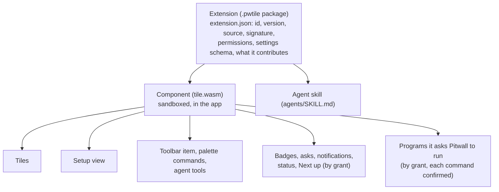

# Tile SDK: one extension model

Part of the [Tile SDK and marketplace](README.md) design. An extension is one self-contained package: everything it shows comes from its WebAssembly component, and Pitwall gives only generic, permission-gated platform pieces. Adapters, the built-in inbox and declarative setup are removed. Sources (S1…) and *unverified* claims are listed in [sources.md](sources.md).

## 15. One extension model

Status: decided by the owner. One model (2026-11-26, [15.9](#159-decisions)
items 1–7); self-contained extensions (2026-11-28, item 8), which replaces
what this section said about declarations, the inbox and the managed
service. Breaking is fine: Pitwall is 0.x and the only extensions in use
are its own.

### 15.1 One concept, not two
The owner asked why there would be both extensions and tiles. There
shouldn't be. There is **one concept, the extension**: one package, one
manifest, one install, update, permission and marketplace flow. A
**tile** is one thing an extension's component draws, beside its Setup
view, toolbar item, palette commands and agent tools. An extension with
no tile is still an extension.

**Decisions.**
1. The **component** (wasm, run in Pitwall's sandbox) is the one way an
   extension runs its own code (owner, 2026-11-26).
2. **Adapters are removed**, with no compatibility period (owner,
   2026-11-26).
3. **Self-contained** (owner, 2026-11-28): "everything should be coming
   from extensions webassembly right? when we install the extension it
   should come with everything right? nothing custom should be done
   there". Everything an extension shows comes from its component: its
   tiles, its **Setup view**, its toolbar item, its palette commands.
   Pitwall has no code, screen or manifest block that exists for one
   extension or one kind of extension.
4. **Native programs** run only through the generic **program
   capability** ([13.2](services.md#132-a-programs-the-component-starts)), Zed's way: the component names
   the command, Pitwall starts and supervises it behind a permission that
   shows the exact command. The manifest's `service` block goes.

### 15.2 Terms used in this document
| Term | Means |
|---|---|
| **Extension** | The package: its manifest (`extension.json`), id, version, source, signature, permissions, settings schema and component |
| **Component** | The extension's own code: one wasm component, run sandboxed by Pitwall in the app |
| **Tile** | A view the component draws in the layout |
| **Setup view** | A view the component draws on the extension's page in the Extensions tile: its own settings and setup screen ([3.12](ui.md#312-the-setup-view-and-host-drawn-fields)) |
| **Program** | A native command the component asks Pitwall to run, once or kept running ([13.2](services.md#132-a-programs-the-component-starts)) |
| **Wasm service** | A headless server component in its own host process ([13.3](services.md#133-b-a-headless-wasm-service)), later |
| **Adapter** | The removed process runtime (JSON over stdio) |

### 15.3 What an extension contains

The manifest only **declares**: ids and titles Pitwall needs before the
component runs (tiles, the Setup view, the toolbar item, commands,
tools), permissions with reasons, and the **settings schema** (key,
type, default). The schema is data, not a form: it says which values
are secrets in the secure store and which a `{setting:KEY}` in a `net`
host or a program pattern may name. What the user sees and does is
drawn by the component.

### 15.4 What Pitwall provides, and nothing else
All generic, the same for every extension, each behind a named
permission where it reaches beyond the extension's own data:

| Piece | Where |
|---|---|
| Install, trust, signatures, permissions, updates, Go back, remove | [6](packaging.md), [7](marketplace.md), [5](permissions.md) |
| The extension's page: header (name, version, source, on/off, Remove), updates, status pill, the Setup view, permissions, programs, data size, Activity, Log | [3.12](ui.md#312-the-setup-view-and-host-drawn-fields) |
| Settings get and set; secrets in the system's secure store, entered only in a **host-drawn secure field** the component places | [14.6](platform-services.md#146-settings-secrets-and-the-setup-view) |
| Platform services: storage, `sql`, `net`, `files`, `notify`, `show`, `asks`, `badges`, `status`, shortcuts, toolbar, agents, agent environment, agent tools | [14.2](platform-services.md#142-the-v0x-minimum-built-in-phases-12), [11](agent-tools.md) |
| Programs, run once or supervised, and a download helper with hash pinning | [13.2](services.md#132-a-programs-the-component-starts) |

The rule for adding to this list stays [14.1](platform-services.md#141-the-rule-the-minimum-then-on-demand): a real extension needs it, and it is useful to any extension.

### 15.5 Removed
| Removed | What does its job now |
|---|---|
| Adapters (Node or any process), protocols 1 and 2, the adapter hub, its Log lines | The component; its Log |
| Pitwall's built-in inbox and `contributes.inbox` | An inbox is an extension's tile (Agention's); questions in the floating control through `asks` |
| `matchAgents` | The component matches by agent id with `agents.read` and `badges` |
| Pitwall-drawn views fed by an adapter (`contributes.views`: list, detail, markdown, status) and adapter commands | Tiles and commands the component draws and answers |
| The checklist (settings, setup actions, Connected) built from the manifest | The Setup view; the status pill from `status.set` |
| Setup `actions` and their confirmation card | One-shot programs, each command confirmed ([13.2](services.md#132-a-programs-the-component-starts)) |
| `agentEnv` | Agent environment, set by the component (`agents.env`, [14.6](platform-services.md#146-settings-secrets-and-the-setup-view)) |
| The managed `service` block (install action, version check, `ready`, `backup`, `firstRun`) | A supervised program; the update's generic backup of the data folder |
| Connections (several sets of settings per extension, `ext:<id>` accounts) | One set per extension; an extension that needs several accounts keeps them itself |
| The settings form Pitwall generates from the manifest | The Setup view; an extension without one shows only its permissions |
| `settings.secret` returning a secret's value | Secrets used by reference: a `net` header, a program's environment |
| `extension.*` acts for actions, the service and connections ("Setup by an agent") | The extension's own `act` tools; install, on, off, update and remove stay |
| `extensions/demo-inbox`, the Node starter template | The component templates (`pitwall extension new`) |

Kept as they are: sources and updates from git, npm and the index;
packages and signatures; grants and Activity; the data folder
`<data>/extension-data/<id>/`; agent tools and skills; "running agents
that use an old setup" ([updates.md](../../extensions/updates.md)), now driven by agent
environment changes.

### 15.6 Headless components
A component without a tile, or with tiles that aren't shown, may need
to keep working: poll a service, keep badges and questions current,
answer agent tools, supervise its programs. So:
- A component whose manifest contributes badges, asks, a toolbar badge
  ([3.9](ui.md#39-toolbar-items)), agent tools or programs, or declares
  `"background": true`, keeps its instance while the extension is on
  and Pitwall runs. Renders stop while nothing shows it; events, timers,
  `net` answers, program events and tool calls continue.
- The `background` permission ([13.3](services.md#133-b-a-headless-wasm-service)) covers it, shown on the
  permission screen as "Runs while you aren't looking at it".
- Limits while nothing is shown: timers at most once a second, the CPU
  watchdog of wasm services ([13.3](services.md#133-b-a-headless-wasm-service)), the same memory limit.
- It stops when Pitwall quits, and its supervised programs with it.
  Work that must continue after that is a wasm service ([13.3](services.md#133-b-a-headless-wasm-service)).

### 15.7 Migration
**Order.** Each step is a release-sized group of pull requests in
[plan.md](plan.md) item 8:
1. **Platform first** (8a), additive: the Setup view, the secure and
   setting fields, settings get and set, programs and the download
   helper, agent environment. Adapters and the old Agention keep working.
2. **Agention rebuilt fresh** (8b) on those pieces, as version 3.0.0,
   with no code taken from the adapter or the 2.0.0 tile.
3. **Removal** (8c), in the release after Agention 3.0.0 ships: adapters,
   the inbox, declarative setup, connections, the generated form,
   `settings.secret`'s value, demo-inbox. Each part is its own pull
   request; all land before that release.
4. **Docs** (8d) with each step: platform pages with step 1, removed
   pages and the migration page with step 3.

**Installed extensions that use removed parts.** A manifest with
`adapter`, `actions`, `agentEnv`, `matchAgents`, `service` or
`contributes.inbox|views` is never started. Its card and page say
"Made for an older Pitwall. <Name> needs an update that runs in
Pitwall's sandbox." and offer:
- **Update** when a version without those keys is available from where it
  came from (Pitwall's bundle, its git or npm source, the index). For
  Pitwall's bundled extensions this is the ordinary update review
  ([6.4](packaging.md#64-updates-and-go-back)), which says what changes
  ("Draws its own setup. Runs `agention serve` through Programs; you
  confirm the command once.") and lists the new permissions, off until
  Allow;
- **Remove** otherwise, keeping its data unless the user says.
Go back to an adapter version isn't offered; the review says so.
`pitwall extension check` and `install` refuse such a manifest with the
same sentence and the key that is no longer read.

**Data kept.**
- The data folder `<data>/extension-data/<id>/` stays where it is,
  including what a managed service kept there (Agention's
  `agention.db`). Programs run with `{data}` as that folder, so the new
  version finds it.
- Settings values and secrets are kept by key: `ui.json`
  `extensions.<id>.values`, and the secure store's items. With
  connections, the default connection's values and secrets become the
  extension's; the others stay in `accounts.json`, unused, and the page
  says "Other connections (Work) aren't used any more" until the user
  removes them.
- Grants keep their names; nothing is asked again except new
  permissions (`programs`, `agents.env`) and each program's command.
- Dropped: `actionsDone`, the service's confirmed-command digest (the
  program asks once instead), the inbox's `selected` thread.
- Things setup actions installed outside Pitwall (Agention's plugin in
  Claude Code and Codex, a global `agention` from npm) are left alone:
  Pitwall never removes what it didn't install itself. The new Setup
  view finds what is there and offers to redo or remove it.

### 15.8 Effect on the plan
[plan.md](plan.md) item 8 replaces the old steps 8 ("port or hand over the bundled
extensions") and 9 ("remove adapters"): platform (8a), Agention (8b),
removal (8c), docs (8d). Item 6a's port of the built-in inbox is
dropped: the inbox is removed, not ported.

Names stay as decided: the crates `pitwall-extension` and
`pitwall-extension-test`, the `pitwall extension …` commands, and "tile"
in the UI words (tile, `TileView`, `tile.wasm`, `.pwtile`).

### 15.9 Decisions
1. **One model, components as the only code runtime?** Decided (owner,
   2026-11-26): yes ([15.1](#151-one-concept-not-two)).
2. **One name for the crate and the CLI?** Decided (owner, 2026-11-26):
   yes: `pitwall-extension` and `pitwall extension …`. Tiles remain the
   headline feature.
3. **When do adapters go?** Decided (owner, 2026-11-26): no
   compatibility period. Now: in the release after Agention 3.0.0
   ([15.7](#157-migration)); it is the only bundled adapter extension
   besides the demo, which is removed.
4. **Keep the inbox as a dedicated surface?** Decided yes on 2026-11-26;
   **reversed** by item 8: the built-in inbox is removed. What it did
   generically is in the SDK already (`asks` in the floating control,
   number keys, `TakeBack`, badges, the toolbar count).
5. **Other languages for components.** Decided (owner, 2026-11-26):
   Rust only in the docs and templates until 1.0; any component that
   passes `check` is accepted.
6. **When does the index open?** Decided (owner, 2026-11-26): for
   component-based extensions with packages and the index; never for
   adapter-based ones; Browse public after the security review
   ([5.5](permissions.md#55-threat-model-and-outside-review)).
7. **Who gets the SDK preview?** Decided (owner, 2026-11-26): the makers
   of the services the bundled extensions connect to first, then anyone
   who asks.
8. **Self-contained extensions.** Decided (owner, 2026-11-28), after
   comparing VS Code and Zed ([10.3](README.md#103-decisions) item 21):
   everything visible comes from the component; Pitwall gives generic,
   permission-gated pieces only ([15.4](#154-what-pitwall-provides-and-nothing-else)); native programs Zed's way
   ([13.2](services.md#132-a-programs-the-component-starts)); adapters, the inbox, declarative setup and the
   generated form removed ([15.5](#155-removed)); Agention rebuilt fresh on this
   model.
9. **Agent environment as a platform service** (`agents.env`, replacing
   `agentEnv`). Proposed here, to confirm with the owner: Agention's
   plugin reads `AGENTION_URL` and the agent's name and session from the
   environment, and only Pitwall starts agents.
