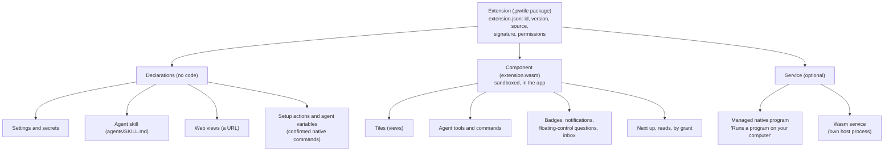

# Tile SDK: one extension model

Part of the [Tile SDK and marketplace](README.md) design. Components as the one way an extension runs its own code; adapters removed. Sources (S1…) and *unverified* claims are listed in [sources.md](sources.md).

## 15. One extension model

Status: proposed to the owner. Decided by the owner: breaking is fine
(adapters are removed, not kept for compatibility). The rest awaits
their answer ([15.8](#158-open-questions-each-with-a-recommendation)).

### 15.1 One concept, not two
The owner asked why there would be both extensions and tiles. There
shouldn't be. There is **one concept, the extension**: one package, one
manifest, one install, update, permission and marketplace flow. A
**tile** is one thing an extension can contribute, beside agent tools,
a skill, commands, settings and a service. An extension with no tile is
still an extension.

The duplication that is real is the **code runtime**. Today an
extension runs its own code as an **adapter**, a process in any
language speaking JSON over stdio, and Pitwall draws its fixed views
from that JSON [today]. This document adds a **component**, wasm code
in Pitwall's sandbox. Two ways to run an extension's code is one too
many.

**Proposal.**
1. The component becomes **the** way an extension runs its own code,
   with or without a tile. A headless component can do everything an
   adapter does: feed inbox questions, badges and notifications, put
   text in Next up, answer agent tools and commands.
2. **Adapters are removed** in the release that ships the component
   runtime: the adapter process protocol (protocols 1 and 2, JSON over
   stdio) goes, with no compatibility period. Pitwall is 0.x and the
   only extensions are the ones it bundles, so each is ported by Pitwall
   or handed to its authors, and adapters are removed once every one
   has a published component version ([15.4](#154-from-adapter-to-component)). Until then, adapters get
   no new features.
3. Native code remains only through the managed `service` ([13.2](services.md#132-a-a-tile-plus-a-managed-service)), at
   its higher trust level.
4. Pitwall-drawn views (today's `list`, `detail`, `markdown`, `status`)
   become SDK components; one renderer draws both. A tile is the general
   case; a declarative view is a tile with a fixed shape.

### 15.2 Terms used in this document
| Term | Means |
|---|---|
| **Extension** | The package: its manifest (`extension.json`), id, version, source, signature, permissions and everything it contributes |
| **Tile** | A UI contribution: a view the extension draws in the layout (or, later, in the right panel), built from the SDK's elements and components |
| **Component** | The extension's own code: one wasm component, run sandboxed by Pitwall in the app, with or without tiles |
| **Service** | A long-running server: a managed native program ([13.2](services.md#132-a-a-tile-plus-a-managed-service)) or a wasm service in its own host process ([13.3](services.md#133-b-a-headless-wasm-service)) |
| **Adapter** | Today's process runtime; removed when components ship |

### 15.3 What an extension can contain

Manifest changes in 0.x (breaking changes are allowed before 1.0,
[14.1](platform-services.md#141-the-rule-the-minimum-then-on-demand)):
- One top-level `"component": "extension.wasm"` replaces the per-tile
  `wasm` key; tiles name views the component renders.
- A component that contributes no tile is **headless**. It runs while
  the extension is on, not only while a tile shows it ([15.5](#155-headless-components)).

### 15.4 From adapter to component

**Parity checklist.** Each adapter capability [today] and its component
equivalent. Every row must be built before adapters are removed, because
the extensions bundled with Pitwall use them.

| Adapter [today] | Component | Status in this document |
|---|---|---|
| `hello` with settings, secrets, grants | `init` context, `settings`, `grants-changed` | [3.2](runtime.md#32-the-guests-exports), [3.8](runtime.md#38-host-apis) |
| One adapter per connection | One component instance per connection, with the connection in `init` | **new: to build** |
| Inbox threads, messages, asks, replies | An `inbox` interface mirroring protocol 1's messages one for one, so a port is mechanical | **new: to build** |
| Floating-control questions | `asks` ([14.2](platform-services.md#142-the-v0x-minimum-built-in-phases-12)), or through `inbox` as today | [14.2](platform-services.md#142-the-v0x-minimum-built-in-phases-12) |
| Views (`list`, `detail`, `markdown`, `status`) | SDK components in a tile | [3.3](ui.md#33-the-ui-description), [4.1](authoring.md#41-shape) |
| Right-panel sections | A tile view placed in the panel (height-limited, as today's sections) | **new: to build** |
| Commands | Commands ([11.12](agent-tools.md#1112-commands-for-the-shell-and-the-palette)) | [11.12](agent-tools.md#1112-commands-for-the-shell-and-the-palette) |
| Badges and notes, notifications | `contrib.badges`, `notify` | [14.2](platform-services.md#142-the-v0x-minimum-built-in-phases-12) |
| Method calls and events (`agents.read`, `queue.add`, …) | `pitwall` interface | [3.8](runtime.md#38-host-apis), [14.2](platform-services.md#142-the-v0x-minimum-built-in-phases-12) |
| Long-lived connections to a service (WebSocket, server-sent events) | Server-sent events work over a streamed `net` response; WebSocket needs a host `ws` interface (whether `wasi:http` covers WebSocket upgrades is *unverified*; assumed not) | **new: to build** |
| Background work while no tile shows anything | Headless components ([15.5](#155-headless-components)) | **new: to build** |
| Talks to its local service | The automatic loopback grant ([13.2](services.md#132-a-a-tile-plus-a-managed-service)) | [13.2](services.md#132-a-a-tile-plus-a-managed-service) |
| Any language | Rust first; other languages that compile to components (*which work well with the SDK's WIT is unverified*) | — |

**Removal, not deprecation.** Pitwall is 0.x and every extension in
use is first-party, so breaking is acceptable and a compatibility
period would only keep two runtimes alive:
1. **Until components ship:** adapters get fixes only. Author docs say
   adapters are going away.
2. **Ported or handed to their authors.** Each extension bundled with
   Pitwall gets a component version, either ported by Pitwall or built
   by the makers of the service it connects to, on the public SDK and
   docs alone (with their own coding agents, [9.5](authoring.md#95-docs-for-authors-agents)). Pitwall offers those
   authors the **SDK preview** while the WIT is 0.x: early builds, the
   docs, the authoring skill, and a channel for feedback. What they
   can't build without is the "a real tile needs it" signal of [14.1](platform-services.md#141-the-rule-the-minimum-then-on-demand).
   The demo becomes the component starter.
3. **Remove once every bundled extension has a component version**,
   published by Pitwall or its authors and passing
   `pitwall extension check|test`. That release removes the adapter
   protocol (protocols 1 and 2), the `adapter`
   manifest key (a manifest with one is refused with "needs an older
   Pitwall; this extension must be updated"), the adapter hub, its Log
   lines and `pitwall extension test`'s adapter parts. Process groups
   stay: services use them.
4. The index never accepts adapter-based extensions, so no extension
   from elsewhere is broken by the removal.

**What users see.** Each bundled extension arrives as an ordinary
update ([6.4](packaging.md#64-updates-and-go-back)), from Pitwall's bundle or from its authors' source, whose review says "Now runs in Pitwall's
sandbox; no longer runs a program on your computer" (unless it also has
a managed service, which keeps running as before). Pitwall's existing
install and update code carries settings, secrets, connections and
grants over by key [today]; permissions keep their names, so nothing is
asked again unless the component asks for something new. Go back to
the adapter version is not offered once adapters are removed: the
review says so. An extension installed by hand with an adapter shows
as "needs updating" with why.

### 15.5 Headless components
A component without a tile, or with tiles that aren't shown, may need
to keep working: poll a service, keep badges and questions current,
answer agent tools. So:
- A component whose manifest contributes badges, asks, an inbox or
  agent tools, or declares `"background": true`, keeps its instance
  while the extension is on and Pitwall runs, as an adapter is kept
  running today. Renders stop while no tile shows it; events, timers,
  `net` answers and tool calls continue.
- The `background` permission ([13.3](services.md#133-b-a-headless-wasm-service)) covers it, shown on the
  permission screen as "Runs while you aren't looking at it".
- Limits while nothing is shown: timers at most once a second, the CPU
  watchdog of wasm services ([13.3](services.md#133-b-a-headless-wasm-service)), the same memory limit.
- It stops when Pitwall quits, as adapters do. Work that must continue
  after that is a wasm service ([13.3](services.md#133-b-a-headless-wasm-service)).
This refines [2.3](runtime.md#23-lifecycle): "suspended when hidden" applies to components with
only tiles; a component that contributes anything above stays.

### 15.6 What stays different
- **Native code** runs only in a managed service (any language, such as
  a Node server; [13.2](services.md#132-a-a-tile-plus-a-managed-service)). Components never run programs.
- **Declarations without code** stay declarations: settings, web views,
  setup actions and agent variables (native commands confirmed by the
  user [today]), the agent skill.
- **Services** outlive the window or run native code; components don't.
- **The inbox surface** stays Pitwall's own (decision 14 in
  extension-api.md [today]): components feed it through `inbox`; they
  don't redraw it as a tile. Pitwall's own inbox tile is rebuilt on
  the SDK as one view of that model ([16.3](native-blocks.md#163-which-built-in-tiles-move-to-the-sdk)); the model, the number keys
  and the floating control stay native.

### 15.7 Effect on the plan
- Names: the crate `pitwall-tile` and the CLI's `pitwall tile …` would
  become `pitwall-extension` and `pitwall extension …` (the CLI already
  has `pitwall extension check|test|new` [today]), before anything is
  published.
- Two new steps after phase 7:
  **8. Port or hand over the bundled extensions** (about 4 weeks of
  Pitwall's time, less for each one its authors build): component
  instances per connection, the `inbox` interface, right-panel
  placement, `ws`, the headless lifecycle, then porting the bundled
  extensions their authors don't take, and the demo. **9. Remove
  adapters** (about 1 week), once each bundled extension has a
  component version: the protocol, the hub, the manifest key, the CLI
  parts, the docs. User-visible effect: one update of each bundled extension, with
  settings, secrets and connections carried over.
- Website docs ([9.6](authoring.md#96-website-docs)): step 8 publishes Migrating from
  adapters and updates the Extensions overview; step 9 replaces the
  adapter pages and the adapter wording in the Settings reference, in
  the release that removes adapters.

### 15.8 Open questions (each with a recommendation)
1. **One model, components as the only code runtime?** *Recommend
   yes*, as proposed in [15.1](#151-one-concept-not-two); it is the owner's decision.
2. **Rename `pitwall-tile` and `pitwall tile …` now?** *Recommend yes*,
   before the first publish: renaming a published crate later costs
   every author.
3. **When do adapters go?** Decided by the owner: no compatibility
   period. *Recommend* removing them in the first release after every
   bundled extension has a published component version, whoever built
   it, and setting a date with the authors who take theirs so the
   removal doesn't wait on one of them indefinitely (Pitwall ports any
   still missing by then).
4. **Keep the inbox as a dedicated surface?** *Recommend yes*: it
   does more than generic components (asks, number keys, sending with
   take-back), and the floating control depends on its model.
5. **Other languages for components** (JavaScript, Go, Python through
   their component toolchains). *Recommend* Rust only in the docs and
   templates until 1.0; accept any component that passes `check`, but
   support only Rust.
6. **When does the index open?** *Recommend* for component-based
   extensions as soon as packages and the index ship (phases 4–5), so
   authors on the preview can publish their versions; never for
   adapter-based ones.
7. **Who gets the SDK preview?** *Recommend* the makers of the services
   the bundled extensions connect to first, then anyone who asks;
   breaking changes announced to them one release ahead ([8.2](runtime.md#82-how-old-tiles-keep-working)).
