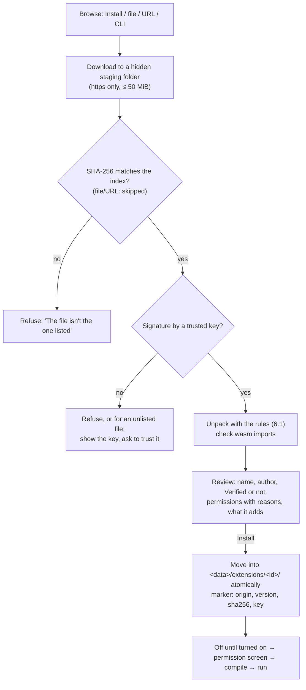

# Tile SDK: packaging

Part of the [Tile SDK and marketplace](README.md) design. The `.pwtile` file, signing, install, update and uninstall. Sources (S1…) and *unverified* claims are listed in [sources.md](sources.md).

## 6. Packaging, signing, install, update

### 6.1 The `.pwtile` file

A zip (stored or deflate only):
```
extension.json        required; format 2 with contributes.tiles
tile.wasm             required; a component (not a core module)
README.md             required; shown on the detail page
LICENSE               required for the index
CHANGELOG.md          optional; "What's new" on update
agents/SKILL.md       optional; an agent skill, text only, ≤ 16 KiB (11.11)
assets/               optional; svg, png, webp, fonts are refused
screenshots/          optional; png/webp, ≤ 6, ≤ 2 MiB each
```
Rules, checked before anything is written: ≤ 50 MiB packed and
unpacked, ≤ 5 000 files [today's limits], `tile.wasm` ≤ 20 MiB, no
absolute paths, no `..`, no symlinks or special files, names NFC and
unique case-insensitively, the manifest's `id` and `version` match the
index entry. `tile.wasm` must be a component whose imports are all in
the `pitwall:tile` world of a version this Pitwall serves (checked by
loading its type, not by running it).

A `.pwtile` can hold an adapter or service too (a folder of files as
today); then it is an ordinary extension with a tile, and the
disclosure ("What this extension does on your computer") lists the
programs as today.

### 6.2 Signing

- **Author key: Ed25519, minisign format.** The author signs the
  package bytes; the signature ships as `<file>.minisig` beside it.
  Minisign is a small, documented format over Ed25519 with a key id
  and a trusted comment (S9); authors can use `minisign` or `rsign2`,
  or `pitwall tile sign` which writes the same format.
- **Where keys are trusted.** In the index, each author has a
  `keys` list; an entry's versions must be signed by one of them. Out
  of the index (a file or a URL), the key is shown and trusted on first
  install for that id; a later version signed by another key is
  refused unless the old key signed a rotation statement (`key
  rotate`, the plan of extension-api.md phase 6 [proposed there]).
- **The index is signed too.** `index.json` and `blocked.json` carry a
  minisign signature by the index key, whose public half ships in
  Pitwall. Two keys ship (current and next) so the index key can
  rotate without stranding old Pitwalls.
- **Why not Sigstore now.** Keyless signing ties a signature to an
  OIDC identity (a GitHub workflow) and a transparency log (S10). It is
  attractive for "built by this repo's CI", but verifying needs the
  trust root and log inclusion proofs, more code in Pitwall and more
  moving parts offline. Revisit for Verified builds (10.6).

### 6.3 Install



- Reuses `install::install` [today] (staging, atomic rename, marker).
  `Origin` gains `Package { url, sha256, key, index: Option<String> }`;
  `Source` gains `Index { index, id }` (updates from the index) and
  `Release { github: "owner/repo", asset: "{id}-{version}.pwtile" }`
  (updates from GitHub releases for unlisted tiles).
- **Offline install:** a `.pwtile` and its `.minisig` from disk work
  with no network. A file without a signature can be installed only
  with "Install unsigned" behind a warning, and is marked Development
  trust ([extension-api.md](../extension-api.md), "Trust levels"
  [today]).
- **CLI:** `pitwall extension install <url|file|index-id>` prints the
  same review and asks on the terminal (`--yes` refuses to grant
  permissions: it installs off, the user turns it on in Settings).

### 6.4 Updates and Go back
- Checks: with the index, one fetch of `index.json` (conditional GET,
  ETag) at start and daily covers every listed tile; unlisted
  `Release` sources use the GitHub releases API, at most daily.
- The review lists what changes, in this order: new permissions (and
  new `net` hosts, larger `memory`), removed permissions, new
  contributions, the signing key if it changed (rotation), then the
  author's CHANGELOG section. A new permission is not granted until
  Allow [today].
- Applying goes through `safe_update` [today]: a tile-only extension
  has no service or setup steps, so its steps are Install and "Start
  and check", where check means the new tile instantiates and `init`
  returns ok within 2 s on a hidden instance. A failure puts the
  previous files back by itself. The tile's `/data` and key-value store
  are kept outside the installed folder (`<data>/extension-data/<id>/`)
  and survive updates and Go back; a tile that changes its data format
  must read the old one (documented).
- Go back: the previous folder is kept as `.<id>.previous` [today]; its
  compiled cache entry is kept too, so going back is instant.
- Auto-install (opt-in per extension [today]) applies only when the
  permission list, hosts, memory and key are unchanged.

### 6.5 Uninstall
Remove [today]: off, settings and secrets forgotten, folder and
`.previous` deleted, plus the compile cache. Its data folder asks:
"Also delete its data (3.2 MiB)?", default keep, as services' data
[today].
