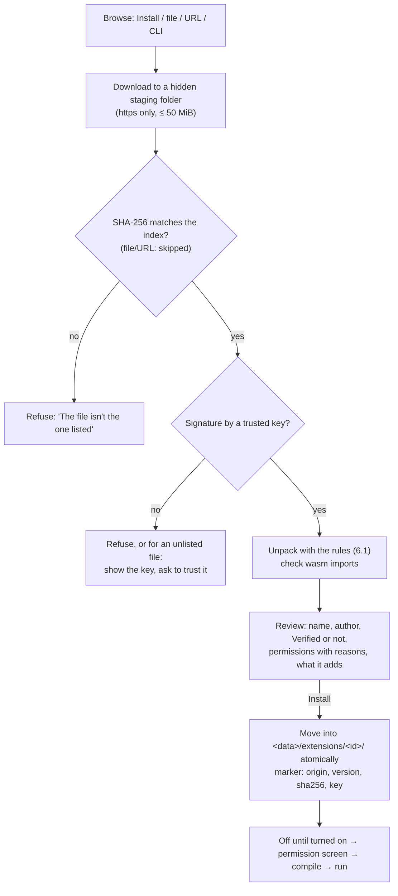

# Tile SDK: packaging

Part of the [Tile SDK and marketplace](README.md) design. The `.pwtile` file, signing, install, update and uninstall. Sources (S1…) and *unverified* claims are listed in [sources.md](sources.md).

## 6. Packaging, signing, install, update

### 6.1 The `.pwtile` file

A zip (stored or deflate only):
```
extension.json        required; format 2 with contributes.tiles
tile.wasm             required; a component (not a core module)
README.md             required; shown on the detail page
LICENSE               required for the index
CHANGELOG.md          optional; "What's new" on update
agents/SKILL.md       optional; an agent skill, text only, ≤ 16 KiB (11.11)
assets/               optional; svg, png, webp, fonts are refused
screenshots/          optional; png/webp, ≤ 8, ≤ 2 MiB each; -dark/-light pairs count once
media/                optional; the README's images: png/webp/jpeg/gif, ≤ 2 MiB each
<icon file>           when "icon" names one: square png/webp, 64–1024 px, ≤ 256 KiB
```
Every image is checked by its first bytes, not its name. The README's
images must be relative paths inside `assets/`, `media/` or
`screenshots/` (at most 24); a network image is drawn as a link and
never fetched, a path with `..` is refused.
Rules, checked before anything is written: ≤ 50 MiB packed and
unpacked, ≤ 5 000 files [today's limits], `tile.wasm` ≤ 20 MiB, no
absolute paths, no `..`, no symlinks or special files, names NFC and
unique case-insensitively, the manifest's `id` and `version` match the
index entry. `tile.wasm` must be a component whose imports are all in
the `pitwall:tile` world of a version this Pitwall serves (checked by
loading its type, not by running it).

A `.pwtile` can hold an adapter or service too (a folder of files as
today); then it is an ordinary extension with a tile, and the
disclosure ("What this extension does on your computer") lists the
programs as today.

### 6.2 Signing

- **Author key: Ed25519, minisign format.** The author signs the
  package bytes; the signature ships as `<file>.minisig` beside it.
  Minisign is a small, documented format over Ed25519 with a key id
  and a trusted comment (S9); authors can use `minisign` or `rsign2`,
  or `pitwall extension sign` which writes the same format.
- **Where keys are trusted.** In the index, each author has a
  `keys` list; an entry's versions must be signed by one of them. Out
  of the index (a file or a URL), the key is shown and trusted on first
  install for that id; a later version signed by another key is
  refused unless the old key signed a rotation statement (`key
  rotate`, the plan of extension-api.md phase 6 [proposed there]).
- **The index is signed too.** `index.json` and `blocked.json` carry a
  minisign signature by the index key, whose public half ships in
  Pitwall. Two keys ship (current and next) so the index key can
  rotate without stranding old Pitwalls.
- **Why not Sigstore now.** Keyless signing ties a signature to an
  OIDC identity (a GitHub workflow) and a transparency log (S10). It is
  attractive for "built by this repo's CI", but verifying needs the
  trust root and log inclusion proofs, more code in Pitwall and more
  moving parts offline. Revisit for Verified builds (10.6).

### 6.3 Install



- Reuses `install::install` [today] (staging, atomic rename, marker).
  `Origin` gains `Package { url, sha256, key, index: Option<String> }`;
  `Source` gains `Index { index, id }` (updates from the index) and
  `Release { github: "owner/repo", asset: "{id}-{version}.pwtile" }`
  (updates from GitHub releases for unlisted tiles).
- **Offline install:** a `.pwtile` and its `.minisig` from disk work
  with no network. A file without a signature can be installed only
  with "Install unsigned" behind a warning, and is marked Development
  trust ([extension-api.md](../extension-api.md), "Trust levels"
  [today]).
- **CLI:** `pitwall extension install <url|file|index-id>` prints the
  same review and asks on the terminal (`--yes` refuses to grant
  permissions: it installs off, the user turns it on in Settings).
- **Before packages: a preview folder (phase 1).** So that authors on
  the SDK preview can pass tiles around before `.pwtile` and signatures
  exist (phase 4), phase 1 installs an unsigned folder holding
  `extension.json`, `tile.wasm` and the files the manifest names
  ([10.3](README.md#103-decisions) item 16). From Settings → Extensions
  ("Install from folder…") or `pitwall extension install <dir or url>`,
  where the URL names such a folder served over HTTPS. It goes through
  the same staging, unpack rules ([6.1](#61-the-pwtile-file)), import check and permission
  screen as a package, with an "Unsigned, preview: only install tiles
  from people you trust" warning. It is marked developer preview
  (Development trust, as an unsigned file above) on every surface, is
  never updated (installing a newer folder replaces it),
  and is counted by the "Run tiles from others" switch ([5.4](permissions.md#54-kill-switches-and-revocation)).
  Unlike `pitwall extension dev`, the folder is copied into
  `<data>/extensions/<id>/`, not loaded in place. Phase 4 adds the
  `.pwtile`, signatures and updates on top of this path; folder
  install stays for authors.

### 6.4 Updates and Go back
- Checks: with the index, one fetch of `index.json` (conditional GET,
  ETag) at start and daily covers every listed tile; unlisted
  `Release` sources use the GitHub releases API, at most daily.
- The review lists what changes, in this order: new permissions (and
  new `net` hosts, larger `memory`), removed permissions, new
  contributions, the signing key if it changed (rotation), then the
  author's CHANGELOG section. A new permission is not granted until
  Allow [today].
- Applying goes through `safe_update` [today]: a tile-only extension
  has no service or setup steps, so its steps are Install and "Start
  and check", where check means the new tile instantiates and `init`
  returns ok within 2 s on a hidden instance. A failure puts the
  previous files back by itself. The tile's `/data` and key-value store
  are kept outside the installed folder (`<data>/extension-data/<id>/`)
  and survive updates and Go back; a tile that changes its data format
  must read the old one (documented).
- Go back: the previous folder is kept as `.<id>.previous` [today]; its
  compiled cache entry is kept too, so going back is instant.
- Auto-install (opt-in per extension [today]) applies only when the
  permission list, hosts, memory and key are unchanged.

### 6.5 Uninstall
Remove [today]: off, settings and secrets forgotten, folder and
`.previous` deleted, plus the compile cache. Its data folder asks:
"Also delete its data (3.2 MiB)?", default keep, as services' data
[today].

### 6.6 As built (phase 4)

What phase 4 built, and where it differs from the design above.

- **The file.** `pitwall extension pack [folder] [-o file]` writes
  `<id>-<version>.pwtile`. The same folder always gives the same bytes:
  entries sorted by name, the date fixed at 1980-01-01, mode 0644, no
  extra fields. The reader is Pitwall's own (`pitwall_core::extensions::
  package::zip`), not a general zip library. It accepts stored or deflate
  entries only. It refuses zip64, encryption, more than one disk, a
  comment, local headers that disagree with the central directory,
  entries that overlap, links and special files, and duplicate names
  (case-insensitively). It also refuses names that aren't plain ASCII
  `[A-Za-z0-9._-/]` with no hidden parts, no `..`, no absolute paths and
  no Windows device names. Sizes are checked before anything is
  inflated. Inflating stops at the declared size, and the CRC-32 must
  match. Only the files of 6.1 are allowed.
- **Differences from 6.1.** There is no checksums file inside the
  package. The signature covers the whole file, and the SHA-256 of the
  file is recorded in the install marker. Names are limited to ASCII
  instead of being checked for NFC. `LICENSE` is optional: it is
  required for the index, in phase 5. A package holds tiles only. An
  extension with an adapter or a service still installs from Git, npm
  or a folder.
- **Signing.** Signatures are minisign (Ed25519, prehashed). Pitwall
  verifies with `minisign-verify` (MIT, no dependencies). `pitwall
  extension sign` and the tests sign with `minisign` (MIT). Neither crate
  has had a formal outside audit; both are small and widely used. Legacy
  (non-prehashed) signatures are refused. The signature's untrusted
  comment carries the public key (`pitwall package signature, public key
  <base64>`), so a first install needs nothing else. A key already
  trusted for that id is used even when the comment is missing, for
  example with a signature written by plain `minisign`. The signature is
  checked over the file's bytes before any entry is read.
- **Trust.** Trust is on first use, per extension id. The marker records
  the signer's key id and public key. An update must be signed by the
  same public key: the whole key is compared, because a key id is only a
  label that anyone can copy. Pitwall does not read rotation
  statements. A package signed by another key, or an unsigned one
  replacing a signed one, needs the user's explicit "Trust the new key"
  in Settings, or `--new-key` from the CLI. An unsigned package needs
  "Install unsigned", or `--unsigned`. It is marked as a preview, as a
  folder is. A folder can't replace a signed package. An older version
  is refused and points at Go back. The installed version is refused
  too, whether it is the same file or a different one.
- **Updates.** An update comes from installing a newer file. There is
  no update check for files, because there is no index or release
  source yet (phase 5). The review lists new permissions, wider ones
  (new `net` hosts, larger `memory` or `sql`), removed ones and the
  key. A new permission waits for Allow. When new hosts are added, the
  existing `net` decision is dropped, so the user is asked again.
- **Go back and Remove.** Both reuse `install::rollback` and
  `install::remove` (`.<id>.previous`). In Settings, Remove asks
  "Also delete its data (size)?", default keep, for tiles as well as
  services. `pitwall extension remove` and agents keep the data.
