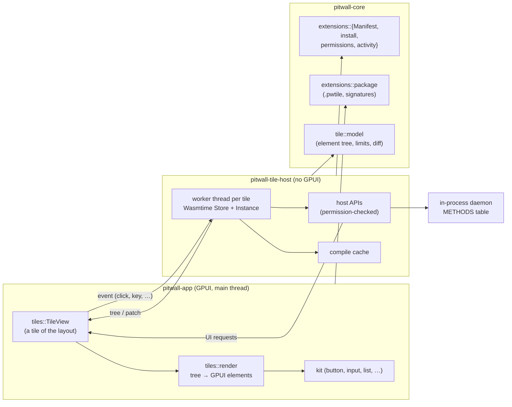
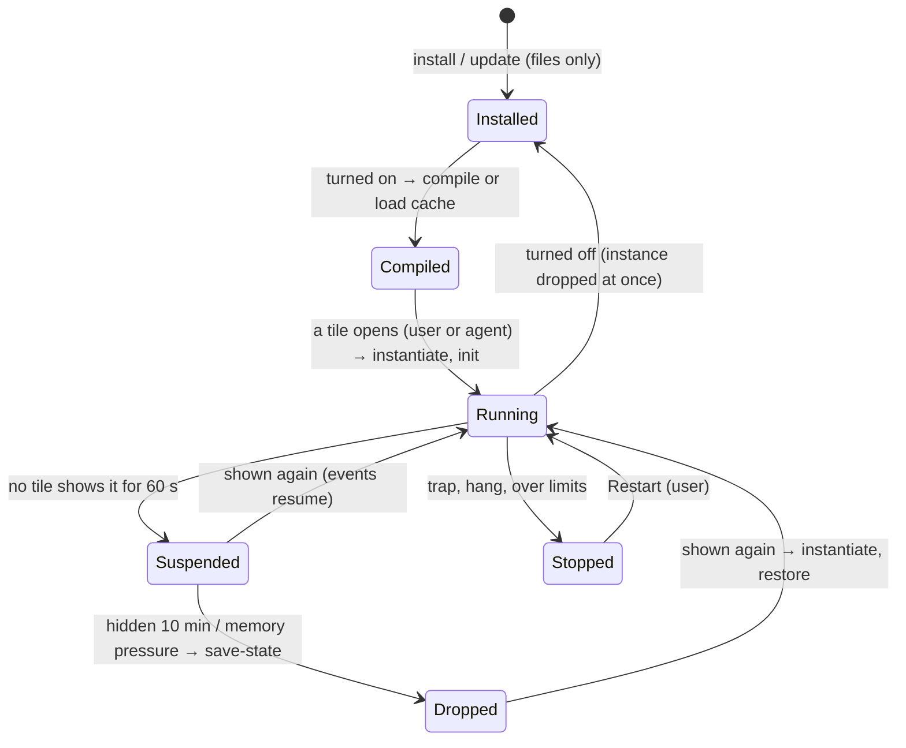
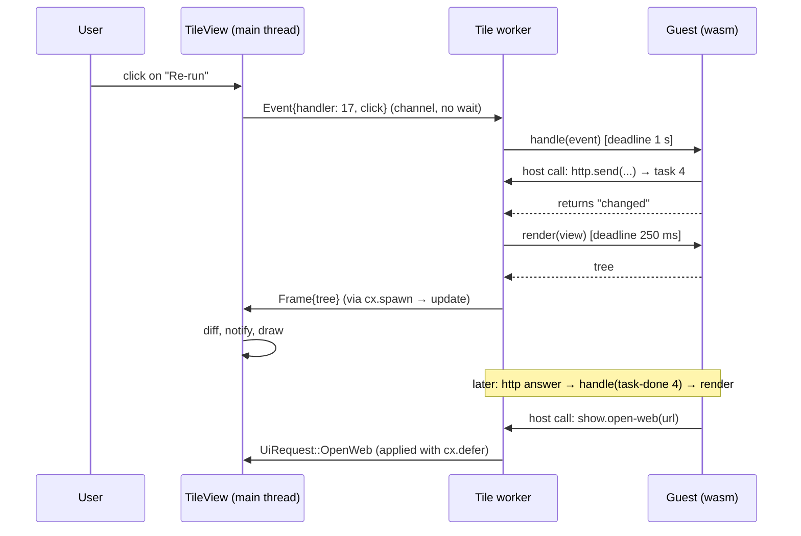

# Tile SDK: runtime

Part of the [Tile SDK and marketplace](README.md) design. Architecture, the WIT interface and versioning: how a tile's component runs, its limits, and how it reaches the host. Sources (S1…) and *unverified* claims are listed in [sources.md](sources.md).

## 2. Architecture

### 2.1 Where it fits



### 2.2 Crates [new]

The repo's rules hold: OS-specific code only in `platform/` folders,
no `cfg(target_os)` in `pitwall-core` outside `src/platform/`, no
extension names in crates.

| Crate | Owns | Depends on |
|---|---|---|
| `pitwall-core` (`extensions::package`, `tile::model`) | The `.pwtile` reader (zip, limits, no symlinks), signature and hash checks, the index schema, the element-tree model (types, limits, cleaning, keyed diff). Pure, testable, no Wasmtime. | `zip` (reading only), `ed25519-dalek`, `sha2` (exact crates *to decide in phase 0*) |
| `pitwall-tile-host` (new) | Wasmtime engine, `bindgen!` of the WIT, one `Store` per tile on its own thread, limits, epoch ticker, compile cache, host-API implementations behind a `TileHost` trait (the app supplies the parts that need the UI or the daemon). No GPUI. | `wasmtime`, `wasmtime-wasi`, `pitwall-core` |
| `pitwall-app` (`tiles/`) | `TileView` (a `Content::Tile` in the layout tree), rendering the model with the kit, event routing, focus, IME, the permission screen and Browse UI, the `TileHost` implementation. | `pitwall-tile-host`, GPUI |
| `pitwall-extension-test` (new, published) | The headless harness: loads a built `tile.wasm` in `pitwall-tile-host` with a fake host, sends events, queries the tree. | `pitwall-tile-host` |
| `sdk/pitwall-extension` (new, published, not in the app's build) | The guest crate: element builders, components, `Tile` trait, async helpers over host APIs, `export!`. | `wit-bindgen` |
| `sdk/wit/` | The WIT package `pitwall:tile`, one folder per published version. | — |
| `pitwall-cli` | `pitwall extension new\|dev\|check\|test\|pack\|sign\|publish`, `pitwall extension install <url\|file>`. | `pitwall-core`, `pitwall-tile-host` (for `check`) |

Wasmtime is Apache-2.0 with the LLVM exception (S2), compatible with
Pitwall's Apache-2.0 licence; it is credited in NOTICE like the
vendored GPUI [today].

Why a separate host crate: Wasmtime is a large dependency with its own
compile time; keeping it out of `pitwall-core` keeps the core fast to
build and test, and keeps the "no Wasmtime in core" line easy to check.
Why the model in core: it is pure data with limits and cleaning, like
today's `extensions::view`, which it replaces (today's declarative
views become SDK components, [15.1](extension-model.md#151-one-concept-not-two)), and the CLI's `check` reads it
without Wasmtime.

OS code: Wasmtime handles its own per-OS memory mapping and trap
handling (*unverified in detail*; its `signals-based-traps` feature,
S17, suggests so). Pitwall expects to add none. If phase 0 finds something
OS-specific (for example a guard-page setting), it goes in
`pitwall-tile-host/src/platform/`.

### 2.3 Lifecycle



- **Load.** Turning the extension on reads `tile.wasm`, checks its
  hash against the install marker, and loads the compiled form from
  the cache or compiles it (on the worker, never the main thread). The
  tile shows "Preparing…" while it compiles.
- **Opened by an agent.** Any tile can be opened by an agent through
  the host-provided `<extension-id>__open` or a show tool the tile
  declares ([11.3](agent-tools.md#113-declaring-tools), phase 2). Pitwall
  places the view next to that agent's terminal (or where `where` and
  `of` say), moves a suspended or dropped tile back to Running as if the
  user had shown it, and then delivers the call as `view-opened` or
  `view-content`, with the agent's input as the content (below). A later call goes to the same view.
- **Instantiate.** When a tile first shows it, or an agent calls one
  of its tools ([section 11](agent-tools.md#11-tools-for-agents)): a new `Store` with the
  limits, the linker with only the interfaces the tile may use (others
  are linked to stubs that return `denied`, so a tile built for more
  permissions still loads; see [5.2](permissions.md#52-enforcement)), then `init(context)`: theme,
  size, granted permissions, settings, the state saved last time.
- **Visible.** Events and timers flow. Rendering happens after each
  handled event that says state changed.
- **Suspended when hidden.** No tile shows it (closed, another space,
  window minimised, occluded per `platform::visible` [today]): the
  guest gets `visibility(false)`, timers stop, network answers queue
  (≤ 64, then dropped with an error), no renders. Memory stays.
  `visibility(false)` is an ordinary call: host calls made while
  handling it complete (storage writes reach the disk), and suspension
  starts when it returns; a timer started then waits until shown.
- **Dropped.** After 10 minutes suspended, or when Pitwall's tile
  memory total passes its cap, the host calls `save-state` (≤ 1 MiB,
  ≤ 50 ms) and drops the instance. Showing it again instantiates and
  passes the bytes to `init`. Background work (polling CI) is
  therefore only while shown or within 10 minutes; a tile that needs
  more is an adapter's or a service's job.
- **Killed on a hang.** Every call into the guest has a deadline
  (epoch interruption, [2.5](#25-sandbox-and-limits-summary-details-in-5)). Past it the call traps, the instance is
  dropped, the tile shows "stopped" with the reason, and the activity
  log keeps it. Three stops within 10 minutes: no automatic restart,
  only Restart by hand.
- **Turned off.** The instance is dropped at once, everything it drew
  goes away, its timers and requests are cancelled, its queued Next up
  items are removed [today's rule for adapters].

Several tiles of the same extension (two views, or the same view in
two spaces) share one instance; each view is a root the guest renders
separately (`render(view-id)`). A view is addressed by (extension id,
tile, view id): the app picks the view id (the tile's id when it is
open once) and the guest hears of each view with `view-opened`, which
carries the content it was opened with, then `view-content` for later
content and `view-closed` (WIT 0.1, [ui.md 3.3](ui.md#33-the-ui-description)).
This is the hook for agents opening a tile with content, as Pitwall's
own viewers are opened: a later call with the same content id updates
that view in place. The manifest's tile entry names what content it
accepts (`"input"`: a JSON schema file in the package).

### 2.4 Threading with GPUI

GPUI views must never be called back synchronously from their own
handlers [today's rule: outcomes go through `cx.defer`]. Wasm calls can
also take milliseconds. So the guest never runs on the main thread.



- One OS thread per running tile, named `tile:<id>`. Its loop takes
  one message at a time: an event, a timer, a task result, a
  `rows`/`draw` request, `save-state`. Events for the same handler
  that pile up are coalesced (scroll, pointer move, resize: keep the
  newest).
- The main thread only sends and receives messages. A frame from the
  worker is applied in the view's update, then `cx.notify()`.
- Host calls that need the UI or the daemon don't block the guest on
  the main thread. Reads the host can answer from a snapshot (theme,
  agents' status, settings) are answered on the worker from a snapshot
  the app pushes when it changes. Actions (open a web tile, focus an
  agent, queue to Next up, notify) are queued as `UiRequest`s and
  applied by the app with `cx.defer`; the guest gets a task id and a
  `task-done` event with the outcome.
- The guest can't be re-entered: while it is inside a call the host
  never calls it again, because all calls come from the one worker
  loop. (Whether Wasmtime itself refuses to re-enter a component
  instance is *unverified*; the design doesn't rely on it.)
- Text input stays on the main thread: the kit's `TextInput` [today]
  edits locally with no round trip, so typing never waits on the
  guest. **The host owns a field's value** (WIT 0.1's `input` record):
  the guest gets `input-changed` after the fact, with the value and the
  selection (coalesced, at most one per field every 50 ms while typing,
  plus one on blur or submit), and `input-selected` when only the
  selection moves. A frame carries no text for the field unless the
  guest replaces it (`value: some(..)` with a revision above the
  user's latest edit; an older one is ignored), so a large text (up to
  1 MiB) crosses the boundary only when it changes and never counts
  against every frame's 2 MiB.

### 2.5 Sandbox and limits (summary; details in 5)

| Limit | Default | How |
|---|---|---|
| Linear memory | 64 MiB, manifest may ask up to 512 MiB (shown on the permission screen) | `StoreLimitsBuilder::memory_size` (S3; unlimited unless set). With `trap_on_grow_failure(true)` a grow past the limit traps instead of returning -1 (S3), so a runaway allocation ends the tile clearly |
| Instances, tables | a handful of instances, 10 000 table elements | `StoreLimitsBuilder` (defaults are 10 000 instances/tables/memories, S3) |
| Time per `handle` | 1 s hard; > 50 ms warned in the Log | epoch interruption (S4) with a wall-clock check: a ticker thread increments the engine epoch every 10 ms; each call stores its deadline as an `Instant` and arms `Store::set_epoch_deadline(1)`; an `epoch_deadline_callback` runs on every tick and interrupts the call once the clock passes the deadline (or the user pressed Stop), else continues for one more tick |
| Time per `render` / `rows` / `draw` | 250 ms hard; budget 8 ms ([2.7](#27-performance-budget)) | same |
| `init` | 2 s; `save-state` 50 ms | same |
| Background CPU while hidden | none (suspended) | lifecycle |
| Tree size | 20 000 nodes, 2 MiB encoded per frame | checked in `tile::model` |
| Host calls | 200 a second; 32 tasks in flight | host counters, `busy` |
| Storage | 10 MiB key-value + 100 MiB data folder | host |

**Deadlines are wall-clock** (decided after phase 0, [10.3](README.md#103-decisions)
item 19). Counting ticks alone (`deadline / 10 ms` ticks with
`epoch_deadline_trap`) overshoots, because the ticker's `sleep(10 ms)`
often lasts longer: 200–430 ms late at 1 s on a Mac and seconds late
on the macOS CI VM ([spike-results.md](spike-results.md#stopping-a-runaway-tile)).
Checking the clock on each tick bounds the overshoot to one tick
(≈ 7 ms measured, ≤ 13 ms). The callback runs about 100 times a
second, only while the guest runs. The same check ends a call at once
when the user presses Stop.

Epoch interruption is chosen over fuel: Wasmtime's docs call fuel
"somewhat expensive" and measure epochs as up to 2–3× faster, and
recommend fuel when deterministic yielding is needed (S4). Pitwall
wants wall-clock deadlines, not determinism. Epochs need 64-bit atomics
(S4), which every platform Pitwall ships on has.

### 2.6 Compile and cache

- Wasmtime compiles a component to native code once (Cranelift), and
  can serialize the result (`Component::serialize`) and load it later
  (`Component::deserialize_file`, which memory-maps the file). Loading
  is `unsafe`: the bytes are "only lightly validated", so a tampered
  file could run arbitrary code; bytes from another Wasmtime version
  give an error, safely (S5). The mapped file must not change while
  loaded (S5). Wasmtime's own on-disk cache (`Config::cache`) exists
  but is off by default (S5); Pitwall manages its own files so it
  controls where they live and when they go. Pitwall builds Wasmtime
  without its `cache` feature at all, and with Wasmtime's and
  Cranelift's crates at `opt-level = "s"` in the release profile: the
  lean build that keeps every architecture under the size gate
  ([10.3](README.md#103-decisions) item 19; its own files also load 2–3× faster
  than Wasmtime's cache, [spike-results.md](spike-results.md#cold-and-warm-start)).
- Pitwall writes compiled files only itself, in
  `<data>/cache/tiles/<id>/<wasm-sha256>.cwasm`, mode 600 in a 700
  folder, never in the extension folder (so the install digest
  [today] is unaffected and Go back keeps its own cache entry).
  Windows has no such modes; there the folder needs an equivalent
  limited to the user ([10.3](README.md#103-decisions) item 18). The
  file name ties it to the exact wasm; Wasmtime's own header check
  ties it to the engine version and settings (S5). A file that fails
  to load is deleted and the wasm compiled again.
- Compiled files are tied to the exact Wasmtime version, patch
  included (S1), so any Pitwall update that moves Wasmtime recompiles
  each tile once, on first use, off the main thread. Phase 0 measured
  7.5 ms for a hello tile and 56–108 ms for a 1 MB tile on an 18-core
  Mac; compile time grows with code size and uses every core, so a big
  tile on a small machine may take several hundred milliseconds.
  Compiling therefore always happens on the tile's worker thread,
  never the main thread, with "Preparing…" shown, and phase 1 checks
  that a 2–3 MB tile compiles in under 1 s on a 4-core CI runner
  ([10.3](README.md#103-decisions) item 19).
- Compile happens at "turn on" (and after an update), not at install,
  so nothing derived from the package runs, even the compiler, before
  the user agrees. Cranelift is not the guest's code; compiling at
  install would be safe, but the rule "install writes files only"
  [today] is simpler to keep whole.

### 2.7 Performance budget

Pitwall draws at the display's rate; a tile must not be why a frame is
late.

| Step | Where | Budget |
|---|---|---|
| Event delivery | main → worker | < 0.1 ms (channel) |
| `handle` + `render` | worker | 8 ms typical; warned over 16 ms; hard stop 1 s / 250 ms |
| Decode + diff + apply | main | ≤ 2 ms for 2 000 nodes (to measure in phase 0; with the canonical-ABI lift, a gate of ≤ 4 ms, [phase 0 gates](README.md#phase-0-gates)) |
| Draw | main | as any tile: only visible nodes; virtual lists lay out visible rows only |

- Renders are coalesced to one per display frame: a burst of events
  makes one tree.
- Full tree per change is the v1 protocol. A tile of 2 000 nodes
  encodes to roughly 100–200 KiB (*estimate*); canonical ABI lifting
  of that size is expected to be well under a millisecond
  (*unverified; phase 0 measures it*). If it isn't, WIT 0.2 adds
  guest-side patches ([8.4](#84-planned-evolutions-each-as-a-new-minor-or-major-world)), not a different model. Prior art for both
  halves: Raycast's first extension runtime serialised a React tree to
  JSON after each render, diffed it with JSON Patch and sent it over
  stdio to be built into native views (S13); Dioxus's diff produces a
  short list of "mutations" (create, set attribute, insert, replace,
  listeners) as its only link to the real tree (S19).
- Large collections never go in the tree: a `virtual-list` or `table`
  names a row count and a row height, and the host asks the guest for
  rows in pages (`rows(list, start, count)`) as they scroll into view,
  cached until the guest invalidates them.

---

## 3. The WIT interface

WIT package `pitwall:tile`, version 0.1.0 at first (stable 1.0 in
phase 7). Below is the shape, abbreviated; the real files of 0.1 live in
`crates/pitwall-tile-host/wit/` (one file per interface, every item
documented), and move to `sdk/wit/0.1.0/` when the SDK publishes them,
one frozen folder per published version, as Zed keeps `since_v0.x.y`
folders for its extension API (S18). WIT 0.1 links only `ui`, `log`,
`tasks`, `storage` and `settings`; the other imports below come with
later worlds. WIT has no
recursive types as far as Pitwall's authors know (*unverified against
the current WIT spec*), and a flat list is cheaper to lift anyway, so a
tree is a list of nodes with parent indices.

### 3.1 The world

```wit
package pitwall:tile@0.1.0;

world tile {
  // What the tile gets (each behind a permission, section 5).
  import ui;          // request a render, focus, scroll-to, toasts
  import storage;     // own key-value store
  import tasks;       // timers
  import settings;    // own settings and secrets
  import net;         // HTTPS to named hosts
  import files;       // chosen project folders
  import git;         // git through Pitwall
  import pitwall;     // the daemon's method table, filtered by grants
  import clipboard;
  import log;
  import agent-tools; // answer tools agents call (section 11)
  // WASI 0.2: clocks, random, stdout/stderr to the Log, and a
  // filesystem with only the tile's own data folder preopened.
  include wasi:cli/imports@0.2.0;

  export guest;
}
```

`include wasi:cli/imports` lets ordinary Rust (`std::time`,
`std::fs` in the data folder, `println!` to the Log, `rand`) work
unchanged. The host builds the WASI context from
`WasiCtxBuilder::new()`, whose defaults are: stdin closed, stdout and
stderr discarded, no environment, no arguments, no preopens, name
lookup denied, and TCP/UDP addresses all denied (S7). Pitwall adds only
what is granted: stdout/stderr to the Log, one preopen (`/data`), plus
`/projects/<n>` for each project folder the user granted under
`files.*`. WIT 0.1 preopens nothing, not even `/data`: tiles keep data
through `storage`, which matches [5.3](permissions.md#53-what-a-hostile-tile-can-still-do)
("tiles get no folders through WASI") while WASI's filesystem code has
had a recent sandbox escape (S1); `/data` waits for a seed tile that
needs files. It also installs a `socket_addr_check` that refuses every
address, because the docs are not consistent about whether TCP is off
by default (S7), and Pitwall's own tests assert it.

**WASI 0.2 or 0.3.** WASI 0.3 (native async in the Component Model)
was declared stable in June 2026 and Wasmtime 46+ ships it (S15);
Rust's `wasm32-wasip3` target is tier 2 from Rust 1.100 (S16; whether
that release is out yet is *unverified*), while `wasm32-wasip2` has
been tier 2 since Rust 1.82 (S16). WIT 0.1 targets WASI 0.2 so authors
can use a stable toolchain today; a later world moves to 0.3's
`async func`, replacing task ids ([8.4](#84-planned-evolutions-each-as-a-new-minor-or-major-world)).

### 3.2 The guest's exports

```wit
interface guest {
  use types.{init-context, event, frame, row-range, rows, draw-op, size, view-id};
  use agent-tools.{tool-call, tool-output};

  init: func(cx: init-context) -> result<_, string>;
  /// Build the view's tree. Called after a handled event that changed state,
  /// on resize, theme change, and when shown.
  render: func(view: view-id) -> frame;
  /// Handle one event. Returns true when state changed (a render follows).
  handle: func(event: event) -> bool;
  /// Rows of a virtual list or table, as small trees.
  rows: func(view: view-id, list: string, range: row-range) -> rows;
  /// Draw a canvas at its laid-out size.
  draw: func(view: view-id, canvas: string, at: size) -> list<draw-op>;
  /// State to keep across a drop or a dev reload (≤ 1 MiB).
  save-state: func() -> list<u8>;
  /// A `read` or `act` tool an agent called (section 11, phase 3). `none`:
  /// the tile answers later with agent-tools.reply. Show-only calls come
  /// as view content instead (`view-opened`, `view-content`; phase 2).
  tool: func(call: tool-call) -> option<tool-output>;
}
```

### 3.8 Host APIs

Each interface is linked to a stub returning `denied` unless its
permission is granted. Long operations return a task id and finish
with `task-done`, so the guest never blocks its worker on the network.
The SDK wraps them as `async` functions on a small single-threaded
executor driven by `task-done` events (no Tokio in the guest).

| Interface | Functions | Permission |
|---|---|---|
| `ui` | `request-render(view)`, `redraw(canvas)`, `scroll-to(key)`, `toast(text, tone)`, `open-view(view)` | none |
| `log` | `debug/info/warn/error` to the tile's Log | none |
| `tasks` | `timer(ms, repeat) -> u32`, `cancel(u32)`; ≥ 100 ms, paused while hidden | none |
| `storage` | `get/set/delete/list(prefix)`; 10 MiB; plus `/data` through WASI | none (own data only) |
| `settings` | `get(key)`, `secret(key)` (own only, from the system's secure store [today]), `open()` (shows its card) | none (own only) |
| `net` | `fetch(request) -> task` (method, URL, headers, body ≤ 8 MiB, answer ≤ 32 MiB); `https://` only, `http://` only to loopback | `net` with hosts ([5.1](permissions.md#51-new-permissions-new)) |
| `files` | `pick-project() -> task`, `read`, `write`, `list`, `stat`, `watch` in granted project folders; also via WASI under `/projects/<n>` | `files.read`, `files.write` |
| `git` | `status`, `diff`, `log`, `show`, `branches`, `blame`; `stage`, `unstage`, `commit`, `checkout`, `fetch`, `pull`, `push` — fixed operations, argv built by Pitwall over `Exec` [today's git code], never free arguments | `git.read`, `git.write`, `git.remote` |
| `pitwall` | `call(method, params-json) -> task` into the daemon's `METHODS` table [today], filtered exactly as for adapters; `subscribe(topics)` → `agents-changed` | the existing ones: `agents.read`, `projects.read`, `worktrees.read`, `profiles.read`, `show`, `agents.focus`, `agents.queue`, `agents.start`, `notify` |
| `clipboard` | `write(text)` (only within 1 s of a user click or key in the tile), `read() -> task` | `clipboard.read` for reading |

Reusing the method table means a tile reaches agents' status, Next up
(`queue.add`), opening a file or a web tile (`viewer.open`,
`web.open`), focusing an agent, and notifications exactly as adapters
do, with the same limits, approvals and activity log ([permissions.md]
(../extensions/permissions.md) [today]). One API, two transports.

Not offered: running programs, raw sockets (TCP to databases is an
decided in [10.3](README.md#103-decisions): not in v1), other extensions' data, the agents' terminals or
screens, Pitwall's own settings.

Not all of this is built at once: [section 14](platform-services.md#14-platform-services-what-pitwall-gives-every-tile) says which services make
the v0.x minimum and which wait until a seed tile needs them.

---

## 8. Versioning and compatibility

### 8.1 Three versions
- **Manifest `v`** [today]: tiles use format 2 with a new `contributes`
  key; older Pitwalls refuse it with "needs a newer Pitwall" [today].
- **`pitwall`** [today]: the lowest Pitwall, checked first.
- **The WIT world**: `pitwall:tile@X.Y.Z`, recorded in the manifest's
  tile entry (`"world"`) and in the component's own imports.

### 8.2 How old tiles keep working
- Pitwall links several world versions at once. Each supported version
  has its own `bindgen!` module in `pitwall-tile-host` (`v0_1`, `v1`, …)
  and a thin adapter from it onto one internal model, so the renderer
  and host APIs exist once. Choosing the module is by the versions the
  component imports.
- Within a major version, interfaces only grow: new functions, new
  enum cases at the end, new `style` and `element` variants, marked
  `@since(version = 1.2.0)` (S6). A tile built for 1.2 that imports a
  1.2-only function can't load in a 1.1 Pitwall; its manifest's
  `pitwall` says so in words before that.
- New element variants are a compatibility hazard for old hosts, not
  old tiles: an old tile never sends them. A new tile on an old host is
  prevented by `pitwall`.
- Pre-1.0 (0.x): each 0.minor may break; Pitwall keeps the last two 0.x
  worlds. WIT 1.0 is declared after the seed tiles have shipped on it
  for one release cycle.

### 8.3 Deprecation policy
- A world major version stays supported for at least 12 months and
  four Pitwall minor releases after its successor ships, whichever is
  longer.
- Settings marks a tile on a deprecated world ("built for an older
  Pitwall API; it will stop working in Pitwall 0.20"), and Browse
  shows the same to its author's page.
- Removing support is announced in the changelog two releases ahead.
- The compiled cache is keyed by wasm and engine, so Wasmtime upgrades
  never need anything from authors.

### 8.4 Planned evolutions (each as a new minor or major world)
- Guest-side patches instead of whole trees, if phase 0–2 measurements
  show decode/diff above budget.
- WASI 0.3 native async (`future`, `stream`) replacing task ids, once
  Wasmtime ships it as stable (status: S15).
- More components (charts as a host component, a diff view).
