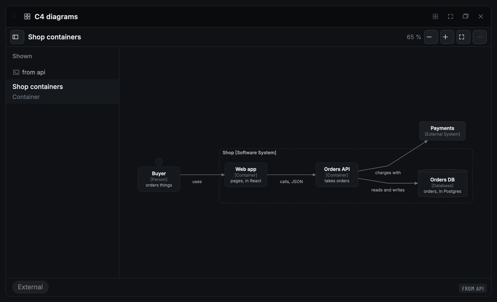

# C4 diagrams

Diagrams your agents draw, shown next to their terminal. **Preview** on
the Tile SDK (WIT `pitwall:tile@0.1.0`), built on the public SDK alone:
phases A and B of [the C4 tile plan](../../docs/spec/2026-11-27-c4-tile/plan.md).

Ask an agent Pitwall started: "draw the containers of this repo as a C4
diagram and show it on the right". It calls `c4__show` with Mermaid and
the diagram opens right of its terminal; "add a cache" updates the same
diagram in place, with Now / Changes to see what changed.

- **Mermaid** `flowchart` (or `graph`) and `sequenceDiagram`. Box labels
  are read as C4 (`Name [Kind]<br/>purpose`), a `subgraph` is a boundary,
  `class x new|changed|external` colours a box. What isn't drawn is listed
  under "Not shown".
- **Click to zoom**: a box another shown diagram details (by its boundary's
  name) opens it; several ask which in a menu under the box. Backspace or the path in the
  bar goes back up.
- **Keys**: `+` `-` zoom, `F` or `0` fit, the arrows move the selection,
  Enter opens it, `B` switches Now and Changes. The wheel zooms, dragging
  pans.
- **All or nothing**: bad Mermaid changes nothing; the agent gets each
  problem with its line and column, and you get a notice with the source,
  each bad line marked as an error with what is wrong.
- **Kept** across restarts in the tile's storage (`d/<id>`), at most 50
  diagrams a project; the oldest not opened for a week (else the least
  recently opened) makes room. Asks for no permissions.

Diagrams in the project's Markdown files (plan phase C) wait for a
`files.read` service.



## Develop

Its own Cargo workspace, not a member of the root one. The core (Mermaid,
C4 reading, links, changes, layout) is plain Rust tested natively; the
`tile` feature (on by default) adds the painter and the tile.

```sh
rustup target add wasm32-wasip2                       # once
cargo test --all-features                             # the core, and tests/tile.rs in Pitwall's tile runtime (builds tile.wasm)
cargo run -p pitwall-cli -- extension check tiles/c4  # from the repository's root
sh scripts/check-deps.sh                              # only pitwall-extension (and the harness, for tests)
cargo test --release --test tile speed -- --ignored --nocapture   # parse, layout and first draw of 50/150/300 boxes
```

`tile.wasm` is committed, so the app's tests and a folder install use it
as built; `cargo test` rebuilds it.

## Files

| File | What |
|---|---|
| `extension.json` | The manifest: the tile `main` and its `show` tool (`c4__show`) |
| `input.schema.json` | `c4__open`'s input: a diagram you showed, by item |
| `src/show.rs` | An agent's Mermaid read all or nothing; items, counts |
| `src/tile.rs` | The tile: views, the list, the bar, keys, the tool |
| `src/paint.rs` | Drawing a laid-out diagram on the canvas in theme colours |
| `src/blocks.rs`, `mermaid/`, `c4.rs`, `index.rs`, `changes.rs`, `layout/` | The core (phase A) |
| `tests/` | Native tests, and `tile.rs` with `pitwall-extension-test` |
| `scripts/check-deps.sh` | CI's dependency check |
