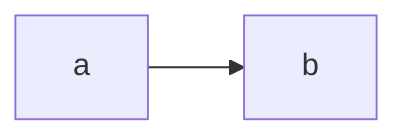
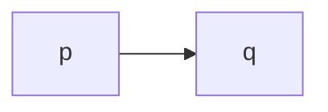
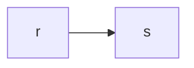
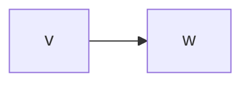
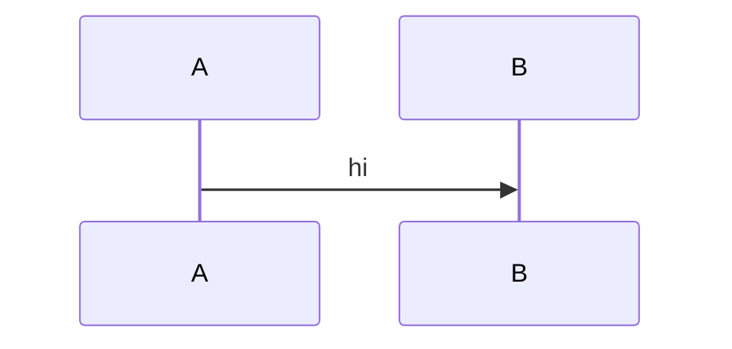

# Fences

Some prose with `mermaid` in it, and a fence that isn't Mermaid:

```rust
fn main() {}
```

## Tildes

~~~mermaid
flowchart TB
  x["X [Container]"] --> y
~~~

## In a list

1. First step:

   ```mermaid
   flowchart LR
     one --> two
   ```

2. Second step, deeper:

      ```Mermaid title="Two"
      flowchart LR
        three --> four
      ```

## Repeats





````mermaid
flowchart LR
  t --> u
````

## Repeats



Setext heading
--------------


