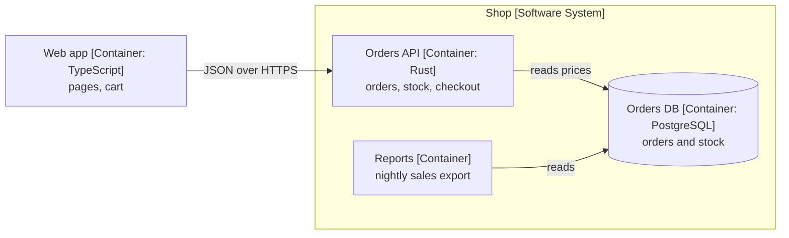
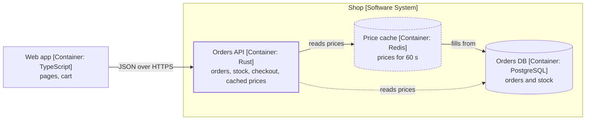
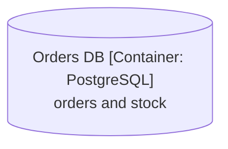
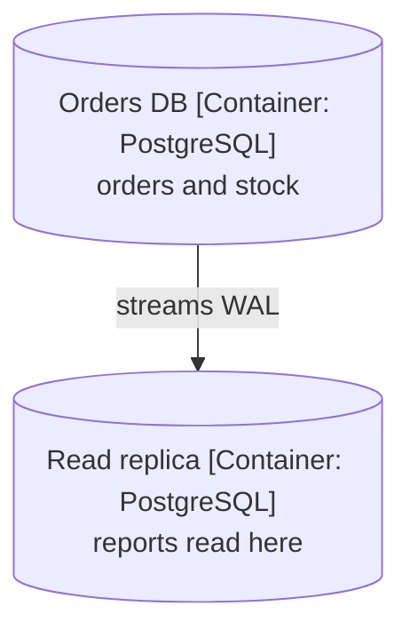

# Orders API: price cache (LLD)

## Container change

Checkout prices every cart line from the database today. This change puts
a cache in front of it.

### Before

### After

## Storage

### 1. Current

### 2. Proposed: a replica

## Notes

### Before we start

Prose only: a heading starting with "Before" whose section has no
diagram doesn't pair.
