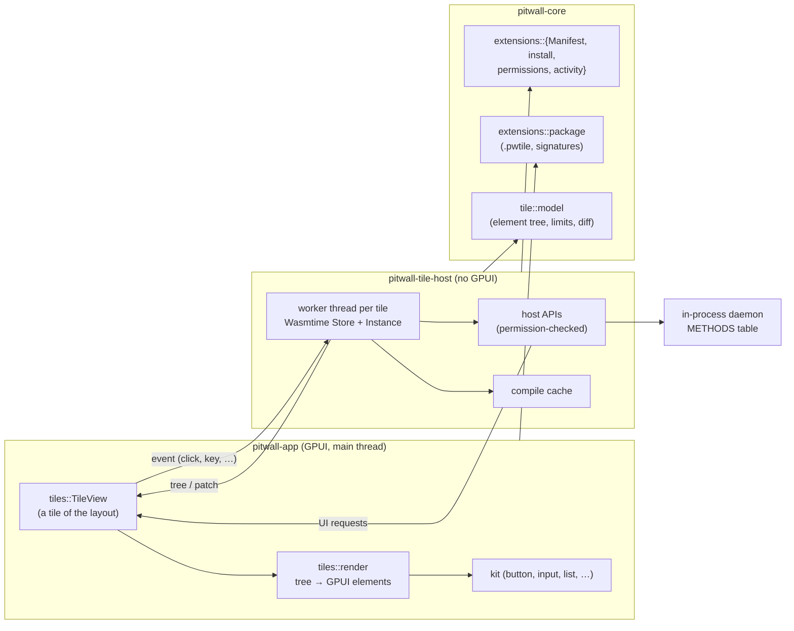
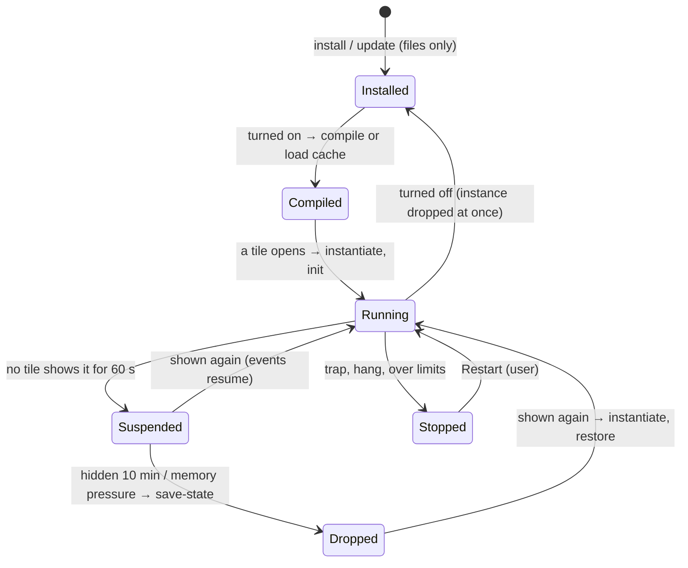
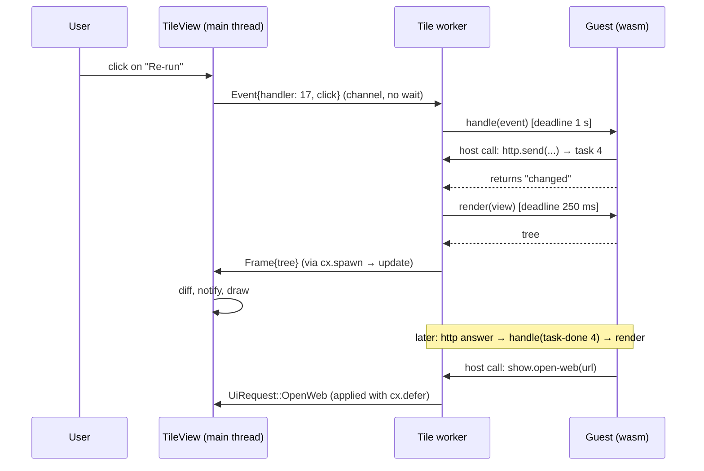
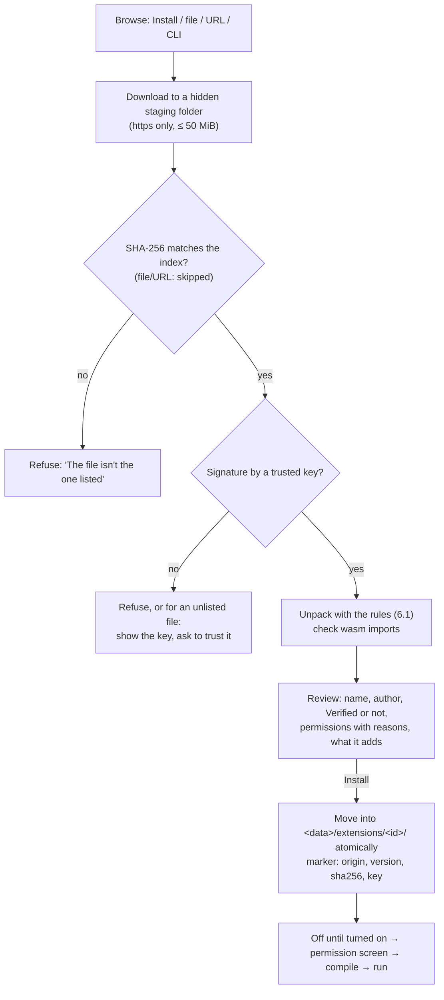
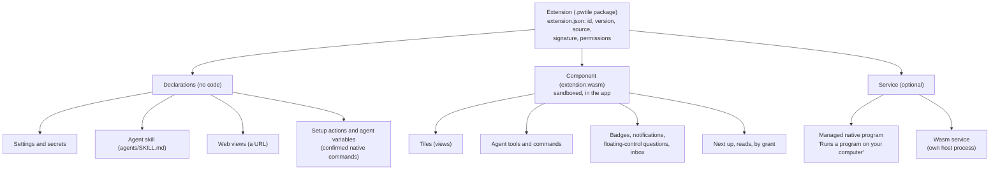

# Tile SDK diagrams

The Mermaid blocks of `docs/spec/tile-sdk/` (runtime.md, packaging.md,
extension-model.md) under the headings they sit under there, copied on
2026-11-27 as test input. They are plain flowcharts, not C4.

## runtime.md

### 2.1 Where it fits

### 2.3 Lifecycle

### 2.4 Threading with GPUI

## packaging.md

### 6.3 Install

## extension-model.md

### 15.3 What an extension can contain

