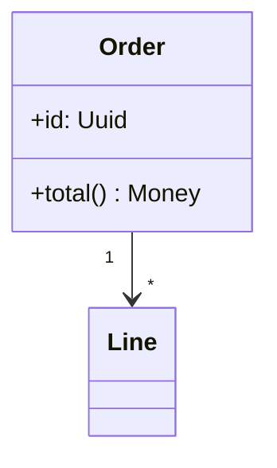
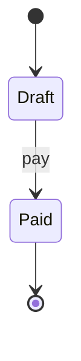
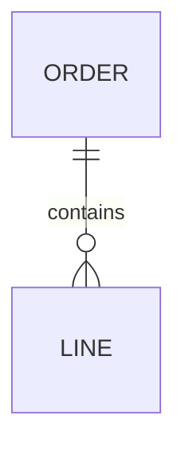
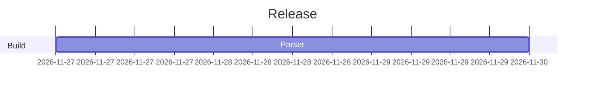
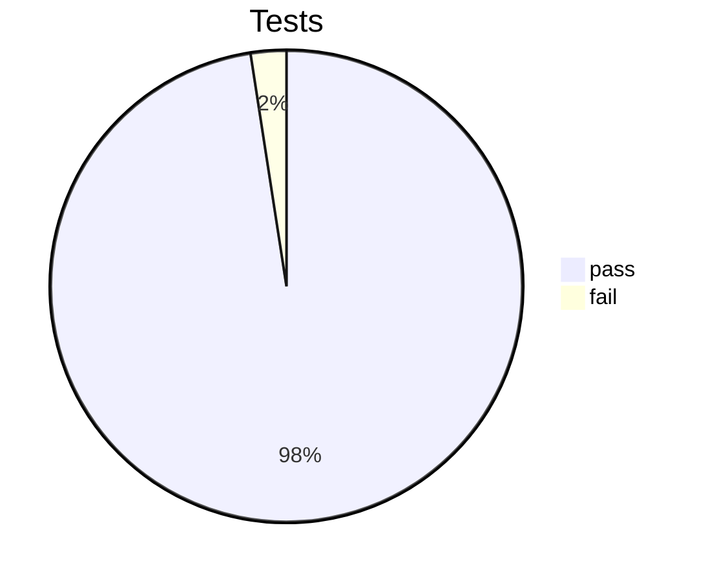
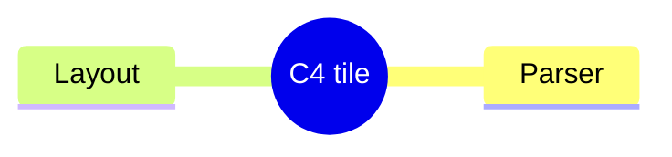
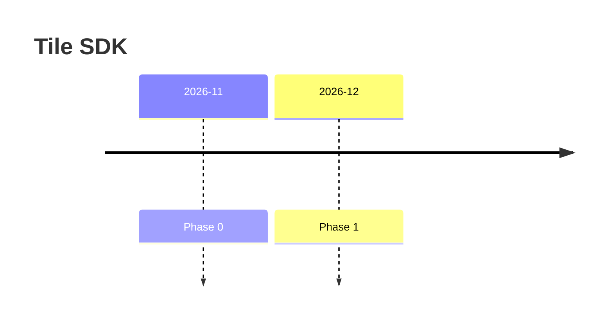
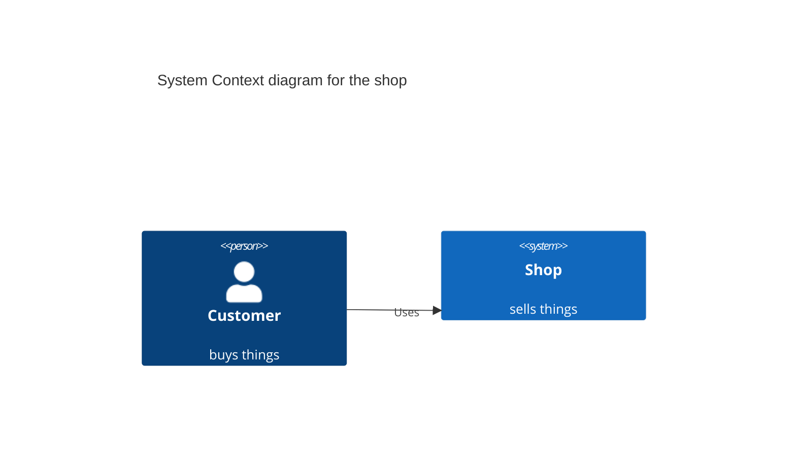

# Diagrams the tile doesn't draw

## Class



## State



## Entity relationship



## Gantt



## Pie



## Mindmap



## Timeline



## Mermaid's own C4



## Unknown word

```mermaid
zenDiagram
  a -> b
```

## Empty

```mermaid
%% only a comment
```
