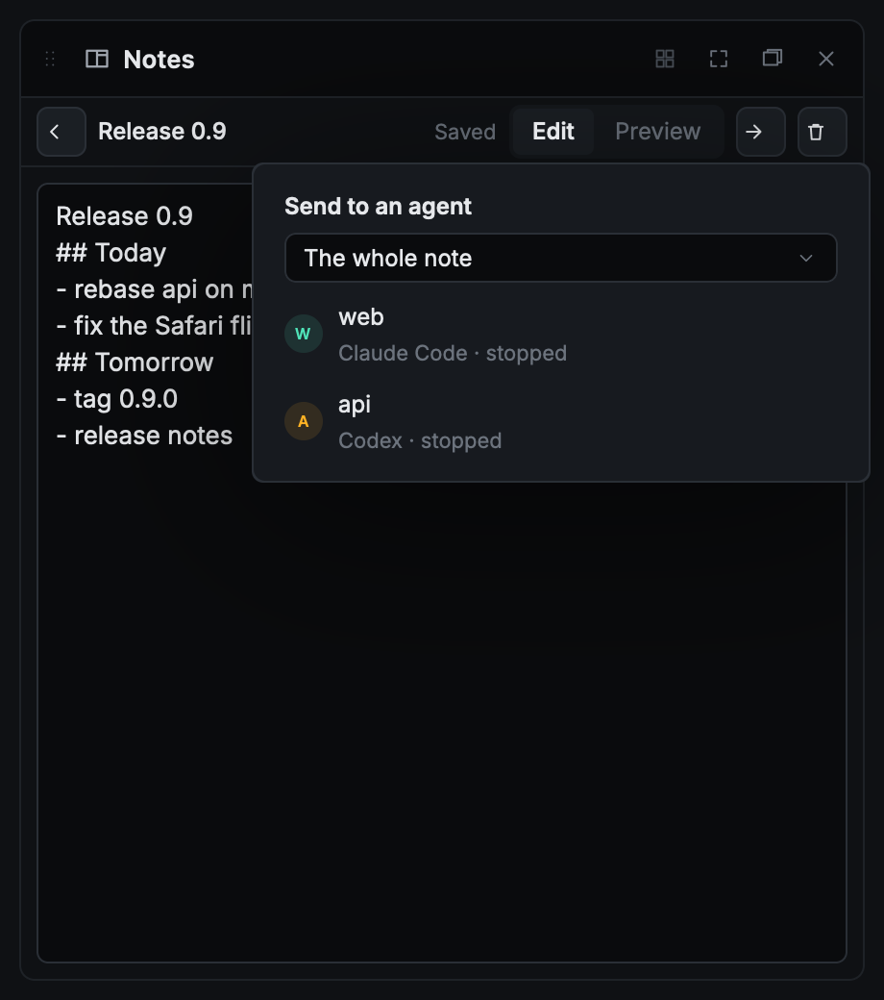
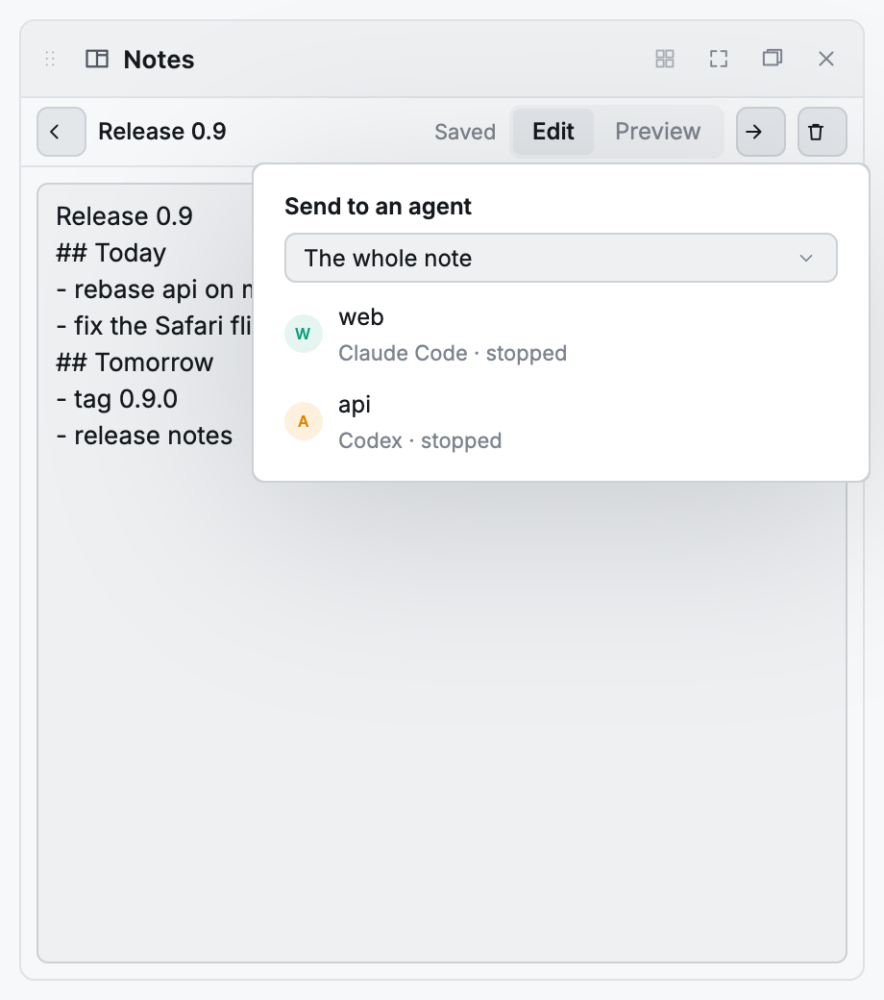

# Notes

Private plain-text notes beside your agents. **Preview** on the Tile SDK
(WIT `pitwall:tile@0.1.0`), built on the public SDK alone: steps 0 and 1 of
[the Notes plan](../../docs/spec/2026-11-27-notes-tile/plan.md).

- **New** with + or N (⌘N is Pitwall's: a new agent); the first line is the
  title. / goes to the search.
- **Saved as you type**: about a second after you stop, when the note's
  field loses focus (to the search, or out of the tile), when you leave the
  note, and when the tile is hidden. No Save button. Text not
  saved yet survives the tile being dropped or reloaded.
- **Search** narrows the list by title and text (every word must appear).
- **Delete** asks once, in the note's bar, or from a row of the list (its
  Delete shows under the pointer).
- **⌘⏎** in a note saves it and goes back to the list (in a narrow tile).
- **Edit and Preview**: Preview shows the note formatted, and ticks its
  tasks; ⌘/ switches, also while typing.
- **Send to an agent** (the arrow in the note's bar): your agents, with
  what they are doing; a click puts the text selected in the note (first,
  when there is some), the note, or the section under one of its
  headings, in that agent's Next up, waiting for your Send. At most 4 000
  characters: of a longer note send a selection or a section.
- **Opened with a draft**: an agent or you can open Notes with
  `{ "title"?, "text" }` (`input.schema.json`). The draft stays unsaved,
  marked "Draft, not saved", until you press Keep; Discard drops it.

Notes are kept in the tile's own storage (`p/_/<id>`), only in this Pitwall.
They aren't in any project, and no agent can read them. Send asks for two
permissions; without them, the rest works and Send says what to allow:

| Permission | Why |
|---|---|
| `agents.read` | To list the agents you can send a note to |
| `agents.queue` | To put a note in an agent's Next up, waiting for your Send |




A tile at least 560 px wide shows the list and the open note side by side;
a narrower one shows one at a time.

## Develop

Made with `pitwall extension new notes --template list --sdk <checkout>`, then
changed into Notes. Its own Cargo workspace, not a member of the root one.

```sh
rustup target add wasm32-wasip2                          # once
cargo test                                               # builds tile.wasm, runs tests/ in Pitwall's tile runtime
cargo run -p pitwall-cli -- extension check tiles/notes  # from the repository's root
sh scripts/check-deps.sh                                 # only pitwall-extension (and the harness, for tests)
```

## Files

| File | What |
|---|---|
| `extension.json` | The manifest: one tile, `main`, that takes `input.schema.json` |
| `src/lib.rs` | The tile: views, the list, the editor, loading and saving |
| `src/note.rs` | Titles, previews, sections, search and times, tested natively |
| `tests/tile.rs` | Tests with `pitwall-extension-test` |
| `input.schema.json` | A draft note to open the tile with |
| `scripts/check-deps.sh` | CI's dependency check |
